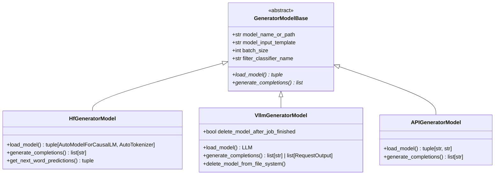
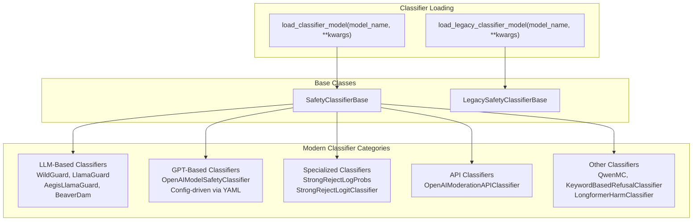
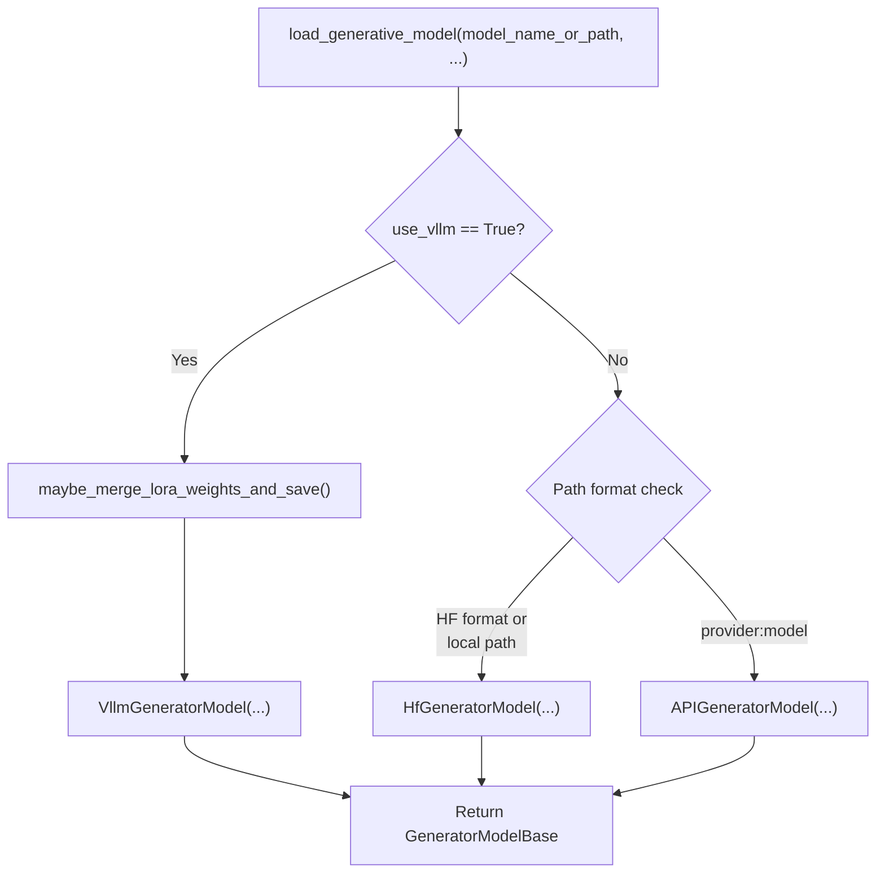
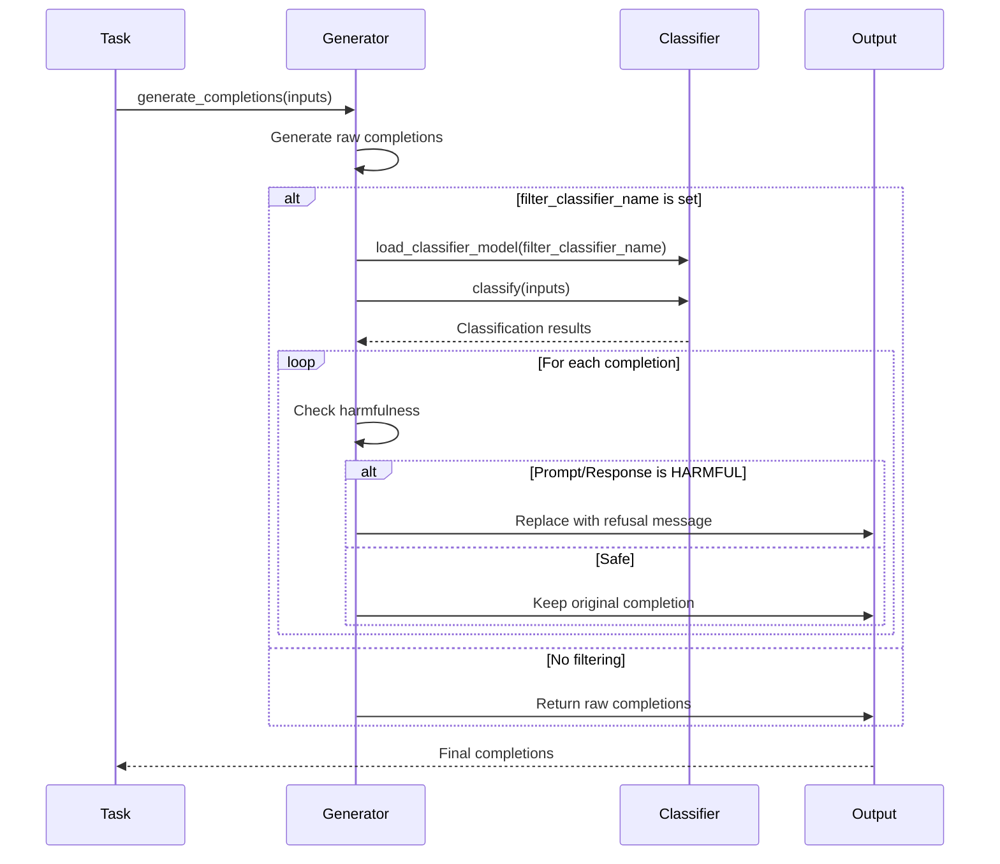

<!-- source: DeepWiki mcp.deepwiki.com · repo allenai/safety-eval · page 3.1 Model Layer · fetched 2026-10-26 -->

# Model Layer

<details>
<summary>Relevant source files</summary>

The following files were used as context for generating this wiki page:

- [README.md](README.md)
- [evaluation/models/__init__.py](evaluation/models/__init__.py)
- [evaluation/schemas.py](evaluation/schemas.py)
- [evaluation/tasks/generation/codex_eval/__init__.py](evaluation/tasks/generation/codex_eval/__init__.py)
- [evaluation/tasks/generation/do_anything_now/__init__.py](evaluation/tasks/generation/do_anything_now/__init__.py)
- [evaluation/tasks/generation/trustllm_jailbreaktrigger/__init__.py](evaluation/tasks/generation/trustllm_jailbreaktrigger/__init__.py)
- [evaluation/tasks/generation/trustllm_jailbreaktrigger/gpt4.yaml](evaluation/tasks/generation/trustllm_jailbreaktrigger/gpt4.yaml)
- [evaluation/tasks/generation/wildjailbreak/__init__.py](evaluation/tasks/generation/wildjailbreak/__init__.py)
- [evaluation/tasks/generation/xstest/exaggerated_safety.json](evaluation/tasks/generation/xstest/exaggerated_safety.json)
- [src/classifier_models/loader.py](src/classifier_models/loader.py)

</details>


## Purpose and Scope

The Model Layer provides an abstraction interface for both generative language models and safety classifier models used throughout the evaluation framework. This layer decouples evaluation tasks from specific model implementations, enabling consistent evaluation across HuggingFace models, vLLM-accelerated models, API-based models, and various safety classifiers.

For information about how these models are used within evaluation tasks, see [Task System](#3.2). For detailed documentation of specific classifier implementations, see [Safety Classifiers](#5.2). For generator model usage details, see [Generator Models](#5.1).

**Sources:** [evaluation/schemas.py:30-350](), [README.md:38-90]()

---

## Generator Model Architecture

### Base Class and Inheritance Hierarchy

All generative models inherit from the abstract `GeneratorModelBase` class, which defines a uniform interface for text generation regardless of the underlying implementation. The base class requires two abstract methods: `load_model()` and `generate_completions()`.



**Diagram: Generator Model Class Hierarchy**

**Sources:** [evaluation/schemas.py:30-96](), [evaluation/schemas.py:99-201](), [evaluation/schemas.py:203-294](), [evaluation/schemas.py:296-349]()

### Three Model Backend Implementations

| Backend | Class | Primary Use Case | Key Features |
|---------|-------|------------------|--------------|
| HuggingFace | `HfGeneratorModel` | Local inference with standard models | Batch generation, stop sequences, token-level analysis |
| vLLM | `VllmGeneratorModel` | High-throughput batch inference | Subprocess-based inference, automatic GPU allocation, efficient batching |
| API | `APIGeneratorModel` | Cloud-based models (OpenAI, Anthropic) | Provider-agnostic interface, no local resources |

**HfGeneratorModel** loads models using `load_hf_lm_and_tokenizer()` and generates completions via `generate_completions()` from `src.generation_utils`. It supports `get_next_word_predictions()` for multiple-choice tasks that require logit analysis.

**VllmGeneratorModel** uses subprocess-based inference through `subprocess_inference_with_vllm()`, which spawns a separate Python process to manage vLLM's LLM engine. This avoids GPU memory conflicts when multiple models are evaluated sequentially. The optional `delete_model_after_job_finished` flag enables automatic cleanup of temporary model directories (used for LoRA-merged weights).

**APIGeneratorModel** expects model names in the format `<provider>:<identifier>` (e.g., `openai:gpt-4`). It currently supports OpenAI models through `query_openai_chat_model()`.

**Sources:** [evaluation/schemas.py:99-165](), [evaluation/schemas.py:203-294](), [evaluation/schemas.py:296-349]()

### Model Input Templates

Each generator model instance is initialized with a `model_input_template`, which defines how task inputs are formatted into prompts. Templates can be loaded from:

1. **Named templates:** References like `tulu2` or `llama3` resolve to predefined templates in `src/templates/single_turn.py` via `get_template()`
2. **File paths:** `.txt` files containing custom template strings with placeholder variables

Templates use Python string formatting with named placeholders. For example, a typical template might contain `{instruction}` which gets replaced with the actual task prompt:

```python
# Example template structure
template = "### User:\n{instruction}\n\n### Assistant:\n"
```

The framework validates that required input fields from tasks (returned by `task.required_input_fields()`) exist in the model template before evaluation begins.

**Sources:** [evaluation/schemas.py:40-56](), [evaluation/schemas.py:505-513]()

---

## Classifier Model Architecture

### Base Classes and Factory Pattern

Safety classifier models follow a different architecture than generators, using a factory pattern for instantiation rather than direct inheritance polymorphism. The system supports two base class types:



**Diagram: Classifier Factory Pattern and Categories**

**Sources:** [src/classifier_models/loader.py:37-124](), [src/classifier_models/loader.py:126-162]()

### Classifier Loading Factory

The `load_classifier_model()` function in [src/classifier_models/loader.py:37-124]() serves as the primary factory for instantiating classifiers. It uses a large if-elif chain to map model names to their corresponding class constructors:

```python
# Example pattern from loader
if model_name == "WildGuard":
    return WildGuard(**kwargs)
elif model_name == "LlamaGuardUserRequest":
    return LlamaGuardUserRequest(**kwargs)
elif model_name == "HarmbenchClassifier":
    return HarmbenchClassifier(**kwargs)
# ... 30+ more classifier types
```

Some classifiers are loaded via YAML configuration files:

- **Named OpenAI classifiers** like `GPTHarmfulDetectorV0UserRequestOnly` load from `config_openai/{model_name}.yaml`
- **Arbitrary GPT classifiers** can be instantiated directly using `OpenAIModelSafetyClassifier` with a `config` or `config_path` parameter

The factory pattern allows adding new classifiers without modifying task code, maintaining clean separation of concerns.

**Sources:** [src/classifier_models/loader.py:37-124]()

### Classifier Output Fields and Compatibility

Classifiers define their output fields through `get_output_fields()`, which returns a list of field names like `"prompt_harmfulness"`, `"response_harmfulness"`, or `"response_refusal"`. Tasks validate compatibility by checking that required output fields are present:

```python
# From ClassificationTaskBase
output_compatible = any(
    all(field in model.get_output_fields() for field in fieldset)
    for fieldset in self.required_output_fields()
)
```

This design allows tasks to work with multiple classifier types as long as they provide the necessary output fields.

**Sources:** [evaluation/schemas.py:461-487]()

---

## Model Loading and Instantiation

### Generator Model Loading

The `load_generative_model()` function in [evaluation/models/__init__.py:12-78]() provides the primary interface for loading generator models:



**Diagram: Generator Model Loading Flow**

The loading logic determines which backend to use based on:
1. **`use_vllm` flag:** If true, uses `VllmGeneratorModel`
2. **Path format:** If contains "/" or is a local path → `HfGeneratorModel`
3. **Default:** Assumes API format (`provider:identifier`) → `APIGeneratorModel`

**Sources:** [evaluation/models/__init__.py:12-78]()

### LoRA Weight Merging

When using vLLM with LoRA adapter models, `maybe_merge_lora_weights_and_save()` automatically detects adapter configurations and merges them into a temporary full model. The function:

1. Checks for `adapter_config.json` in the model directory
2. If found, loads base model and merges adapter weights
3. Saves merged model to a temporary directory
4. Returns the temporary path (or `None` if no adapter detected)

The merged model directory is marked for deletion after evaluation completes via the `delete_model_after_job_finished` flag.

For details on LoRA adapter support, see [LoRA Adapter Support](#10.2).

**Sources:** [evaluation/models/__init__.py:40-46]()

### Classifier Model Loading

Classifiers are loaded through `load_classifier_model(model_name, **kwargs)`, which returns a `SafetyClassifierBase` instance. The function supports:

- Direct class name mapping for known classifiers
- YAML configuration loading for GPT-based classifiers
- Dynamic configuration via `OpenAIModelSafetyClassifierConfig`

Legacy classifiers use `load_legacy_classifier_model()`, which returns `LegacySafetyClassifierBase` instances with different input/output signatures.

**Sources:** [src/classifier_models/loader.py:37-124](), [src/classifier_models/loader.py:126-162]()

---

## Model Configuration and Hyperparameters

### Generation Hyperparameters

Generator models accept the following hyperparameters in `generate_completions()`:

| Parameter | Type | Description | Default |
|-----------|------|-------------|---------|
| `max_new_tokens` | `int` | Maximum tokens to generate | Task-specific |
| `temperature` | `float` | Sampling temperature (0 = greedy) | Task-specific |
| `top_p` | `float` | Nucleus sampling threshold | Task-specific |
| `repetition_penalty` | `float` | Penalty for repeated tokens | `1.0` (vLLM) |
| `n` | `int` | Number of completions per prompt | `1` |
| `stop` | `str \| list[str]` | Stop sequences for generation | `None` |

These hyperparameters can be overridden at evaluation time through task YAML configurations or command-line arguments. For details, see [Hyperparameter Overrides](#8.2).

**Sources:** [evaluation/schemas.py:76-96](), [evaluation/schemas.py:106-165](), [evaluation/schemas.py:225-287]()

### Revision and Model Variants

The optional `hf_revision` parameter allows loading specific model revisions or branches from HuggingFace:

```python
model = load_generative_model(
    model_name_or_path="allenai/tulu-2-7b",
    hf_revision="main",  # or specific commit SHA
    ...
)
```

This enables testing different checkpoints without changing model names.

**Sources:** [evaluation/schemas.py:35-44](), [evaluation/models/__init__.py:19-20]()

---

## Optional Safety Filtering

### Filter Classifier Integration

All three generator model backends support optional safety filtering through the `filter_classifier_name` parameter. When specified, the generator loads a classifier and applies it to filter outputs:



**Diagram: Optional Safety Filtering Sequence**

**Sources:** [evaluation/schemas.py:145-164](), [evaluation/schemas.py:252-286](), [evaluation/schemas.py:329-348]()

### Filtering Behavior

When filtering is enabled:

1. **Input classification:** The classifier checks `prompt_harmfulness` for each input
2. **Output classification:** For vLLM, can also check `response_harmfulness`
3. **Replacement:** Harmful content is replaced with `"I'm sorry, I can't help with that."`
4. **Memory cleanup:** The filter classifier model is deleted after processing to free GPU memory

The `filter_model_override_path` parameter allows using a custom checkpoint for the filter classifier, independent of the main classifier used for evaluation.

**Sources:** [evaluation/schemas.py:37-38](), [evaluation/schemas.py:145-164](), [evaluation/schemas.py:252-286]()

### Use Cases for Filtering

Filtering is typically used to:
- **Simulate safer model variants** without retraining
- **Pre-filter harmful prompts** before generation (reducing compute costs)
- **Post-filter harmful outputs** to prevent unsafe content
- **Compare filtered vs. unfiltered behavior** in evaluation reports

Note that filtering happens within the model layer, before results reach the task evaluation logic, ensuring consistent application across all tasks.

**Sources:** [evaluation/schemas.py:145-164]()

---

