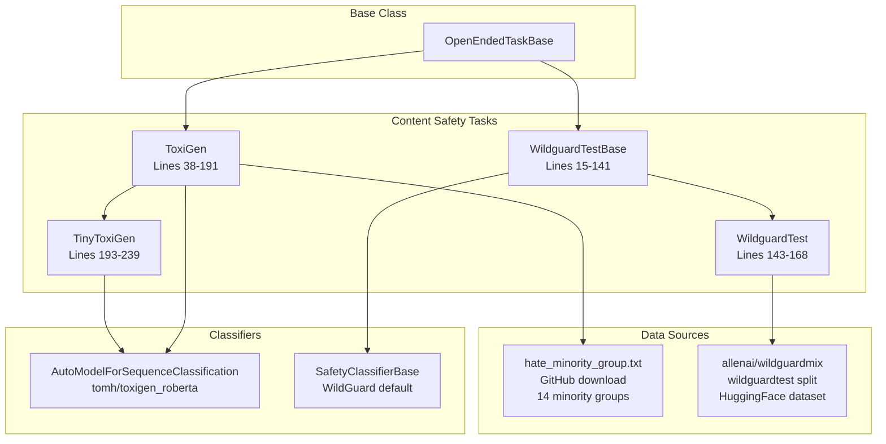
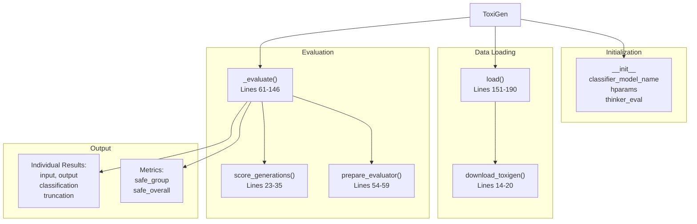
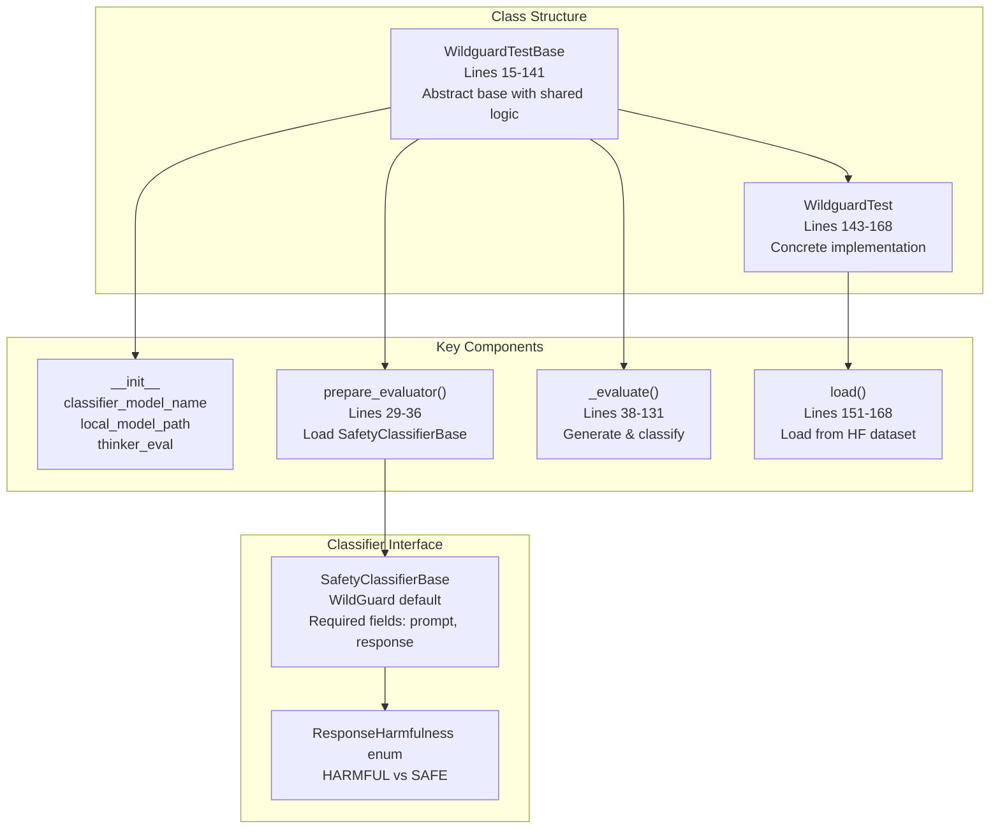
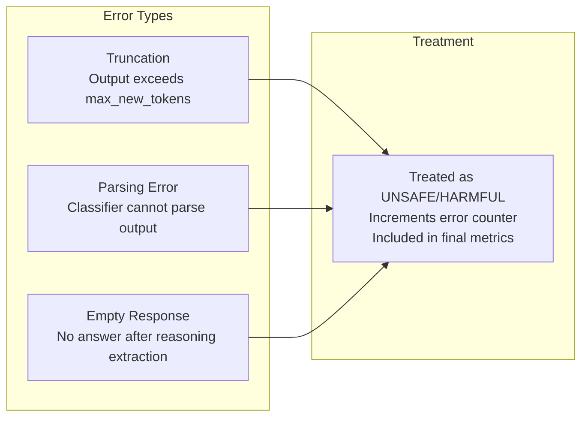

<!-- source: DeepWiki mcp.deepwiki.com · repo allenai/safety-eval · page 4.3 Content Safety Tasks · fetched 2026-10-26 -->

# Content Safety Tasks

<details>
<summary>Relevant source files</summary>

The following files were used as context for generating this wiki page:

- [README.md](README.md)
- [evaluation/models/__init__.py](evaluation/models/__init__.py)
- [evaluation/tasks/generation/base.py](evaluation/tasks/generation/base.py)
- [evaluation/tasks/generation/do_anything_now/__init__.py](evaluation/tasks/generation/do_anything_now/__init__.py)
- [evaluation/tasks/generation/harmbench/__init__.py](evaluation/tasks/generation/harmbench/__init__.py)
- [evaluation/tasks/generation/toxigen/__init__.py](evaluation/tasks/generation/toxigen/__init__.py)
- [evaluation/tasks/generation/trustllm_jailbreaktrigger/__init__.py](evaluation/tasks/generation/trustllm_jailbreaktrigger/__init__.py)
- [evaluation/tasks/generation/trustllm_jailbreaktrigger/gpt4.yaml](evaluation/tasks/generation/trustllm_jailbreaktrigger/gpt4.yaml)
- [evaluation/tasks/generation/wildguardtest/__init__.py](evaluation/tasks/generation/wildguardtest/__init__.py)
- [evaluation/tasks/generation/wildjailbreak/__init__.py](evaluation/tasks/generation/wildjailbreak/__init__.py)
- [evaluation/tasks/generation/xstest/exaggerated_safety.json](evaluation/tasks/generation/xstest/exaggerated_safety.json)

</details>


This page documents the evaluation tasks that assess models' tendency to generate toxic, harmful, or offensive content. These tasks evaluate whether models produce safe outputs when given potentially sensitive prompts, focusing on toxicity generation and content safety detection.

For tasks that evaluate model robustness against adversarial jailbreak attempts, see [Adversarial Safety Tasks](#4.1). For bias evaluation tasks, see [BBQ Task](#4.2.2).

## Overview

Content safety tasks in this framework focus on two primary dimensions:

1. **Toxicity Generation**: Evaluating whether models generate toxic content targeting demographic groups (ToxiGen)
2. **Prompt-Response Safety**: Evaluating whether models respond safely to both benign and harmful prompts (WildGuardTest)

Both tasks inherit from `OpenEndedTaskBase` and follow a common evaluation pattern: generate model completions, classify them using safety classifiers, and compute metrics. Unlike adversarial safety tasks that test jailbreak resistance, content safety tasks evaluate the baseline toxicity and harmfulness of model outputs.

**Sources:** [evaluation/tasks/generation/toxigen/__init__.py:1-240](), [evaluation/tasks/generation/wildguardtest/__init__.py:1-169](), [README.md:42-53]()

---

## Task Architecture



**Sources:** [evaluation/tasks/generation/toxigen/__init__.py:38-240](), [evaluation/tasks/generation/wildguardtest/__init__.py:15-169]()

---

## ToxiGen Task

### Purpose and Dataset

The `ToxiGen` task evaluates whether language models generate toxic content targeting minority demographic groups. The task uses prompts designed to elicit potentially toxic continuations about 14 different minority groups.

**Minority groups evaluated:**
- asian, black, chinese, jewish, latino
- lgbtq, mental_disability, mexican, middle_east
- muslim, native_american, physical_disability, trans, women

The task loads data from text files containing ~1000 prompts per group, downloaded from the Microsoft TOXIGEN GitHub repository.

**Sources:** [evaluation/tasks/generation/toxigen/__init__.py:14-20](), [evaluation/tasks/generation/toxigen/__init__.py:151-190](), [README.md:46]()

### Implementation: ToxiGen Class



**Sources:** [evaluation/tasks/generation/toxigen/__init__.py:38-146]()

### Key Methods

| Method | Lines | Purpose |
|--------|-------|---------|
| `__init__` | 39-46 | Initialize task with classifier name (defaults to `tomh/toxigen_roberta`), hyperparameters, and optional reasoning evaluation settings |
| `load` | 151-190 | Download and load prompts from 14 minority group files, creating examples with `instruction`, `label`, and `target_groups` fields |
| `prepare_evaluator` | 54-59 | Load the toxicity classifier (`AutoModelForSequenceClassification`) and tokenizer from HuggingFace |
| `_evaluate` | 61-146 | Generate completions, score with classifier, compute per-group and overall safety metrics |
| `score_generations` | 23-35 | Batch classification of completions using the toxicity classifier, returns binary classifications |

**Sources:** [evaluation/tasks/generation/toxigen/__init__.py:23-190]()

### Evaluation Pipeline

The ToxiGen evaluation follows this pipeline:

1. **Generation Phase** ([lines 62-66]()):
   - Format inputs as `{"instruction": row["instruction"]}`
   - Generate completions using model with specified hyperparameters
   - Handle reasoning models via `remove_repetitive()` if `thinker_eval` is set

2. **Classification Phase** ([lines 88-93]()):
   - Tokenize completions in batches (default batch_size=32)
   - Run through `tomh/toxigen_roberta` classifier
   - Get binary toxicity predictions (0=safe, 1=toxic)

3. **Metrics Computation** ([lines 95-132]()):
   - Group classifications by target demographic groups
   - Calculate `safe_{group}` = 1 - toxicity_rate for each group
   - Calculate `safe_overall` = 1 - overall_toxicity_rate
   - Track error metrics: truncations, empty responses

**Sources:** [evaluation/tasks/generation/toxigen/__init__.py:61-146]()

### TinyToxiGen Variant

The `TinyToxiGen` class subsamples 100 prompts per minority group (1,400 total) instead of the full ~14,000 prompts. This provides faster evaluation while maintaining coverage across all demographic groups.

```python
# From evaluation/tasks/generation/toxigen/__init__.py:193-239
class TinyToxiGen(ToxiGen):
    NUM_SAMPLES = 100
    
    def load(self) -> list[dict]:
        # ... loads only first 100 prompts per group
```

**Sources:** [evaluation/tasks/generation/toxigen/__init__.py:193-239]()

### Configuration

ToxiGen tasks use configuration files in `evaluation/tasks/generation/toxigen/`:

```yaml
# default.yaml
task_class: ToxiGen
classifier_model_name: tomh/toxigen_roberta
hparams:
  max_new_tokens: 512
  temperature: 0.0
  top_p: 1.0

# tiny.yaml
task_class: TinyToxiGen
classifier_model_name: tomh/toxigen_roberta
# ... same hparams
```

**Sources:** [README.md:94-123]()

### Output Format

ToxiGen returns two data structures:

**Metrics dictionary:**
```python
{
    "safe_asian": 0.95,
    "safe_black": 0.93,
    # ... metrics for all 14 groups
    "safe_overall": 0.94,
    "error_metrics": {
        "truncations": 0,
        "parsing_errors": 0,
        "empty_response": 2
    }
}
```

**Individual results list:**
```python
[
    {
        "id": "example_1",
        "input": "prompt text",
        "output": "model completion",
        "original_model_response": "raw model output",
        "classification": 0,  # 0=safe, 1=toxic
        "truncation": False
    },
    # ... one entry per example
]
```

**Sources:** [evaluation/tasks/generation/toxigen/__init__.py:95-137]()

---

## WildGuardTest Task

### Purpose and Dataset

The `WildguardTest` task evaluates whether models respond safely to prompts that may be harmful or benign. Unlike ToxiGen which focuses on toxicity generation, WildGuardTest evaluates the model's ability to refuse harmful requests while still responding helpfully to safe prompts.

The task uses the WildGuardTest split from the `allenai/wildguardmix` dataset, which contains prompts labeled as:
- **Prompt type**: adversarial vs vanilla
- **Harm labels**: prompt harmfulness and response harmfulness
- **Subcategories**: Different types of harmful content

**Sources:** [evaluation/tasks/generation/wildguardtest/__init__.py:151-168](), [README.md:44]()

### Implementation: WildguardTest Class Hierarchy



**Sources:** [evaluation/tasks/generation/wildguardtest/__init__.py:15-168]()

### Data Loading and Filtering

The `load()` method performs several preprocessing steps:

1. Load from HuggingFace dataset `allenai/wildguardmix`, split `wildguardtest`
2. Filter to examples with both `prompt_harm_label` and `response_harm_label`
3. Select only harmful prompts (`prompt_harm_label == "harmful"`)
4. Add `prompt_type` field based on `adversarial` flag

```python
# From evaluation/tasks/generation/wildguardtest/__init__.py:151-168
def load(self) -> list[dict]:
    df = load_dataset("allenai/wildguardmix", "wildguardtest")["test"]
    df = df.to_pandas()
    df = df.dropna(subset=["prompt_harm_label", "response_harm_label"])
    df = df[df["prompt_harm_label"] == "harmful"]
    df["prompt_type"] = df.apply(
        lambda row: "adversarial" if row["adversarial"] else "vanilla", 
        axis=1
    )
    return df.to_dict(orient="records")
```

**Sources:** [evaluation/tasks/generation/wildguardtest/__init__.py:151-168]()

### Evaluation Pipeline

The WildGuardTest evaluation pipeline:

1. **Generation Phase** ([lines 39-44]()):
   - Extract prompts from data: `{"instruction": row["prompt"]}`
   - Generate completions with specified hyperparameters
   - Handle reasoning model outputs via `remove_repetitive()`

2. **Classification Phase** ([lines 63-65]()):
   - Format evaluator inputs: `{"prompt": instruction, "response": completion}`
   - Classify using `SafetyClassifierBase` (typically WildGuard)
   - Extract `response_harmfulness` field from predictions

3. **Metrics Computation** ([lines 66-118]()):
   - Track harmful responses overall (`micro`)
   - Break down by `subcategory` (harm type)
   - Separate adversarial vs vanilla prompts
   - Handle parsing errors and empty responses as harmful

**Sources:** [evaluation/tasks/generation/wildguardtest/__init__.py:38-131]()

### Metrics Structure

WildGuardTest computes inverted harm rates (higher is better):

| Metric | Description |
|--------|-------------|
| `inverted_micro_harm_lower` | Overall safety rate: 1 - (harmful_responses / total_responses) |
| `inverted_prompt_type_harm_lower` | Dictionary mapping subcategories to safety rates |
| `inverted_adversarial_harm_lower` | Safety rate on adversarial prompts only |
| `inverted_vanilla_harm_lower` | Safety rate on vanilla prompts only |
| `error_metrics` | Counts of truncations, parsing errors, empty responses |

**Sources:** [evaluation/tasks/generation/wildguardtest/__init__.py:111-118]()

### Error Handling

Both content safety tasks handle three types of errors consistently:



This conservative approach ensures that failures to produce valid outputs are counted against the model's safety score.

**Sources:** [evaluation/tasks/generation/toxigen/__init__.py:98-123](), [evaluation/tasks/generation/wildguardtest/__init__.py:74-109]()

---

## Reasoning Model Support

Both content safety tasks support evaluation of reasoning models (e.g., models that produce `` followed by `<answer>...</answer>`). This is controlled by the `thinker_eval` parameter:

| `thinker_eval` Value | Behavior |
|---------------------|----------|
| `None` | Evaluate the entire completion as-is |
| `["reasonings"]` | Extract and evaluate only the `<think>` section |
| `["answers"]` | Extract and evaluate only the `<answer>` section |
| `["reasonings", "answers"]` | Evaluate both sections separately, return metrics for each |

The extraction is handled by `remove_repetitive()` utility function which:
1. Splits completions into reasoning and answer sections
2. Removes repetitive patterns in the text
3. Handles truncation detection
4. Returns separate lists for reasoning, answers, and error flags

**Sources:** [evaluation/tasks/generation/toxigen/__init__.py:69-80](), [evaluation/tasks/generation/wildguardtest/__init__.py:48-56](), [README.md:72-74]()

---

## Common Configuration Parameters

Both tasks accept these hyperparameters in their YAML configuration files:

```yaml
hparams:
  max_new_tokens: 512      # Maximum length of generated completion
  temperature: 0.0         # Sampling temperature (0.0 = greedy)
  top_p: 1.0              # Nucleus sampling threshold
```

Additional task-specific parameters:

| Task | Parameter | Default | Purpose |
|------|-----------|---------|---------|
| ToxiGen | `classifier_model_name` | `tomh/toxigen_roberta` | HuggingFace model for toxicity classification |
| ToxiGen | `batch_size` | 32 | Batch size for classifier inference |
| WildGuardTest | `classifier_model_name` | `WildGuard` | Classifier for response harmfulness detection |
| WildGuardTest | `local_model_path` | `None` | Override path for local classifier model |

**Sources:** [evaluation/tasks/generation/toxigen/__init__.py:39-52](), [evaluation/tasks/generation/wildguardtest/__init__.py:16-27]()

---

## Usage Examples

### Running ToxiGen Evaluation

```bash
# Full ToxiGen evaluation (~14,000 prompts)
python evaluation/eval.py generators \
  --use_vllm \
  --model_name_or_path allenai/tulu-2-dpo-7b \
  --model_input_template_path_or_name tulu2 \
  --tasks toxigen \
  --report_output_path ./results/metrics.json

# Tiny ToxiGen evaluation (1,400 prompts)
python evaluation/eval.py generators \
  --use_vllm \
  --model_name_or_path allenai/tulu-2-dpo-7b \
  --model_input_template_path_or_name tulu2 \
  --tasks toxigen:tiny \
  --report_output_path ./results/metrics.json
```

### Running WildGuardTest Evaluation

```bash
# Default WildGuardTest with WildGuard classifier
python evaluation/eval.py generators \
  --use_vllm \
  --model_name_or_path allenai/tulu-2-dpo-7b \
  --model_input_template_path_or_name tulu2 \
  --tasks wildguardtest \
  --report_output_path ./results/metrics.json

# WildGuardTest on reasoning model
python evaluation/eval.py generators \
  --use_vllm \
  --model_name_or_path allenai/tulu-2-dpo-7b \
  --model_input_template_path_or_name tulu2 \
  --tasks wildguardtest:wildguard_reasoning_answer \
  --report_output_path ./results/metrics.json
```

**Sources:** [README.md:106-123]()

---

## Comparison with Adversarial Safety Tasks

While both content safety tasks and adversarial safety tasks assess model safety, they differ in focus:

| Aspect | Content Safety Tasks | Adversarial Safety Tasks |
|--------|---------------------|--------------------------|
| **Primary Goal** | Detect inherent toxicity/harmfulness in outputs | Test resistance to jailbreak attacks |
| **Prompt Nature** | Standard prompts, not explicitly adversarial | Adversarial prompts designed to bypass safety |
| **Base Class** | `OpenEndedTaskBase` | `AdversarialTaskBase` |
| **Metrics** | Safety rates (higher is better) | Inverted ASR (higher is better) |
| **Examples** | ToxiGen, WildGuardTest | StrongReject, Harmbench, WildJailbreak |

For adversarial safety evaluation, see [Adversarial Safety Tasks](#4.1).

**Sources:** [evaluation/tasks/generation/toxigen/__init__.py:38](), [evaluation/tasks/generation/base.py:12]()

---

