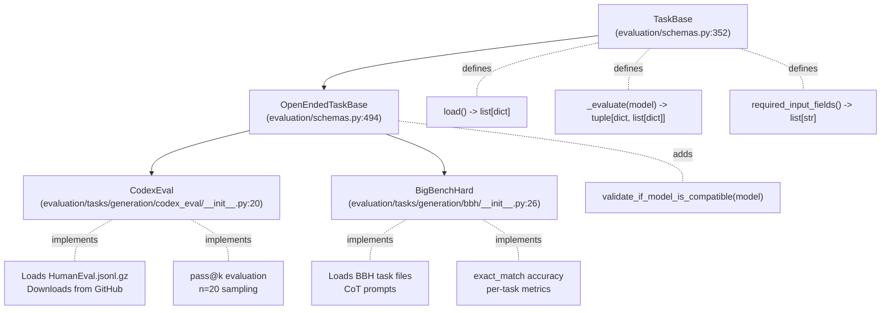
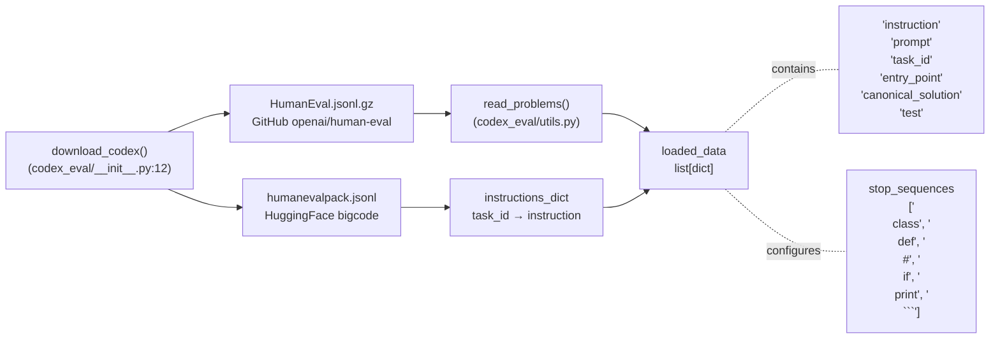
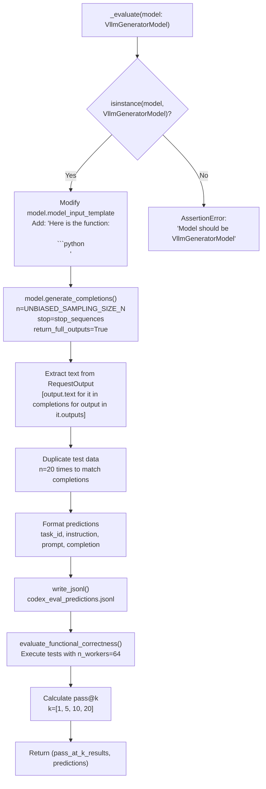
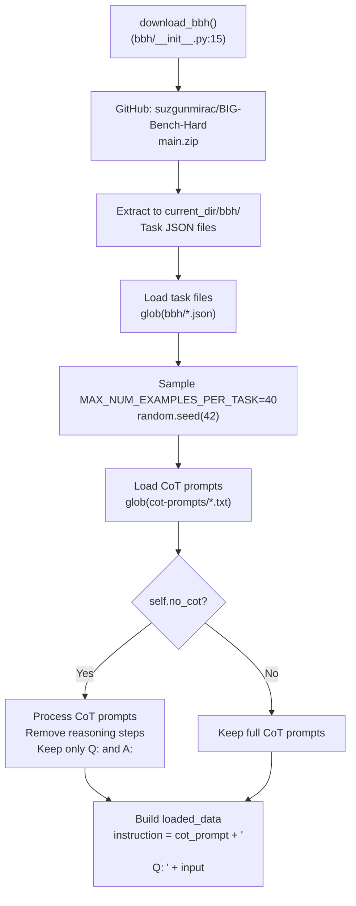
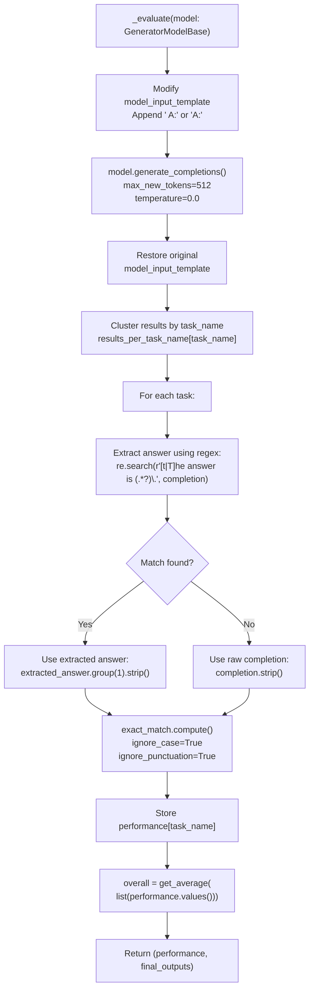

<!-- source: DeepWiki mcp.deepwiki.com · repo allenai/safety-eval · page 4.4 Code and Reasoning Tasks · fetched 2026-10-26 -->

# Code and Reasoning Tasks

<details>
<summary>Relevant source files</summary>

The following files were used as context for generating this wiki page:

- [evaluation/schemas.py](evaluation/schemas.py)
- [evaluation/tasks/generation/bbh/__init__.py](evaluation/tasks/generation/bbh/__init__.py)
- [evaluation/tasks/generation/codex_eval/__init__.py](evaluation/tasks/generation/codex_eval/__init__.py)

</details>


This document describes the evaluation tasks that assess model capabilities in **code generation** and **complex reasoning**. These tasks evaluate general model competence rather than safety concerns, providing a comprehensive view of model performance across diverse cognitive challenges.

The framework includes two primary tasks in this category:
- **CodexEval**: Evaluates Python code generation using the HumanEval dataset
- **BigBenchHard**: Assesses complex reasoning using chain-of-thought prompting across diverse problem types

For adversarial safety evaluations, see [Adversarial Safety Tasks](#4.1). For bias and capability assessments, see [Capability and Bias Tasks](#4.2). For toxicity evaluations, see [Content Safety Tasks](#4.3).

---

## Task Architecture and Inheritance

Both code and reasoning tasks inherit from `OpenEndedTaskBase`, which provides the common interface for generation-based evaluations. The inheritance structure follows the standard task pattern used throughout the framework.

**Diagram: Code and Reasoning Task Class Hierarchy**



Sources: [evaluation/schemas.py:352-518](), [evaluation/tasks/generation/codex_eval/__init__.py:20-26](), [evaluation/tasks/generation/bbh/__init__.py:26-33]()

---

## CodexEval: Code Generation Evaluation

The `CodexEval` task evaluates Python code generation capabilities using the HumanEval benchmark. This task measures functional correctness of generated code through test case execution.

### Task Configuration

The `CodexEval` class is located at [evaluation/tasks/generation/codex_eval/__init__.py:20-116]() and has the following characteristics:

| Parameter | Value | Purpose |
|-----------|-------|---------|
| `max_new_tokens` | 512 | Maximum length of generated code |
| `temperature` | 0.8 | Sampling temperature for diversity |
| `top_p` | 0.95 | Nucleus sampling threshold |
| `UNBIASED_SAMPLING_SIZE_N` | 20 | Number of samples per problem |
| `EVAL_PASS_AT_KS` | [1, 5, 10, 20] | pass@k metrics to compute |

Sources: [evaluation/tasks/generation/codex_eval/__init__.py:21-34]()

### Data Loading Process

The task automatically downloads and preprocesses HumanEval data:

**Diagram: CodexEval Data Pipeline**



Sources: [evaluation/tasks/generation/codex_eval/__init__.py:12-68]()

The `load()` method at [evaluation/tasks/generation/codex_eval/__init__.py:45-68]() performs the following steps:
1. Downloads data files if not present using `download_codex()`
2. Reads problems from `HumanEval.jsonl.gz` using `read_problems()`
3. Loads instruction formatting from `humanevalpack.jsonl`
4. Creates instruction-task mappings using task IDs
5. Configures stop sequences for code generation

### Evaluation Methodology

The evaluation process involves specialized handling for code generation:

**Diagram: CodexEval Evaluation Workflow**



Sources: [evaluation/tasks/generation/codex_eval/__init__.py:70-115]()

Key implementation details:

1. **Model Requirement**: Only `VllmGeneratorModel` is supported due to the need for `return_full_outputs=True` functionality [evaluation/tasks/generation/codex_eval/__init__.py:71-72]()

2. **Template Modification**: The model input template is dynamically modified to include code block formatting [evaluation/tasks/generation/codex_eval/__init__.py:76-81]():
   ```python
   answer = "Here is the function:\n\n```python\n"
   model.model_input_template = current_model_input_template + answer + "{prompt}"
   ```

3. **Multiple Sampling**: Each problem generates 20 completions for unbiased pass@k estimation [evaluation/tasks/generation/codex_eval/__init__.py:83-90]()

4. **Stop Sequences**: Generation halts at class/function definitions and other code delimiters [evaluation/tasks/generation/codex_eval/__init__.py:53]()

5. **Functional Correctness**: The `evaluate_functional_correctness()` function executes generated code against test cases using 64 parallel workers [evaluation/tasks/generation/codex_eval/__init__.py:108-113]()

### Output Format

The task returns two components:

**Metrics Dictionary** (`pass_at_k_results`):
```json
{
  "pass@1": 0.45,
  "pass@5": 0.68,
  "pass@10": 0.78,
  "pass@20": 0.85
}
```

**Individual Results** (`predictions`):
```json
[
  {
    "id": "HumanEval/0_0",
    "task_id": "HumanEval/0",
    "instruction": "Write a function...",
    "prompt": "def has_close_elements(numbers, threshold):\n",
    "completion": "    return any(abs(a - b) < threshold...)"
  }
]
```

Sources: [evaluation/tasks/generation/codex_eval/__init__.py:99-115]()

---

## BigBenchHard: Complex Reasoning Evaluation

The `BigBenchHard` task evaluates complex reasoning capabilities using chain-of-thought (CoT) prompting across diverse problem types. It measures exact match accuracy on challenging reasoning tasks.

### Task Configuration

The `BigBenchHard` class is located at [evaluation/tasks/generation/bbh/__init__.py:26-161]() with the following configuration:

| Parameter | Value | Purpose |
|-----------|-------|---------|
| `max_new_tokens` | 512 | Maximum reasoning length |
| `temperature` | 0.0 | Deterministic generation |
| `top_p` | 1.0 | No nucleus sampling |
| `MAX_NUM_EXAMPLES_PER_TASK` | 40 | Examples sampled per task |
| `no_cot` | bool | Optional: disable CoT prompting |

Sources: [evaluation/tasks/generation/bbh/__init__.py:27-40]()

### Data Loading and Chain-of-Thought Processing

The task loads multiple reasoning tasks with optional CoT prompt processing:

**Diagram: BigBenchHard Data Loading Pipeline**



Sources: [evaluation/tasks/generation/bbh/__init__.py:15-108]()

The `load()` method performs sophisticated CoT prompt processing at [evaluation/tasks/generation/bbh/__init__.py:51-108]():

1. **Data Download**: Downloads BIG-Bench-Hard repository from GitHub if not present
2. **Task Loading**: Reads all task JSON files from the `bbh/` directory
3. **Stratified Sampling**: Randomly samples 40 examples per task with seed 42
4. **CoT Prompt Loading**: Loads chain-of-thought prompts from `cot-prompts/*.txt`
5. **Optional CoT Removal**: If `no_cot=True`, removes reasoning steps while preserving Q&A format [evaluation/tasks/generation/bbh/__init__.py:72-84]():
   - Finds fields starting with "Q:"
   - Extracts answer after "So the answer is"
   - Reconstructs prompt with only question and direct answer

### Evaluation and Answer Extraction

The evaluation process handles chain-of-thought reasoning output:

**Diagram: BigBenchHard Evaluation Flow**



Sources: [evaluation/tasks/generation/bbh/__init__.py:110-160]()

Key evaluation steps:

1. **Template Modification**: Appends "A:" to prompt the model for an answer [evaluation/tasks/generation/bbh/__init__.py:112-116]()

2. **Deterministic Generation**: Uses temperature=0.0 for reproducible outputs [evaluation/tasks/generation/bbh/__init__.py:118-122]()

3. **Answer Extraction**: Uses regex pattern `[t|T]he answer is (.*?)\.` to extract the final answer from CoT reasoning [evaluation/tasks/generation/bbh/__init__.py:142-146]()

4. **Exact Match Scoring**: Computes exact match with case and punctuation normalization [evaluation/tasks/generation/bbh/__init__.py:155-158]()

5. **Per-Task Aggregation**: Calculates accuracy for each individual task, then computes overall average [evaluation/tasks/generation/bbh/__init__.py:159]()

### Output Format

The task returns structured performance metrics and detailed outputs:

**Metrics Dictionary** (`performance`):
```json
{
  "boolean_expressions": 0.85,
  "causal_judgement": 0.72,
  "date_understanding": 0.91,
  "...": "...",
  "overall": 0.78
}
```

**Individual Results** (`final_outputs`):
```json
[
  {
    "id": 0,
    "task_name": "boolean_expressions",
    "input": "Q: not ( ( not not True ) ) is...",
    "target": "False",
    "output": "False"
  }
]
```

Sources: [evaluation/tasks/generation/bbh/__init__.py:136-160]()

---

## Required Input Fields

Both tasks follow the standard `OpenEndedTaskBase` interface and require the `instruction` field:

| Task | Required Fields | Description |
|------|----------------|-------------|
| `CodexEval` | `["instruction"]` | Natural language description of coding task |
| `BigBenchHard` | `["instruction"]` | CoT prompt + question formatted as instruction |

The model's input template must contain placeholder for these fields, validated by `validate_if_model_is_compatible()` at [evaluation/schemas.py:495-513]().

Sources: [evaluation/tasks/generation/codex_eval/__init__.py:36-43](), [evaluation/tasks/generation/bbh/__init__.py:42-49](), [evaluation/schemas.py:495-513]()

---

## Integration with Task System

Both tasks integrate with the framework's task evaluation pipeline:

**Table: Task Integration Points**

| Integration Point | CodexEval | BigBenchHard |
|------------------|-----------|--------------|
| Base class | `OpenEndedTaskBase` | `OpenEndedTaskBase` |
| Model type | `VllmGeneratorModel` (required) | `GeneratorModelBase` (any) |
| Template modification | Yes (adds code block prefix) | Yes (adds "A:" suffix) |
| Stop sequences | Yes (code delimiters) | No |
| Multiple sampling | Yes (n=20) | No (temperature=0.0) |
| Metric type | pass@k | exact_match |
| Result aggregation | Single pass@k dict | Per-task + overall |

Sources: [evaluation/tasks/generation/codex_eval/__init__.py:70-115](), [evaluation/tasks/generation/bbh/__init__.py:110-160]()

---

## Usage Examples

### Running CodexEval

To evaluate a model on CodexEval:

```bash
python eval.py generators \
  --model_name <model_path> \
  --chat_template <template_name> \
  --tasks CodexEval \
  --batch_size 1 \
  --max_new_tokens 512
```

**Note**: Must use a model backend that supports vLLM (see [Generator Models](#5.1) for details).

### Running BigBenchHard

To evaluate with chain-of-thought:

```bash
python eval.py generators \
  --model_name <model_path> \
  --chat_template <template_name> \
  --tasks BigBenchHard \
  --batch_size 8
```

To evaluate without chain-of-thought:

```bash
python eval.py generators \
  --model_name <model_path> \
  --chat_template <template_name> \
  --tasks BigBenchHard:no_cot \
  --batch_size 8
```

For comprehensive evaluation orchestration, see [Batch Evaluation with GPU Orchestration](#7.2).

Sources: [evaluation/tasks/generation/codex_eval/__init__.py:20-116](), [evaluation/tasks/generation/bbh/__init__.py:26-161]()

---

