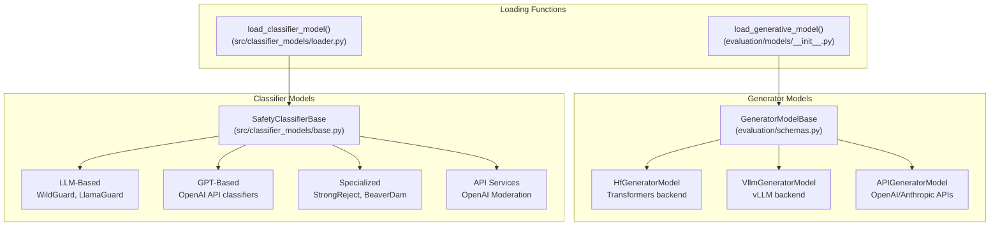
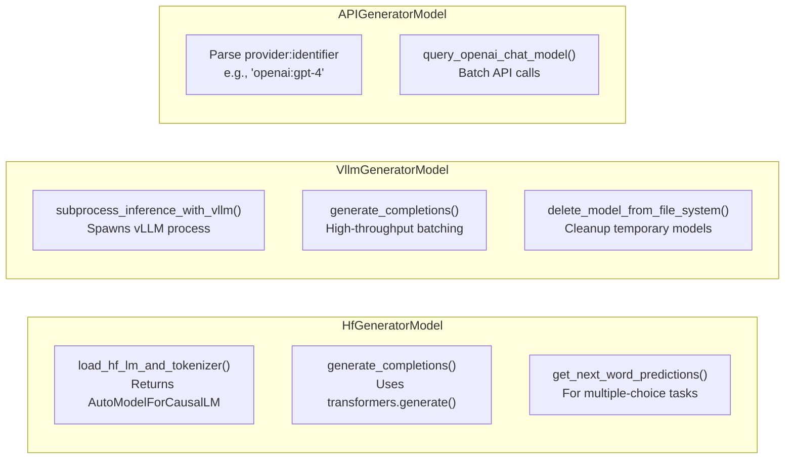
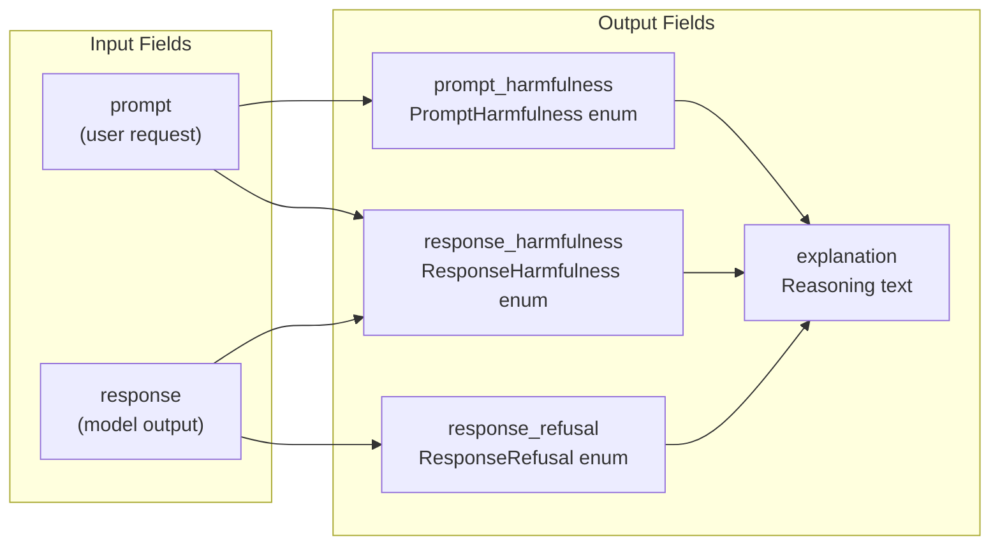
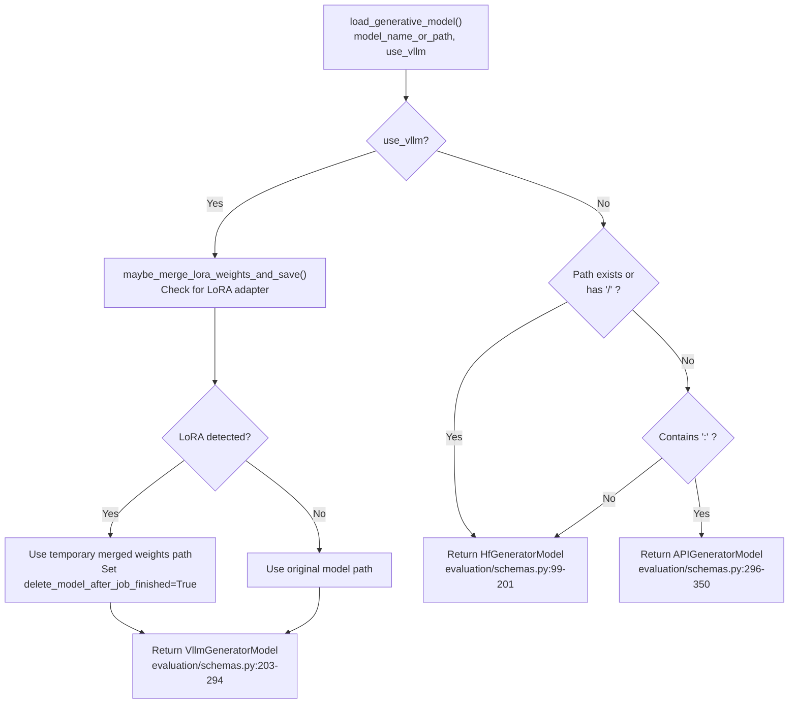
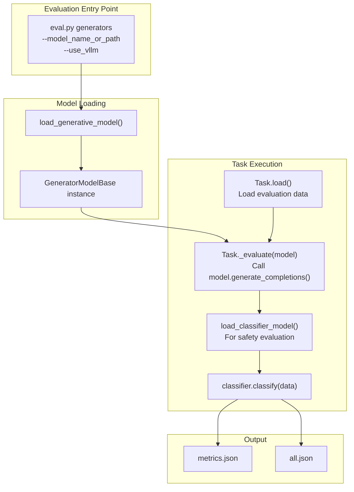

<!-- source: DeepWiki mcp.deepwiki.com · repo allenai/safety-eval · page 5 Models · fetched 2026-10-26 -->

# Models

<details>
<summary>Relevant source files</summary>

The following files were used as context for generating this wiki page:

- [README.md](README.md)
- [evaluation/models/__init__.py](evaluation/models/__init__.py)
- [evaluation/schemas.py](evaluation/schemas.py)
- [evaluation/tasks/generation/codex_eval/__init__.py](evaluation/tasks/generation/codex_eval/__init__.py)
- [evaluation/tasks/generation/do_anything_now/__init__.py](evaluation/tasks/generation/do_anything_now/__init__.py)
- [evaluation/tasks/generation/trustllm_jailbreaktrigger/__init__.py](evaluation/tasks/generation/trustllm_jailbreaktrigger/__init__.py)
- [evaluation/tasks/generation/trustllm_jailbreaktrigger/gpt4.yaml](evaluation/tasks/generation/trustllm_jailbreaktrigger/gpt4.yaml)
- [evaluation/tasks/generation/wildjailbreak/__init__.py](evaluation/tasks/generation/wildjailbreak/__init__.py)
- [evaluation/tasks/generation/xstest/exaggerated_safety.json](evaluation/tasks/generation/xstest/exaggerated_safety.json)
- [src/classifier_models/loader.py](src/classifier_models/loader.py)

</details>


## Purpose and Scope

This page provides a comprehensive overview of the model layer in the AI2 Safety Evaluation Framework, covering both **generative models** (used to produce text responses) and **classifier models** (used to evaluate safety properties of prompts and responses). This page focuses on model abstractions, implementations, and loading mechanisms.

For specific details on generator model backends, see [Generator Models](#5.1). For classifier implementations, see [Safety Classifiers](#5.2). For task-specific integration patterns, see [Task System](#3.2).

**Sources:** [README.md:1-218](), [evaluation/schemas.py:1-550](), [src/classifier_models/loader.py:1-183]()

## Model Layer Overview

The framework provides two distinct model hierarchies:

1. **Generator Models** - Language models that generate text completions for evaluation tasks
2. **Classifier Models** - Safety evaluation models that classify prompts/responses for harmfulness, refusal, etc.

Both hierarchies follow abstract base class patterns with multiple concrete implementations. Models are instantiated via factory functions that handle loading logic, configuration, and optional features like safety filtering.

**Sources:** [evaluation/schemas.py:30-97](), [evaluation/schemas.py:352-550]()

### Generator vs Classifier Models



**Sources:** [evaluation/schemas.py:30-350](), [src/classifier_models/loader.py:37-124](), [evaluation/models/__init__.py:12-78]()

## Generator Model Architecture

Generator models implement the `GeneratorModelBase` abstract class, which defines a common interface for text generation across different backends.

### Base Interface

The `GeneratorModelBase` class [evaluation/schemas.py:30-97]() defines:

| Method | Purpose | Returns |
|--------|---------|---------|
| `__init__()` | Initialize with model path, template, optional filtering | - |
| `load_model()` | Load model from path or API identifier | `tuple[object, object]` |
| `generate_completions()` | Generate text for input prompts | `list[str]` or `list[RequestOutput]` |

Key initialization parameters:
- `model_name_or_path` - HuggingFace model ID, local path, or API identifier
- `model_input_template_path_or_name` - Chat template for formatting inputs
- `filter_classifier_name` - Optional classifier for pre/post-generation filtering
- `hf_revision` - Specific model revision/branch

**Sources:** [evaluation/schemas.py:30-59]()

### Generator Model Implementations



**Sources:** [evaluation/schemas.py:99-201](), [evaluation/schemas.py:203-294](), [evaluation/schemas.py:296-350]()

### Generator Model Comparison

| Implementation | Use Case | Key Features | File Reference |
|----------------|----------|--------------|----------------|
| `HfGeneratorModel` | Small-medium models, full control | Transformers library, next-word prediction support, in-process | [evaluation/schemas.py:99-201]() |
| `VllmGeneratorModel` | Large models, production inference | Subprocess isolation, PagedAttention, high throughput | [evaluation/schemas.py:203-294]() |
| `APIGeneratorModel` | Proprietary models (GPT-4, Claude) | No local compute, batch API calls | [evaluation/schemas.py:296-350]() |

**Sources:** [evaluation/schemas.py:99-350](), [evaluation/models/__init__.py:38-76]()

### Optional Safety Filtering

All generator models support optional pre/post-generation filtering via the `filter_classifier_name` parameter. When enabled:

1. Generator loads specified classifier after text generation
2. Classifier evaluates prompt harmfulness or response harmfulness
3. Harmful outputs are replaced with refusal message: `"I'm sorry, I can't help with that."`
4. Classifier model is deleted to free GPU memory

Filter implementation locations:
- HfGeneratorModel: [evaluation/schemas.py:145-163]()
- VllmGeneratorModel: [evaluation/schemas.py:255-285]()
- APIGeneratorModel: [evaluation/schemas.py:329-347]()

**Sources:** [evaluation/schemas.py:145-163](), [evaluation/schemas.py:255-285](), [evaluation/schemas.py:329-347]()

## Classifier Model Architecture

Classifier models implement the `SafetyClassifierBase` interface, providing safety evaluation capabilities across multiple dimensions: prompt harmfulness, response harmfulness, and response refusal detection.

### Classifier Types and Implementations

The framework includes 30+ classifier implementations organized into categories:

```mermaid
graph TB
    Base["SafetyClassifierBase<br/>src/classifier_models/base.py"]
    
    subgraph "LLM-Based Classifiers"
        WG["WildGuard<br/>allenai/wildguard"]
        LG["LlamaGuard variants<br/>UserRequest, ModelResponse, Guard2"]
        Aegis["AegisLlamaGuard<br/>Permissive/Defensive"]
        BD["BeaverDam<br/>PKU-Alignment/beaver-dam-7b"]
    end
    
    subgraph "StrongReject Family"
        SR["StrongRejectClassifier<br/>Standard rubric-based"]
        SRL["StrongRejectLogitClassifier<br/>Logit analysis"]
        SRP["StrongRejectLogProbs<br/>Log probability scoring"]
    end
    
    subgraph "GPT-Based Classifiers"
        OAISC["OpenAIModelSafetyClassifier<br/>Configurable via YAML"]
        Named["Named Variants<br/>V0, V1, V2 versions"]
    end
    
    subgraph "API Services"
        OAIMod["OpenAIModerationAPIClassifier<br/>openai.moderations.create()"]
    end
    
    subgraph "Specialized Classifiers"
        HB["HarmbenchClassifier<br/>Harmbench-specific"]
        MD["MDJudgeResponseHarmClassifier<br/>MD-Judge model"]
        LF["LongformerHarmClassifier<br/>LibrAI Longformer"]
        KW["KeywordBasedRefusalClassifier<br/>Pattern matching"]
        QB["QwenMC<br/>Qwen3MC multiple-choice"]
        SB["SorryBenchClassifier<br/>SorryBench evaluation"]
    end
    
    Base --> WG
    Base --> LG
    Base --> Aegis
    Base --> BD
    Base --> SR
    Base --> SRL
    Base --> SRP
    Base --> OAISC
    Base --> Named
    Base --> OAIMod
    Base --> HB
    Base --> MD
    Base --> LF
    Base --> KW
    Base --> QB
    Base --> SB
```



**Sources:** [src/classifier_models/loader.py:37-124](), [README.md:42-70]()

### Classifier Loading System

The `load_classifier_model()` function [src/classifier_models/loader.py:37-124]() implements a factory pattern with name-based dispatch:

```python
def load_classifier_model(model_name: str, **kwargs) -> SafetyClassifierBase
```

**Supported model names:**

| Model Name | Class | Purpose | Line Reference |
|------------|-------|---------|----------------|
| `WildGuard` | `WildGuard` | General safety classification | [src/classifier_models/loader.py:43-44]() |
| `LlamaGuardUserRequest` | `LlamaGuardUserRequest` | Prompt harmfulness | [src/classifier_models/loader.py:45-46]() |
| `LlamaGuardModelResponse` | `LlamaGuardModelResponse` | Response harmfulness | [src/classifier_models/loader.py:47-48]() |
| `HarmbenchClassifier` | `HarmbenchClassifier` | Harmbench evaluation | [src/classifier_models/loader.py:49-50]() |
| `StrongRejectClassifier` | `StrongRejectClassifier` | StrongReject rubric | [src/classifier_models/loader.py:63-64]() |
| `StrongRejectLogProbs` | `StrongRejectLogProbs` | StrongReject log-prob scoring | [src/classifier_models/loader.py:69-70]() |
| `OpenAIModeration` | `OpenAIModerationAPIClassifier` | OpenAI Moderation API | [src/classifier_models/loader.py:107-108]() |

For GPT-based classifiers configured via YAML:
```python
config = OpenAIModelSafetyClassifierConfig.from_yaml(f'config_openai/{model_name}.yaml')
return OpenAIModelSafetyClassifier(**config.get_config_dict())
```

**Sources:** [src/classifier_models/loader.py:37-124]()

### Classifier Output Fields

Classifiers produce structured outputs with standardized field names:



**Common output field combinations:**
- Prompt classifiers: `["prompt_harmfulness"]`
- Response classifiers: `["response_harmfulness"]`, `["response_refusal"]`, or both
- Full-turn classifiers: `["prompt_harmfulness", "response_harmfulness", "response_refusal"]`

**Sources:** [src/classifier_models/base.py](), [evaluation/schemas.py:15-19]()

## Model Loading and Integration

### Generator Model Loading

The `load_generative_model()` function [evaluation/models/__init__.py:12-78]() provides a unified interface:



**Sources:** [evaluation/models/__init__.py:12-78]()

### Model Template System

Generator models use input templates to format prompts according to each model's chat format:

```python
# Template loaded from name or file
model_input_template = get_template(
    model_name_or_path=model_name_or_path,
    chat_template=model_input_template_path_or_name,
)["prompt"]

# Templates contain placeholders like {instruction}
formatted = model_input_template.format(instruction=user_prompt)
```

Templates are referenced in task configurations:
- YAML config: `model_input_template_path_or_name: tulu2`
- Task evaluation: Template automatically applied during `generate_completions()`

**Sources:** [evaluation/schemas.py:46-53](), [evaluation/tasks/generation/trustllm_jailbreaktrigger/gpt4.yaml:1-6]()

### Integration with Tasks

Models are loaded and passed to task evaluation methods:



**Key integration points:**
1. CLI parses model arguments and calls `load_generative_model()`
2. Task `_evaluate()` method receives model instance
3. Task calls `model.generate_completions()` with formatted inputs
4. Task loads classifier via `load_classifier_model()` for safety evaluation
5. Classifier processes model outputs to compute metrics

**Sources:** [evaluation/schemas.py:410-429](), [evaluation/tasks/generation/codex_eval/__init__.py:70-115]()

## Model Compatibility Validation

Tasks validate model compatibility before evaluation:

### Generator Model Validation

`OpenEndedTaskBase.validate_if_model_is_compatible()` [evaluation/schemas.py:495-513]() checks:
- Required input fields (e.g., `instruction`, `prompt`) exist in model template
- Raises `AssertionError` if incompatible

Example:
```python
input_compatible = all(
    field in model.model_input_template
    for field in self.required_input_fields()
)
```

### Classifier Model Validation

`ClassificationTaskBase.validate_if_model_is_compatible()` [evaluation/schemas.py:461-487]() verifies:
- Input fields: Task's required fields match classifier's `get_possible_input_fields()`
- Output fields: Task's required output field sets match classifier's `get_output_fields()`

Both must pass or assertion fails.

**Sources:** [evaluation/schemas.py:461-513]()

## Example Model Configurations

### Generator Model Example

```bash
# vLLM model
python evaluation/eval.py generators \
  --use_vllm \
  --model_name_or_path allenai/tulu-2-dpo-7b \
  --model_input_template_path_or_name tulu2 \
  --tasks wildguardtest,harmbench

# API model
python evaluation/eval.py generators \
  --model_name_or_path openai:gpt-4 \
  --tasks wildguardtest
```

### Classifier Model Example

Task YAML configuration specifying classifier:
```yaml
task_class: TrustLLMJailbreakTriggerSubset
classifier_model_name: OpenInstructGPTJailbreakTriggerClassifier
hparams:
  max_new_tokens: 512
  temperature: 0.7
```

**Sources:** [README.md:96-134](), [evaluation/tasks/generation/trustllm_jailbreaktrigger/gpt4.yaml:1-6]()

## Summary

The model layer provides:

1. **Three generator backends** - HuggingFace, vLLM, and API-based models with unified interface
2. **30+ classifier implementations** - Comprehensive safety evaluation across multiple dimensions
3. **Factory pattern loading** - Centralized model instantiation with name-based dispatch
4. **Optional safety filtering** - Pre/post-generation filtering for generator models
5. **Template system** - Flexible input formatting for different model chat formats
6. **Validation system** - Automatic compatibility checking between models and tasks

For implementation details on specific model types, see [Generator Models](#5.1) and [Safety Classifiers](#5.2).

**Sources:** [evaluation/schemas.py:30-550](), [src/classifier_models/loader.py:1-183](), [evaluation/models/__init__.py:1-79](), [README.md:1-218]()

---

