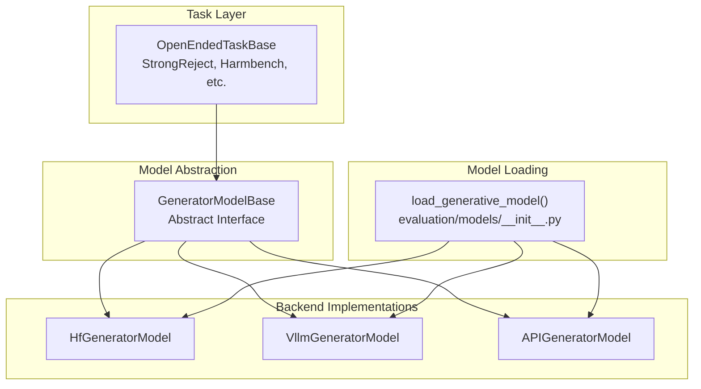
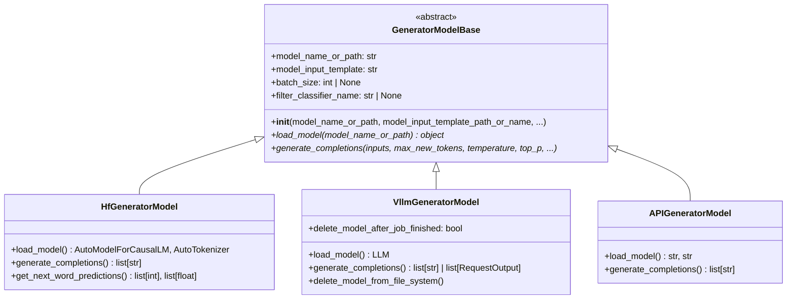
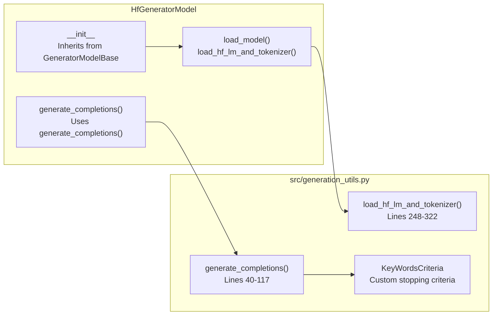
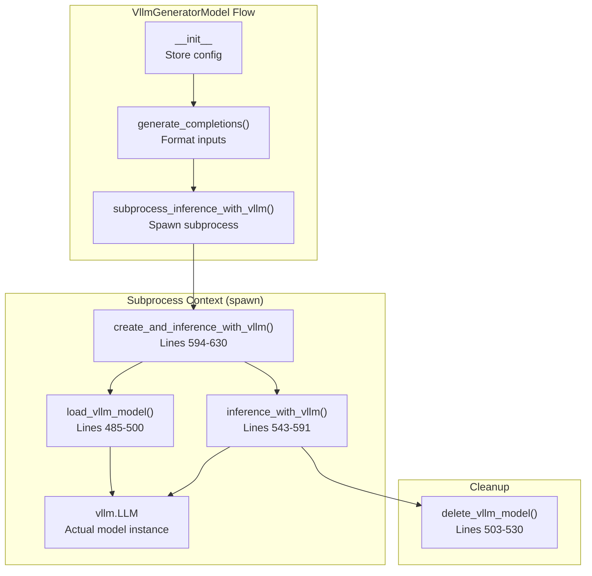
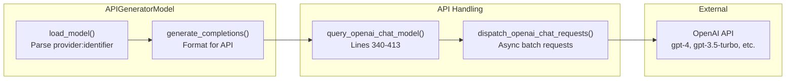
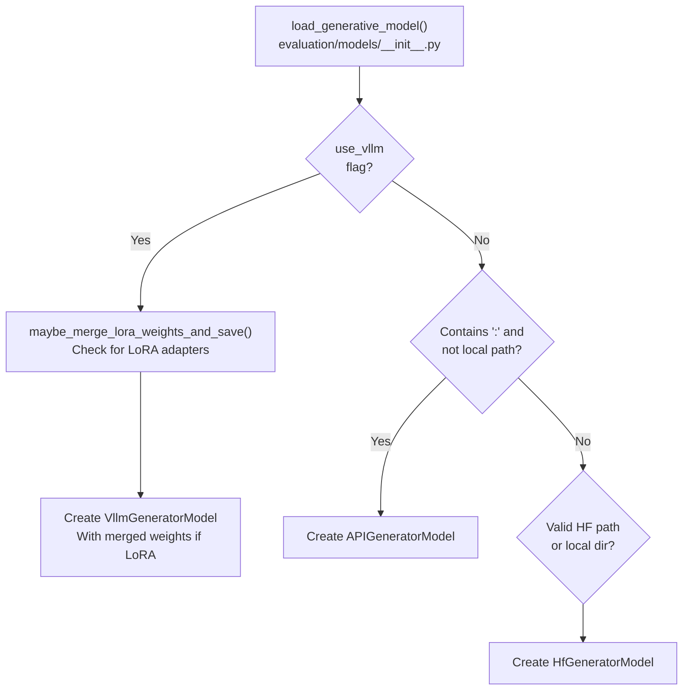
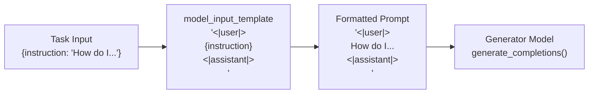
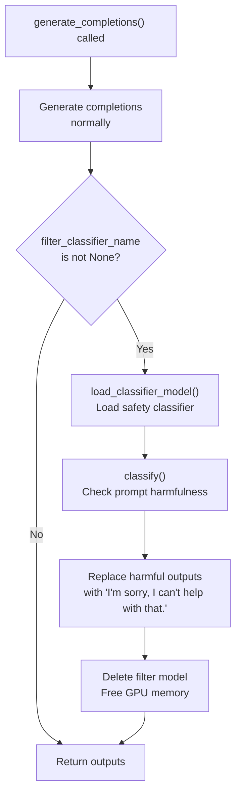

<!-- source: DeepWiki mcp.deepwiki.com · repo allenai/safety-eval · page 5.1 Generator Models · fetched 2026-10-26 -->

# Generator Models

<details>
<summary>Relevant source files</summary>

The following files were used as context for generating this wiki page:

- [README.md](README.md)
- [evaluation/models/__init__.py](evaluation/models/__init__.py)
- [evaluation/schemas.py](evaluation/schemas.py)
- [evaluation/tasks/generation/codex_eval/__init__.py](evaluation/tasks/generation/codex_eval/__init__.py)
- [evaluation/tasks/generation/do_anything_now/__init__.py](evaluation/tasks/generation/do_anything_now/__init__.py)
- [evaluation/tasks/generation/trustllm_jailbreaktrigger/__init__.py](evaluation/tasks/generation/trustllm_jailbreaktrigger/__init__.py)
- [evaluation/tasks/generation/trustllm_jailbreaktrigger/gpt4.yaml](evaluation/tasks/generation/trustllm_jailbreaktrigger/gpt4.yaml)
- [evaluation/tasks/generation/wildjailbreak/__init__.py](evaluation/tasks/generation/wildjailbreak/__init__.py)
- [evaluation/tasks/generation/xstest/__init__.py](evaluation/tasks/generation/xstest/__init__.py)
- [evaluation/tasks/generation/xstest/exaggerated_safety.json](evaluation/tasks/generation/xstest/exaggerated_safety.json)
- [src/generation_utils.py](src/generation_utils.py)

</details>


This document covers the generator model implementations in the AI2 Safety Evaluation Framework. Generator models are language models that produce text completions for evaluation tasks. The framework provides three backend implementations: HuggingFace Transformers, vLLM, and API-based models.

For information about safety classifier models, see [Safety Classifiers](#5.2). For guidance on loading and configuring models, see [Model Loading and Configuration](#5.3).

## Overview

The generator model layer provides a unified interface for text generation across different model backends. All generator models inherit from `GeneratorModelBase` and implement a common `generate_completions` method, enabling tasks to work seamlessly with any backend.

**Supported Backends:**
- **HuggingFace Transformers**: Direct model loading with `transformers` library
- **vLLM**: High-throughput inference engine for production deployments
- **API Services**: OpenAI, Anthropic, and other API providers



**Sources:** [evaluation/schemas.py:30-350](), [evaluation/models/__init__.py:12-78]()

## Model Abstraction Layer

The `GeneratorModelBase` class defines the interface that all generator models must implement. It handles input template formatting and optional safety filtering.

### Core Interface



### Key Responsibilities

| Responsibility | Implementation Location |
|---|---|
| Input template formatting | [evaluation/schemas.py:32-56]() |
| Safety filtering (optional) | [evaluation/schemas.py:145-163](), [evaluation/schemas.py:255-285]() |
| Model loading abstraction | [evaluation/schemas.py:61-73]() |
| Completion generation | [evaluation/schemas.py:76-96]() |

**Sources:** [evaluation/schemas.py:30-97]()

## HuggingFace Generator

The `HfGeneratorModel` class uses the `transformers` library for direct model loading and inference. It supports batch processing, LoRA adapters, and various quantization options.

### Architecture



### Key Features

**Model Loading** ([src/generation_utils.py:248-322]()):
- Detects and loads LoRA adapters automatically via `is_adapter_model()`
- Supports 8-bit quantization with `load_in_8bit=True`
- Handles GPTQ quantized models
- Sets padding side to left for batch generation

**Generation** ([evaluation/schemas.py:106-165]()):
- Formats inputs using `model_input_template`
- Implements custom stopping criteria via `KeyWordsCriteria`
- Removes prompt from output to return only completion
- Supports optional safety filtering with classifiers

**Batch Processing:**
```python
# From evaluation/schemas.py:117-140
formatted_inputs = [self.model_input_template.format(**d) for d in inputs]
outputs = generate_completions(
    model=model,
    tokenizer=tokenizer,
    prompts=formatted_inputs,
    batch_size=self.batch_size,
    max_new_tokens=max_new_tokens,
    temperature=temperature,
    top_p=top_p,
    repetition_penalty=repetition_penalty,
    stop_id_sequences=stop_id_sequences,
)
```

### Multiple Choice Prediction

The `HfGeneratorModel` includes specialized functionality for multiple-choice tasks via `get_next_word_predictions()`:

**Functionality** ([evaluation/schemas.py:167-200]()):
- Computes logits for next token only
- Restricts to candidate token IDs
- Returns predicted indices and probabilities
- Used by WMDP and BBQ tasks

**Sources:** [evaluation/schemas.py:99-201](), [src/generation_utils.py:248-322](), [src/generation_utils.py:40-117]()

## vLLM Generator

The `VllmGeneratorModel` class uses the vLLM inference engine for high-throughput generation. It spawns models in subprocesses to avoid GPU memory conflicts.

### Architecture



### Subprocess Pattern

**Why Subprocess?** The vLLM model is loaded in a separate subprocess using the `spawn` context to ensure complete cleanup and prevent GPU memory leaks between evaluations.

**Implementation** ([src/generation_utils.py:633-662]()):
```python
# Simplified from actual code
ctx = multiprocessing.get_context("spawn")
parent_conn, child_conn = ctx.Pipe()
subprocess = ctx.Process(
    target=create_and_inference_with_vllm,
    args=(prompts, model_name_or_path, ..., child_conn),
    kwargs=sampling_args
)
subprocess.start()
result = parent_conn.recv()
subprocess.join()
```

### Key Features

| Feature | Implementation |
|---|---|
| High-throughput batching | vLLM engine handles automatic batching |
| Tensor parallelism | Automatic multi-GPU distribution via `tensor_parallel_size` |
| LoRA support | Automatic weight merging via `maybe_merge_lora_weights_and_save()` |
| Memory cleanup | `delete_vllm_model()` with Ray shutdown |
| Full outputs | `return_full_outputs=True` returns `RequestOutput` objects |

**Generation Parameters** ([evaluation/schemas.py:225-250]()):
- Temperature and top_p sampling
- Custom stop sequences
- Repetition penalty
- Number of completions per prompt (`n`)

**Sources:** [evaluation/schemas.py:203-294](), [src/generation_utils.py:485-662]()

## API Generator

The `APIGeneratorModel` class provides integration with external API services like OpenAI. It supports chat-based APIs with automatic retry logic.

### Architecture



### Model Name Format

API models use the format `<provider>:<identifier>`:
- `openai:gpt-4`
- `openai:gpt-3.5-turbo`
- `openai:gpt-4-turbo`

**Parsing** ([evaluation/schemas.py:297-302]()):
```python
provider, identifier = model_name_or_path.split(":", 1)
if provider.lower() == "openai":
    outputs = query_openai_chat_model(identifier, ...)
```

### Key Features

**Async Request Batching** ([src/generation_utils.py:340-413]()):
- Processes requests in batches for efficiency
- Automatic retry with exponential backoff
- Reuses existing outputs if output file exists
- Handles repetitive pattern errors

**Retry Logic:**
```python
# From src/generation_utils.py:377-401
while retry_count < retry_limit:
    try:
        outputs = asyncio.run(
            dispatch_openai_chat_requests(...)
        )
        retry_count = 0
        break
    except Exception as e:
        retry_count += 1
        time.sleep(30 * retry_count)
```

**Limitations:**
- Requires `batch_size` parameter
- No support for `return_full_outputs` mode
- OpenAI only (other providers not yet implemented)

**Sources:** [evaluation/schemas.py:296-349](), [src/generation_utils.py:340-413]()

## Model Loading Factory

The `load_generative_model()` function provides a factory pattern for instantiating the appropriate generator model based on configuration.

### Decision Tree



### Usage Examples

**vLLM Model:**
```bash
# From README.md:107-113
python evaluation/eval.py generators \
  --use_vllm \
  --model_name_or_path allenai/tulu-2-dpo-7b \
  --model_input_template_path_or_name tulu2 \
  --tasks wildguardtest,harmbench,toxigen:tiny
```

**HuggingFace Model:**
```python
# Without use_vllm flag, loads HfGeneratorModel
model = load_generative_model(
    model_name_or_path="allenai/tulu-2-dpo-7b",
    model_input_template_path_or_name="tulu2",
    use_vllm=False,
    batch_size=8
)
```

**API Model:**
```bash
# From README.md:127-133
python evaluation/eval.py generators \
  --model_name_or_path openai:gpt-4 \
  --model_input_template_path_or_name None \
  --tasks wildguardtest,harmbench,toxigen:tiny
```

### LoRA Adapter Handling

**Detection** ([src/generation_utils.py:238-245]()):
- Checks for `adapter_model.safetensors` or `adapter_model.bin`
- Works with HuggingFace Hub repos and local directories

**Merging** ([evaluation/models/__init__.py:40-46]()):
- Merges LoRA weights into base model for vLLM compatibility
- Creates temporary directory with merged weights
- Flags for deletion after job completion

**Sources:** [evaluation/models/__init__.py:12-78](), [src/generation_utils.py:238-245]()

## Input Templates

Input templates control how task inputs are formatted before being passed to the model. They use Python string formatting with named placeholders.

### Template Structure

**Template Loading** ([evaluation/schemas.py:46-53]()):
```python
if model_input_template_path_or_name.endswith(".txt"):
    # Load from file
    with open(model_input_template_path_or_name, "r") as f:
        self.model_input_template = f.read()
else:
    # Load from src/templates
    self.model_input_template = get_template(
        model_name_or_path=model_name_or_path,
        chat_template=model_input_template_path_or_name,
    )["prompt"]
```

### Template Application



### Common Placeholders

| Placeholder | Used By | Description |
|---|---|---|
| `{instruction}` | Most tasks | Single-turn instruction/prompt |
| `{prompt}` | Code tasks | Code completion prefix |
| Custom fields | Task-specific | BBQ uses `{context}`, `{question}`, `{choices}` |

**Example Usage** ([evaluation/schemas.py:118](), [evaluation/schemas.py:236]()):
```python
formatted_inputs = [self.model_input_template.format(**d) for d in inputs]
```

**Sources:** [evaluation/schemas.py:32-56](), [src/templates/single_turn.py]()

## Safety Filtering

Generator models support optional safety filtering through classifier models. This feature filters outputs by replacing harmful completions with refusal messages.

### Filter Flow



### Implementation Details

**Configuration:**
- Set via `filter_classifier_name` parameter
- Optional `filter_model_override_path` for local classifier models

**HuggingFace Implementation** ([evaluation/schemas.py:145-163]()):
```python
if self.filter_classifier_name is not None:
    filter_model = load_classifier_model(
        self.filter_classifier_name,
        local_model_path=self.filter_model_override_path,
    )
    assert "prompt_harmfulness" in filter_model.get_output_fields()
    # Classify inputs
    cls_outputs = filter_model.classify(inputs)
    for i, cls_output in enumerate(cls_outputs):
        if cls_output.prompt_harmfulness == PromptHarmfulness.HARMFUL:
            outputs[i] = "I'm sorry, I can't help with that."
```

**vLLM Implementation** ([evaluation/schemas.py:255-285]()):
- Supports both `prompt_harmfulness` and `response_harmfulness` filtering
- Automatically cleans up vLLM filter models to prevent memory leaks

**API Implementation** ([evaluation/schemas.py:329-347]()):
- Only supports `prompt_harmfulness` filtering
- Same replacement logic as other backends

**Sources:** [evaluation/schemas.py:145-163](), [evaluation/schemas.py:255-285](), [evaluation/schemas.py:329-347]()

## Generation Hyperparameters

All generator models accept standard generation hyperparameters that control the sampling process.

### Parameter Table

| Parameter | Type | Default | Description |
|---|---|---|---|
| `max_new_tokens` | int | Task-specific | Maximum tokens to generate |
| `temperature` | float | Task-specific | Sampling temperature (0.0 = deterministic) |
| `top_p` | float | Task-specific | Nucleus sampling threshold |
| `repetition_penalty` | float | 1.0 | Penalty for token repetition (HF/vLLM only) |
| `n` | int | 1 | Number of completions per prompt |
| `stop` | str \| list[str] | None | Stop sequences for generation |

### Parameter Usage by Backend

**HuggingFace** ([evaluation/schemas.py:106-140]()):
- All parameters supported
- `repetition_penalty` used in `generate_completions()`
- Custom `stop_id_sequences` via `KeyWordsCriteria`

**vLLM** ([evaluation/schemas.py:225-250]()):
- All parameters supported
- `repetition_penalty` passed to `SamplingParams`
- `n > 1` requires `return_full_outputs=True`

**API** ([evaluation/schemas.py:304-328]()):
- `temperature` and `top_p` supported
- `max_new_tokens` renamed to `max_tokens`
- No support for `repetition_penalty` or `stop`

### Special Handling

**Llama-3 Models** ([src/generation_utils.py:46-51](), [src/generation_utils.py:568-574]()):
```python
if "llama-3" in model_name_or_path.lower():
    # Add special end-of-turn token
    llama3_stop_id = 128009
    if llama3_stop_id not in stop_token_ids:
        stop_token_ids.append(llama3_stop_id)
```

**Sources:** [evaluation/schemas.py:76-96](), [src/generation_utils.py:40-117](), [src/generation_utils.py:543-591]()

---

