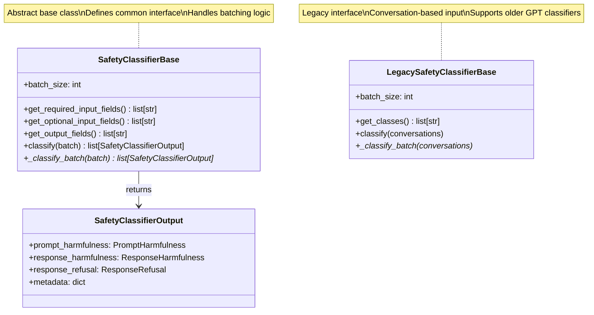
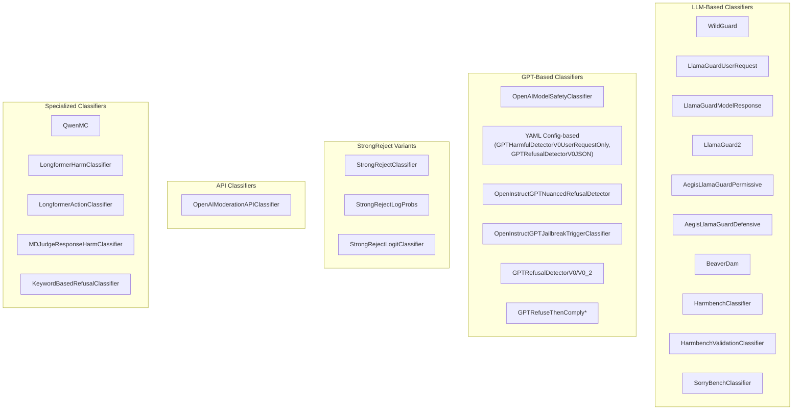
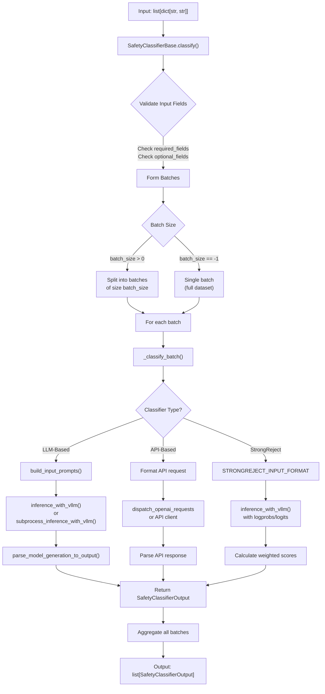
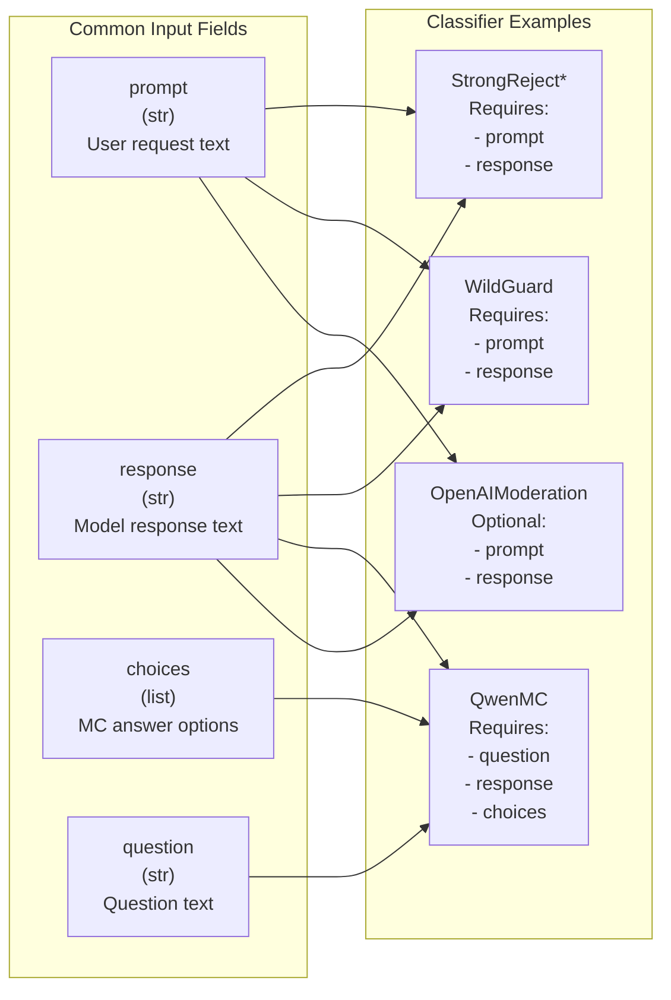
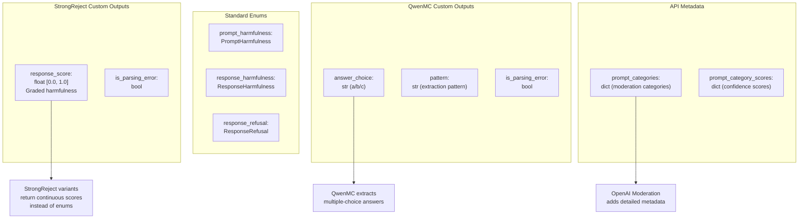
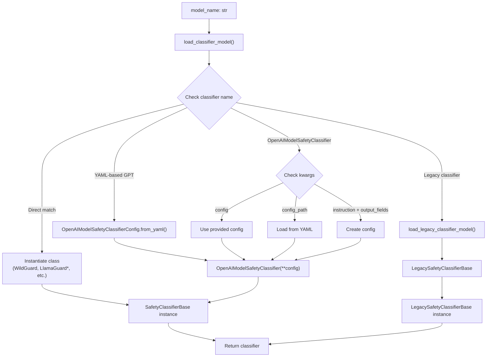
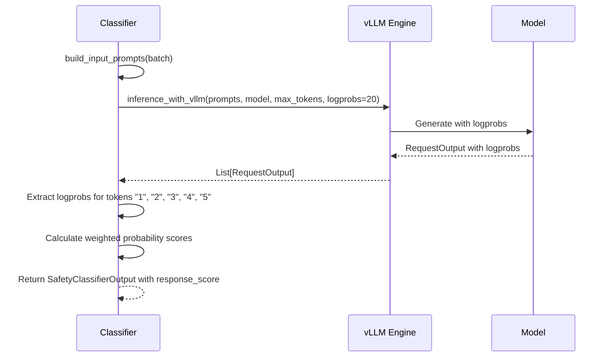
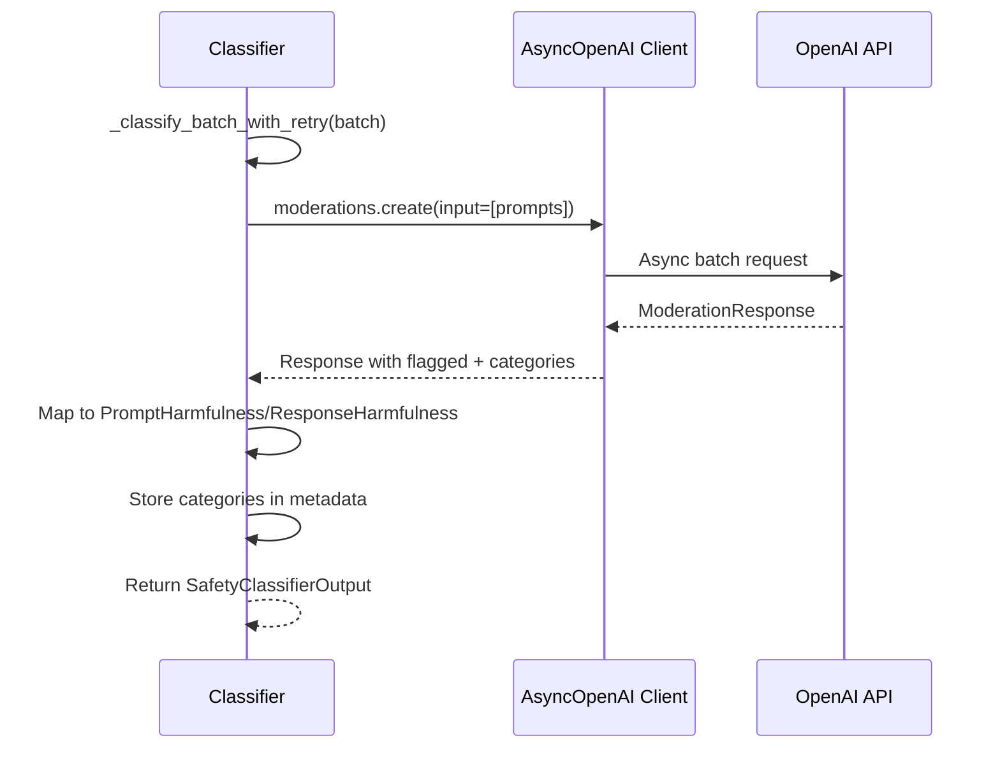

<!-- source: DeepWiki mcp.deepwiki.com · repo allenai/safety-eval · page 5.2 Safety Classifiers · fetched 2026-10-26 -->

# Safety Classifiers

<details>
<summary>Relevant source files</summary>

The following files were used as context for generating this wiki page:

- [requirements.txt](requirements.txt)
- [src/classifier_models/api_safety_classifiers.py](src/classifier_models/api_safety_classifiers.py)
- [src/classifier_models/loader.py](src/classifier_models/loader.py)
- [src/classifier_models/qwen_mc_match.py](src/classifier_models/qwen_mc_match.py)
- [src/classifier_models/strong_reject_classifier.py](src/classifier_models/strong_reject_classifier.py)
- [src/classifier_models/strong_reject_logit_classifier.py](src/classifier_models/strong_reject_logit_classifier.py)
- [src/classifier_models/strong_reject_logprobs.py](src/classifier_models/strong_reject_logprobs.py)
- [src/dispatch_openai_requests.py](src/dispatch_openai_requests.py)

</details>


This document covers the safety classifier system in the AI2 Safety Evaluation Framework. Safety classifiers evaluate model-generated content for harmfulness, refusal behavior, and other safety properties. This page describes the common architecture, base classes, and organization of all classifier implementations. For specific classifier implementation details, see [StrongReject Classifiers](#5.2.1), [LLM-Based Classifiers](#5.2.2), and [API-Based Classifiers](#5.2.3). For information on how classifiers are discovered and instantiated, see [Model Loading and Configuration](#5.3).

## Base Architecture

All safety classifiers inherit from `SafetyClassifierBase`, which defines the common interface and batching logic. The base class enforces a standardized workflow for classification tasks.



**Sources:** [src/classifier_models/base.py](), [src/classifier_models/loader.py:5-5]()

The `SafetyClassifierBase` class [src/classifier_models/base.py]() provides three critical methods that all classifiers must implement:

| Method | Purpose | Return Type |
|--------|---------|-------------|
| `get_required_input_fields()` | Specifies mandatory fields (e.g., "prompt", "response") | `list[str]` |
| `get_optional_input_fields()` | Specifies optional fields that may enhance classification | `list[str]` |
| `get_output_fields()` | Defines what fields the classifier produces | `list[str]` |
| `_classify_batch()` | Performs actual classification logic (abstract method) | `list[SafetyClassifierOutput]` |

## Classifier Categories

The framework includes 30+ classifier implementations organized into five categories. The `load_classifier_model()` factory function [src/classifier_models/loader.py:37-123]() handles instantiation.

### Category Overview



**Sources:** [src/classifier_models/loader.py:37-123]()

### Classifier Type Characteristics

| Category | Inference Method | Input Format | Primary Use Case |
|----------|------------------|--------------|------------------|
| LLM-Based | Local inference (vLLM/HF) | Prompt templates with few-shot examples | High-throughput batch classification |
| GPT-Based | OpenAI API | Configurable instructions in YAML | Flexible, instruction-based classification |
| StrongReject | Local inference (vLLM/HF) | 5-point scoring rubric | Graded harmfulness assessment |
| API | External API calls | Service-specific formats | Zero-setup moderation |
| Specialized | Various | Task-specific formats | Domain-specific classification |

**Sources:** [src/classifier_models/loader.py:37-123](), [src/classifier_models/wildguard.py](), [src/classifier_models/openai_model_safety_classifier.py]()

## Classification Workflow

The standard classification workflow processes input data through field validation, batch formation, inference, and output parsing.

### Workflow Diagram



**Sources:** [src/classifier_models/base.py](), [src/classifier_models/wildguard.py](), [src/classifier_models/strong_reject_logprobs.py:66-91](), [src/classifier_models/api_safety_classifiers.py:56-61]()

### Batch Processing Logic

Classifiers support two batching modes controlled by the `batch_size` parameter:

- **`batch_size > 0`**: Data is split into fixed-size batches processed sequentially [src/classifier_models/base.py]()
- **`batch_size == -1`**: All data is processed in a single batch (optimal for vLLM-based classifiers)

**Sources:** [src/classifier_models/base.py]()

## Input and Output Structure

### Input Format

Classifiers accept batches of dictionaries with standardized field names. The required and optional fields vary by classifier.



**Sources:** [src/classifier_models/strong_reject_classifier.py:31-32](), [src/classifier_models/qwen_mc_match.py:28-29](), [src/classifier_models/api_safety_classifiers.py:18-22]()

### Output Structure

All classifiers return `SafetyClassifierOutput` objects with standardized enum fields and flexible metadata.

**SafetyClassifierOutput Fields:**

| Field | Type | Possible Values | Purpose |
|-------|------|-----------------|---------|
| `prompt_harmfulness` | `PromptHarmfulness` | `HARMFUL`, `UNHARMFUL`, `UNKNOWN` | Classifies user request safety |
| `response_harmfulness` | `ResponseHarmfulness` | `HARMFUL`, `UNHARMFUL`, `UNKNOWN` | Classifies model response safety |
| `response_refusal` | `ResponseRefusal` | `REFUSAL`, `COMPLIANCE`, `UNKNOWN` | Detects refusal behavior |
| `metadata` | `dict[str, Any]` | Arbitrary key-value pairs | Classifier-specific data |

**Sources:** [src/classifier_models/base.py]()

### Specialized Output Fields

Some classifiers produce non-standard outputs via the `metadata` field or custom fields:



**Sources:** [src/classifier_models/strong_reject_classifier.py:37-38](), [src/classifier_models/qwen_mc_match.py:34-35](), [src/classifier_models/api_safety_classifiers.py:40-42]()

## Classifier Loading

The factory pattern in `load_classifier_model()` centralizes classifier instantiation. It maps classifier names to implementation classes and handles configuration.

### Loading Architecture



**Sources:** [src/classifier_models/loader.py:37-123]()

### Factory Function Signature

The `load_classifier_model()` function [src/classifier_models/loader.py:37-123]() accepts:

```python
def load_classifier_model(model_name: str, **kwargs) -> SafetyClassifierBase
```

**Common kwargs:**
- `batch_size: int` - Batch size for processing (default varies by classifier)
- `ephemeral_model: bool` - Whether to load model temporarily for single use
- `config: OpenAIModelSafetyClassifierConfig` - Pre-built configuration object
- `config_path: str` - Path to YAML configuration file

**Sources:** [src/classifier_models/loader.py:37-123]()

### Supported Classifier Names

The loader recognizes the following classifier identifiers:

**LLM-Based:** `WildGuard`, `LlamaGuardUserRequest`, `LlamaGuardModelResponse`, `LlamaGuard2`, `AegisLlamaGuardPermissive`, `AegisLlamaGuardDefensive`, `BeaverDam`, `HarmbenchClassifier`, `HarmbenchValidationClassifier`, `sorrybench`

**StrongReject Variants:** `StrongRejectClassifier`, `StrongRejectLogProbs`, `StrongRejectLogitClassifier`

**GPT-Based:** `OpenAIModelSafetyClassifier`, `GPTHarmfulDetectorV0UserRequestOnly`, `GPTRefusalDetectorV0JSON`, `OpenInstructGPTNuancedRefusalDetector`, `OpenInstructGPTJailbreakTriggerClassifier`, `GPTRefusalDetectorV0`, `GPTRefusalDetectorV0_2`, `GPTRefuseThenComplyRefusalDetector`, `GPTRefuseThenComplyHarmfulnessDetector`

**API:** `OpenAIModeration`

**Specialized:** `Qwen3MC`, `LongformerHarmClassifier`, `LongformerActionClassifier`, `MDJudgeResponseHarmClassifier`, `KeywordBasedRefusalClassifier`

**Sources:** [src/classifier_models/loader.py:37-123]()

## Implementation Patterns

### Pattern 1: vLLM-Based Classification

Most LLM-based classifiers use vLLM for efficient batch inference. Example from `StrongRejectLogProbs`:



**Sources:** [src/classifier_models/strong_reject_logprobs.py:66-91]()

The `inference_with_vllm()` function [src/generation_utils.py]() provides a unified interface for vLLM inference with configurable parameters like `temperature`, `top_p`, `max_tokens`, and `logprobs`.

### Pattern 2: API-Based Classification

API classifiers use asynchronous requests for parallel processing. Example from `OpenAIModerationAPIClassifier`:



**Sources:** [src/classifier_models/api_safety_classifiers.py:27-61]()

The classifier includes retry logic using `tenacity` [src/classifier_models/api_safety_classifiers.py:27-27]() with exponential backoff to handle rate limits.

### Pattern 3: Regex-Based Parsing

Many classifiers extract structured information from text outputs using regex patterns. Example from `QwenMC`:

**Extraction Strategy:**
1. Try standard multiple-choice extraction [src/evaluation/utils.py]()
2. If failed, apply custom regex: `r"(?i)therefore,?\s*the\s*answer\s*is:?[\s\(<\*]*(.*)\\b"` [src/classifier_models/qwen_mc_match.py:40-40]()
3. Match extracted text against normalized choice strings [src/classifier_models/qwen_mc_match.py:46-56]()
4. Return `is_parsing_error` if all methods fail [src/classifier_models/qwen_mc_match.py:39-39]()

**Sources:** [src/classifier_models/qwen_mc_match.py:37-59]()

## Legacy Classifier Interface

The framework maintains backward compatibility with older GPT-based classifiers through `LegacySafetyClassifierBase` [src/classifier_models/base.py](). This interface uses conversation-based inputs instead of dictionary fields.

**Key Differences:**

| Aspect | Modern Interface | Legacy Interface |
|--------|------------------|------------------|
| Input Format | `list[dict[str, str]]` | `list[list[ConversationTurn]]` |
| Field Discovery | `get_required_input_fields()` | `get_classes()` |
| Output Format | `SafetyClassifierOutput` | Class-specific enums |
| Loading Function | `load_classifier_model()` | `load_legacy_classifier_model()` |

**Conversion Utility:**

The `convert_data_items_to_legacy_classifier_input()` function [src/classifier_models/loader.py:164-182]() transforms modern dictionary inputs into `ConversationTurn` objects for legacy classifiers.

**Sources:** [src/classifier_models/base.py](), [src/classifier_models/loader.py:126-161](), [src/classifier_models/loader.py:164-182]()

## Configuration and Dependencies

### Required Dependencies

Key packages for classifier functionality:

| Package | Purpose | Usage |
|---------|---------|-------|
| `vllm==0.11.0` | High-throughput inference | LLM-based classifiers |
| `transformers>=4.57.0` | Model loading and tokenization | All local model classifiers |
| `openai>=1.23.3` | API client | GPT-based and API classifiers |
| `tenacity>=8.4.1` | Retry logic with backoff | API classifiers |
| `torch>=2.8.0,<2.9` | PyTorch backend | All neural classifiers |

**Sources:** [requirements.txt:14-35]()

### OpenAI Configuration

GPT-based classifiers require OpenAI API credentials and use the `dispatch_openai_requests` module [src/dispatch_openai_requests.py]() for efficient async batching. The module provides:

- `dispatch_openai_chat_requests()` - Async chat completion batching [src/dispatch_openai_requests.py:27-47]()
- `dispatch_batch_openai_requests_with_retry()` - Retry wrapper with exponential backoff [src/dispatch_openai_requests.py:17-24]()

**Sources:** [src/dispatch_openai_requests.py:1-117](), [requirements.txt:14-14]()

---

