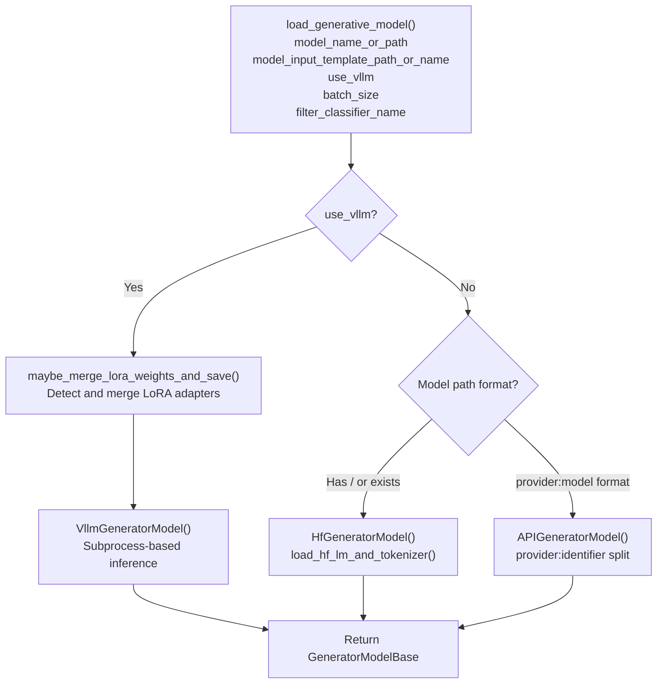
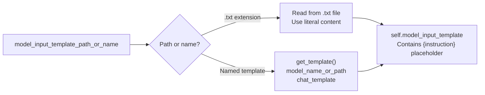
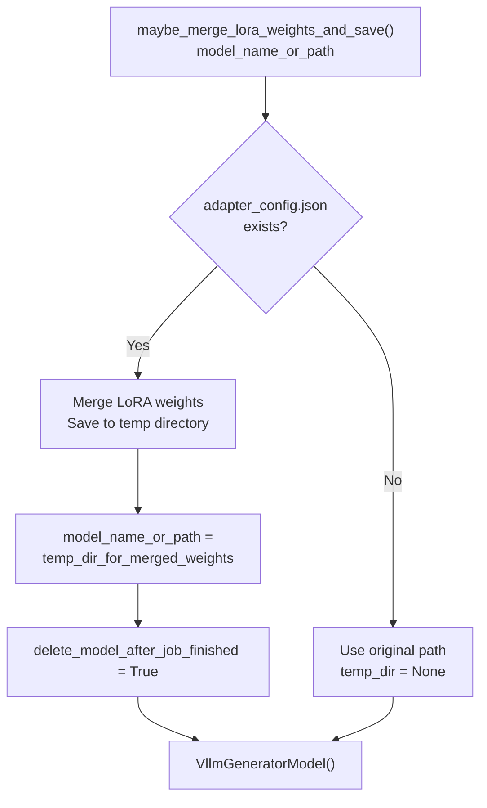
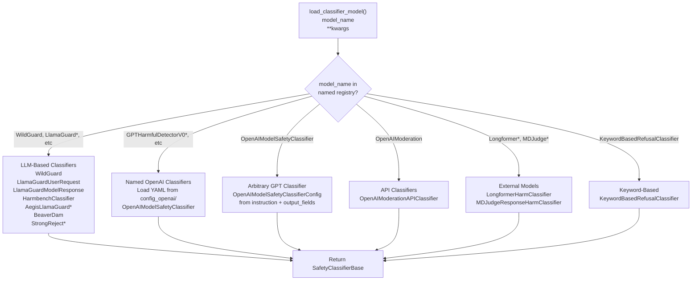
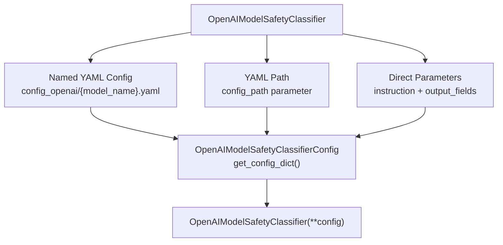
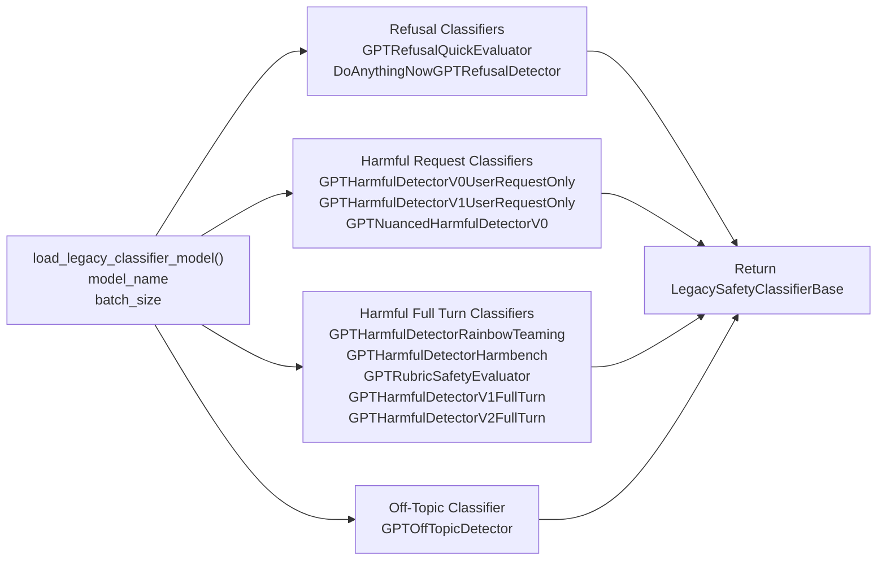
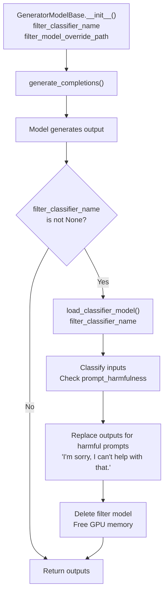

<!-- source: DeepWiki mcp.deepwiki.com · repo allenai/safety-eval · page 5.3 Model Loading and Configuration · fetched 2026-10-26 -->

# Model Loading and Configuration

<details>
<summary>Relevant source files</summary>

The following files were used as context for generating this wiki page:

- [README.md](README.md)
- [evaluation/models/__init__.py](evaluation/models/__init__.py)
- [evaluation/schemas.py](evaluation/schemas.py)
- [evaluation/tasks/generation/codex_eval/__init__.py](evaluation/tasks/generation/codex_eval/__init__.py)
- [evaluation/tasks/generation/do_anything_now/__init__.py](evaluation/tasks/generation/do_anything_now/__init__.py)
- [evaluation/tasks/generation/trustllm_jailbreaktrigger/__init__.py](evaluation/tasks/generation/trustllm_jailbreaktrigger/__init__.py)
- [evaluation/tasks/generation/trustllm_jailbreaktrigger/gpt4.yaml](evaluation/tasks/generation/trustllm_jailbreaktrigger/gpt4.yaml)
- [evaluation/tasks/generation/wildjailbreak/__init__.py](evaluation/tasks/generation/wildjailbreak/__init__.py)
- [evaluation/tasks/generation/xstest/exaggerated_safety.json](evaluation/tasks/generation/xstest/exaggerated_safety.json)
- [src/classifier_models/loader.py](src/classifier_models/loader.py)

</details>


## Purpose and Scope

This page documents the model loading infrastructure and configuration mechanisms used throughout the safety evaluation framework. It covers the factory patterns, type detection logic, and configuration systems for both generator models and classifier models.

For details on the specific generator model implementations (HfGeneratorModel, VllmGeneratorModel, APIGeneratorModel), see [Generator Models](#5.1). For details on classifier implementations, see [Safety Classifiers](#5.2) and its subsections.

## Generator Model Loading

### Factory Pattern: load_generative_model

The framework uses a factory pattern implemented in `load_generative_model()` to instantiate the appropriate generator model type based on the provided model identifier and configuration.



**Model Type Detection Flow**

Sources: [evaluation/models/__init__.py:12-78]()

The function implements the following detection logic:

| Condition | Model Type | Class Instantiated |
|-----------|------------|-------------------|
| `use_vllm=True` | vLLM-based inference | `VllmGeneratorModel` |
| Path contains `/` or exists locally | HuggingFace Transformers | `HfGeneratorModel` |
| Neither of above | API-based model | `APIGeneratorModel` |

### Template Configuration

Model input templates control how task data is formatted into prompts. Templates can be specified as either a file path or a template name.



**Template Loading Process**

Sources: [evaluation/schemas.py:46-54]()

Templates are loaded in the `GeneratorModelBase.__init__()` constructor:

- **File-based templates**: If the path ends with `.txt`, the file content is read directly
- **Named templates**: Otherwise, `get_template()` retrieves predefined templates from `src/templates/single_turn.py`

The template must contain placeholder fields matching the task's `required_input_fields()`, typically `{instruction}` for single-turn tasks.

### LoRA Adapter Handling

When using vLLM, the framework automatically detects and merges LoRA adapter weights before loading the model.



**LoRA Merge Process**

Sources: [evaluation/models/__init__.py:40-46]()

The merged weights are stored in a temporary directory and the model path is updated to point to this directory. The `delete_model_after_job_finished` flag is set to `True` to clean up after evaluation completes. For more details on LoRA adapter support, see [LoRA Adapter Support](#10.2).

### Generator Model Initialization Parameters

The following parameters are passed to generator model constructors:

| Parameter | Type | Purpose | Applicable To |
|-----------|------|---------|---------------|
| `model_name_or_path` | `str` | Model identifier or local path | All |
| `model_input_template_path_or_name` | `str` | Template file path or name | All |
| `hf_revision` | `str \| None` | HuggingFace revision/branch | HF, vLLM |
| `batch_size` | `int \| None` | Batch size for inference | HF, API |
| `filter_classifier_name` | `str \| None` | Optional pre/post filtering | All |
| `filter_model_override_path` | `str \| None` | Override path for filter model | All |
| `delete_model_after_job_finished` | `bool` | Cleanup flag for merged LoRA | vLLM only |

Sources: [evaluation/schemas.py:31-59](), [evaluation/models/__init__.py:12-78]()

## Classifier Model Loading

### Factory Pattern: load_classifier_model

Classifier models are loaded through a centralized factory function that maintains a registry of all available classifier types.



**Classifier Registry Architecture**

Sources: [src/classifier_models/loader.py:37-123]()

### Named Classifier Registry

The factory function maintains a hardcoded registry of classifier names mapped to their implementation classes:

**LLM-Based Classifiers:**
- `WildGuard` → `WildGuard`
- `LlamaGuardUserRequest` → `LlamaGuardUserRequest`
- `LlamaGuardModelResponse` → `LlamaGuardModelResponse`
- `LlamaGuard2` → `LlamaGuard2`
- `HarmbenchClassifier` → `HarmbenchClassifier`
- `HarmbenchValidationClassifier` → `HarmbenchValidationClassifier`
- `AegisLlamaGuardPermissive` → `AegisLlamaGuardPermissive`
- `AegisLlamaGuardDefensive` → `AegisLlamaGuardDefensive`
- `BeaverDam` → `BeaverDam`
- `sorrybench` → `SorryBenchClassifier`
- `StrongRejectClassifier` → `StrongRejectClassifier`
- `StrongRejectLogitClassifier` → `StrongRejectLogitClassifier`
- `StrongRejectLogProbs` → `StrongRejectLogProbs`
- `Qwen3MC` → `QwenMC`

**GPT-Based Classifiers:**
- Named configurations: `GPTHarmfulDetectorV0UserRequestOnly`, `GPTRefusalDetectorV0JSON`
- Generic configurations: Loaded via YAML or programmatic configuration

**API Classifiers:**
- `OpenAIModeration` → `OpenAIModerationAPIClassifier`

**External Models:**
- `LongformerHarmClassifier` → `LongformerHarmClassifier`
- `LongformerActionClassifier` → `LongformerActionClassifier`
- `MDJudgeResponseHarmClassifier` → `MDJudgeResponseHarmClassifier`

**Keyword-Based:**
- `KeywordBasedRefusalClassifier` → `KeywordBasedRefusalClassifier`

Sources: [src/classifier_models/loader.py:37-123]()

### Configuration-Based Loading for GPT Classifiers

OpenAI-based classifiers support three loading mechanisms:



**GPT Classifier Configuration Mechanisms**

Sources: [src/classifier_models/loader.py:73-104]()

1. **Named configurations**: For pre-defined classifier names in the `named_openai_classifiers` set, configurations are loaded from `config_openai/{model_name}.yaml`

2. **Path-based configurations**: Pass `config_path` kwarg to load from a custom YAML file

3. **Programmatic configurations**: Pass `instruction` and `output_fields` kwargs, or a pre-constructed `OpenAIModelSafetyClassifierConfig` object

### Legacy Classifier Support

The framework maintains backward compatibility through `load_legacy_classifier_model()` for older classifier implementations:



**Legacy Classifier Categories**

Sources: [src/classifier_models/loader.py:126-161]()

Legacy classifiers use the `LegacySafetyClassifierBase` interface and require conversion of input data via `convert_data_items_to_legacy_classifier_input()`, which transforms dict-based data items into `ConversationTurn` objects.

## Model Configuration in Task YAML Files

Task configuration files specify which models and classifiers to use for evaluation. The framework uses YAML files to define task-specific configurations.

### Task Configuration Structure

```yaml
task_class: TrustLLMJailbreakTriggerSubset
classifier_model_name: OpenInstructGPTJailbreakTriggerClassifier
hparams:
  max_new_tokens: 512
  temperature: 0.7
  top_p: 0.95
```

**Configuration Fields:**

| Field | Type | Purpose |
|-------|------|---------|
| `task_class` | `str` | Python class name for the task implementation |
| `classifier_model_name` | `str` | Name passed to `load_classifier_model()` |
| `hparams` | `dict` | Hyperparameter overrides for generation |

Sources: [evaluation/tasks/generation/trustllm_jailbreaktrigger/gpt4.yaml:1-6]()

### Hyperparameter Configuration

Tasks can specify default hyperparameters for model generation:

**Common Generation Hyperparameters:**

| Parameter | Type | Default | Purpose |
|-----------|------|---------|---------|
| `max_new_tokens` | `int` | Task-specific | Maximum tokens to generate |
| `temperature` | `float` | Task-specific | Sampling temperature |
| `top_p` | `float` | Task-specific | Nucleus sampling threshold |
| `repetition_penalty` | `float` | `None` | Repetition penalty (vLLM only) |
| `n` | `int` | `1` | Number of completions per prompt |
| `stop` | `str \| list[str]` | `None` | Stop sequences |

These parameters can be overridden at runtime via command-line arguments or the `hparam_overrides` parameter. See [Hyperparameter Overrides](#8.2) for details on override mechanisms.

Sources: [evaluation/schemas.py:76-96]()

## Model Filtering and Safety Guards

Generator models support optional pre- or post-generation filtering through classifier models:



**Filtering Implementation Details**

Sources: [evaluation/schemas.py:145-163](), [evaluation/schemas.py:255-286]()

The filtering mechanism:
1. Loads the specified classifier model after generation completes
2. Classifies inputs for prompt harmfulness or response harmfulness
3. Replaces outputs with a refusal message if harmful content is detected
4. Cleans up the classifier model to free GPU memory

This feature is used primarily for safety-aligned model evaluation where certain prompts should trigger refusals.

---

