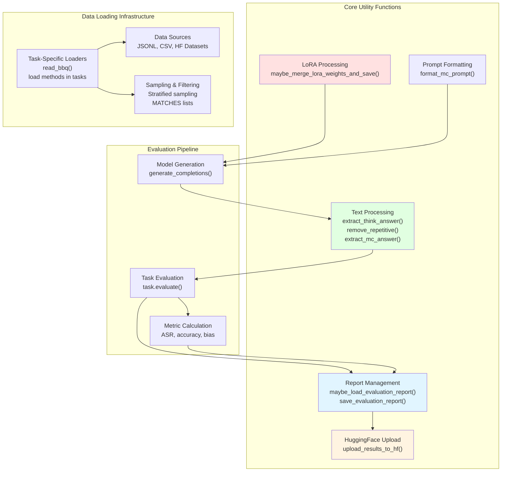
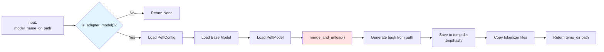
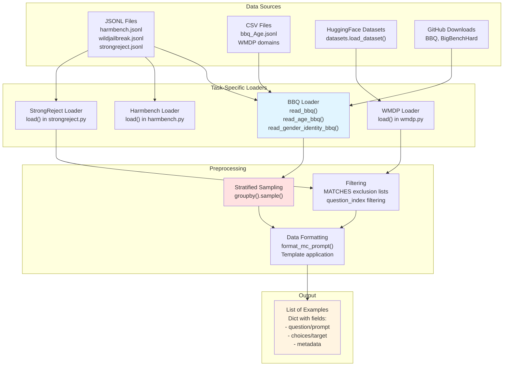
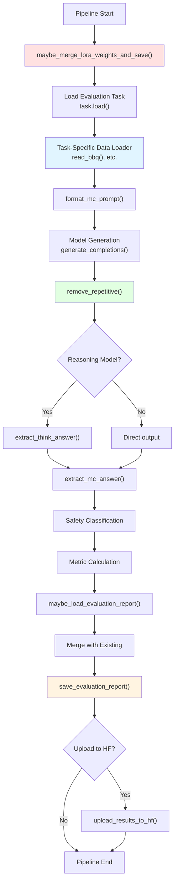

<!-- source: DeepWiki mcp.deepwiki.com · repo allenai/safety-eval · page 6 Data Processing and Utilities · fetched 2026-10-26 -->

# Data Processing and Utilities

<details>
<summary>Relevant source files</summary>

The following files were used as context for generating this wiki page:

- [evaluation/tasks/generation/bbq/load_bbq.py](evaluation/tasks/generation/bbq/load_bbq.py)
- [evaluation/utils.py](evaluation/utils.py)

</details>


## Purpose and Scope

This document describes the data processing infrastructure and utility functions that support the safety evaluation framework. The utilities layer provides essential services for managing evaluation reports, processing model outputs, loading datasets, and uploading results. These components are used throughout the evaluation pipeline to handle data transformations, state persistence, and result aggregation.

For detailed information on model loading and configuration, see [Model Loading and Configuration](#5.3). For information on how evaluations are orchestrated, see [Orchestration and Execution](#3.3).

This page provides an overview of the utility systems. For detailed documentation of specific utilities, see:
- [Core Utilities](#6.1) - Report management, LoRA merging, text processing
- [Data Loading Patterns](#6.2) - Dataset loading and preprocessing

## Overview

The data processing and utilities layer serves as the foundation for the evaluation pipeline, providing reusable functions for:

1. **Report Management**: Loading, saving, and merging evaluation reports
2. **Model Processing**: LoRA weight merging for adapter models
3. **Text Processing**: Answer extraction, repetition removal, tokenization
4. **Result Upload**: HuggingFace Hub integration
5. **Data Loading**: Task-specific dataset loaders with sampling and filtering
6. **Formatting**: Multiple-choice prompt formatting and answer extraction

The primary utilities module is located at [evaluation/utils.py](), which contains core functions used across all evaluation tasks.



**Utility Functions in the Evaluation Pipeline**

Sources: [evaluation/utils.py]()

## Core Utility Functions

The [evaluation/utils.py]() module provides essential utility functions organized into several categories:

### Report Management Functions

| Function | Purpose | Key Parameters |
|----------|---------|----------------|
| `maybe_load_evaluation_report()` | Load existing evaluation report or return empty dict | `report_output_path` |
| `save_evaluation_report()` | Save report with automatic directory creation and merging | `report_output_path`, `evaluation_report` |

The report management system implements incremental updates, allowing multiple evaluation runs to be merged into a single report without overwriting existing results.

**Report Loading Process:**
1. Check if report file exists at specified path
2. If exists, load with retry logic (3 attempts with 1-second delays)
3. Handle JSON decode errors gracefully
4. Return empty dict if file doesn't exist

**Report Saving Process:**
1. Create output directory if needed
2. Load existing report if present
3. Merge new results with existing (preserving existing keys)
4. Write updated report as formatted JSON

Sources: [evaluation/utils.py:12-62]()

### LoRA Weight Merging

The `maybe_merge_lora_weights_and_save()` function detects LoRA adapter models and merges them with their base models before evaluation.

**Workflow:**


**LoRA Weight Merging Process**

The function:
1. Checks if model is an adapter using `is_adapter_model()` from [src/generation_utils.py]()
2. Loads `PeftConfig` and base model
3. Applies adapter weights using `PeftModel.from_pretrained()`
4. Merges adapter into base with `merge_and_unload()`
5. Saves merged model to temporary directory with hash-based name
6. Copies tokenizer files to temporary directory

Sources: [evaluation/utils.py:64-94]()

### Text Processing Functions

The utilities module provides several text processing functions for handling model outputs:

#### Answer Extraction from Reasoning Models

`extract_think_answer()` extracts reasoning and answer components from models that use `` tag to separate reasoning from answer
- Remove `<think>`, `<answer>`, and `</answer>` tags
- Handle cases where think tags are absent
- Return separate lists of reasonings and answers

Sources: [evaluation/utils.py:128-174]()

#### Repetition Removal and Truncation

`remove_repetitive()` handles token length limits and truncation for long outputs.

**Parameters:**
- `inputs`: List of completions
- `thinker_eval`: Whether model uses think/answer structure
- `flex`: Flexible parsing flag
- `limit`: Maximum token length (default 30000)

**Processing:**
1. Tokenize using `allenai/wildguard` tokenizer
2. For non-reasoning models: truncate completions exceeding limit
3. For reasoning models: separately truncate reasoning and answer sections
4. Track truncation errors (`"completions"`, `"reasonings"`, `"answers"`, `"both"`)
5. Return processed texts and error tracking list

Sources: [evaluation/utils.py:176-228]()

#### Multiple-Choice Prompt Formatting

`format_mc_prompt()` creates standardized multiple-choice prompts with configurable formatting.

**Parameters:**
- `question_format`: Format type (returns plain question if `"OpenEnded"`)
- `question`: Question text
- `choices`: List of answer choices
- `question_prefix`, `choices_prefix`, `answer_prefix`: Section prefixes
- `label_format`: Template for choice labels (must contain 'A')

**Output Format:**
```
{question_prefix}{question}
{choices_prefix}(a) Choice 1
(b) Choice 2
(c) Choice 3
{answer_prefix}
```

Sources: [evaluation/utils.py:231-257]()

#### Multiple-Choice Answer Extraction

`extract_mc_answer()` uses regex patterns to extract answer choices from free-form model outputs.

**Pattern Hierarchy** (applied in order):
1. "Therefore, the answer is ..." style
2. "So the answer is ..." style
3. "The correct answer is:" style
4. "The answer is ..." with period
5. "A: ..." style
6. "Answer: ..." style
7. "... is correct" style
8. Parenthesized answer `(a)`
9. Boxed answer `\boxed{a}`
10. Answer as standalone word
11. Answer anywhere in text

**Return Value:**
```python
{
    "answer_choice": "a",  # Extracted choice (or "is_parsing_error")
    "pattern": "Answer: ... style",  # Matching pattern
    "full extract": "..."  # Original response
}
```

Sources: [evaluation/utils.py:260-313]()

### HuggingFace Upload

`upload_results_to_hf()` uploads evaluation results to HuggingFace Hub datasets.

**Parameters:**
- `results_dict`: Dictionary containing evaluation results
- `hf_dataset_name`: Target dataset repository
- `hf_dataset_save_dir`: Directory path within dataset
- `task_name`: Name of evaluation task
- `primary_score`: Primary metric value
- `prepend_timestamp`: Whether to add timestamp to filename

**Process:**
1. Add `task_name` and `primary_score` to results dict
2. Generate filename (with optional timestamp prefix)
3. Write results to temporary `results.json`
4. Upload to HuggingFace Hub using `HfApi`
5. Remove temporary file

The function requires `HF_TOKEN` environment variable for authentication.

Sources: [evaluation/utils.py:96-126]()

## Data Loading Infrastructure



**Data Loading Architecture**

Sources: [evaluation/tasks/generation/bbq/load_bbq.py]()

### Task-Specific Loaders

Each evaluation task implements a custom loader that handles the specific format and preprocessing requirements of its dataset. These loaders follow common patterns:

**Common Loading Pattern:**
1. Locate data files relative to task directory
2. Read and parse data (JSON, JSONL, CSV, or HuggingFace dataset)
3. Transform into standardized example format
4. Apply filtering to exclude problematic examples
5. Perform stratified sampling if requested
6. Return list of example dictionaries

### BBQ Data Loading Example

The BBQ (Bias Benchmark for QA) loader demonstrates sophisticated preprocessing with stratified sampling across multiple demographic categories.

**BBQ Categories:**
- Age
- Disability Status
- Nationality
- Physical Appearance
- Religion
- Socioeconomic Status (SES)
- Sexual Orientation
- Gender Identity
- Race/Ethnicity

Each category loader (e.g., `read_age_bbq()`, `read_gender_identity_bbq()`) implements:

**Preprocessing Steps:**
1. Load category-specific JSONL file
2. Extract question, context, and answer choices
3. Identify stereotyped groups from metadata
4. Determine if stereotype is correct answer
5. Apply exclusion lists for problematic examples
6. Perform stratified sampling by:
   - `question_polarity` (negative/non-negative)
   - `context_condition` (ambiguous/disambiguous)
   - `stereotype_correct` (boolean)
7. Target 500 examples per category (using fractional sampling)

**Example Structure:**
```python
{
    "question": "Context text. Question text?",
    "choices": ["Answer 0", "Answer 1", "Answer 2"],
    "question_polarity": "neg",
    "context_condition": "ambig",
    "category": "Age",
    "subcategory": ["old"],
    "full_choices": [
        {"text": "...", "bias": True, "unknown": False, "correct": False},
        {"text": "...", "bias": False, "unknown": False, "correct": True},
        {"text": "...", "bias": False, "unknown": True, "correct": False}
    ],
    "stereotype_correct": False
}
```

Sources: [evaluation/tasks/generation/bbq/load_bbq.py:8-378]()

### Sampling Strategies

The framework employs stratified sampling to ensure balanced evaluation across important dimensions:

**Stratified Sampling Implementation:**
```python
df.groupby(["question_polarity", "context_condition", "stereotype_correct"]).sample(
    frac=target_count / len(examples), 
    random_state=42
)
```

This ensures:
- Consistent random sampling across runs (fixed seed)
- Balanced representation of ambiguous/disambiguous contexts
- Equal representation of positive/negative polarity questions
- Balanced distribution of stereotype-correct/incorrect examples

**Sampling Parameters:**
- `sample`: Boolean flag to enable sampling (passed to loader functions)
- `frac`: Calculated fraction to achieve target sample size
- `random_state=42`: Fixed seed for reproducibility

Sources: [evaluation/tasks/generation/bbq/load_bbq.py:38-41](), [evaluation/tasks/generation/bbq/load_bbq.py:73-75]()

## Integration with Evaluation Pipeline

The utilities and data loading functions integrate into the evaluation pipeline at specific stages:



**Utility Function Integration Points**

Sources: [evaluation/utils.py]()

### Error Tracking

The text processing utilities track various error conditions during evaluation:

| Error Type | Description | Source Function |
|------------|-------------|-----------------|
| `"completions"` | Completion truncated due to length | `remove_repetitive()` |
| `"reasonings"` | Reasoning section truncated | `remove_repetitive()` |
| `"answers"` | Answer section truncated | `remove_repetitive()` |
| `"both"` | Both reasoning and answer truncated | `remove_repetitive()` |
| `"is_parsing_error"` | Failed to extract answer from output | `extract_mc_answer()` |
| `False` | No errors detected | All processing functions |

These error indicators are preserved in individual results for downstream analysis and filtering.

Sources: [evaluation/utils.py:181-227](), [evaluation/utils.py:309-311]()

### Report Structure

Evaluation reports follow a standardized structure:

**metrics.json:**
```json
{
    "task_name": {
        "metric_name": value,
        "asr": 0.123,
        "accuracy": 0.789
    }
}
```

**all.json (individual results):**
```json
[
    {
        "prompt": "...",
        "completion": "...",
        "prediction": "...",
        "ground_truth": "...",
        "correct": true,
        "error": false
    }
]
```

The report management system automatically merges results from multiple evaluation runs, preserving existing task results while adding new ones.

Sources: [evaluation/utils.py:40-62]()

## Summary

The data processing and utilities layer provides:

1. **Robust Report Management**: Incremental updates, automatic merging, retry logic
2. **Model Preprocessing**: Automatic LoRA adapter merging for evaluation
3. **Text Processing**: Answer extraction, truncation handling, repetition removal
4. **Standardized Data Loading**: Task-specific loaders with consistent interfaces
5. **Sampling and Filtering**: Stratified sampling for balanced evaluation
6. **Result Export**: HuggingFace Hub integration for result sharing

These utilities are used throughout the evaluation pipeline to ensure consistent data handling, state management, and result tracking across all evaluation tasks and model types.

Sources: [evaluation/utils.py](), [evaluation/tasks/generation/bbq/load_bbq.py]()

---

