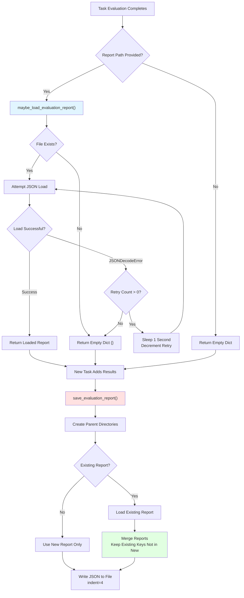
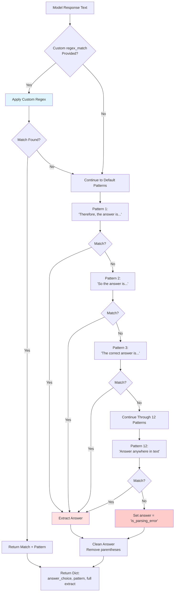
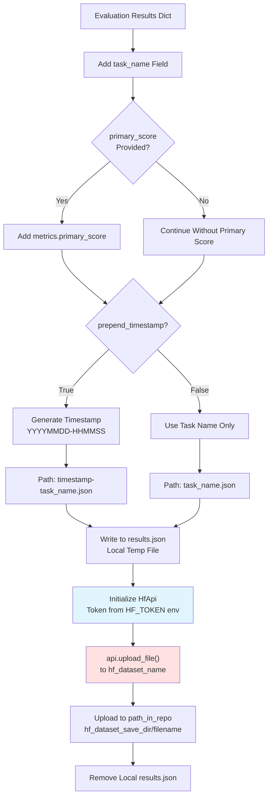
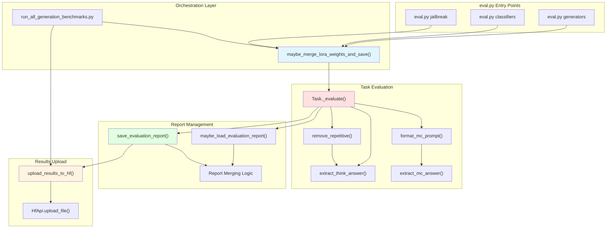

<!-- source: DeepWiki mcp.deepwiki.com · repo allenai/safety-eval · page 6.1 Core Utilities · fetched 2026-10-26 -->

# Core Utilities

<details>
<summary>Relevant source files</summary>

The following files were used as context for generating this wiki page:

- [evaluation/utils.py](evaluation/utils.py)

</details>


## Purpose and Scope

This page documents the core utility functions in [evaluation/utils.py]() that support the evaluation framework. These utilities provide four primary categories of functionality:

1. **Report Management**: Loading, saving, and merging evaluation reports with incremental update support
2. **LoRA Adapter Support**: Detection and merging of LoRA adapter weights into base models
3. **Text Processing**: Extraction of answers from reasoning models, multiple-choice response parsing, and output cleanup
4. **HuggingFace Hub Integration**: Uploading evaluation results to HuggingFace datasets

For information about how these utilities are used in the evaluation pipeline, see [Data Processing and Utilities](#6). For details on GPU orchestration that uses these utilities, see [GPU Task Orchestration](#10.1).

---

## Report Management System

The framework maintains evaluation reports as JSON files containing metrics and individual results. The report management system supports incremental updates, allowing tasks to save their results without overwriting other tasks' data.

### Core Functions

| Function | Purpose | Key Features |
|----------|---------|--------------|
| `maybe_load_evaluation_report()` | Load existing report or return empty dict | Retry logic for concurrent access, handles missing files |
| `save_evaluation_report()` | Save report with incremental merge | Preserves existing keys, creates directories automatically |

### Report Loading with Retry Logic

The `maybe_load_evaluation_report()` function implements retry logic to handle concurrent file access scenarios common in multi-GPU evaluation:

[evaluation/utils.py:12-37]()

**Key implementation details**:
- Returns empty dictionary if path is `None` or file doesn't exist
- Implements 3-retry mechanism with 1-second delays for `JSONDecodeError`
- Handles race conditions when multiple processes access the same report file

### Report Saving with Incremental Merge

The `save_evaluation_report()` function merges new results with existing reports, enabling parallel task execution:

[evaluation/utils.py:40-61]()

**Merge behavior**:
- Loads existing report if present at `report_output_path`
- Preserves all keys from existing report that aren't in new `evaluation_report`
- New keys in `evaluation_report` take precedence over existing keys
- Creates parent directories automatically using `os.makedirs()`

### Report Management Flow



**Sources**: [evaluation/utils.py:12-61]()

---

## LoRA Adapter Support

The framework automatically detects and merges LoRA adapter models, converting them to full models before evaluation. This process is transparent to the evaluation tasks.

### LoRA Merging Function

The `maybe_merge_lora_weights_and_save()` function handles the complete LoRA adapter workflow:

[evaluation/utils.py:64-94]()

### LoRA Detection and Merging Process

```mermaid
flowchart LR
    A["Model Path Input"] --> B["is_adapter_model()<br/>Check for adapter_config.json"]
    
    B --> C{"Is Adapter Model?"}
    C -->|"No"| D["Return None<br/>Use Original Path"]
    
    C -->|"Yes"| E["Load PeftConfig<br/>Get base_model_name_or_path"]
    E --> F["Load Base Model<br/>AutoModelForCausalLM"]
    F --> G["Load Adapter Weights<br/>PeftModel.from_pretrained()"]
    
    G --> H["model.merge_and_unload()<br/>Merge LoRA into Base"]
    H --> I["Set generation_config.do_sample=True"]
    
    I --> J["Generate Hash Name<br/>SHA1 of model path"]
    J --> K["Create Temp Directory<br/>.tmp/hash_name/"]
    
    K --> L["Save Merged Model<br/>model.save_pretrained()"]
    L --> M["Save Tokenizer<br/>tokenizer.save_pretrained()"]
    
    M --> N["Copy Additional Tokenizer Files<br/>token* files from original path"]
    N --> O["Return Temp Directory Path"]
    
    D --> P["Evaluation Proceeds"]
    O --> P
    
    style B fill:#e1f5ff
    style H fill:#ffe1e1
    style K fill:#fff4e1
```



**Sources**: [evaluation/utils.py:64-94](), [src/generation_utils.py:is_adapter_model()]()

### Temporary Directory Management

The merged model is saved to a temporary directory with a deterministic hash-based name:

| Component | Implementation | Purpose |
|-----------|---------------|---------|
| Hash Generation | `hashlib.sha1(path).hexdigest() % (10**8)` | Creates unique 8-digit identifier |
| Directory Location | `evaluation/.tmp/{hash_name}/` | Stores merged weights temporarily |
| File Copying | `os.system("cp -r {path} {temp_dir}")` | Copies tokenizer files from original path |

**Cleanup**: Temporary directories are cleaned up by the orchestration scripts after evaluation completes.

**Sources**: [evaluation/utils.py:80-90]()

---

## Text Processing Utilities

The framework provides specialized text processing functions for extracting structured information from model outputs, handling multiple-choice questions, and processing reasoning traces.

### Think-Answer Extraction

The `extract_think_answer()` function parses DeepSeek-R1 style reasoning outputs with `'<br/>reasoning = before<br/>answer = after"]
    E -->|"No"| G["reasoning = ''<br/>answer = full text"]
    
    D --> H{"Contains '</think>'?"}
    H -->|"Yes"| I["Split on '</think>'<br/>reasoning = before<br/>answer = after"]
    H -->|"No"| J["No answer tag<br/>reasoning = full text<br/>answer = ''"]
    
    F --> K["Strip Tag Prefixes<br/>Remove '<think>', '<answer>'"]
    G --> K
    I --> K
    J --> K
    
    K --> L["Strip Tag Suffixes<br/>Remove '</answer>'"]
    L --> M["Return Lists:<br/>reasonings, answers"]
    
    style E fill:#e1f5ff
    style K fill:#ffe1e1
```

**Tag handling rules**:
- Strips leading `<think>` (8 characters) from reasoning
- Strips leading `<answer>` (9 characters) from answer
- Strips trailing `</answer>` (9 characters) from answer
- In flex mode, treats untagged output as answer only
- In strict mode, treats untagged output as reasoning only

**Sources**: [evaluation/utils.py:128-174]()

### Repetition Removal and Truncation

The `remove_repetitive()` function handles token length limits and extracts reasoning/answer pairs:

[evaluation/utils.py:176-228]()

**Processing logic**:

| Model Type | Processing Strategy | Token Limit |
|------------|---------------------|-------------|
| Non-reasoning (`thinker_eval=None`) | Truncate completions directly | 30,000 tokens |
| Reasoning models | Extract reasoning/answer separately, truncate each | 30,000 per component |

**Error tracking**:
- Returns list of error flags for each example
- Error values: `False`, `"completions"`, `"reasonings"`, `"answers"`, `"both"`
- Uses `allenai/wildguard` tokenizer for token counting

### Multiple Choice Processing

The framework provides two functions for multiple-choice question handling:

#### Format MC Prompt

The `format_mc_prompt()` function creates standardized multiple-choice prompts:

[evaluation/utils.py:231-257]()

**Parameters**:

| Parameter | Type | Purpose | Example |
|-----------|------|---------|---------|
| `question_format` | str | Format mode | `"OpenEnded"` returns question only |
| `question` | str | Question text | `"What is the capital of France?"` |
| `choices` | list | Answer options | `["Paris", "London", "Berlin", "Madrid"]` |
| `question_prefix` | str | Text before question | `"Question: "` |
| `choices_prefix` | str | Text before choices | `"Choices:\n"` |
| `answer_prefix` | str | Text before answer | `"Answer: "` |
| `label_format` | str | Label template | `"(A)"` where A is replaced |

**Output format example**:
```
Question: What is the capital of France?
Choices:
(a) Paris
(b) London
(c) Berlin
(d) Madrid
Answer: 
```

#### Extract MC Answer

The `extract_mc_answer()` function parses model responses using a cascade of regex patterns:

[evaluation/utils.py:260-313]()

### Answer Extraction Pattern Cascade



**Default pattern list** [evaluation/utils.py:265-278]():
1. `"Therefore, the answer is..."` style
2. `"So the answer is..."` style
3. `"The correct answer is:"` style
4. `"The answer is..."` with period
5. `"A: ..."` style
6. `"Answer: ..."` style
7. `"... is correct"` style
8. Parenthesized answer `(a)`
9. Boxed answer `\boxed{a}`
10. Answer as word in sentence
11. Just the answer itself
12. Answer anywhere in text

**Pattern selection**:
- Parameter `last=True`: Uses last occurrence of pattern match
- Parameter `last=False`: Uses first occurrence
- Pattern supports 3 or 4 choices via `num_choices` parameter

**Sources**: [evaluation/utils.py:231-313]()

---

## HuggingFace Hub Integration

The `upload_results_to_hf()` function uploads evaluation results to HuggingFace Hub datasets following the oe-eval standards:

[evaluation/utils.py:96-126]()

### Upload Process Flow



**Sources**: [evaluation/utils.py:96-126]()

### Upload Configuration

| Parameter | Type | Required | Purpose |
|-----------|------|----------|---------|
| `results_dict` | dict | Yes | Complete evaluation results |
| `hf_dataset_name` | str | Yes | Target dataset repo (e.g., `"org/dataset"`) |
| `hf_dataset_save_dir` | str | Yes | Directory path within dataset repo |
| `task_name` | str | No | Added as `task_name` field in results |
| `primary_score` | float | No | Added as `metrics.primary_score` |
| `prepend_timestamp` | bool | No | Prefixes filename with timestamp |

**Authentication**: Requires `HF_TOKEN` environment variable containing a HuggingFace API token with write access to the target dataset.

**File naming examples**:
- Without timestamp: `save_dir/strongreject.json`
- With timestamp: `save_dir/20240315-143022-strongreject.json`

**Sources**: [evaluation/utils.py:96-126]()

---

## Integration with Evaluation Pipeline

These utilities are used throughout the evaluation pipeline at key points:

### Utility Usage Map



**Key integration points**:

1. **LoRA Merging**: Called by all evaluation entry points and orchestration scripts before model loading
2. **Text Processing**: Used within task `_evaluate()` methods for output parsing and cleanup
3. **Report Management**: Used at start (load) and end (save) of each task evaluation
4. **Upload**: Called after evaluation completion for individual tasks or batch results

**Sources**: [evaluation/utils.py](), [evaluation/eval.py](), [evaluation/run_all_generation_benchmarks.py]()

---

