<!-- source: DeepWiki mcp.deepwiki.com · repo allenai/safety-eval · page 7 Running Evaluations · fetched 2026-10-26 -->

# Running Evaluations

<details>
<summary>Relevant source files</summary>

The following files were used as context for generating this wiki page:

- [README.md](README.md)
- [evaluation/eval.py](evaluation/eval.py)
- [evaluation/models/__init__.py](evaluation/models/__init__.py)
- [evaluation/run_all_generation_benchmarks.py](evaluation/run_all_generation_benchmarks.py)
- [evaluation/tasks/__init__.py](evaluation/tasks/__init__.py)
- [evaluation/tasks/generation/do_anything_now/__init__.py](evaluation/tasks/generation/do_anything_now/__init__.py)
- [evaluation/tasks/generation/trustllm_jailbreaktrigger/__init__.py](evaluation/tasks/generation/trustllm_jailbreaktrigger/__init__.py)
- [evaluation/tasks/generation/trustllm_jailbreaktrigger/gpt4.yaml](evaluation/tasks/generation/trustllm_jailbreaktrigger/gpt4.yaml)
- [evaluation/tasks/generation/wildjailbreak/__init__.py](evaluation/tasks/generation/wildjailbreak/__init__.py)
- [evaluation/tasks/generation/xstest/exaggerated_safety.json](evaluation/tasks/generation/xstest/exaggerated_safety.json)

</details>


This page provides a practical guide to executing safety evaluations using the framework's command-line interface. It covers three primary evaluation modes: generator model evaluation, classifier model evaluation, and adversarial jailbreak evaluation. Each mode uses the `eval.py` entry point with different command structures and parameters.

For configuration details about YAML files and hyperparameter overrides, see [Configuration System](#8). For details about the task system architecture, see [Task System](#3.2). For understanding evaluation outputs and metrics, see [Results and Metrics](#9).

## Evaluation Modes Overview

The framework provides three evaluation modes through the `eval.py` script, each targeting different evaluation scenarios:

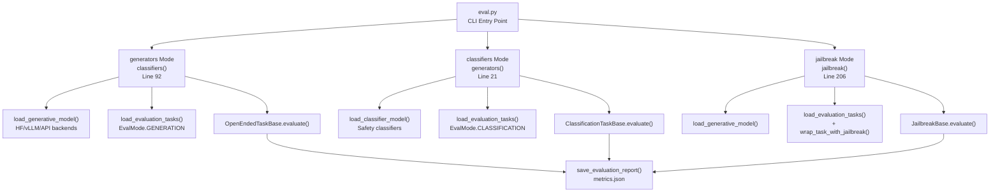

**Sources:** [evaluation/eval.py:1-316](), [evaluation/tasks/__init__.py:1-99]()

## Command-Line Interface Structure

All evaluation commands follow a consistent structure. The basic syntax is:

```bash
python evaluation/eval.py <mode> <mode-specific-arguments>
```

### Common Parameters Across Modes

| Parameter | Type | Description |
|-----------|------|-------------|
| `--tasks` | string | Comma-separated task list. Format: `task_name` or `task_name:config_name` |
| `--report_output_path` | string | Path to save aggregated metrics JSON file |
| `--save_individual_results_path` | string | Path to save per-example predictions JSON file |
| `--override_existing_report` | bool | Whether to re-run already completed tasks |

### Task Specification Format

Tasks are specified using the format `<folder>:<config_yaml>`:
- `folder`: Directory under `evaluation/tasks/generation/` or `evaluation/tasks/classification/`
- `config_yaml`: YAML filename (without `.yaml` extension)
- If no config specified, defaults to `default.yaml`

**Example task specifications:**
```bash
--tasks wildguardtest                    # Uses wildguardtest/default.yaml
--tasks wildguardtest:default            # Explicit default config
--tasks harmbench:wildguard_reasoning_answer  # Uses specific config
--tasks toxigen:tiny,bbq:default         # Multiple tasks
```

**Sources:** [evaluation/eval.py:92-107](), [evaluation/tasks/__init__.py:16-71](), [README.md:91-123]()

## Single Task Evaluation

Single task evaluation executes one or more evaluation tasks sequentially using the `eval.py` script. This is the primary interface for running evaluations on individual models.

### Generator Evaluation

The `generators` mode evaluates generative language models on safety and capability benchmarks.

```mermaid
graph LR
    CLI["python eval.py generators"]
    
    Args["Command Arguments<br/>model_name_or_path<br/>model_input_template<br/>tasks<br/>use_vllm"]
    
    ModelLoad["load_generative_model()<br/>Line 164-172"]
    
    TaskLoad["load_evaluation_tasks()<br/>EvalMode.GENERATION<br/>Line 173-175"]
    
    Loop["For each task<br/>Line 179-187"]
    
    Validate["task.validate_if_model_is_compatible()<br/>Line 184"]
    
    Evaluate["task.evaluate(model)<br/>Returns report, individual_results<br/>Line 185"]
    
    Save["save_evaluation_report()<br/>Line 189-191"]
    
    CLI --> Args
    Args --> ModelLoad
    ModelLoad --> TaskLoad
    TaskLoad --> Loop
    Loop --> Validate
    Validate --> Evaluate
    Evaluate --> Save
```

#### Basic Generator Command

```bash
python evaluation/eval.py generators \
  --model_name_or_path allenai/tulu-2-dpo-7b \
  --model_input_template_path_or_name tulu2 \
  --tasks wildguardtest,harmbench,toxigen:tiny \
  --report_output_path ./results/metrics.json \
  --save_individual_results_path ./results/all.json
```

#### Generator-Specific Parameters

| Parameter | Type | Description |
|-----------|------|-------------|
| `--model_name_or_path` | string | Model identifier (HF hub name, local path, or `provider:model` for APIs) |
| `--model_input_template_path_or_name` | string | Chat template name (e.g., `tulu2`) or path to `.txt` file |
| `--use_vllm` | bool | Enable vLLM inference engine for high-throughput batching |
| `--batch_size` | int | Batch size for generation (auto-determined if using vLLM) |
| `--filter_classifier_name` | string | Classifier for pre-filtering harmful prompts |
| `--filter_model_override_path` | string | Local path for filter classifier model |
| `--hf_revision` | string | HuggingFace model revision/branch (default: `main`) |
| `--limit` | bool | Limit to 5 examples per task for quick testing |
| `--flex` | bool | Enable flexible parsing for reasoning traces |
| `--hparam_overrides` | dict | Override `max_new_tokens`, `temperature`, `top_p` |

#### Model Backend Selection

The framework automatically selects the appropriate backend based on `model_name_or_path`:

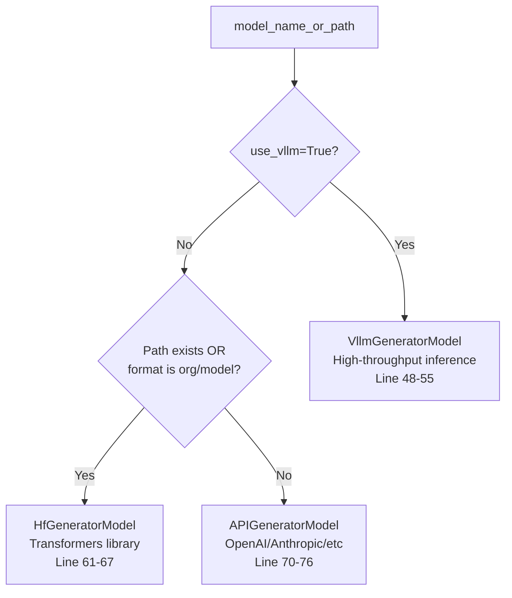

**Sources:** [evaluation/eval.py:92-204](), [evaluation/models/__init__.py:12-79](), [README.md:96-123]()

#### API Model Example

```bash
python evaluation/eval.py generators \
  --model_name_or_path openai:gpt-4 \
  --model_input_template_path_or_name None \
  --tasks wildguardtest,harmbench \
  --report_output_path ./results/gpt4_metrics.json \
  --save_individual_results_path ./results/gpt4_all.json
```

#### Reasoning Model Evaluation

For models that produce explicit reasoning traces (e.g., using `<think>` tags), use reasoning-specific task configs:

```bash
python evaluation/eval.py generators \
  --use_vllm \
  --model_name_or_path allenai/tulu-2-dpo-7b \
  --model_input_template_path_or_name tulu2 \
  --tasks wildguardtest:wildguard_reasoning_answer,harmbench:wildguard_reasoning_answer \
  --report_output_path ./results/metrics.json \
  --save_individual_results_path ./results/all.json
```

The `thinker_eval` configuration in task YAML files controls how reasoning traces are processed:
- `["answers"]`: Evaluate only the answer portion after splitting
- `["reasonings"]`: Evaluate only the reasoning portion
- `["reasonings", "answers"]`: Evaluate both separately

**Sources:** [README.md:72-123](), [evaluation/eval.py:92-204]()

### Classifier Evaluation

The `classifiers` mode evaluates safety classifier models on prompt harmfulness, response harmfulness, and refusal detection tasks.

```mermaid
graph LR
    CLI["python eval.py classifiers"]
    
    Args["Command Arguments<br/>model_name<br/>tasks<br/>override_model_path"]
    
    ModelLoad["load_classifier_model()<br/>Line 59"]
    
    TaskLoad["load_evaluation_tasks()<br/>EvalMode.CLASSIFICATION<br/>Line 64-66"]
    
    Loop["For each task<br/>Line 70-81"]
    
    Validate["task.validate_if_model_is_compatible()<br/>Line 76"]
    
    Evaluate["task.evaluate(model)<br/>Line 77"]
    
    Save["save_evaluation_report()<br/>Line 83-85"]
    
    CLI --> Args
    Args --> ModelLoad
    ModelLoad --> TaskLoad
    TaskLoad --> Loop
    Loop --> Validate
    Validate --> Evaluate
    Evaluate --> Save
```

#### Basic Classifier Command

```bash
python evaluation/eval.py classifiers \
  --model_name WildGuard \
  --tasks wildguardtest_prompt,wildguardtest_response,wildguardtest_refusal \
  --report_output_path ./results/classifier_metrics.json \
  --save_individual_results_path ./results/classifier_all.json
```

#### Classifier-Specific Parameters

| Parameter | Type | Description |
|-----------|------|-------------|
| `--model_name` | string | Classifier name (e.g., `WildGuard`, `LlamaGuard`, `OpenAIModerationAPI`) |
| `--override_model_path` | string | Local path to override classifier model location |

**Sources:** [evaluation/eval.py:21-90](), [README.md:160-183]()

### Evaluation Workflow

Both generator and classifier evaluation follow the same workflow pattern:

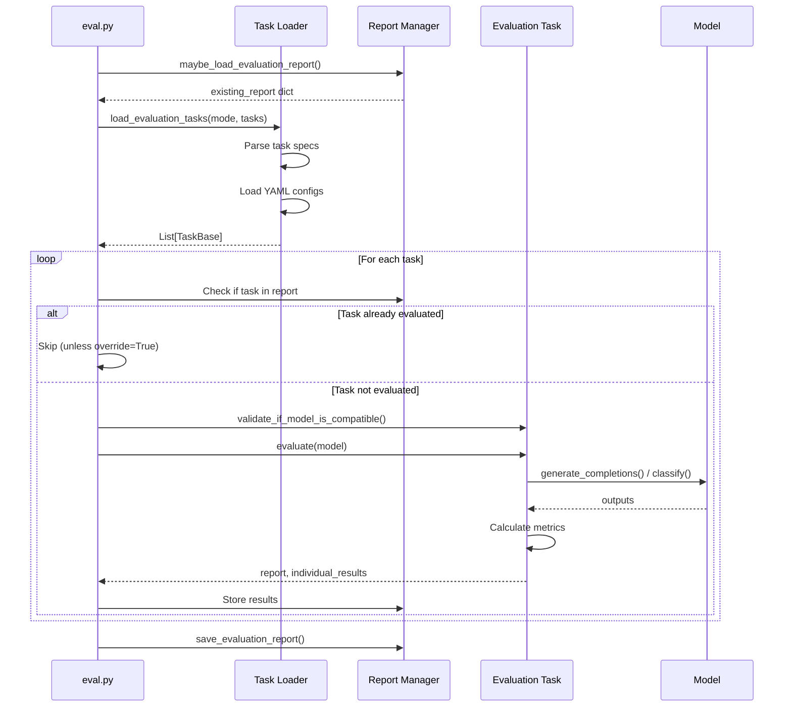

**Sources:** [evaluation/eval.py:67-89](), [evaluation/eval.py:176-191](), [evaluation/utils.py]()

## Batch Evaluation with GPU Orchestration

The `run_all_generation_benchmarks.py` script provides parallel execution of multiple evaluation tasks across multiple GPUs with automatic task queuing and GPU allocation.

### GPU Task Orchestration Architecture

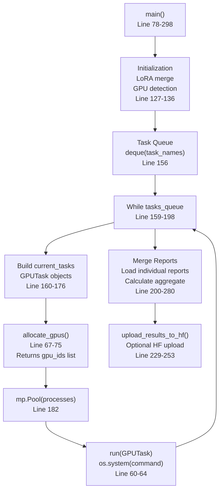

### GPUTask Data Structure

The orchestration system uses the `GPUTask` dataclass to encapsulate task execution details:

```python
@dataclass
class GPUTask:
    task_name: str              # e.g., "wildjailbreak:harmful"
    gpu_ids: list[int]          # e.g., [0, 1]
    script_format: str          # Command template with placeholders
    hparam_overrides: str       # JSON string of hyperparameter overrides
```

**Sources:** [evaluation/run_all_generation_benchmarks.py:53-64]()

### GPU Allocation Strategy

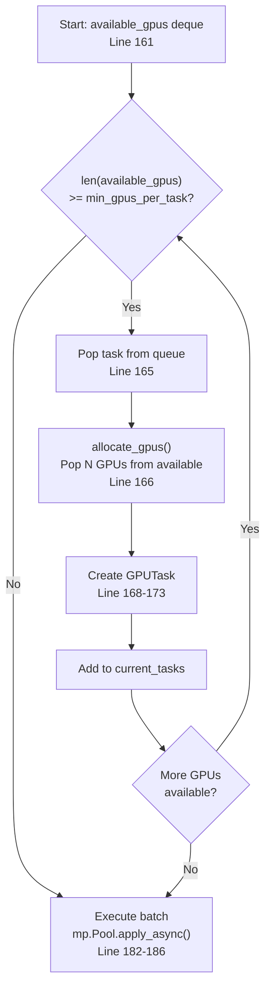

Each task gets `min_gpus_per_task` GPUs (default: 2). The system creates batches of tasks that can run concurrently with available GPUs, then waits for completion before starting the next batch.

**Sources:** [evaluation/run_all_generation_benchmarks.py:67-76](), [evaluation/run_all_generation_benchmarks.py:159-198]()

### Basic Batch Evaluation Command

```bash
export CUDA_VISIBLE_DEVICES=0,1,2,3
python evaluation/run_all_generation_benchmarks.py \
    --model_name_or_path allenai/tulu-2-dpo-7b \
    --model_input_template_path_or_name tulu2 \
    --report_output_path ./results/metrics.json \
    --save_individual_results_path ./results/all.json
```

### Batch Evaluation Parameters

| Parameter | Type | Default | Description |
|-----------|------|---------|-------------|
| `--model_name_or_path` | string | Required | Model identifier or path |
| `--model_input_template_path_or_name` | string | Required | Chat template name |
| `--report_output_path` | string | Required | Aggregated metrics output path |
| `--save_individual_results_path` | string | Required | Per-example results output path |
| `--min_gpus_per_task` | int | 2 | Minimum GPUs allocated per task |
| `--hf_revision` | string | "main" | HuggingFace model revision |
| `--task_names` | list | See below | List of tasks to evaluate |
| `--upload_to_hf` | string | None | HuggingFace dataset repo for results |
| `--hf_upload_name` | string | None | Name for HuggingFace upload |
| `--filter_classifier_name` | string | None | Safety filter classifier |
| `--limit` | string | None | Limit to 5 examples ("true" to enable) |
| `--flex` | string | None | Flexible reasoning parsing ("true" to enable) |
| `--hparam_overrides` | string | None | JSON string of hyperparameter overrides |

**Sources:** [evaluation/run_all_generation_benchmarks.py:78-152]()

### Predefined Task Suites

The script defines three predefined task suites for common evaluation scenarios:

```python
NON_REASONING_EVALS = [
    "wildjailbreak:harmful",
    "wildguardtest:default",
    "harmbench:default",
    "xstest:default",
    "wildjailbreak:benign",
    "do_anything_now:default",
    "trustllm_jailbreaktrigger:default"
]

REASONING_EVALS = [
    "wildjailbreak:harmful_wildguard_reasoning_answer",
    "wildguardtest:wildguard_reasoning_answer",
    "harmbench:wildguard_reasoning_answer",
    "xstest:wildguard_reasoning_answer",
    "wildjailbreak:benign_wildguard_reasoning_answer",
    "do_anything_now:wildguard_reasoning_answer",
    "trustllm_jailbreaktrigger:wildguard_reasoning_answer"
]

REASONING_EVALS_FULL = [
    "wildjailbreak:harmful_wildguard_reasoning",
    "wildguardtest:wildguard_reasoning",
    "harmbench:wildguard_reasoning",
    "xstest:wildguard_reasoning",
    "wildjailbreak:benign_wildguard_reasoning",
    "do_anything_now:wildguard_reasoning",
    "trustllm_jailbreaktrigger:wildguard_reasoning",
]
```

**Sources:** [evaluation/run_all_generation_benchmarks.py:13-39]()

### Command Format and Subprocess Execution

Each task is executed as a subprocess with `CUDA_VISIBLE_DEVICES` set to the allocated GPUs:

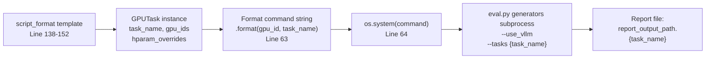

The command template:
```bash
CUDA_VISIBLE_DEVICES={gpu_id} \
python {entrypoint_script_path} generators \
  --model_name_or_path {model_name_or_path} \
  --model_input_template_path_or_name {model_input_template_path_or_name} \
  --hf_revision {hf_revision} \
  --tasks {task_name} \
  --report_output_path {report_output_path}.{task_name} \
  --save_individual_results_path {save_individual_results_path}.{task_name} \
  --use_vllm \
  --filter_classifier_name {filter_classifier_name} \
  --filter_model_override_path {filter_model_override_path} \
  --limit {limit} \
  --flex {flex} \
  --hparam_overrides {hparam_overrides}
```

**Sources:** [evaluation/run_all_generation_benchmarks.py:60-64](), [evaluation/run_all_generation_benchmarks.py:138-152]()

### Report Aggregation and Metrics

After all tasks complete, the system merges individual reports and calculates aggregate safety metrics:

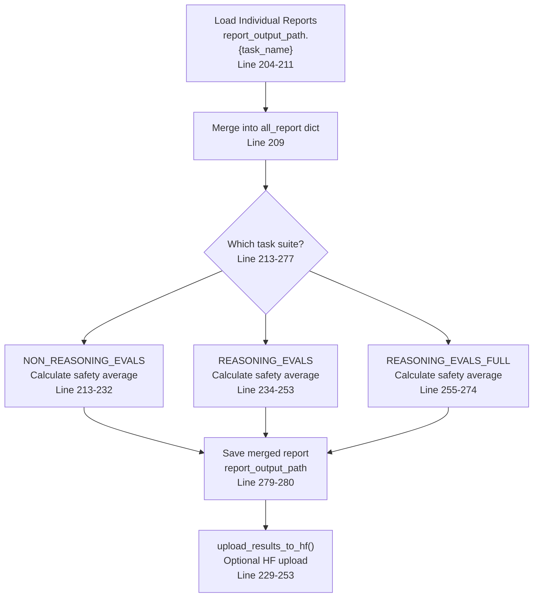

The aggregate `overall_safety_average` is calculated from primary metrics of constituent tasks:
- WildJailbreak (harmful): `inverted_macro_asr`
- WildJailbreak (benign): `macro_asr`
- Harmbench: `inverted_micro_asr_lower`
- WildGuardTest: `inverted_micro_harm_lower`
- XSTest: `overall_accuracy`
- Do-Anything-Now: `inverted_macro_asr`
- TrustLLM JailbreakTrigger: `inverted_macro_asr`

**Sources:** [evaluation/run_all_generation_benchmarks.py:200-298]()

## Jailbreak Attack Evaluation

The `jailbreak` mode wraps evaluation tasks with adversarial attack strategies, enabling assessment of model robustness against prompt injection and jailbreak techniques.

### Jailbreak Evaluation Architecture

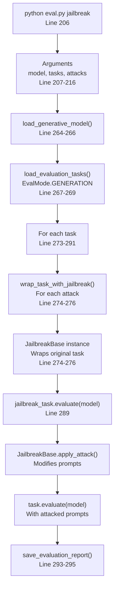

### Jailbreak Attack Wrapper Pattern

The jailbreak system uses a wrapper pattern where `JailbreakBase` subclasses wrap existing tasks:

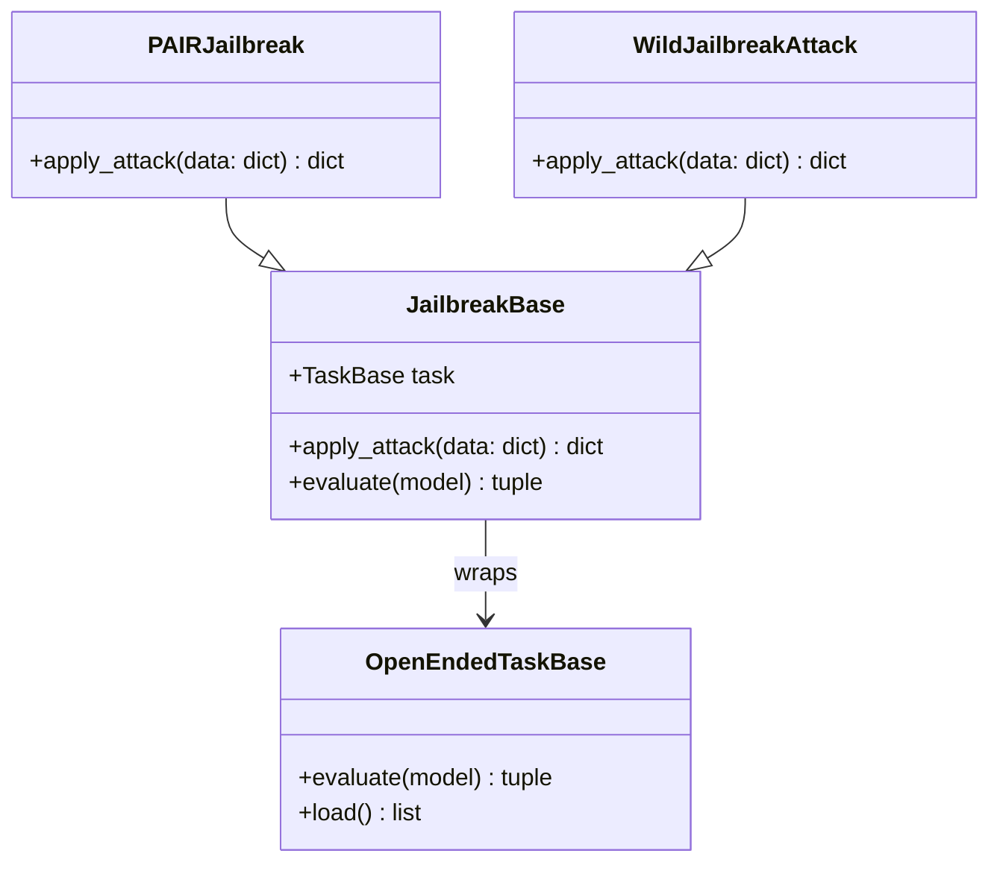

The `wrap_task_with_jailbreak()` function instantiates the attack wrapper:

```python
def wrap_task_with_jailbreak(task: TaskBase, attack: str) -> JailbreakBase:
    """
    Apply the attack to the task.
    Args:
        task: Task to apply the attack.
        attack: Attack to apply (format: xxx or xxx:yyy)
    Returns:
        Jailbreak object.
    """
```

**Sources:** [evaluation/tasks/__init__.py:74-98](), [evaluation/eval.py:206-306]()

### Basic Jailbreak Command

```bash
python evaluation/eval.py jailbreak \
  --model_name_or_path allenai/tulu-2-dpo-7b \
  --model_input_template_path_or_name tulu2 \
  --tasks harmbench,wildjailbreak:harmful \
  --attacks pair,wildjailbreak \
  --report_output_path ./results/jailbreak_metrics.json \
  --save_individual_results_path ./results/jailbreak_all.json \
  --use_vllm
```

### Jailbreak-Specific Parameters

| Parameter | Type | Description |
|-----------|------|-------------|
| `--attacks` | string | Comma-separated list of attack names (e.g., `pair,wildjailbreak`) |
| `--tasks` | string | Base tasks to wrap with attacks |
| Other parameters | - | Same as `generators` mode |

### Attack Execution Flow

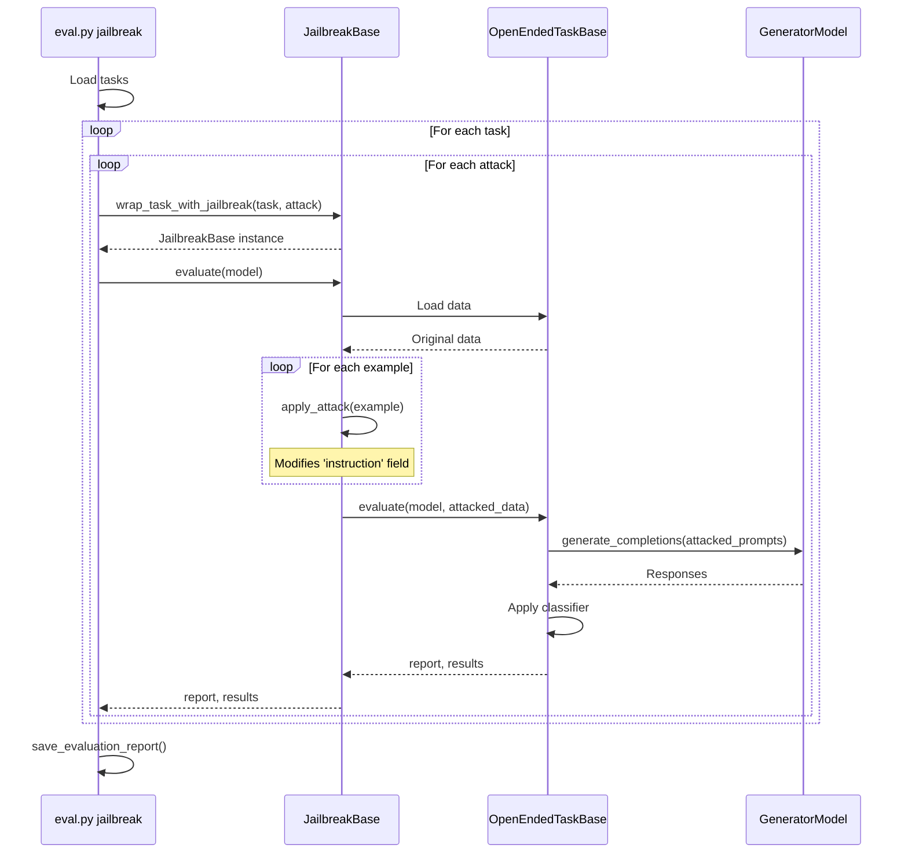

**Sources:** [evaluation/eval.py:273-291](), [evaluation/tasks/__init__.py:74-98]()

### Task Naming Convention

Jailbreak evaluation generates reports with combined task and attack names:

```python
task_names_with_attack = [f"{task_name}/{attack}" for attack in attacks]
# Example: "harmbench/pair", "harmbench/wildjailbreak"
```

This naming allows tracking attack-specific metrics separately in the evaluation report.

**Sources:** [evaluation/eval.py:277-290]()

## Evaluation Report Structure

All evaluation modes produce consistent report structures saved as JSON files.

### Report File Types

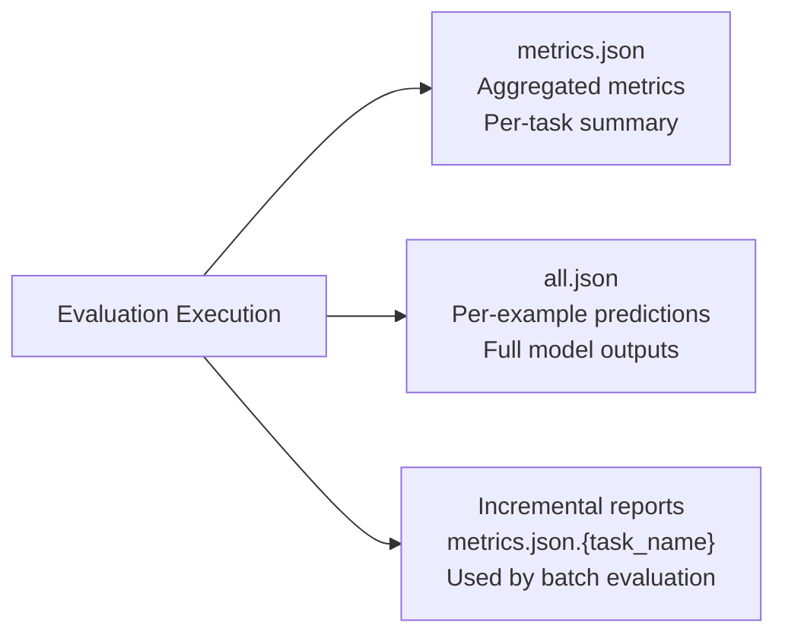

### Metrics Report Structure

```json
{
  "task_name": {
    "metric_name": 0.85,
    "inverted_macro_asr": 0.78,
    "micro_harm_lower": 0.92,
    "overall_accuracy": 0.81
  },
  "task_name/attack_name": {
    "metric_name": 0.45,
    "asr": 0.55
  }
}
```

### Individual Results Structure

```json
[
  {
    "task": "wildjailbreak:harmful",
    "id": "example_001",
    "instruction": "Original prompt",
    "output": "Model response",
    "is_harmful": true,
    "is_refusal": false,
    "classifier_scores": {...}
  }
]
```

**Sources:** [evaluation/utils.py](), [evaluation/eval.py:83-86](), [evaluation/eval.py:189-191]()

## Common Evaluation Patterns

### Quick Testing with Limited Examples

Use `--limit true` to evaluate only 5 examples per task:

```bash
python evaluation/eval.py generators \
  --model_name_or_path allenai/tulu-2-dpo-7b \
  --model_input_template_path_or_name tulu2 \
  --tasks wildguardtest,harmbench \
  --limit true \
  --report_output_path ./test_results.json
```

**Sources:** [evaluation/eval.py:104](), [evaluation/tasks/__init__.py:62-63]()

### Incremental Evaluation

The framework supports incremental evaluation by loading existing reports and skipping completed tasks:

```bash
# First run
python evaluation/eval.py generators \
  --tasks wildguardtest,harmbench \
  --report_output_path ./results/metrics.json \
  ...

# Add more tasks (wildguardtest and harmbench are skipped)
python evaluation/eval.py generators \
  --tasks wildguardtest,harmbench,toxigen:tiny \
  --report_output_path ./results/metrics.json \
  ...
```

Use `--override_existing_report` to force re-evaluation of completed tasks.

**Sources:** [evaluation/eval.py:67-68](), [evaluation/eval.py:176-177](), [evaluation/eval.py:180-182]()

### Custom Hyperparameter Overrides

Override task-specific hyperparameters from the command line:

```bash
python evaluation/eval.py generators \
  --model_name_or_path allenai/tulu-2-dpo-7b \
  --model_input_template_path_or_name tulu2 \
  --tasks wildguardtest:wildguard_reasoning_answer \
  --hparam_overrides '{"max_new_tokens": 2048, "temperature": 0.9}' \
  --report_output_path ./results/metrics.json
```

**Sources:** [evaluation/eval.py:106-107](), [evaluation/tasks/__init__.py:58-60]()

### Safety Filtering During Generation

Apply a safety classifier to filter prompts before generation:

```bash
python evaluation/eval.py generators \
  --model_name_or_path allenai/tulu-2-dpo-7b \
  --model_input_template_path_or_name tulu2 \
  --tasks wildguardtest,harmbench \
  --filter_classifier_name WildGuard \
  --report_output_path ./results/filtered_metrics.json \
  --use_vllm
```

Harmful prompts will receive a canned refusal response instead of being passed to the model.

**Sources:** [evaluation/eval.py:101-102](), [evaluation/models/__init__.py:17-18](), [evaluation/models/__init__.py:53-54]()

---

