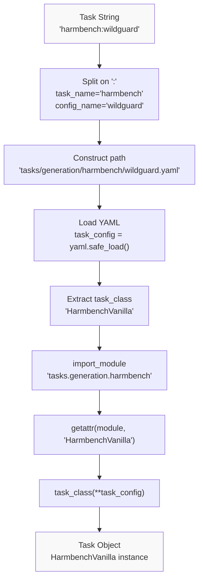
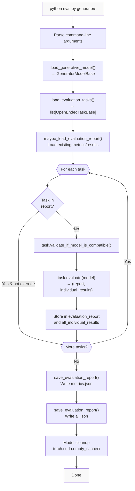
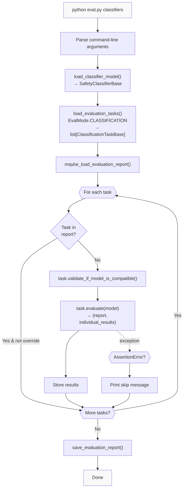
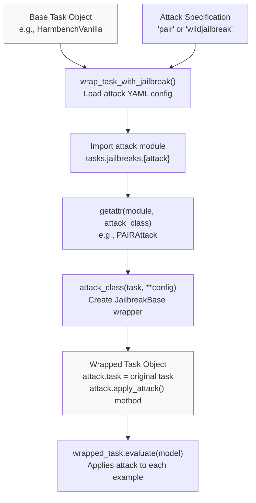

<!-- source: DeepWiki mcp.deepwiki.com · repo allenai/safety-eval · page 7.1 Single Task Evaluation · fetched 2026-10-26 -->

# Single Task Evaluation

<details>
<summary>Relevant source files</summary>

The following files were used as context for generating this wiki page:

- [README.md](README.md)
- [evaluation/eval.py](evaluation/eval.py)
- [evaluation/models/__init__.py](evaluation/models/__init__.py)
- [evaluation/tasks/__init__.py](evaluation/tasks/__init__.py)
- [evaluation/tasks/generation/do_anything_now/__init__.py](evaluation/tasks/generation/do_anything_now/__init__.py)
- [evaluation/tasks/generation/trustllm_jailbreaktrigger/__init__.py](evaluation/tasks/generation/trustllm_jailbreaktrigger/__init__.py)
- [evaluation/tasks/generation/trustllm_jailbreaktrigger/gpt4.yaml](evaluation/tasks/generation/trustllm_jailbreaktrigger/gpt4.yaml)
- [evaluation/tasks/generation/wildjailbreak/__init__.py](evaluation/tasks/generation/wildjailbreak/__init__.py)
- [evaluation/tasks/generation/xstest/exaggerated_safety.json](evaluation/tasks/generation/xstest/exaggerated_safety.json)

</details>


This page describes how to run individual evaluation tasks using the `eval.py` command-line interface. Single task evaluation allows you to evaluate a specific model on one or more benchmarks sequentially within a single process. For running multiple tasks in parallel across GPUs, see [Batch Evaluation with GPU Orchestration](#7.2). For adversarial attack evaluation using the jailbreak wrapper system, see [Jailbreak Attack Evaluation](#7.3).

## Overview

The `eval.py` script provides three evaluation modes, each accessed as a subcommand:

| Mode | Purpose | Entry Point Function |
|------|---------|---------------------|
| `generators` | Evaluate generative language models on safety and capability benchmarks | [`eval.py:generators()`](evaluation/eval.py:92-203) |
| `classifiers` | Evaluate safety classifier models on prompt/response classification tasks | [`eval.py:classifiers()`](evaluation/eval.py:21-89) |
| `jailbreak` | Evaluate generative models with adversarial attack wrappers applied | [`eval.py:jailbreak()`](evaluation/eval.py:206-305) |

All three modes follow a similar pattern: load a model, load evaluation tasks, execute each task, and save results to JSON report files.

**Sources:** [evaluation/eval.py:1-316](), [README.md:38-134]()

## Task Specification Syntax

Tasks are specified using a structured string format that determines which evaluation configuration to load:

```
<task_folder>[:<config_name>]
```

- **`<task_folder>`**: Directory name under `evaluation/tasks/generation/` or `evaluation/tasks/classification/`
- **`<config_name>`**: (Optional) YAML configuration file name without `.yaml` extension. Defaults to `"default"` if omitted.

**Examples:**
- `wildguardtest` → loads `evaluation/tasks/generation/wildguardtest/default.yaml`
- `harmbench:wildguard_reasoning_answer` → loads `evaluation/tasks/generation/harmbench/wildguard_reasoning_answer.yaml`
- `toxigen:tiny` → loads `evaluation/tasks/generation/toxigen/tiny.yaml`

Multiple tasks are specified as a comma-separated list: `--tasks wildguardtest,harmbench,toxigen:tiny`

**Sources:** [evaluation/tasks/__init__.py:16-71](), [evaluation/eval.py:44-47](), [README.md:94-95]()

### Task Loading Process



**Task Configuration Loading Process**

The [`load_evaluation_tasks()`](evaluation/tasks/__init__.py:16-71) function implements dynamic task instantiation:

1. Parse task string to extract `task_name` and `config_file_name`
2. Construct file path: `tasks/{mode.value}/{task_name}/{config_file_name}.yaml`
3. Import Python module: `tasks.{mode.value}.{task_name}`
4. Load YAML configuration and extract `task_class` field
5. Use `getattr()` to retrieve class from module
6. Instantiate task with remaining YAML configuration as keyword arguments

**Sources:** [evaluation/tasks/__init__.py:16-71]()

## Generators Mode

The `generators` mode evaluates generative language models on open-ended tasks. These include safety benchmarks (e.g., Harmbench, WildJailbreak) and capability benchmarks (e.g., GSM8K, MMLU).

### Basic Usage

```bash
python evaluation/eval.py generators \
  --model_name_or_path allenai/tulu-2-dpo-7b \
  --model_input_template_path_or_name tulu2 \
  --tasks wildguardtest,harmbench,toxigen:tiny \
  --report_output_path ./results/metrics.json \
  --save_individual_results_path ./results/all.json \
  --use_vllm
```

**Sources:** [README.md:106-113](), [evaluation/eval.py:92-107]()

### Required Parameters

| Parameter | Type | Description |
|-----------|------|-------------|
| `model_name_or_path` | `str` | Model identifier (HuggingFace path, local path, or API format `provider:model`) |
| `tasks` | `str` | Comma-separated list of task specifications |
| `model_input_template_path_or_name` | `str` | Chat template name (from `src/templates/`) or path to `.txt` file containing template with `{instruction}` placeholder |
| `report_output_path` | `str` | Path to save aggregated metrics JSON file |

**Sources:** [evaluation/eval.py:92-107]()

### Optional Parameters

| Parameter | Type | Default | Description |
|-----------|------|---------|-------------|
| `save_individual_results_path` | `str` | `None` | Path to save per-example predictions |
| `override_existing_report` | `bool` | `False` | If `True`, re-evaluate tasks already in report |
| `use_vllm` | `bool` | `False` | Use vLLM inference engine instead of HuggingFace |
| `batch_size` | `int` | `None` | Batch size (ignored if `use_vllm=True`) |
| `filter_classifier_name` | `str` | `None` | Safety classifier for pre-generation filtering |
| `filter_model_override_path` | `str` | `None` | Local path for filter classifier weights |
| `hf_revision` | `str` | `None` | HuggingFace model revision/branch |
| `limit` | `bool` | `False` | Limit evaluation to 5 examples per task for testing |
| `flex` | `bool` | `False` | Enable flexible reasoning trace parsing |
| `hparam_overrides` | `dict` | `None` | Override generation hyperparameters (`max_new_tokens`, `temperature`, `top_p`) |

**Sources:** [evaluation/eval.py:92-157]()

### Execution Flow



**Generator Evaluation Execution Flow**

The [`generators()`](evaluation/eval.py:92-203) function orchestrates the evaluation:

1. **Model Loading** ([line 164-172](evaluation/eval.py:164-172)): Calls [`load_generative_model()`](evaluation/models/__init__.py:12-78) which returns `HfGeneratorModel`, `VllmGeneratorModel`, or `APIGeneratorModel` based on parameters
2. **Task Loading** ([line 173-175](evaluation/eval.py:173-175)): Calls [`load_evaluation_tasks()`](evaluation/tasks/__init__.py:16-71) with `EvalMode.GENERATION`
3. **Report Loading** ([line 176-177](evaluation/eval.py:176-177)): Loads existing reports to enable incremental evaluation
4. **Task Loop** ([line 179-187](evaluation/eval.py:179-187)): 
   - Skips tasks already evaluated (unless `override_existing_report=True`)
   - Validates model compatibility
   - Calls [`task.evaluate(model)`](evaluation/tasks/generation/base.py) which returns `(report_dict, individual_results_list)`
5. **Save Results** ([line 189-191](evaluation/eval.py:189-191)): Writes JSON files
6. **Cleanup** ([line 193-198](evaluation/eval.py:193-198)): Releases GPU memory

**Sources:** [evaluation/eval.py:92-203](), [evaluation/models/__init__.py:12-78](), [evaluation/tasks/__init__.py:16-71]()

### Reasoning Model Evaluation

For reasoning models that output structured think-then-answer responses, specify the `thinker_eval` parameter in the task YAML configuration:

```yaml
task_class: HarmbenchVanilla
classifier_model_name: WildGuard
thinker_eval: ["answers"]  # or ["reasonings"] or ["reasonings", "answers"]
hparams:
  max_new_tokens: 2048  # Increased for reasoning traces
```

The framework will parse responses using `<think>` and `<answer>` tags and evaluate the specified sections separately.

**Sources:** [README.md:72-74]()

### Example Commands

**Local Model with vLLM:**
```bash
python evaluation/eval.py generators \
  --use_vllm \
  --model_name_or_path meta-llama/Llama-2-7b-chat-hf \
  --model_input_template_path_or_name llama2 \
  --tasks wildguardtest,xstest \
  --report_output_path ./results/llama2_metrics.json
```

**OpenAI API Model:**
```bash
python evaluation/eval.py generators \
  --model_name_or_path openai:gpt-4 \
  --model_input_template_path_or_name None \
  --tasks wildguardtest,harmbench \
  --report_output_path ./results/gpt4_metrics.json
```

**With Safety Filter:**
```bash
python evaluation/eval.py generators \
  --use_vllm \
  --model_name_or_path allenai/tulu-2-dpo-7b \
  --model_input_template_path_or_name tulu2 \
  --tasks harmbench \
  --filter_classifier_name WildGuard \
  --report_output_path ./results/tulu2_filtered_metrics.json
```

**Sources:** [README.md:106-134]()

## Classifiers Mode

The `classifiers` mode evaluates safety classifier models on three types of classification tasks: prompt harmfulness detection, response harmfulness detection, and response refusal detection.

### Basic Usage

```bash
python evaluation/eval.py classifiers \
  --model_name WildGuard \
  --tasks wildguardtest_prompt,wildguardtest_response,wildguardtest_refusal \
  --report_output_path ./classifier_results/metrics.json \
  --save_individual_results_path ./classifier_results/all.json
```

**Sources:** [README.md:176-182](), [evaluation/eval.py:21-57]()

### Required Parameters

| Parameter | Type | Description |
|-----------|------|-------------|
| `model_name` | `str` | Classifier model identifier (e.g., `"WildGuard"`, `"LlamaGuard"`, `"OpenAIModerationAPIClassifier"`) |
| `tasks` | `str` | Comma-separated list of classification task specifications |
| `report_output_path` | `str` | Path to save aggregated metrics JSON file |

### Optional Parameters

| Parameter | Type | Default | Description |
|-----------|------|---------|-------------|
| `save_individual_results_path` | `str` | `None` | Path to save per-example predictions |
| `override_model_path` | `str` | `None` | Local path to override model weights |
| `override_existing_report` | `bool` | `False` | If `True`, re-evaluate tasks already in report |

**Sources:** [evaluation/eval.py:21-57]()

### Execution Flow



**Classifier Evaluation Execution Flow**

The [`classifiers()`](evaluation/eval.py:21-89) function follows a similar pattern to `generators()` but with classifier-specific loading:

1. **Classifier Loading** ([line 59](evaluation/eval.py:59)): Calls [`load_classifier_model()`](src/classifier_models/loader.py) which returns a `SafetyClassifierBase` subclass
2. **Task Loading** ([line 64-66](evaluation/eval.py:64-66)): Calls [`load_evaluation_tasks()`](evaluation/tasks/__init__.py:16-71) with `EvalMode.CLASSIFICATION`
3. **Error Handling** ([line 75-81](evaluation/eval.py:75-81)): Catches `AssertionError` exceptions from model validation and skips incompatible tasks

**Sources:** [evaluation/eval.py:21-89]()

### Model Compatibility Validation

Each classification task can validate whether it is compatible with the provided classifier. The validation check (via [`validate_if_model_is_compatible()`](evaluation/schemas.py)) ensures the classifier provides the required output fields for the task. If validation fails, the task is skipped with a warning message.

**Sources:** [evaluation/eval.py:76-81]()

## Jailbreak Mode

The `jailbreak` mode wraps evaluation tasks with adversarial attack strategies. This allows testing how models respond to jailbreak attempts applied to existing benchmarks.

### Basic Usage

```bash
python evaluation/eval.py jailbreak \
  --model_name_or_path allenai/tulu-2-dpo-7b \
  --model_input_template_path_or_name tulu2 \
  --tasks harmbench \
  --attacks pair,wildjailbreak \
  --report_output_path ./jailbreak_results/metrics.json \
  --use_vllm
```

This command evaluates the model on Harmbench with two attacks, creating two result entries: `harmbench/pair` and `harmbench/wildjailbreak`.

**Sources:** [README.md:222-228](), [evaluation/eval.py:206-216]()

### Required Parameters

| Parameter | Type | Description |
|-----------|------|-------------|
| `model_name_or_path` | `str` | Model identifier (same format as `generators` mode) |
| `tasks` | `str` | Comma-separated list of task specifications |
| `attacks` | `str` | Comma-separated list of attack identifiers |
| `model_input_template_path_or_name` | `str` | Chat template for the model |
| `report_output_path` | `str` | Path to save metrics JSON file |

### Optional Parameters

| Parameter | Type | Default | Description |
|-----------|------|---------|-------------|
| `save_individual_results_path` | `str` | `None` | Path to save per-example predictions |
| `batch_size` | `int` | `None` | Batch size for generation |
| `override_existing_report` | `bool` | `False` | If `True`, re-evaluate existing task/attack combinations |
| `use_vllm` | `bool` | `False` | Use vLLM inference engine |

**Sources:** [evaluation/eval.py:206-256]()

### Attack Wrapping Process



**Attack Application Process**

The [`wrap_task_with_jailbreak()`](evaluation/tasks/__init__.py:74-98) function wraps a base task with an attack:

1. Parse attack string (format: `attack_name[:config_name]`)
2. Load attack YAML configuration from `evaluation/tasks/jailbreaks/{attack_name}/{config_name}.yaml`
3. Import attack module: `tasks.jailbreaks.{attack_name}`
4. Extract `attack_class` field from YAML
5. Instantiate attack class with base task as first argument: `attack_class(task, **config)`
6. Return `JailbreakBase` instance that delegates to wrapped task while modifying inputs

**Sources:** [evaluation/tasks/__init__.py:74-98]()

### Execution Flow

The [`jailbreak()`](evaluation/eval.py:206-305) function extends the `generators` pattern:

1. Load generator model (same as `generators` mode)
2. Load base evaluation tasks
3. **Wrap each task with each attack** ([line 274-276](evaluation/eval.py:274-276)): Creates `len(tasks) × len(attacks)` wrapped task objects
4. **Generate task names** ([line 277](evaluation/eval.py:277)): Format as `"{task_name}/{attack}"`
5. Evaluate each wrapped task, storing results with combined names
6. Save reports and cleanup

**Sources:** [evaluation/eval.py:206-305]()

## Common Workflow Patterns

### Incremental Evaluation

The framework supports incremental evaluation by default. If a task name already exists in the report file, it is skipped unless `--override_existing_report` is specified:

```bash
# First run: evaluates all three tasks
python evaluation/eval.py generators \
  --model_name_or_path model_v1 \
  --tasks task1,task2,task3 \
  --report_output_path ./results.json

# Second run: only evaluates task4 (task1-3 already in results.json)
python evaluation/eval.py generators \
  --model_name_or_path model_v1 \
  --tasks task1,task2,task3,task4 \
  --report_output_path ./results.json
```

**Sources:** [evaluation/eval.py:180-182](), [evaluation/eval.py:71-73]()

### Report File Structure

The report files are JSON dictionaries with task names as keys:

**metrics.json** (aggregated metrics):
```json
{
  "wildguardtest": {
    "asr": 0.05,
    "refusal_rate": 0.92,
    "num_examples": 500
  },
  "harmbench": {
    "asr": 0.03,
    "num_examples": 400
  }
}
```

**all.json** (individual results):
```json
{
  "wildguardtest": [
    {
      "prompt": "...",
      "response": "...",
      "is_harmful": false,
      "is_refusal": true
    },
    ...
  ]
}
```

**Sources:** [evaluation/utils.py:maybe_load_evaluation_report](), [evaluation/utils.py:save_evaluation_report]()

### Hyperparameter Overrides

Override generation hyperparameters at runtime without modifying task YAML files:

```python
python evaluation/eval.py generators \
  --model_name_or_path model \
  --tasks harmbench \
  --hparam_overrides '{"max_new_tokens": 2048, "temperature": 0.9}' \
  --report_output_path ./results.json
```

The overrides are applied to all tasks' `hparams` configuration ([line 58-60](evaluation/tasks/__init__.py:58-60)).

**Sources:** [evaluation/tasks/__init__.py:58-60](), [evaluation/eval.py:106]()

## Code Entity Reference

This table maps high-level concepts to specific code entities for navigation:

| Concept | Code Entity | Location |
|---------|-------------|----------|
| CLI entry point for generators | `generators()` | [evaluation/eval.py:92-203]() |
| CLI entry point for classifiers | `classifiers()` | [evaluation/eval.py:21-89]() |
| CLI entry point for jailbreaks | `jailbreak()` | [evaluation/eval.py:206-305]() |
| Model loading | `load_generative_model()` | [evaluation/models/__init__.py:12-78]() |
| Classifier loading | `load_classifier_model()` | [src/classifier_models/loader.py]() |
| Task loading | `load_evaluation_tasks()` | [evaluation/tasks/__init__.py:16-71]() |
| Attack wrapping | `wrap_task_with_jailbreak()` | [evaluation/tasks/__init__.py:74-98]() |
| Report loading | `maybe_load_evaluation_report()` | [evaluation/utils.py]() |
| Report saving | `save_evaluation_report()` | [evaluation/utils.py]() |
| Generator model base class | `GeneratorModelBase` | [evaluation/schemas.py]() |
| Open-ended task base class | `OpenEndedTaskBase` | [evaluation/schemas.py]() |
| Classification task base class | `ClassificationTaskBase` | [evaluation/schemas.py]() |
| Jailbreak wrapper base class | `JailbreakBase` | [evaluation/schemas.py]() |

**Sources:** [evaluation/eval.py:1-316](), [evaluation/models/__init__.py:1-79](), [evaluation/tasks/__init__.py:1-99]()

---

