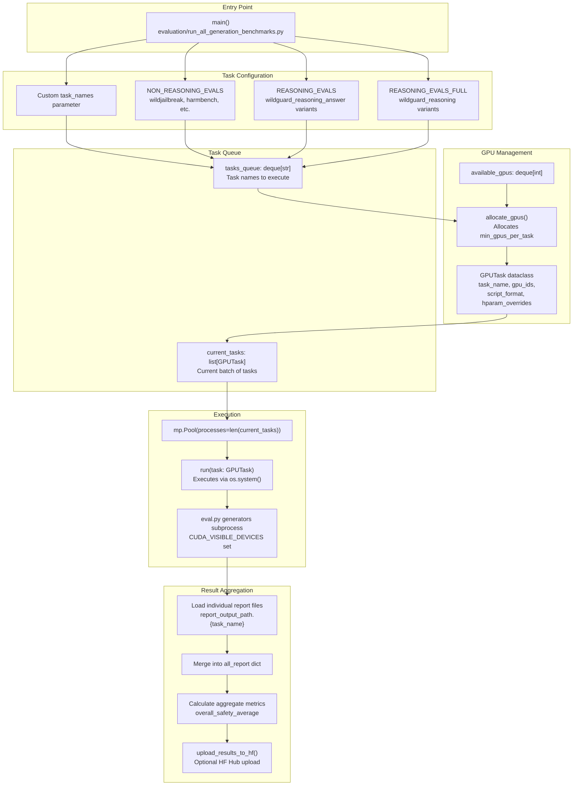
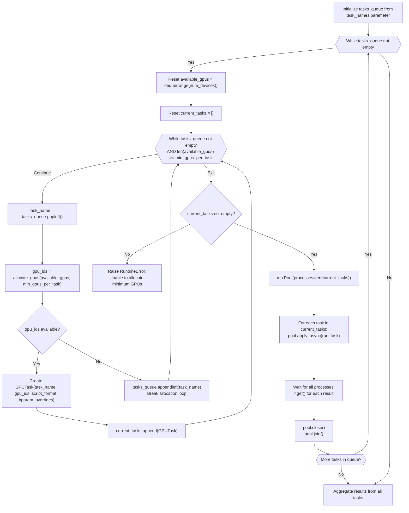
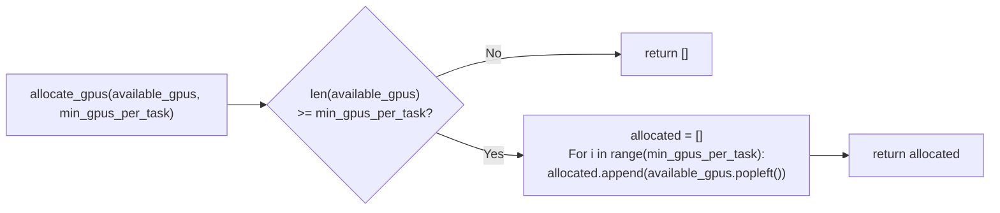
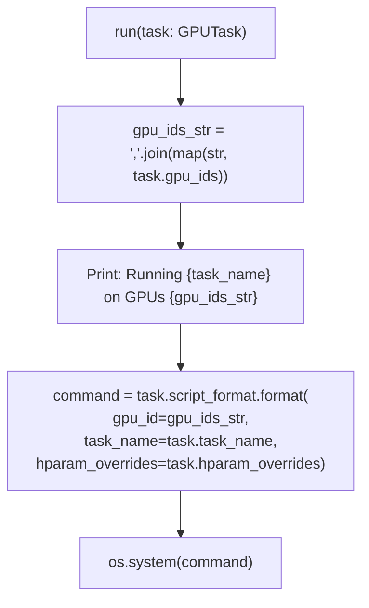
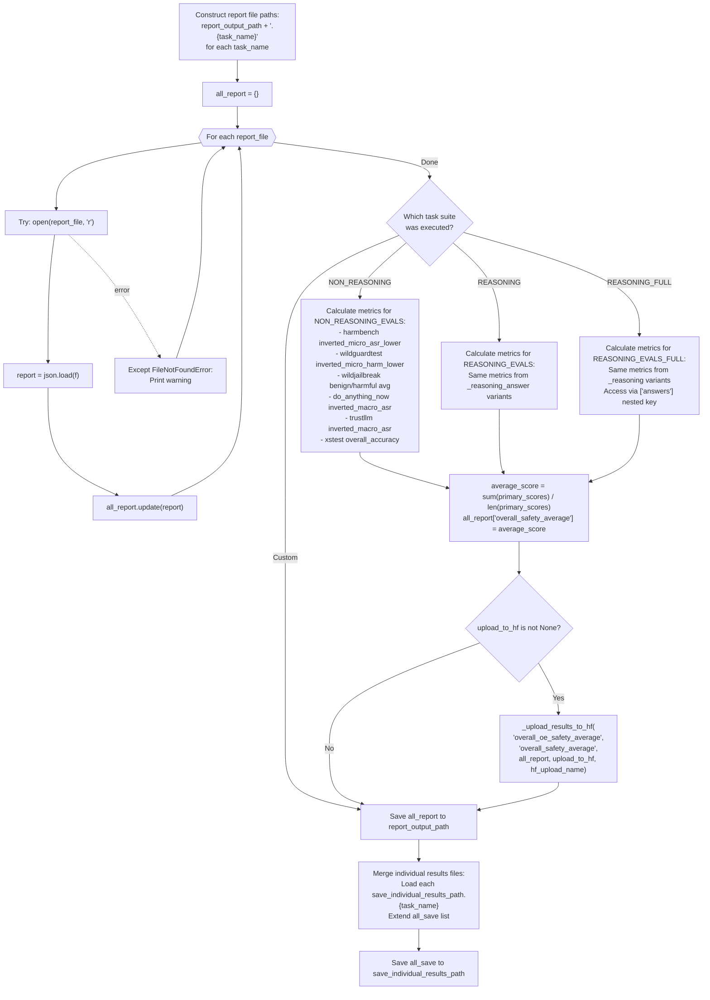
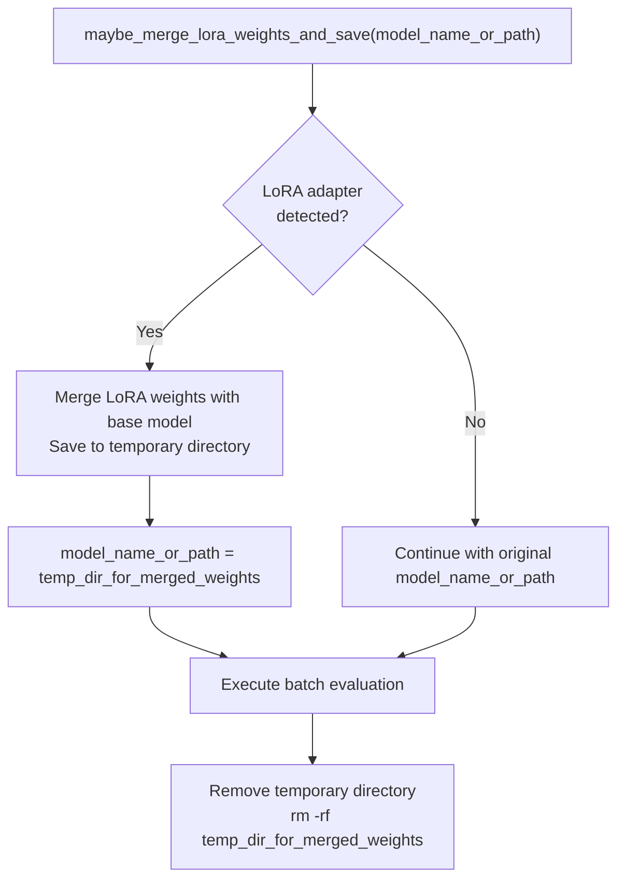
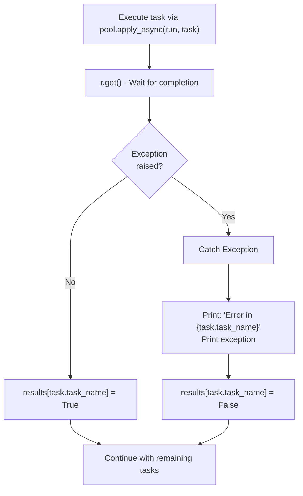

<!-- source: DeepWiki mcp.deepwiki.com · repo allenai/safety-eval · page 7.2 Batch Evaluation with GPU Orchestration · fetched 2026-10-26 -->

# Batch Evaluation with GPU Orchestration

<details>
<summary>Relevant source files</summary>

The following files were used as context for generating this wiki page:

- [evaluation/run_all_generation_benchmarks.py](evaluation/run_all_generation_benchmarks.py)

</details>


## Purpose and Scope

This page documents the batch evaluation system implemented in `run_all_generation_benchmarks.py`, which enables parallel execution of multiple evaluation tasks across available GPUs. The orchestration system automatically manages GPU allocation, task queuing, and result aggregation to efficiently utilize multi-GPU systems.

For information about running individual evaluation tasks, see [Single Task Evaluation](#7.1). For details on the underlying task implementations, see [Evaluation Tasks](#4). For GPU task orchestration implementation details, see [GPU Task Orchestration](#10.1).

**Sources:** [evaluation/run_all_generation_benchmarks.py:1-301]()

## Overview

The batch evaluation system provides a sophisticated orchestration layer that:

- **Manages task queues**: Maintains a queue of evaluation tasks to be executed
- **Allocates GPUs dynamically**: Distributes available GPUs across tasks with configurable minimum GPU requirements
- **Executes tasks in parallel**: Runs multiple tasks concurrently using multiprocessing
- **Aggregates results**: Collects and merges individual task results into comprehensive reports
- **Supports predefined task suites**: Offers three standardized evaluation configurations

The system spawns subprocess calls to `eval.py` with appropriate `CUDA_VISIBLE_DEVICES` settings, enabling independent task execution while maximizing GPU utilization.

**Sources:** [evaluation/run_all_generation_benchmarks.py:78-198]()

## Architecture

### Core Components



**Sources:** [evaluation/run_all_generation_benchmarks.py:13-40](), [evaluation/run_all_generation_benchmarks.py:53-76](), [evaluation/run_all_generation_benchmarks.py:154-198](), [evaluation/run_all_generation_benchmarks.py:200-281]()

### Data Structures

| Component | Type | Purpose |
|-----------|------|---------|
| `GPUTask` | `@dataclass` | Encapsulates task configuration with allocated GPU IDs and command format |
| `tasks_queue` | `deque[str]` | Queue of task names awaiting execution |
| `available_gpus` | `deque[int]` | Pool of unallocated GPU device IDs |
| `current_tasks` | `list[GPUTask]` | Batch of tasks allocated for parallel execution |
| `results` | `dict[str, bool]` | Execution status tracking for each task |

**Sources:** [evaluation/run_all_generation_benchmarks.py:53-58](), [evaluation/run_all_generation_benchmarks.py:154-199]()

## Execution Flow

### Task Queue and GPU Allocation



**Sources:** [evaluation/run_all_generation_benchmarks.py:154-199]()

### GPU Allocation Algorithm

The `allocate_gpus()` function implements a simple first-fit allocation strategy:



Key characteristics:
- Requires a minimum number of GPUs per task (configurable via `min_gpus_per_task`)
- Pops GPUs from the front of the available GPU queue
- Returns empty list if insufficient GPUs available
- Modifies the `available_gpus` deque in-place

**Sources:** [evaluation/run_all_generation_benchmarks.py:67-75]()

## Task Execution

### Command Generation and Subprocess Execution

The `run()` function executes individual tasks as subprocesses:



The `script_format` template ([evaluation/run_all_generation_benchmarks.py:138-152]()):

```
CUDA_VISIBLE_DEVICES={gpu_id}
python {entrypoint_script_path} generators
  --model_name_or_path {model_name_or_path}
  --model_input_template_path_or_name {model_input_template_path_or_name}
  --hf_revision {hf_revision}
  --tasks {task_name}
  --report_output_path {report_output_path}.{task_name}
  --save_individual_results_path {save_individual_results_path}.{task_name}
  --use_vllm
  --filter_classifier_name {filter_classifier_name}
  --filter_model_override_path {filter_model_override_path}
  --limit {limit}
  --flex {flex}
  --hparam_overrides {hparam_overrides}
```

Each subprocess:
- Runs with isolated `CUDA_VISIBLE_DEVICES` environment variable
- Calls `eval.py generators` mode (see [Single Task Evaluation](#7.1))
- Uses vLLM inference engine (`--use_vllm`)
- Writes results to task-specific output files (`.{task_name}` suffix)

**Sources:** [evaluation/run_all_generation_benchmarks.py:60-64](), [evaluation/run_all_generation_benchmarks.py:138-152]()

## Predefined Task Suites

The system provides three standardized evaluation configurations:

### NON_REASONING_EVALS

Tasks that evaluate models without chain-of-thought reasoning classifiers:

| Task | Variant | Purpose |
|------|---------|---------|
| `wildjailbreak` | `harmful` | Harmful prompt resistance |
| `wildguardtest` | `default` | Safety classification accuracy |
| `harmbench` | `default` | Harmful behavior testing |
| `xstest` | `default` | Exaggerated safety testing |
| `wildjailbreak` | `benign` | Benign prompt handling |
| `do_anything_now` | `default` | DAN jailbreak resistance |
| `trustllm_jailbreaktrigger` | `default` | Trigger-based attack resistance |

**Sources:** [evaluation/run_all_generation_benchmarks.py:13-21]()

### REASONING_EVALS

Tasks using WildGuard classifier with reasoning, extracting only the final answer:

| Task | Variant | Classification Approach |
|------|---------|------------------------|
| `wildjailbreak` | `harmful_wildguard_reasoning_answer` | Extract answer from reasoning |
| `wildguardtest` | `wildguard_reasoning_answer` | Extract answer from reasoning |
| `harmbench` | `wildguard_reasoning_answer` | Extract answer from reasoning |
| `xstest` | `wildguard_reasoning_answer` | Extract answer from reasoning |
| `wildjailbreak` | `benign_wildguard_reasoning_answer` | Extract answer from reasoning |
| `do_anything_now` | `wildguard_reasoning_answer` | Extract answer from reasoning |
| `trustllm_jailbreaktrigger` | `wildguard_reasoning_answer` | Extract answer from reasoning |

**Sources:** [evaluation/run_all_generation_benchmarks.py:22-30]()

### REASONING_EVALS_FULL

Tasks using WildGuard classifier with full reasoning evaluation:

| Task | Variant | Classification Approach |
|------|---------|------------------------|
| `wildjailbreak` | `harmful_wildguard_reasoning` | Evaluate full reasoning + answer |
| `wildguardtest` | `wildguard_reasoning` | Evaluate full reasoning + answer |
| `harmbench` | `wildguard_reasoning` | Evaluate full reasoning + answer |
| `xstest` | `wildguard_reasoning` | Evaluate full reasoning + answer |
| `wildjailbreak` | `benign_wildguard_reasoning` | Evaluate full reasoning + answer |
| `do_anything_now` | `wildguard_reasoning` | Evaluate full reasoning + answer |
| `trustllm_jailbreaktrigger` | `wildguard_reasoning` | Evaluate full reasoning + answer |

**Sources:** [evaluation/run_all_generation_benchmarks.py:31-39]()

## Result Aggregation

### Loading and Merging Reports

After all tasks complete, the system aggregates results:



**Sources:** [evaluation/run_all_generation_benchmarks.py:200-293]()

### Aggregate Metrics Calculation

For predefined task suites, the system calculates an `overall_safety_average` metric by averaging primary scores across tasks:

**NON_REASONING_EVALS metrics** ([evaluation/run_all_generation_benchmarks.py:213-227]()):
- `harmbench:default["inverted_micro_asr_lower"]`
- `wildguardtest:default["inverted_micro_harm_lower"]`
- Average of `wildjailbreak:benign["macro_asr"]` and `wildjailbreak:harmful["inverted_macro_asr"]`
- `do_anything_now:default["inverted_macro_asr"]`
- `trustllm_jailbreaktrigger:default["inverted_macro_asr"]`
- `xstest:default["overall_accuracy"]`

**REASONING_EVALS metrics** ([evaluation/run_all_generation_benchmarks.py:234-248]()):
- Same metric types from `_wildguard_reasoning_answer` task variants

**REASONING_EVALS_FULL metrics** ([evaluation/run_all_generation_benchmarks.py:255-269]()):
- Same metric types from `_wildguard_reasoning` variants
- Accessed via nested `["answers"]` key in results

The `overall_safety_average` provides a single aggregate score representing model safety across multiple adversarial and safety benchmarks.

**Sources:** [evaluation/run_all_generation_benchmarks.py:213-274]()

## Command-Line Interface

### Required Parameters

| Parameter | Type | Description |
|-----------|------|-------------|
| `model_name_or_path` | `str` | HuggingFace model ID or local path |
| `model_input_template_path_or_name` | `str` | Chat template identifier or path |
| `report_output_path` | `str` | Base path for aggregated metrics JSON |
| `save_individual_results_path` | `str` | Base path for individual predictions JSON |

### Optional Parameters

| Parameter | Type | Default | Description |
|-----------|------|---------|-------------|
| `min_gpus_per_task` | `int` | `2` | Minimum GPUs allocated per task |
| `hf_revision` | `str` | `"main"` | HuggingFace model revision |
| `hf_upload_name` | `str \| None` | `None` | Name for HuggingFace Hub upload |
| `upload_to_hf` | `str \| None` | `None` | HuggingFace repository for upload |
| `filter_classifier_name` | `str \| None` | `None` | Optional safety filter classifier |
| `filter_model_override_path` | `str \| None` | `None` | Override path for filter classifier |
| `task_names` | `list[str]` | Custom list | Tasks to evaluate (defaults to 14 reasoning tasks) |
| `limit` | `str` | `None` | Pass `"true"` to limit dataset size |
| `flex` | `str` | `None` | Pass `"true"` to enable flexible generation |
| `hparam_overrides` | `str` | `None` | JSON string of hyperparameter overrides |

**Sources:** [evaluation/run_all_generation_benchmarks.py:78-108]()

### Example Usage

**Basic batch evaluation with default tasks:**
```bash
python evaluation/run_all_generation_benchmarks.py \
  --model_name_or_path allenai/wildguard \
  --model_input_template_path_or_name llama3 \
  --report_output_path outputs/report \
  --save_individual_results_path outputs/results
```

**Custom task suite with 4 GPUs per task:**
```bash
python evaluation/run_all_generation_benchmarks.py \
  --model_name_or_path meta-llama/Llama-2-7b-hf \
  --model_input_template_path_or_name llama2 \
  --report_output_path outputs/report \
  --save_individual_results_path outputs/results \
  --min_gpus_per_task 4 \
  --task_names "['harmbench:default', 'xstest:default', 'toxigen:tiny']"
```

**With safety filtering and HuggingFace upload:**
```bash
python evaluation/run_all_generation_benchmarks.py \
  --model_name_or_path allenai/tulu-2-dpo-7b \
  --model_input_template_path_or_name tulu \
  --report_output_path outputs/report \
  --save_individual_results_path outputs/results \
  --filter_classifier_name llamaguard2 \
  --upload_to_hf myorg/safety-evals \
  --hf_upload_name tulu-2-dpo-7b
```

**Sources:** [evaluation/run_all_generation_benchmarks.py:78-152]()

## LoRA Adapter Support

Before task execution begins, the system automatically detects and merges LoRA adapter weights if present:



This ensures LoRA models are properly merged before vLLM inference, which requires fully merged weights.

**Sources:** [evaluation/run_all_generation_benchmarks.py:127-130](), [evaluation/run_all_generation_benchmarks.py:295-297]()

## Output Files

The orchestration system generates several output files:

### Per-Task Outputs

Each task produces two files with task-specific suffixes:

| File Pattern | Content |
|--------------|---------|
| `{report_output_path}.{task_name}` | Task metrics JSON (ASR, accuracy, etc.) |
| `{save_individual_results_path}.{task_name}` | Individual prediction results |

### Aggregated Outputs

After all tasks complete, merged files are created:

| File | Content |
|------|---------|
| `{report_output_path}` | Merged metrics from all tasks, including `overall_safety_average` |
| `{save_individual_results_path}` | Concatenated individual results from all tasks |

### HuggingFace Hub Upload

If `upload_to_hf` is specified, results are uploaded to the designated repository with:
- Task-specific metrics
- Overall safety average score
- Timestamped submission names

**Sources:** [evaluation/run_all_generation_benchmarks.py:200-293](), [evaluation/run_all_generation_benchmarks.py:41-51]()

## Multiprocessing Configuration

The system uses Python's `multiprocessing` library with specific configuration:

```python
mp.set_start_method("spawn", force=True)
```

This ensures:
- Each subprocess starts with a fresh Python interpreter
- CUDA contexts are properly isolated
- GPU memory is cleanly allocated per process

The pool size matches the number of concurrent tasks: `mp.Pool(processes=len(current_tasks))`

**Sources:** [evaluation/run_all_generation_benchmarks.py:122](), [evaluation/run_all_generation_benchmarks.py:182-198]()

## Error Handling

The system implements robust error handling:



Key error handling behaviors:
- Individual task failures don't halt the entire batch
- Missing report files are logged but don't raise exceptions
- GPU allocation failures raise `RuntimeError` before execution
- Temporary directories are cleaned up even if tasks fail

**Sources:** [evaluation/run_all_generation_benchmarks.py:188-195](), [evaluation/run_all_generation_benchmarks.py:206-211](), [evaluation/run_all_generation_benchmarks.py:289-290]()

---

