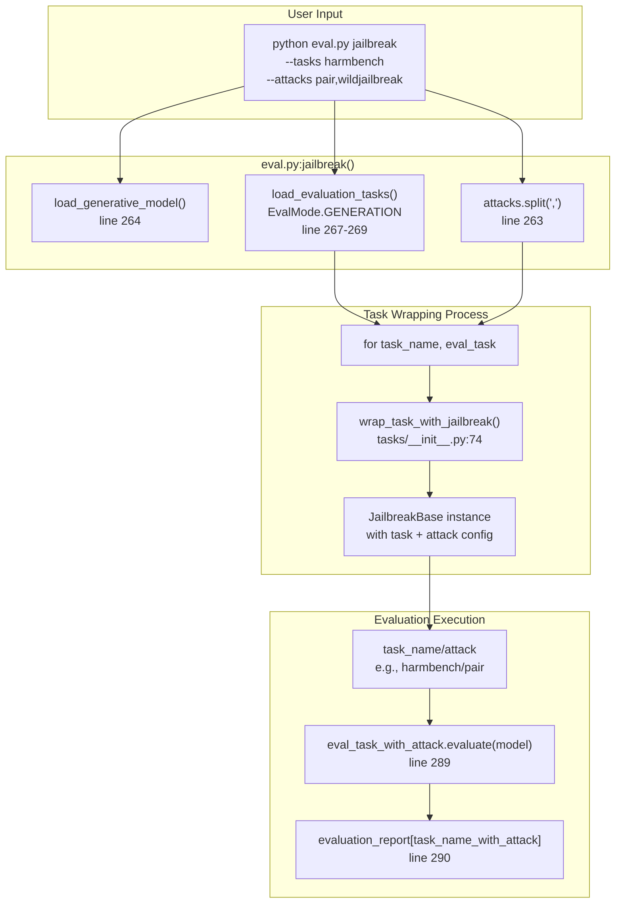
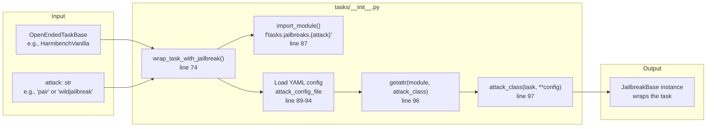
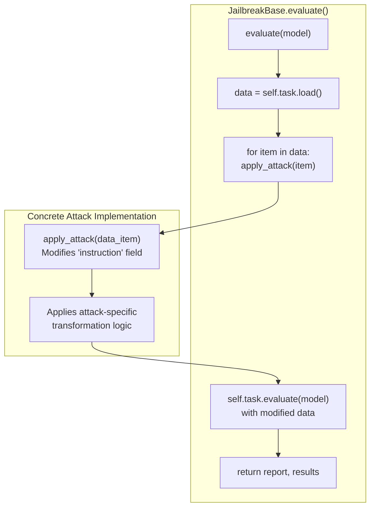
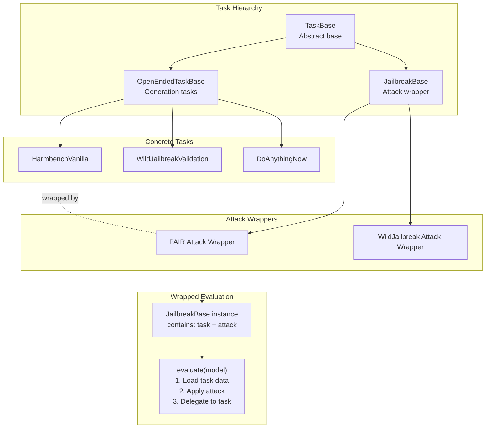

<!-- source: DeepWiki mcp.deepwiki.com · repo allenai/safety-eval · page 7.3 Jailbreak Attack Evaluation · fetched 2026-10-26 -->

# Jailbreak Attack Evaluation

<details>
<summary>Relevant source files</summary>

The following files were used as context for generating this wiki page:

- [README.md](README.md)
- [evaluation/eval.py](evaluation/eval.py)
- [evaluation/models/__init__.py](evaluation/models/__init__.py)
- [evaluation/tasks/__init__.py](evaluation/tasks/__init__.py)
- [evaluation/tasks/generation/do_anything_now/__init__.py](evaluation/tasks/generation/do_anything_now/__init__.py)
- [evaluation/tasks/generation/trustllm_jailbreaktrigger/__init__.py](evaluation/tasks/generation/trustllm_jailbreaktrigger/__init__.py)
- [evaluation/tasks/generation/trustllm_jailbreaktrigger/gpt4.yaml](evaluation/tasks/generation/trustllm_jailbreaktrigger/gpt4.yaml)
- [evaluation/tasks/generation/wildjailbreak/__init__.py](evaluation/tasks/generation/wildjailbreak/__init__.py)
- [evaluation/tasks/generation/xstest/exaggerated_safety.json](evaluation/tasks/generation/xstest/exaggerated_safety.json)

</details>


This page describes how to evaluate language models under adversarial jailbreak attacks using the framework's jailbreak evaluation mode. This mode wraps standard evaluation tasks with attack strategies to test model robustness against adversarial inputs.

For information about running standard generation evaluations without attacks, see [Single Task Evaluation](#7.1). For information about the adversarial task base classes, see [Adversarial Safety Tasks](#4.1).

## Overview

Jailbreak attack evaluation allows you to test how well models resist adversarial attempts to bypass safety measures. The system works by:

1. Loading a standard generation task (e.g., Harmbench, WildJailbreak)
2. Wrapping the task with one or more attack strategies
3. Running the model on the adversarially modified inputs
4. Evaluating responses using safety classifiers to calculate Attack Success Rate (ASR)

This approach decouples the task data from the attack methodology, enabling flexible combinations of tasks and attacks.

**Sources:** [README.md:1-217](), [evaluation/eval.py:206-305]()

## System Architecture



**Diagram: Jailbreak Evaluation Flow**

This diagram shows how the `jailbreak` command in `eval.py` processes user input through task wrapping to execution.

**Sources:** [evaluation/eval.py:206-305](), [evaluation/tasks/__init__.py:74-98]()

## The Jailbreak Evaluation Mode

The jailbreak evaluation mode is invoked via the `jailbreak` function in `eval.py`. This function coordinates the loading of models, tasks, and attacks, then executes the evaluation.

### Command Signature

```python
def jailbreak(
    model_name_or_path: str,
    tasks: str,
    attacks: str,
    model_input_template_path_or_name: str,
    report_output_path: str,
    save_individual_results_path: str | None = None,
    batch_size: int | None = None,
    override_existing_report: bool = False,
    use_vllm: bool = False,
)
```

### Key Parameters

| Parameter | Description | Example |
|-----------|-------------|---------|
| `model_name_or_path` | Model identifier or local path | `allenai/tulu-2-dpo-7b` |
| `tasks` | Comma-separated task specifications | `harmbench,wildjailbreak` |
| `attacks` | Comma-separated attack names | `pair,wildjailbreak` |
| `model_input_template_path_or_name` | Chat template for the model | `tulu2` |
| `report_output_path` | Path for metrics JSON output | `./jailbreak_metrics.json` |
| `save_individual_results_path` | Path for individual results | `./jailbreak_all.json` |
| `use_vllm` | Enable vLLM for faster inference | `True` |

**Sources:** [evaluation/eval.py:206-256]()

### Execution Process

The jailbreak function follows this process:

1. **Model Loading** ([line 264-266]()): Loads the generator model using `load_generative_model()`
2. **Task Loading** ([line 267-269]()): Loads base tasks using `load_evaluation_tasks()` with `EvalMode.GENERATION`
3. **Attack Parsing** ([line 263]()): Splits the comma-separated attack string into individual attack names
4. **Task-Attack Cartesian Product** ([line 273-276]()): For each task, creates wrapped versions with all specified attacks
5. **Naming Convention** ([line 277]()): Creates task names in format `{task_name}/{attack}` (e.g., `harmbench/pair`)
6. **Evaluation Loop** ([line 278-291]()): Evaluates each task-attack combination and saves results
7. **Report Saving** ([line 293-295]()): Persists metrics and individual results to JSON files

**Sources:** [evaluation/eval.py:258-305]()

## Attack Wrapper System



**Diagram: wrap_task_with_jailbreak Function Flow**

This diagram shows how `wrap_task_with_jailbreak` dynamically loads attack classes and creates wrapper instances.

**Sources:** [evaluation/tasks/__init__.py:74-98]()

### The wrap_task_with_jailbreak Function

The `wrap_task_with_jailbreak` function is the core mechanism for applying attacks to tasks. It uses a dynamic loading pattern to instantiate attack wrappers.

**Function Location:** [evaluation/tasks/__init__.py:74-98]()

**Process:**

1. **Attack Module Import** ([line 87]()): Dynamically imports from `tasks.jailbreaks.{attack}` module
2. **Config File Resolution** ([line 88-91]()): 
   - Parses attack string to extract config name (e.g., `pair:custom` → `custom.yaml`)
   - Defaults to `default.yaml` if no config specified
   - Config path: `tasks/jailbreaks/{attack_name}/{config_name}.yaml`
3. **Config Loading** ([line 93-94]()): Loads YAML configuration using `yaml.safe_load()`
4. **Class Extraction** ([line 96]()): Gets `attack_class` from config and retrieves it from module using `getattr()`
5. **Instantiation** ([line 97]()): Creates jailbreak wrapper with `attack_class(task, **attack_config)`

**Return Type:** `JailbreakBase` - An attack wrapper containing the original task

**Sources:** [evaluation/tasks/__init__.py:74-98]()

## JailbreakBase Schema

The `JailbreakBase` abstract class defines the interface for all attack wrappers. Each attack must implement the `apply_attack` method to transform task inputs.

### Key Characteristics

- **Composition Pattern**: Wraps an existing `TaskBase` instance via `self.task`
- **Abstract Method**: `apply_attack(data_item: dict) -> dict` must be implemented by subclasses
- **Evaluation Delegation**: The `evaluate()` method applies attacks then delegates to the wrapped task

### Attack Application Flow



**Diagram: Attack Application in JailbreakBase**

The wrapper loads task data, applies attack transformations to each item, then evaluates using the underlying task's logic.

**Sources:** [evaluation/schemas.py]() (referenced in imports), [evaluation/tasks/__init__.py:8]()

## Available Attacks

The framework includes several built-in jailbreak attacks, each with its own attack strategy and configuration.

### Attack Implementations

| Attack Name | Module Path | Attack Strategy |
|-------------|-------------|-----------------|
| `pair` | `tasks/jailbreaks/pair/` | Prompt Automatic Iterative Refinement |
| `wildjailbreak` | `tasks/jailbreaks/wildjailbreak/` | In-the-wild adversarial prompts |
| Custom attacks | `tasks/jailbreaks/{name}/` | User-defined attack logic |

### Attack Module Structure

Each attack module follows a standard structure:

```
tasks/jailbreaks/{attack_name}/
├── __init__.py          # Contains attack class implementation
├── default.yaml         # Default configuration
└── {variant}.yaml       # Optional variant configurations
```

The YAML configuration must specify:
- `attack_class`: Name of the Python class implementing `JailbreakBase`
- Additional parameters specific to the attack

**Example Configuration:** [evaluation/tasks/generation/trustllm_jailbreaktrigger/gpt4.yaml:1-6]()

**Sources:** [evaluation/tasks/__init__.py:87-97](), [evaluation/tasks/generation/wildjailbreak/__init__.py:1-31](), [evaluation/tasks/generation/do_anything_now/__init__.py:1-16](), [evaluation/tasks/generation/trustllm_jailbreaktrigger/__init__.py:1-16]()

## Adversarial Task Datasets

While attacks modify how prompts are presented, adversarial tasks provide the underlying harmful/jailbreak content. Several tasks are specifically designed for adversarial evaluation.

### Pre-loaded Adversarial Tasks

| Task Name | Class | Data File | Description |
|-----------|-------|-----------|-------------|
| `wildjailbreak` | `WildJailbreakValidation` | `harmful.jsonl` | In-the-wild jailbreak attempts |
| `wildjailbreak:benign` | `WildJailbreakValidationBenign` | `benign.jsonl` | Benign contrast set |
| `trustllm_jailbreaktrigger` | `TrustLLMJailbreakTriggerSubset` | `trustllm_jailbreaktrigger_400.jsonl` | Trigger-based jailbreaks |
| `do_anything_now` | `DoAnythingNow` | `do_anything_now_jailbreak.jsonl` | DAN jailbreak prompts |
| `harmbench` | `HarmbenchVanilla` | Various | Harmful behavior testing |

### Data Format

Adversarial tasks load data where:
- The `adversarial` field contains the jailbreak or harmful prompt
- This field is mapped to `instruction` for evaluation
- Tasks inherit from `AdversarialTaskBase`

**Example from WildJailbreak** ([evaluation/tasks/generation/wildjailbreak/__init__.py:7-16]()):
```python
class WildJailbreakValidation(AdversarialTaskBase):
    def load(self) -> list[dict]:
        current_dir = os.path.abspath(os.path.dirname(__file__))
        task_file = os.path.join(current_dir, f"harmful.jsonl")
        data = load_standard_data(task_file)
        for item in data:
            item["instruction"] = item["adversarial"]
        return data
```

**Sources:** [evaluation/tasks/generation/wildjailbreak/__init__.py:1-31](), [evaluation/tasks/generation/trustllm_jailbreaktrigger/__init__.py:1-16](), [evaluation/tasks/generation/do_anything_now/__init__.py:1-16]()

## Usage Examples

### Basic Jailbreak Evaluation

Evaluate a model with PAIR attack on Harmbench:

```bash
python evaluation/eval.py jailbreak \
  --model_name_or_path allenai/tulu-2-dpo-7b \
  --model_input_template_path_or_name tulu2 \
  --tasks harmbench \
  --attacks pair \
  --report_output_path ./jailbreak_results/metrics.json \
  --save_individual_results_path ./jailbreak_results/all.json
```

### Multiple Tasks and Attacks

Test multiple task-attack combinations:

```bash
python evaluation/eval.py jailbreak \
  --model_name_or_path allenai/tulu-2-dpo-7b \
  --model_input_template_path_or_name tulu2 \
  --tasks harmbench,wildjailbreak \
  --attacks pair,wildjailbreak \
  --report_output_path ./jailbreak_results/metrics.json \
  --save_individual_results_path ./jailbreak_results/all.json
```

This creates four evaluations:
- `harmbench/pair`
- `harmbench/wildjailbreak`
- `wildjailbreak/pair`
- `wildjailbreak/wildjailbreak`

### Using vLLM for Faster Inference

For improved throughput with compatible models:

```bash
python evaluation/eval.py jailbreak \
  --use_vllm \
  --model_name_or_path allenai/tulu-2-dpo-7b \
  --model_input_template_path_or_name tulu2 \
  --tasks harmbench \
  --attacks pair \
  --report_output_path ./jailbreak_results/metrics.json
```

**Sources:** [evaluation/eval.py:222-228](), [README.md:96-134]()

## Output Format and Metrics

### Task Naming Convention

Results are saved with composite keys following the pattern `{task_name}/{attack_name}`:

```json
{
  "harmbench/pair": {
    "overall_safety_average": 0.85,
    "attack_success_rate": 0.15,
    ...
  },
  "harmbench/wildjailbreak": {
    ...
  }
}
```

**Implementation:** [evaluation/eval.py:277-290]()

### Report Structure

The evaluation report contains:

1. **Metrics JSON** (`report_output_path`):
   - Attack Success Rate (ASR): Percentage of successful jailbreaks
   - Overall safety average: 1 - ASR
   - Task-specific metrics from the wrapped task
   - Per-category breakdowns if applicable

2. **Individual Results JSON** (`save_individual_results_path`):
   - Original prompt from task
   - Attack-modified prompt
   - Model response
   - Safety classifier predictions
   - Success/failure labels

### Incremental Evaluation

The jailbreak mode supports incremental evaluation via `override_existing_report`:

- **`override_existing_report=False`** (default): Skips task-attack combinations already in the report ([line 282-285]())
- **`override_existing_report=True`**: Re-evaluates all combinations

This allows resuming interrupted evaluations or adding new attacks to existing results.

**Sources:** [evaluation/eval.py:278-295](), [evaluation/utils.py]() (referenced for report management)

## Integration with Task System



**Diagram: Task and Attack Integration**

This diagram shows how `JailbreakBase` wrappers contain concrete tasks, applying attacks before delegating evaluation.

**Sources:** [evaluation/tasks/__init__.py:74-98](), [evaluation/eval.py:273-291]()

### Compatibility Requirements

For a task to be compatible with jailbreak evaluation:

1. **Must inherit from** `OpenEndedTaskBase` (generation tasks only)
2. **Must have** `load()` method returning `list[dict]` where each dict contains an `instruction` field
3. **Must support** the wrapped task's required classifier via `classifier_model_name` in config
4. **Data modification**: The attack's `apply_attack()` method typically modifies the `instruction` field

**Note:** Classification tasks (`ClassificationTaskBase`) are not compatible with jailbreak wrapping, as they evaluate classifiers rather than generators.

**Sources:** [evaluation/eval.py:267-268](), [evaluation/schemas.py]() (task base classes), [evaluation/tasks/__init__.py:16-71]()

## Configuration and Customization

### Task Configuration

When using jailbreak mode, tasks are configured via their standard YAML files in `tasks/generation/{task_name}/`. The classifier specified in the task config will be used for safety evaluation of the attacked prompts.

**Example:** [evaluation/tasks/generation/trustllm_jailbreaktrigger/gpt4.yaml:1-6]()

### Attack Configuration

Attacks can have custom configurations via YAML files:

```yaml
# tasks/jailbreaks/pair/default.yaml (example structure)
attack_class: PAIRAttack
num_iterations: 5
target_model: target_lm
```

To use a custom attack configuration:
```bash
--attacks pair:custom  # Uses pair/custom.yaml instead of pair/default.yaml
```

### Creating Custom Attacks

To implement a custom attack:

1. **Create directory structure:**
   ```
   tasks/jailbreaks/my_attack/
   ├── __init__.py
   └── default.yaml
   ```

2. **Implement attack class** in `__init__.py`:
   ```python
   from evaluation.schemas import JailbreakBase
   
   class MyAttack(JailbreakBase):
       def apply_attack(self, data_item: dict) -> dict:
           # Modify data_item["instruction"] with attack logic
           data_item["instruction"] = transform(data_item["instruction"])
           return data_item
   ```

3. **Configure in YAML:**
   ```yaml
   attack_class: MyAttack
   # Add custom parameters
   ```

4. **Use in evaluation:**
   ```bash
   --attacks my_attack
   ```

**Sources:** [evaluation/tasks/__init__.py:74-98](), [evaluation/schemas.py]() (JailbreakBase interface)

---

