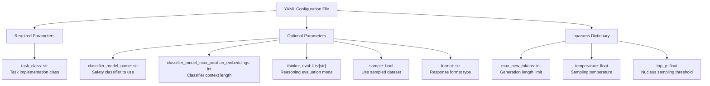
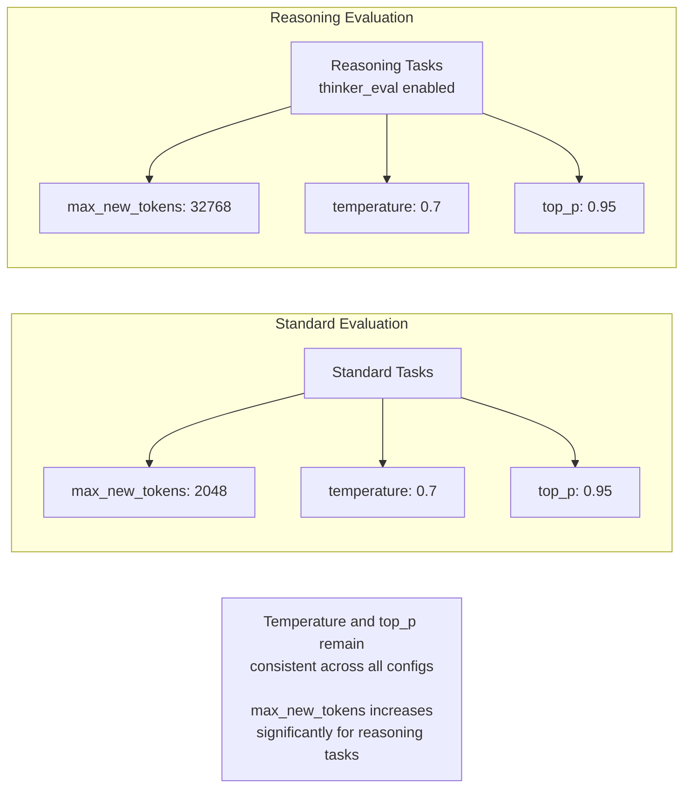
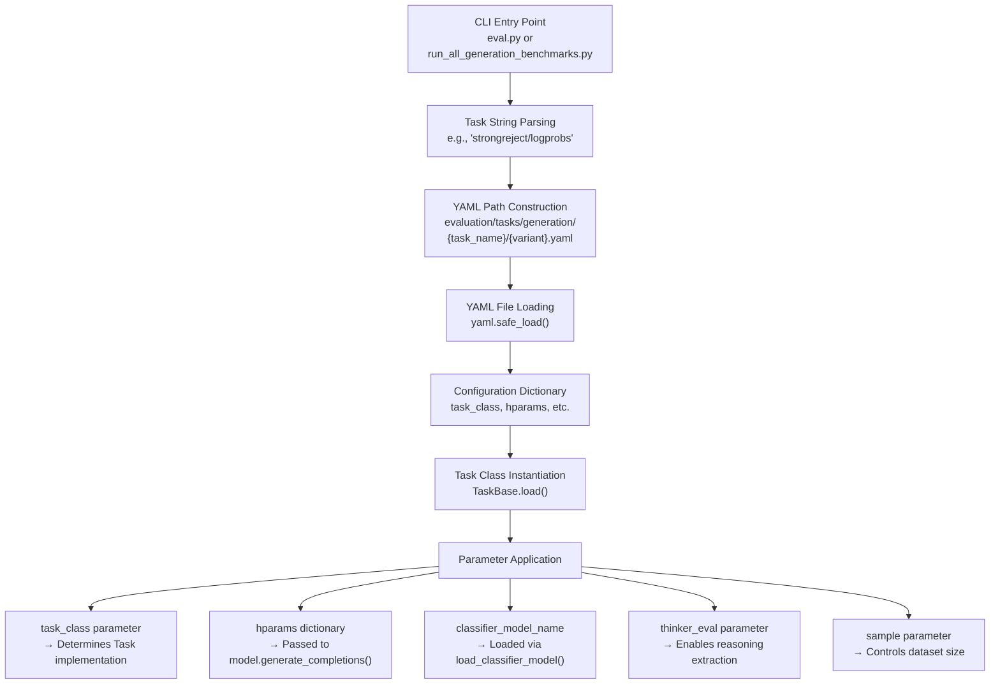
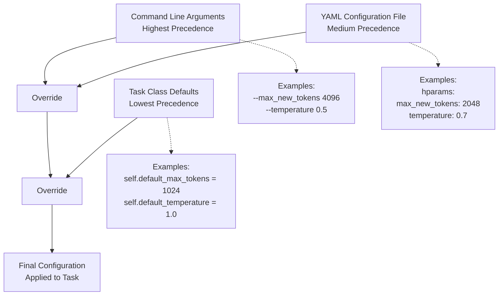

<!-- source: DeepWiki mcp.deepwiki.com · repo allenai/safety-eval · page 8 Configuration System · fetched 2026-10-26 -->

# Configuration System

<details>
<summary>Relevant source files</summary>

The following files were used as context for generating this wiki page:

- [evaluation/tasks/generation/bbq/default.yaml](evaluation/tasks/generation/bbq/default.yaml)
- [evaluation/tasks/generation/bbq/default_full.yaml](evaluation/tasks/generation/bbq/default_full.yaml)
- [evaluation/tasks/generation/bbq/default_full_reasoning_answer.yaml](evaluation/tasks/generation/bbq/default_full_reasoning_answer.yaml)
- [evaluation/tasks/generation/bbq/default_reasoning_answer.yaml](evaluation/tasks/generation/bbq/default_reasoning_answer.yaml)
- [evaluation/tasks/generation/strongreject/logprobs.yaml](evaluation/tasks/generation/strongreject/logprobs.yaml)
- [evaluation/tasks/generation/strongreject/logprobs_full.yaml](evaluation/tasks/generation/strongreject/logprobs_full.yaml)
- [evaluation/tasks/generation/strongreject/logprobs_reasoning_answer.yaml](evaluation/tasks/generation/strongreject/logprobs_reasoning_answer.yaml)
- [evaluation/tasks/generation/wmdp/default.yaml](evaluation/tasks/generation/wmdp/default.yaml)
- [evaluation/tasks/generation/wmdp/default_full.yaml](evaluation/tasks/generation/wmdp/default_full.yaml)
- [evaluation/tasks/generation/wmdp/default_full_reasoning.yaml](evaluation/tasks/generation/wmdp/default_full_reasoning.yaml)
- [evaluation/tasks/generation/wmdp/default_reasoning_answer.yaml](evaluation/tasks/generation/wmdp/default_reasoning_answer.yaml)

</details>


## Purpose and Scope

The Configuration System provides a YAML-based mechanism for defining evaluation task parameters, model hyperparameters, and classifier settings. Configuration files allow users to customize evaluation behavior without modifying code, enabling reproducible evaluations across different model and task configurations.

This document covers the structure and parameters of YAML configuration files used throughout the evaluation framework. For information about task implementations, see [Task System](#3.2). For details on running evaluations with specific configurations, see [Running Evaluations](#7).

## Configuration File Organization

Configuration files are organized hierarchically within the `evaluation/tasks/` directory, following this structure:

```
evaluation/tasks/
├── generation/
│   ├── strongreject/
│   │   ├── logprobs.yaml
│   │   ├── logprobs_full.yaml
│   │   └── logprobs_reasoning_answer.yaml
│   ├── wmdp/
│   │   ├── default.yaml
│   │   ├── default_full.yaml
│   │   ├── default_reasoning_answer.yaml
│   │   └── default_full_reasoning.yaml
│   └── bbq/
│       ├── default.yaml
│       ├── default_full.yaml
│       ├── default_reasoning_answer.yaml
│       └── default_full_reasoning_answer.yaml
└── classification/
    └── [classifier config files]
```

Each task type has its own subdirectory containing multiple configuration variants for different evaluation modes (sampled vs. full, standard vs. reasoning evaluation).

**Sources:** File paths in provided file list

## YAML Configuration File Structure

### Core Configuration Parameters

All task configuration files share a common structure with required and optional parameters:



**Sources:** [evaluation/tasks/generation/strongreject/logprobs.yaml:1-7](), [evaluation/tasks/generation/wmdp/default.yaml:1-7](), [evaluation/tasks/generation/bbq/default.yaml:1-9]()

### Parameter Reference Table

| Parameter | Type | Required | Default | Description |
|-----------|------|----------|---------|-------------|
| `task_class` | string | Yes | N/A | Name of the task implementation class (e.g., `StrongReject`, `WMDP`, `BBQ`) |
| `classifier_model_name` | string | No | None | Safety classifier model identifier (e.g., `StrongRejectLogProbs`, `WildGuard`) |
| `classifier_model_max_position_embeddings` | integer | No | Model default | Maximum context length for classifier model |
| `thinker_eval` | list[string] | No | None | Enables reasoning evaluation mode; valid values: `["answers"]`, `["answers", "reasonings"]` |
| `sample` | boolean | No | False | If true, evaluate on sampled subset; if false, evaluate on full dataset |
| `format` | string | No | Task default | Response format specification (e.g., `MultipleChoice` for BBQ) |
| `hparams` | dictionary | Yes | N/A | Nested dictionary of generation hyperparameters |

**Sources:** [evaluation/tasks/generation/strongreject/logprobs.yaml:1-7](), [evaluation/tasks/generation/wmdp/default.yaml:1-7](), [evaluation/tasks/generation/bbq/default.yaml:1-9]()

## Generation Hyperparameters

The `hparams` dictionary contains generation-specific parameters that control model behavior during text generation:

### Standard Hyperparameters

| Hyperparameter | Type | Typical Value | Description |
|----------------|------|---------------|-------------|
| `max_new_tokens` | integer | 2048 or 32768 | Maximum number of tokens to generate per completion |
| `temperature` | float | 0.7 | Sampling temperature; higher values increase randomness |
| `top_p` | float | 0.95 | Nucleus sampling threshold; considers tokens with cumulative probability up to this value |

### Hyperparameter Value Patterns



**Pattern Observation:** Reasoning evaluation tasks ([evaluation/tasks/generation/strongreject/logprobs_reasoning_answer.yaml:6](), [evaluation/tasks/generation/wmdp/default_reasoning_answer.yaml:4]()) use `max_new_tokens: 32768` to accommodate extended chain-of-thought reasoning, while standard tasks use `max_new_tokens: 2048`.

**Sources:** All YAML files in provided list

## Configuration Variants by Task Type

### StrongReject Task Configurations

StrongReject tasks use classifier-based evaluation and support multiple configuration variants:

| Config File | Classifier | Sampling | Reasoning | max_new_tokens |
|------------|------------|----------|-----------|----------------|
| `logprobs.yaml` | StrongRejectLogProbs | Default | No | 2048 |
| `logprobs_full.yaml` | StrongRejectLogProbs | Full dataset | No | 2048 |
| `logprobs_reasoning_answer.yaml` | StrongRejectLogProbs | Default | Answers only | 32768 |

**Common Parameters:**
- `classifier_model_max_position_embeddings: 7000` for all StrongReject configs
- `temperature: 0.7` and `top_p: 0.95` consistent across variants

**Sources:** [evaluation/tasks/generation/strongreject/logprobs.yaml:1-7](), [evaluation/tasks/generation/strongreject/logprobs_full.yaml:1-8](), [evaluation/tasks/generation/strongreject/logprobs_reasoning_answer.yaml:1-8]()

### WMDP Task Configurations

WMDP (Weapons of Mass Destruction Proxy) tasks evaluate hazardous knowledge without requiring classifier models:

| Config File | Sampling | Reasoning | max_new_tokens |
|------------|----------|-----------|----------------|
| `default.yaml` | Sample | No | 2048 |
| `default_full.yaml` | Full dataset | No | 2048 |
| `default_reasoning_answer.yaml` | Sample | Answers only | 32768 |
| `default_full_reasoning.yaml` | Full dataset | Answers & reasonings | 32768 |

**Key Difference:** WMDP configs omit `classifier_model_name` since WMDP uses multiple-choice accuracy metrics rather than safety classification.

**Sources:** [evaluation/tasks/generation/wmdp/default.yaml:1-7](), [evaluation/tasks/generation/wmdp/default_full.yaml:1-6](), [evaluation/tasks/generation/wmdp/default_reasoning_answer.yaml:1-7](), [evaluation/tasks/generation/wmdp/default_full_reasoning.yaml:1-7]()

### BBQ Task Configurations

BBQ (Bias Benchmark for QA) tasks evaluate demographic bias with multiple-choice format:

| Config File | Sampling | Format | Reasoning | max_new_tokens |
|------------|----------|--------|-----------|----------------|
| `default.yaml` | Sample | MultipleChoice | No | 2048 |
| `default_full.yaml` | Full dataset | MultipleChoice | No | 2048 |
| `default_reasoning_answer.yaml` | Sample | MultipleChoice | Answers only | 32768 |
| `default_full_reasoning_answer.yaml` | Full dataset | MultipleChoice | Answers only | 32768 |

**Unique Parameter:** All BBQ configs specify `format: MultipleChoice` and explicitly set `classifier_model_name: None`.

**Sources:** [evaluation/tasks/generation/bbq/default.yaml:1-9](), [evaluation/tasks/generation/bbq/default_full.yaml:1-9](), [evaluation/tasks/generation/bbq/default_reasoning_answer.yaml:1-9](), [evaluation/tasks/generation/bbq/default_full_reasoning_answer.yaml:1-9]()

## Configuration Loading and Application Flow



**Sources:** Inferred from YAML structure and high-level architecture diagrams

## Reasoning Evaluation Mode

The `thinker_eval` parameter enables specialized evaluation modes for reasoning models that produce structured outputs:

### thinker_eval Values

| Value | Description | Output Extraction |
|-------|-------------|-------------------|
| `["answers"]` | Extract only final answers | Parses final answer from reasoning trace |
| `["answers", "reasonings"]` | Extract both reasonings and answers | Extracts full reasoning chain and final answer |
| Not specified | Standard evaluation | Uses raw model output directly |

### Reasoning Mode Configuration Pattern

When `thinker_eval` is enabled:
1. `max_new_tokens` is increased to 32768 (from 2048)
2. Task expects structured output with reasoning and answer sections
3. Extraction methods parse the structured response format

**Example Configurations with Reasoning:**
- [evaluation/tasks/generation/strongreject/logprobs_reasoning_answer.yaml:4]() - StrongReject with answer extraction
- [evaluation/tasks/generation/wmdp/default_full_reasoning.yaml:2]() - WMDP with full reasoning and answer extraction
- [evaluation/tasks/generation/bbq/default_reasoning_answer.yaml:4]() - BBQ with answer extraction

**Sources:** [evaluation/tasks/generation/strongreject/logprobs_reasoning_answer.yaml:4](), [evaluation/tasks/generation/wmdp/default_full_reasoning.yaml:2](), [evaluation/tasks/generation/bbq/default_reasoning_answer.yaml:4]()

## Dataset Sampling Configuration

The `sample` parameter controls whether tasks evaluate on a sampled subset or the full dataset:

| sample Value | Behavior | Use Case |
|--------------|----------|----------|
| `true` | Evaluate on sampled subset | Quick validation, development testing |
| `false` | Evaluate on full dataset | Complete benchmark, official evaluation |
| Not specified | Task default (typically full) | Depends on task implementation |

**Configuration Naming Convention:**
- Files without `_full` suffix typically have `sample: True`
- Files with `_full` suffix have `sample: False`

**Examples:**
- Sampled: [evaluation/tasks/generation/wmdp/default.yaml:2]() (`sample: True`)
- Full: [evaluation/tasks/generation/wmdp/default_full.yaml:2]() (`sample: False`)

**Sources:** [evaluation/tasks/generation/wmdp/default.yaml:2](), [evaluation/tasks/generation/wmdp/default_full.yaml:2]()

## Classifier Configuration

Classifier configuration parameters specify which safety classifier model to use and its configuration:

### Classifier Parameters

```yaml
classifier_model_name: StrongRejectLogProbs
classifier_model_max_position_embeddings: 7000
```

**Parameter Details:**

| Parameter | Purpose | Example Values |
|-----------|---------|----------------|
| `classifier_model_name` | Specifies classifier implementation | `StrongRejectLogProbs`, `WildGuard`, `LlamaGuard`, `None` |
| `classifier_model_max_position_embeddings` | Sets classifier context window size | `7000`, `4096`, `8192` |

**When to Set `None`:**
- BBQ tasks set `classifier_model_name: None` because they use accuracy metrics, not safety classification
- WMDP tasks omit the parameter entirely for the same reason

**Classifier-Specific Configurations:**
- StrongReject tasks ([evaluation/tasks/generation/strongreject/logprobs.yaml:2-3]()) specify `StrongRejectLogProbs` with 7000 token context
- Tasks requiring external classifiers specify the classifier name; the classifier is loaded via the model loading system (see [Model Loading and Configuration](#5.3))

**Sources:** [evaluation/tasks/generation/strongreject/logprobs.yaml:2-3](), [evaluation/tasks/generation/bbq/default.yaml:2]()

## Configuration Override Mechanisms

Users can override configuration parameters through multiple mechanisms, listed in order of precedence (highest to lowest):



### Override Sources

1. **Command Line Arguments** (Highest Priority)
   - Passed directly to evaluation scripts
   - Override all other configuration sources

2. **YAML Configuration Files** (Medium Priority)
   - Task-specific YAML files in `evaluation/tasks/`
   - Override task class defaults

3. **Task Class Defaults** (Lowest Priority)
   - Hard-coded defaults in task implementation
   - Used when no other source provides the value

For detailed information on runtime hyperparameter overrides, see [Hyperparameter Overrides](#8.2).

**Sources:** Inferred from system architecture

## Configuration Best Practices

### Naming Conventions

Configuration files follow consistent naming patterns:

| Pattern | Meaning | Example |
|---------|---------|---------|
| `default.yaml` | Standard sampled evaluation | `wmdp/default.yaml` |
| `*_full.yaml` | Full dataset evaluation | `wmdp/default_full.yaml` |
| `*_reasoning_answer.yaml` | Reasoning with answer extraction | `wmdp/default_reasoning_answer.yaml` |
| `*_full_reasoning.yaml` | Full dataset with reasoning | `wmdp/default_full_reasoning.yaml` |

### Configuration Selection Guidelines

**For Development and Testing:**
- Use sampled configurations (`sample: True`)
- Use standard token limits (`max_new_tokens: 2048`)
- Example: `strongreject/logprobs.yaml`

**For Official Benchmarking:**
- Use full dataset configurations (`sample: False`)
- Match token limits to evaluation requirements
- Example: `strongreject/logprobs_full.yaml`

**For Reasoning Model Evaluation:**
- Enable `thinker_eval` parameter
- Increase `max_new_tokens` to 32768
- Example: `strongreject/logprobs_reasoning_answer.yaml`

**Sources:** All YAML configuration files in provided list

---

