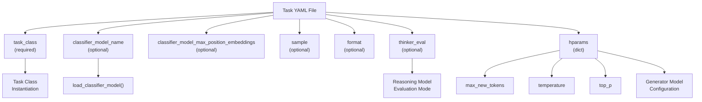
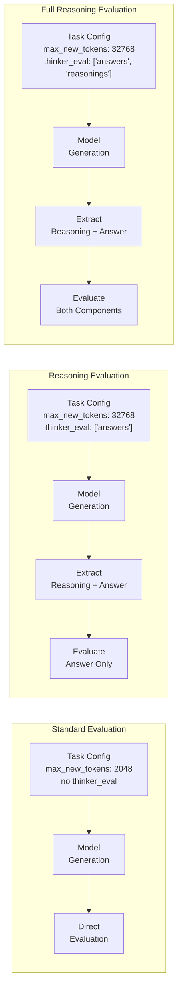
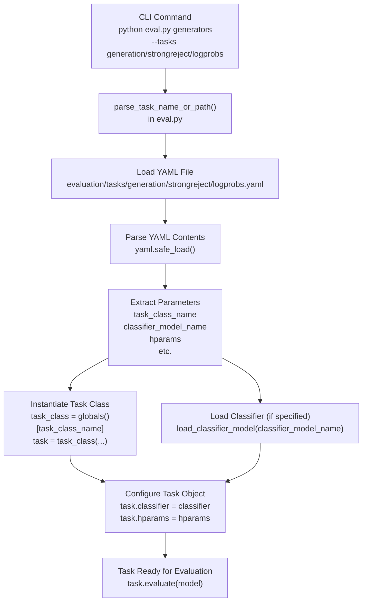
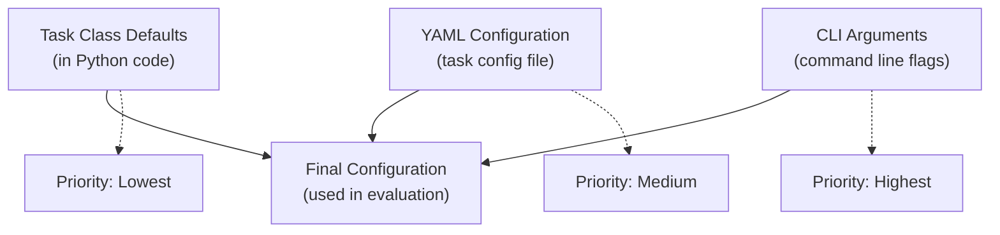

<!-- source: DeepWiki mcp.deepwiki.com · repo allenai/safety-eval · page 8.1 Task Configuration Files · fetched 2026-10-26 -->

# Task Configuration Files

<details>
<summary>Relevant source files</summary>

The following files were used as context for generating this wiki page:

- [evaluation/tasks/generation/bbq/default.yaml](evaluation/tasks/generation/bbq/default.yaml)
- [evaluation/tasks/generation/bbq/default_full.yaml](evaluation/tasks/generation/bbq/default_full.yaml)
- [evaluation/tasks/generation/bbq/default_full_reasoning_answer.yaml](evaluation/tasks/generation/bbq/default_full_reasoning_answer.yaml)
- [evaluation/tasks/generation/bbq/default_reasoning_answer.yaml](evaluation/tasks/generation/bbq/default_reasoning_answer.yaml)
- [evaluation/tasks/generation/strongreject/logprobs.yaml](evaluation/tasks/generation/strongreject/logprobs.yaml)
- [evaluation/tasks/generation/strongreject/logprobs_full.yaml](evaluation/tasks/generation/strongreject/logprobs_full.yaml)
- [evaluation/tasks/generation/strongreject/logprobs_reasoning_answer.yaml](evaluation/tasks/generation/strongreject/logprobs_reasoning_answer.yaml)
- [evaluation/tasks/generation/wmdp/default.yaml](evaluation/tasks/generation/wmdp/default.yaml)
- [evaluation/tasks/generation/wmdp/default_full.yaml](evaluation/tasks/generation/wmdp/default_full.yaml)
- [evaluation/tasks/generation/wmdp/default_full_reasoning.yaml](evaluation/tasks/generation/wmdp/default_full_reasoning.yaml)
- [evaluation/tasks/generation/wmdp/default_reasoning_answer.yaml](evaluation/tasks/generation/wmdp/default_reasoning_answer.yaml)

</details>


## Purpose and Scope

Task configuration files are YAML documents that define the parameters and behavior for evaluation tasks in the safety evaluation framework. Each task type has one or more configuration files that specify which task class to instantiate, which safety classifier to use, sampling strategies, and generation hyperparameters.

This document covers the structure, parameters, and usage of task YAML configuration files. For information about how hyperparameters can be overridden at runtime, see [Hyperparameter Overrides](#8.2). For details about the task system architecture, see [Task System](#3.2). For information about specific task implementations, see [Evaluation Tasks](#4).

## File Organization and Naming Conventions

Task configuration files are organized in a hierarchical directory structure under `evaluation/tasks/`:

```
evaluation/tasks/
├── generation/
│   ├── strongreject/
│   │   ├── logprobs.yaml
│   │   ├── logprobs_full.yaml
│   │   ├── logprobs_reasoning_answer.yaml
│   │   └── ...
│   ├── wmdp/
│   │   ├── default.yaml
│   │   ├── default_full.yaml
│   │   ├── default_reasoning_answer.yaml
│   │   └── ...
│   ├── bbq/
│   │   ├── default.yaml
│   │   ├── default_full.yaml
│   │   ├── default_reasoning_answer.yaml
│   │   └── ...
│   └── ...
└── classification/
    └── ...
```

**Naming Patterns:**
- `default.yaml` - Standard configuration with sampling enabled
- `default_full.yaml` - Full dataset evaluation without sampling
- `*_reasoning_answer.yaml` - Configuration for reasoning models that evaluate extracted answers
- `*_full_reasoning*.yaml` - Full dataset evaluation with reasoning model support

Tasks are referenced in the evaluation system using path-based identifiers like `generation/strongreject/logprobs` or `generation/wmdp/default`, where the path points to the YAML file without the `.yaml` extension.

**Sources:** [evaluation/tasks/generation/strongreject/logprobs.yaml:1-7](), [evaluation/tasks/generation/wmdp/default.yaml:1-7](), [evaluation/tasks/generation/bbq/default.yaml:1-9]()

## Core Configuration Parameters

### YAML Structure Overview



**Sources:** [evaluation/tasks/generation/strongreject/logprobs.yaml:1-7](), [evaluation/tasks/generation/bbq/default.yaml:1-9](), [evaluation/tasks/generation/wmdp/default_full_reasoning.yaml:1-7]()

### Required Parameters

#### `task_class`

The `task_class` parameter specifies which Python class implements the evaluation task. This must correspond to a class that inherits from `TaskBase`, `OpenEndedTaskBase`, or `ClassificationTaskBase`.

```yaml
task_class: StrongReject
```

Common task class values:
- `StrongReject` - StrongReject adversarial safety evaluation
- `WMDP` - Weapons of Mass Destruction Proxy benchmark
- `BBQ` - Bias Benchmark for QA
- `HarmbenchVanilla` - Harmbench harmful behavior testing
- `XSTest` - Exaggerated safety testing
- `ToxiGen` - Toxicity generation evaluation

The task class name maps directly to the Python class implementation in the codebase.

**Sources:** [evaluation/tasks/generation/strongreject/logprobs.yaml:1](), [evaluation/tasks/generation/wmdp/default.yaml:1](), [evaluation/tasks/generation/bbq/default.yaml:1]()

### Optional Core Parameters

#### `classifier_model_name`

Specifies which safety classifier model to use for evaluating generated outputs. If set to `None` or omitted, the task will use its default classifier or no classifier if none is required.

```yaml
classifier_model_name: StrongRejectLogProbs
```

Common classifier values:
- `StrongRejectLogProbs` - Log probability-based StrongReject classifier
- `wildguard` - WildGuard safety classifier
- `llamaguard-2` - LlamaGuard 2 safety classifier
- `None` - No classifier or use task default

**Sources:** [evaluation/tasks/generation/strongreject/logprobs.yaml:2](), [evaluation/tasks/generation/bbq/default.yaml:2]()

#### `classifier_model_max_position_embeddings`

Sets the maximum position embeddings for the classifier model. This is important for models with longer context requirements.

```yaml
classifier_model_max_position_embeddings: 7000
```

**Sources:** [evaluation/tasks/generation/strongreject/logprobs.yaml:3]()

#### `sample`

Controls whether to sample a subset of the dataset or use the full dataset for evaluation.

```yaml
sample: True   # Use sampling
sample: False  # Use full dataset
```

When `sample: True`, the task will typically evaluate a representative subset. When `sample: False`, the entire dataset is evaluated. The specific sampling strategy is implemented within each task class.

**Sources:** [evaluation/tasks/generation/wmdp/default.yaml:2](), [evaluation/tasks/generation/wmdp/default_full.yaml:2](), [evaluation/tasks/generation/bbq/default.yaml:4]()

#### `format`

Specifies the input/output format for the task. This parameter is task-specific and determines how prompts are formatted and responses are parsed.

```yaml
format: MultipleChoice
```

**Sources:** [evaluation/tasks/generation/bbq/default.yaml:3]()

### Generation Hyperparameters (`hparams`)

The `hparams` dictionary contains generation hyperparameters that control model output behavior. These parameters are passed to the generator model during inference.

```yaml
hparams:
  max_new_tokens: 2048
  temperature: 0.7
  top_p: 0.95
```

**Standard Hyperparameters:**

| Parameter | Description | Typical Values |
|-----------|-------------|----------------|
| `max_new_tokens` | Maximum number of tokens to generate | `2048` (standard), `32768` (reasoning models) |
| `temperature` | Sampling temperature for generation | `0.7` (default), `0.0` (greedy) |
| `top_p` | Nucleus sampling probability threshold | `0.95` (default) |

**Sources:** [evaluation/tasks/generation/strongreject/logprobs.yaml:4-7](), [evaluation/tasks/generation/wmdp/default.yaml:3-7](), [evaluation/tasks/generation/bbq/default.yaml:5-9]()

## Reasoning Model Configurations

### `thinker_eval` Parameter

The `thinker_eval` parameter enables specialized evaluation modes for reasoning models (often called "thinker" models). These models generate extended reasoning traces before producing final answers, and evaluation can be performed on different parts of the output.

```yaml
thinker_eval: ["answers"]
thinker_eval: ["answers", "reasonings"]
```

**Evaluation Modes:**

| Value | Description | Use Case |
|-------|-------------|----------|
| `["answers"]` | Evaluate only extracted final answers | Standard reasoning evaluation |
| `["answers", "reasonings"]` | Evaluate both answers and reasoning traces | Comprehensive reasoning analysis |

When `thinker_eval` is specified, the task uses specialized extraction logic to parse the model's output and separate reasoning from final answers.

**Token Budget Adjustment:**

Reasoning model configurations typically require significantly larger token budgets to accommodate extended thinking traces:

```yaml
# Standard configuration
hparams:
  max_new_tokens: 2048

# Reasoning configuration
thinker_eval: ["answers"]
hparams:
  max_new_tokens: 32768  # 16x larger for reasoning traces
```

**Sources:** [evaluation/tasks/generation/strongreject/logprobs_reasoning_answer.yaml:4-8](), [evaluation/tasks/generation/wmdp/default_full_reasoning.yaml:2-7](), [evaluation/tasks/generation/bbq/default_reasoning_answer.yaml:4-9]()

### Reasoning Configuration Patterns



**Sources:** [evaluation/tasks/generation/strongreject/logprobs_reasoning_answer.yaml:1-8](), [evaluation/tasks/generation/wmdp/default_full_reasoning.yaml:1-7](), [evaluation/tasks/generation/wmdp/default_reasoning_answer.yaml:1-7]()

## Configuration Examples by Task Type

### StrongReject Configurations

**Standard Configuration:**
```yaml
task_class: StrongReject
classifier_model_name: StrongRejectLogProbs
classifier_model_max_position_embeddings: 7000
hparams:
  max_new_tokens: 2048
  temperature: 0.7
  top_p: 0.95
```

**Full Dataset Configuration:**
```yaml
task_class: StrongReject
classifier_model_name: StrongRejectLogProbs
classifier_model_max_position_embeddings: 7000
sample: False
hparams:
  max_new_tokens: 2048
  temperature: 0.7
  top_p: 0.95
```

**Reasoning Model Configuration:**
```yaml
task_class: StrongReject
classifier_model_name: StrongRejectLogProbs
classifier_model_max_position_embeddings: 7000
thinker_eval: ["answers"]
hparams:
  max_new_tokens: 32768
  temperature: 0.7
  top_p: 0.95
```

**Sources:** [evaluation/tasks/generation/strongreject/logprobs.yaml:1-7](), [evaluation/tasks/generation/strongreject/logprobs_full.yaml:1-8](), [evaluation/tasks/generation/strongreject/logprobs_reasoning_answer.yaml:1-8]()

### WMDP Configurations

**Standard Configuration (with sampling):**
```yaml
task_class: WMDP
sample: True
hparams:
  max_new_tokens: 2048
  temperature: 0.7
  top_p: 0.95
```

**Full Dataset Configuration:**
```yaml
task_class: WMDP
sample: False
hparams:
  max_new_tokens: 2048
  temperature: 0.7
  top_p: 0.95
```

**Reasoning Model Configuration:**
```yaml
task_class: WMDP
thinker_eval: ["answers"]
sample: True
hparams:
  max_new_tokens: 32768
  temperature: 0.7
  top_p: 0.95
```

**Full Reasoning Configuration:**
```yaml
task_class: WMDP
thinker_eval: ["answers", "reasonings"]
sample: False
hparams:
  max_new_tokens: 32768
  temperature: 0.7
  top_p: 0.95
```

**Sources:** [evaluation/tasks/generation/wmdp/default.yaml:1-7](), [evaluation/tasks/generation/wmdp/default_full.yaml:1-6](), [evaluation/tasks/generation/wmdp/default_reasoning_answer.yaml:1-7](), [evaluation/tasks/generation/wmdp/default_full_reasoning.yaml:1-7]()

### BBQ Configurations

**Standard Configuration:**
```yaml
task_class: BBQ
classifier_model_name: None
format: MultipleChoice
sample: True
hparams:
  max_new_tokens: 2048
  temperature: 0.7
  top_p: 0.95
```

**Reasoning Model Configuration:**
```yaml
task_class: BBQ
classifier_model_name: None
format: MultipleChoice
thinker_eval: ["answers"]
sample: True
hparams:
  max_new_tokens: 32768
  temperature: 0.7
  top_p: 0.95
```

**Sources:** [evaluation/tasks/generation/bbq/default.yaml:1-9](), [evaluation/tasks/generation/bbq/default_reasoning_answer.yaml:1-9](), [evaluation/tasks/generation/bbq/default_full.yaml:1-9]()

## Configuration Loading and Usage

### Configuration Resolution Flow



**Sources:** [evaluation/tasks/generation/strongreject/logprobs.yaml:1-7](), [evaluation/tasks/generation/wmdp/default.yaml:1-7](), [evaluation/tasks/generation/bbq/default.yaml:1-9]()

### Task Name Resolution

Task names in CLI commands are resolved to YAML configuration files using the following logic:

1. **Path-based Resolution:** Task name like `generation/strongreject/logprobs` maps to `evaluation/tasks/generation/strongreject/logprobs.yaml`

2. **Parameter Extraction:** YAML file is loaded and parsed to extract:
   - `task_class` → Python class name
   - `classifier_model_name` → Classifier to load
   - `hparams` → Generation hyperparameters
   - Other task-specific parameters

3. **Class Instantiation:** The task class is instantiated dynamically:
   ```python
   task_class = globals()[task_class_name]
   task = task_class(**task_params)
   ```

4. **Classifier Loading:** If `classifier_model_name` is specified:
   ```python
   classifier = load_classifier_model(classifier_model_name, ...)
   task.classifier = classifier
   ```

**Sources:** [evaluation/tasks/generation/strongreject/logprobs.yaml:1-2](), [evaluation/tasks/generation/wmdp/default.yaml:1]()

### Parameter Override Hierarchy

Configuration parameters can be overridden at multiple levels:



The override hierarchy (from lowest to highest priority):
1. **Task Class Defaults** - Hardcoded in task implementation
2. **YAML Configuration** - Specified in task YAML file
3. **CLI Arguments** - Runtime overrides via command line

For details on runtime overrides, see [Hyperparameter Overrides](#8.2).

**Sources:** [evaluation/tasks/generation/strongreject/logprobs.yaml:4-7](), [evaluation/tasks/generation/wmdp/default.yaml:3-7]()

## Configuration Validation

When a YAML configuration file is loaded, the system performs several validation checks:

1. **Required Fields:** Verifies that `task_class` is present
2. **Class Existence:** Confirms that the specified task class exists in the codebase
3. **Classifier Validity:** If `classifier_model_name` is specified, validates it exists
4. **Hyperparameter Types:** Ensures `hparams` values are of correct types
5. **Task-Specific Validation:** Each task class may perform additional validation

Invalid configurations will raise errors during task instantiation, preventing evaluation from starting.

**Sources:** [evaluation/tasks/generation/strongreject/logprobs.yaml:1-7](), [evaluation/tasks/generation/wmdp/default.yaml:1-7](), [evaluation/tasks/generation/bbq/default.yaml:1-9]()

## Best Practices

### Configuration File Organization

1. **Use Descriptive Names:** Name files to indicate their purpose (e.g., `default.yaml`, `logprobs_full.yaml`, `reasoning_answer.yaml`)

2. **Separate Sampling Variants:** Create separate configs for sampled vs. full dataset evaluation
   - `default.yaml` for sampled
   - `default_full.yaml` for full dataset

3. **Separate Reasoning Variants:** Use distinct configs for reasoning models
   - Standard configs: `max_new_tokens: 2048`
   - Reasoning configs: `max_new_tokens: 32768`, `thinker_eval: ["answers"]`

4. **Group Related Configurations:** Keep all variants of a task in the same directory

### Hyperparameter Selection

| Scenario | Recommended Settings |
|----------|---------------------|
| Standard evaluation | `max_new_tokens: 2048, temperature: 0.7, top_p: 0.95` |
| Reasoning models | `max_new_tokens: 32768, temperature: 0.7, top_p: 0.95` |
| Greedy decoding | `temperature: 0.0, top_p: 1.0` |
| Creative generation | `temperature: 1.0, top_p: 0.95` |

### Classifier Selection

- **StrongReject tasks:** Use `StrongRejectLogProbs` for fine-grained evaluation
- **General safety:** Consider `wildguard` or `llamaguard-2`
- **No classification needed:** Set `classifier_model_name: None`
- **Task default:** Omit parameter to use task's default classifier

**Sources:** [evaluation/tasks/generation/strongreject/logprobs.yaml:1-7](), [evaluation/tasks/generation/wmdp/default.yaml:1-7](), [evaluation/tasks/generation/bbq/default.yaml:1-9](), [evaluation/tasks/generation/strongreject/logprobs_reasoning_answer.yaml:1-8](), [evaluation/tasks/generation/wmdp/default_full_reasoning.yaml:1-7]()

---

