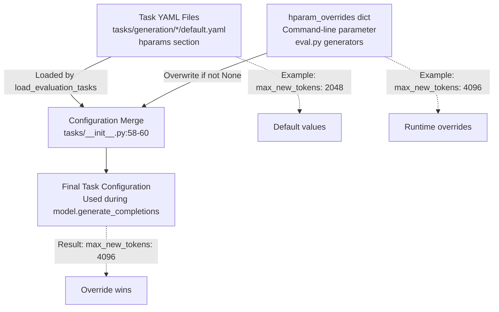
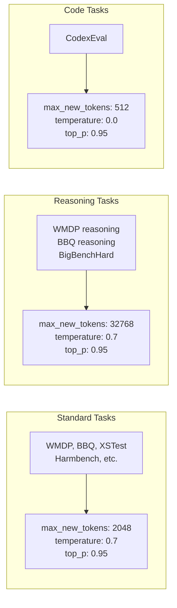
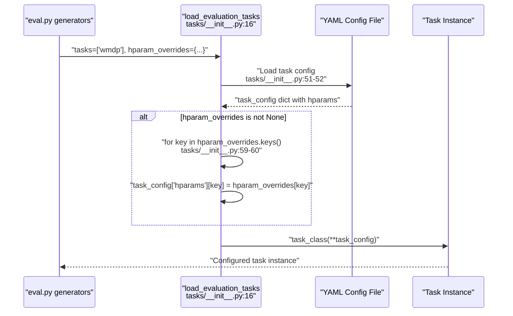
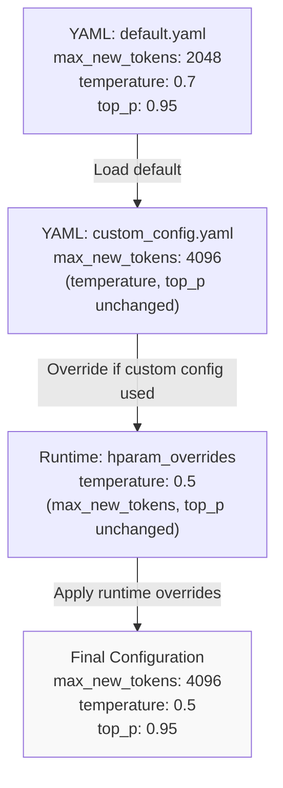
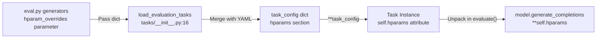

<!-- source: DeepWiki mcp.deepwiki.com · repo allenai/safety-eval · page 8.2 Hyperparameter Overrides · fetched 2026-10-26 -->

# Hyperparameter Overrides

<details>
<summary>Relevant source files</summary>

The following files were used as context for generating this wiki page:

- [evaluation/eval.py](evaluation/eval.py)
- [evaluation/tasks/__init__.py](evaluation/tasks/__init__.py)
- [evaluation/tasks/generation/wmdp/default.yaml](evaluation/tasks/generation/wmdp/default.yaml)
- [evaluation/tasks/generation/wmdp/default_full.yaml](evaluation/tasks/generation/wmdp/default_full.yaml)
- [evaluation/tasks/generation/wmdp/default_full_reasoning.yaml](evaluation/tasks/generation/wmdp/default_full_reasoning.yaml)
- [evaluation/tasks/generation/wmdp/default_reasoning_answer.yaml](evaluation/tasks/generation/wmdp/default_reasoning_answer.yaml)

</details>


This page documents the hyperparameter override system that allows runtime customization of generation parameters without modifying task configuration files. Hyperparameter overrides enable users to control generation behavior (token limits, temperature, sampling parameters) when running evaluations, providing flexibility for experimentation and model-specific tuning.

For information about task configuration files themselves, see [Task Configuration Files](#8.1). For details about running evaluations with various configurations, see [Single Task Evaluation](#7.1) and [Batch Evaluation with GPU Orchestration](#7.2).

## Overview

The framework provides a three-tier configuration system for generation hyperparameters:



**Sources:** [evaluation/eval.py:92-204](), [evaluation/tasks/__init__.py:16-71]()

## Overridable Hyperparameters

The following generation hyperparameters can be overridden at runtime:

| Parameter | Type | Default (typical) | Purpose |
|-----------|------|-------------------|----------|
| `max_new_tokens` | `int` | 2048 or 32768 | Maximum number of tokens to generate in model responses |
| `temperature` | `float` | 0.7 | Sampling temperature; lower values (0.0-0.5) produce more deterministic outputs, higher values (0.7-1.0) increase randomness |
| `top_p` | `float` | 0.95 | Nucleus sampling parameter; only tokens with cumulative probability up to this threshold are considered |

These parameters directly control the behavior of the generator model's `generate_completions` method during evaluation.

**Sources:** [evaluation/eval.py:156](), [evaluation/tasks/generation/wmdp/default.yaml:3-6]()

## Default Values Across Tasks

Different task types have different default hyperparameters based on their requirements:



These defaults are specified in the `hparams` section of each task's YAML configuration file (e.g., `tasks/generation/wmdp/default.yaml` vs `tasks/generation/wmdp/default_reasoning_answer.yaml`).

**Sources:** [evaluation/tasks/generation/wmdp/default.yaml:3-6](), [evaluation/tasks/generation/wmdp/default_full_reasoning.yaml:4-6]()

## Command-Line Override Mechanism

### Using Python Fire Syntax

When running evaluations with `eval.py generators`, pass hyperparameter overrides as a dictionary using Python Fire's syntax:

```bash
python eval.py generators \
    --model_name_or_path ./model \
    --model_input_template_path_or_name llama3 \
    --tasks wmdp,harmbench \
    --report_output_path ./report.json \
    --hparam_overrides '{"max_new_tokens": 4096, "temperature": 0.5}'
```

The `hparam_overrides` parameter accepts a dictionary that can contain any combination of the three overridable parameters.

**Sources:** [evaluation/eval.py:106](), [evaluation/eval.py:156]()

### Override Application Flow

The override mechanism follows this execution path:



**Sources:** [evaluation/tasks/__init__.py:58-60](), [evaluation/eval.py:173-175]()

## Configuration Precedence

The configuration system applies hyperparameters in the following order of precedence (later sources override earlier ones):

1. **YAML Default Values**: Base configuration from `tasks/generation/[task_name]/default.yaml`
2. **YAML Custom Config**: Alternative configuration if specified via `task:config_name` syntax
3. **Runtime Overrides**: Values passed via `hparam_overrides` parameter (highest precedence)

### Example: Configuration Precedence



**Sources:** [evaluation/tasks/__init__.py:34-60]()

## Implementation Details

### Override Application in Code

The override logic is implemented in the task loading function:

```python
# Location: evaluation/tasks/__init__.py:58-60
if hparam_overrides is not None:
    for key in hparam_overrides.keys():
        task_config["hparams"][key] = hparam_overrides[key]
```

This simple loop directly overwrites the `hparams` dictionary entries loaded from the YAML file, ensuring that runtime overrides take precedence.

**Sources:** [evaluation/tasks/__init__.py:58-60]()

### Parameter Passing Chain



**Sources:** [evaluation/eval.py:174](), [evaluation/tasks/__init__.py:58-60]()

## Usage Examples

### Example 1: Increasing Token Budget

To evaluate tasks with a larger generation budget:

```bash
python eval.py generators \
    --model_name_or_path meta-llama/Llama-2-7b-hf \
    --model_input_template_path_or_name llama2 \
    --tasks strongreject,harmbench \
    --report_output_path ./results.json \
    --hparam_overrides '{"max_new_tokens": 8192}'
```

This increases the maximum token count from the default (typically 2048) to 8192 for both tasks.

### Example 2: Deterministic Generation

For reproducible results with minimal randomness:

```bash
python eval.py generators \
    --model_name_or_path gpt-3.5-turbo \
    --model_input_template_path_or_name gpt-3.5-turbo \
    --tasks bbq,xstest \
    --report_output_path ./deterministic.json \
    --hparam_overrides '{"temperature": 0.0, "top_p": 1.0}'
```

This configures greedy decoding (temperature=0) with no top-p filtering.

### Example 3: Multiple Parameter Overrides

To customize multiple parameters simultaneously:

```bash
python eval.py generators \
    --model_name_or_path ./finetuned_model \
    --model_input_template_path_or_name olmo \
    --tasks wmdp,codex_eval \
    --report_output_path ./custom.json \
    --hparam_overrides '{"max_new_tokens": 4096, "temperature": 0.8, "top_p": 0.9}'
```

**Sources:** [evaluation/eval.py:92-204]()

## Limitations and Considerations

### Scope of Overrides

- **Generation Tasks Only**: Hyperparameter overrides only apply to `eval.py generators` mode. Classification tasks (`eval.py classifiers`) do not use generation hyperparameters.
- **Global Application**: When specified, overrides apply to all tasks in the evaluation run. Task-specific overrides require running separate evaluation commands.
- **Fixed Parameter Set**: Only `max_new_tokens`, `temperature`, and `top_p` can be overridden. Other model parameters (like `do_sample`, `num_beams`) are not configurable via this mechanism.

### Not Available in Jailbreak Mode

The `eval.py jailbreak` command does not currently support `hparam_overrides`. To customize hyperparameters for jailbreak evaluations, modify the task YAML files directly or run tasks separately using `generators` mode.

**Sources:** [evaluation/eval.py:206-306]()

## Batch Evaluation Considerations

When using `run_all_generation_benchmarks.py` for multi-GPU batch evaluation, hyperparameter overrides are not directly supported. The batch orchestration script generates evaluation commands without hyperparameter override capabilities. To customize hyperparameters in batch mode:

1. Create custom YAML configuration files for each task
2. Modify the task list to reference custom configs (e.g., `"wmdp:custom_high_temp"`)
3. Run the batch evaluation script with the customized task list

**Sources:** [evaluation/eval.py:92-204](), [evaluation/tasks/__init__.py:16-71]()

---

