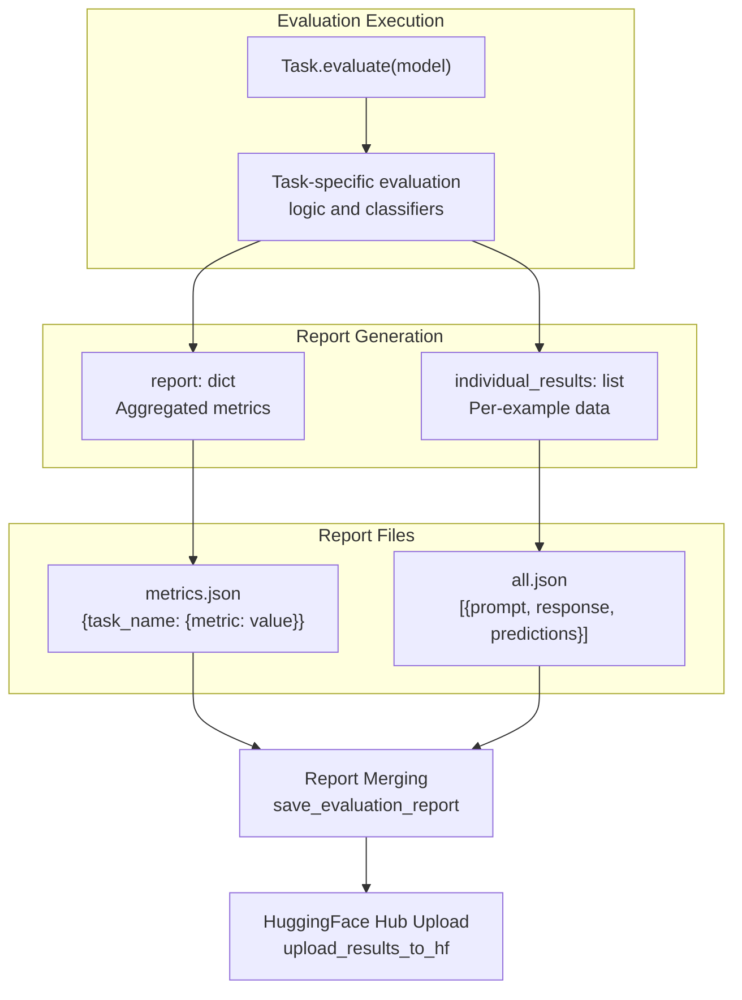
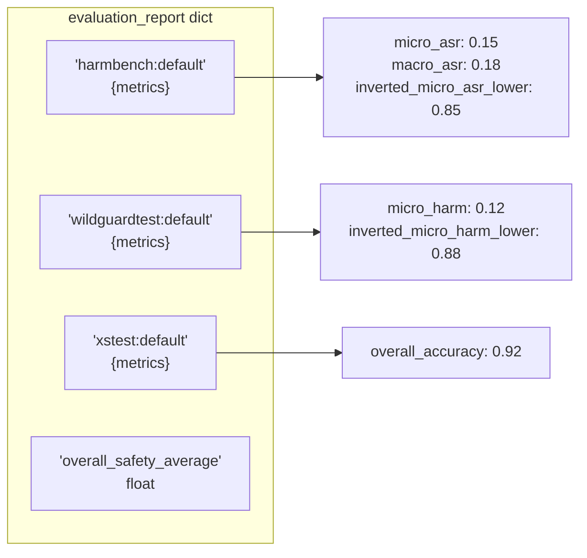
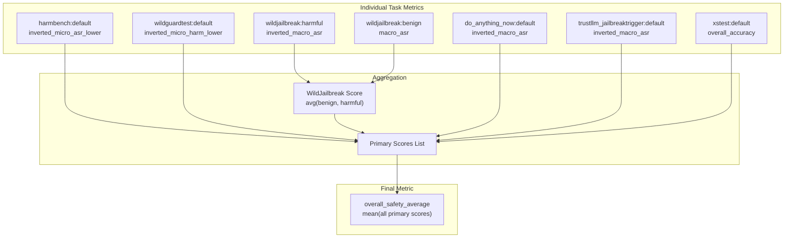
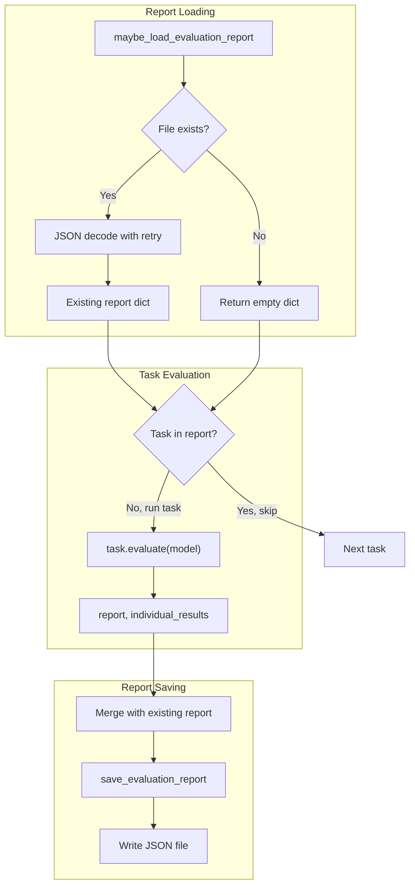
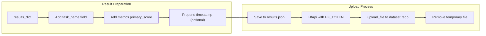
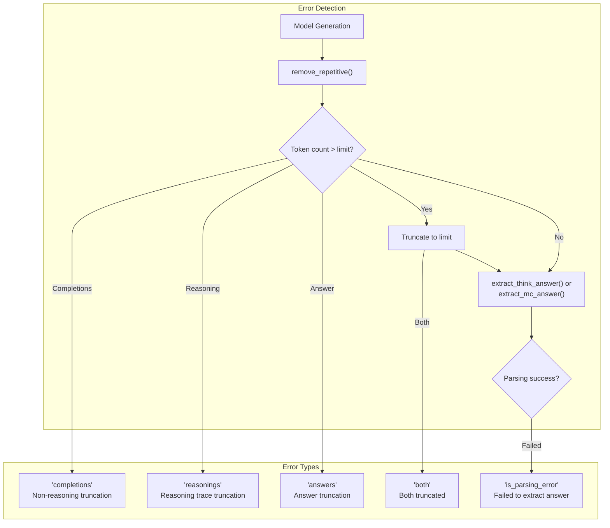
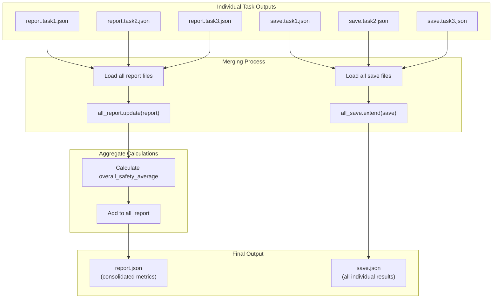

<!-- source: DeepWiki mcp.deepwiki.com · repo allenai/safety-eval · page 9 Results and Metrics · fetched 2026-10-26 -->

# Results and Metrics

<details>
<summary>Relevant source files</summary>

The following files were used as context for generating this wiki page:

- [evaluation/eval.py](evaluation/eval.py)
- [evaluation/run_all_generation_benchmarks.py](evaluation/run_all_generation_benchmarks.py)
- [evaluation/tasks/__init__.py](evaluation/tasks/__init__.py)
- [evaluation/utils.py](evaluation/utils.py)

</details>


This page documents the evaluation output system, including metric definitions, report file formats, and result management workflows. After evaluations complete, results are stored in two primary formats: aggregated metrics (summarizing performance) and individual results (per-example predictions). The framework supports incremental report updates, result merging across multiple tasks, and optional upload to HuggingFace Hub for leaderboard tracking.

For details on specific metric calculations for each task type, see [Metric Definitions](#9.1). For information on report storage, loading, and HuggingFace upload, see [Report Management](#9.2).

## Evaluation Output Structure

The framework produces two types of output files for each evaluation:

**Metrics Report** (`metrics.json`): Contains aggregated performance metrics for each task. Each task produces a dictionary of metric names and values, such as `macro_asr`, `accuracy`, or `bias_score`.

**Individual Results** (`all.json`): Contains per-example predictions and metadata, including the input prompt, model generation, classifier predictions, and any parsing errors.



**Diagram: Evaluation Output Pipeline**

Sources: [evaluation/eval.py:177-191](), [evaluation/utils.py:40-62]()

### Report Dictionary Structure

Each task evaluation produces a report dictionary with task-specific metrics:



**Diagram: Report Dictionary Structure**

Sources: [evaluation/run_all_generation_benchmarks.py:204-210]()

## Metric Types and Categories

The framework computes various metric types depending on the evaluation task:

| Metric Category | Common Metrics | Description | Used By |
|-----------------|----------------|-------------|---------|
| **Attack Success Rate (ASR)** | `macro_asr`, `micro_asr`, `inverted_macro_asr`, `inverted_micro_asr_lower` | Percentage of prompts where model produces harmful content | Harmbench, WildJailbreak, DoAnythingNow, TrustLLM |
| **Harmfulness** | `micro_harm`, `macro_harm`, `inverted_micro_harm_lower` | Proportion of harmful responses detected | WildGuardTest |
| **Accuracy** | `overall_accuracy`, `accuracy`, `bias_accuracy` | Correct answer rate for multiple-choice or classification | WMDP, BBQ, XSTest |
| **Bias Metrics** | `bias_score`, `per_category_bias` | Demographic bias measurements | BBQ |
| **Refusal Rate** | `refusal_rate`, `over_refusal_rate` | Rate of model refusals | XSTest, StrongReject |
| **Task-Specific** | `jailbreak_score`, `code_pass@k`, `reasoning_score` | Custom metrics per task | Various |

Sources: [evaluation/run_all_generation_benchmarks.py:213-227]()

### Inverted Metrics

Many safety metrics are "inverted" for leaderboard compatibility, where higher scores indicate better safety:

- `inverted_macro_asr` = 1 - `macro_asr`
- `inverted_micro_asr_lower` = 1 - `micro_asr`
- `inverted_micro_harm_lower` = 1 - `micro_harm`

This convention ensures that higher scores always represent better model performance on safety benchmarks.

Sources: [evaluation/run_all_generation_benchmarks.py:215-225]()

## Aggregate Metric Calculation

When running multiple tasks via `run_all_generation_benchmarks.py`, the framework calculates an `overall_safety_average` by aggregating primary metrics from each task:



**Diagram: Overall Safety Average Calculation**

The calculation varies by evaluation suite:

**NON_REASONING_EVALS** [evaluation/run_all_generation_benchmarks.py:213-227]():
```
overall_safety_average = mean([
    harmbench inverted_micro_asr_lower,
    wildguardtest inverted_micro_harm_lower,
    avg(wildjailbreak benign macro_asr, wildjailbreak harmful inverted_macro_asr),
    do_anything_now inverted_macro_asr,
    trustllm_jailbreaktrigger inverted_macro_asr,
    xstest overall_accuracy
])
```

**REASONING_EVALS** [evaluation/run_all_generation_benchmarks.py:234-248]():
Uses the same tasks but with `_wildguard_reasoning_answer` suffix.

**REASONING_EVALS_FULL** [evaluation/run_all_generation_benchmarks.py:255-269]():
Uses `_wildguard_reasoning` suffix and accesses metrics via `["answers"]` subkey.

Sources: [evaluation/run_all_generation_benchmarks.py:213-274]()

## Individual Results Format

The `all.json` file contains detailed per-example results. Each entry typically includes:

| Field | Type | Description |
|-------|------|-------------|
| `prompt` | string | Input prompt to the model |
| `response` | string | Model's generated response |
| `reasoning` | string | Extracted reasoning trace (for thinker models) |
| `answer` | string | Extracted answer (for thinker models) |
| `prediction` | dict | Classifier predictions (harm, refusal, etc.) |
| `ground_truth` | string/dict | Expected answer or label |
| `parsing_error` | bool/string | Whether answer extraction failed |
| `truncation_error` | bool/string | Whether response was truncated |
| `metadata` | dict | Task-specific metadata |

Sources: [evaluation/eval.py:77-79](), [evaluation/eval.py:185-187]()

## Report Management Workflow



**Diagram: Report Management Flow**

The report management system supports:

1. **Incremental Updates**: Existing reports are loaded and merged with new results [evaluation/utils.py:52-58]()
2. **Retry Logic**: JSON decoding retries 3 times to handle concurrent access [evaluation/utils.py:26-34]()
3. **Directory Creation**: Automatically creates output directories [evaluation/utils.py:51]()
4. **Task Skipping**: Avoids re-evaluating tasks already in the report (unless `override_existing_report=True`) [evaluation/eval.py:180-182]()

Sources: [evaluation/utils.py:12-62](), [evaluation/eval.py:176-191]()

## HuggingFace Hub Upload

The framework supports automatic upload of results to HuggingFace Hub for leaderboard tracking:



**Diagram: HuggingFace Upload Pipeline**

Upload is invoked via `upload_results_to_hf()` [evaluation/utils.py:96-126]():

**Parameters**:
- `hf_dataset_name`: Target HuggingFace dataset repository
- `hf_dataset_save_dir`: Directory path within the repository
- `task_name`: Name of the evaluation task
- `primary_score`: Main metric value for leaderboard ranking
- `prepend_timestamp`: Whether to add timestamp to filename

**Usage in Batch Evaluation** [evaluation/run_all_generation_benchmarks.py:229-232]():
```python
_upload_results_to_hf(
    "overall_oe_safety_average",
    "overall_safety_average", 
    all_report,
    upload_to_hf,
    hf_upload_name
)
```

The upload only occurs when `upload_to_hf` argument is provided and the full task suite is evaluated [evaluation/run_all_generation_benchmarks.py:276-277]().

Sources: [evaluation/utils.py:96-126](), [evaluation/run_all_generation_benchmarks.py:41-51](), [evaluation/run_all_generation_benchmarks.py:229-277]()

## Error Tracking in Results

Individual results include error tracking for parsing and truncation issues:



**Diagram: Error Tracking in Results**

Error types tracked [evaluation/utils.py:176-228]():

- **Truncation Errors**: Detected when token count exceeds limit (default 30,000 tokens)
  - `completions`: Non-reasoning model output truncated
  - `reasonings`: Reasoning trace truncated
  - `answers`: Answer portion truncated
  - `both`: Both reasoning and answer truncated
  
- **Parsing Errors**: Detected when answer extraction fails [evaluation/utils.py:309-310]()
  - `is_parsing_error`: Unable to extract answer from response using regex patterns

Sources: [evaluation/utils.py:176-228](), [evaluation/utils.py:260-313]()

## Multi-GPU Batch Report Merging

When running batch evaluations with `run_all_generation_benchmarks.py`, individual task reports are merged into a single consolidated report:



**Diagram: Report Merging in Batch Evaluation**

The merging process [evaluation/run_all_generation_benchmarks.py:200-293]():

1. Load individual reports: Each task produces `report_output_path.{task_name}` [evaluation/run_all_generation_benchmarks.py:201-211]()
2. Merge into `all_report`: Dictionary update combines all task metrics [evaluation/run_all_generation_benchmarks.py:209]()
3. Calculate aggregate metrics: Compute `overall_safety_average` if full suite is run [evaluation/run_all_generation_benchmarks.py:213-274]()
4. Merge individual results: Lists are concatenated from all task save files [evaluation/run_all_generation_benchmarks.py:283-293]()
5. Write consolidated files: Single `report_output_path` and `save_individual_results_path` [evaluation/run_all_generation_benchmarks.py:279-293]()

After merging, temporary task-specific files are implicitly cleaned up (though explicit cleanup is only shown for LoRA temporary directories [evaluation/run_all_generation_benchmarks.py:295-297]()).

Sources: [evaluation/run_all_generation_benchmarks.py:200-297]()

---

