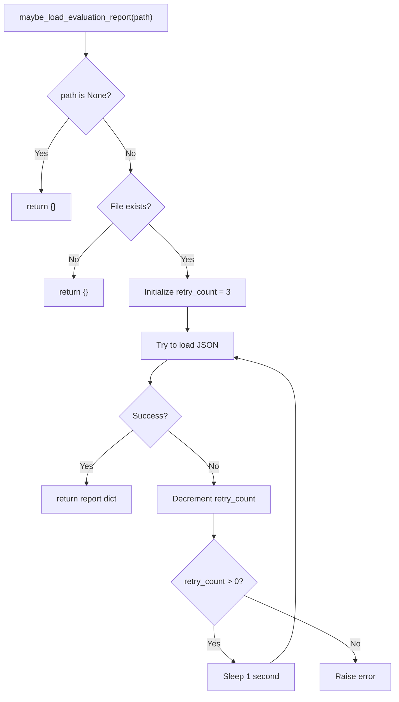
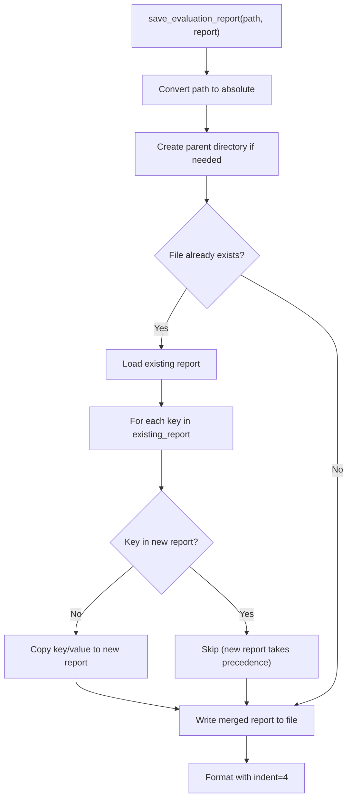
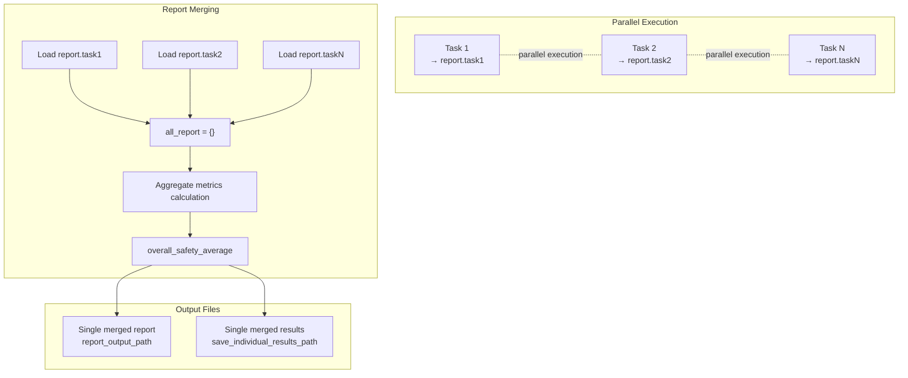
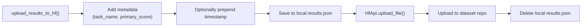
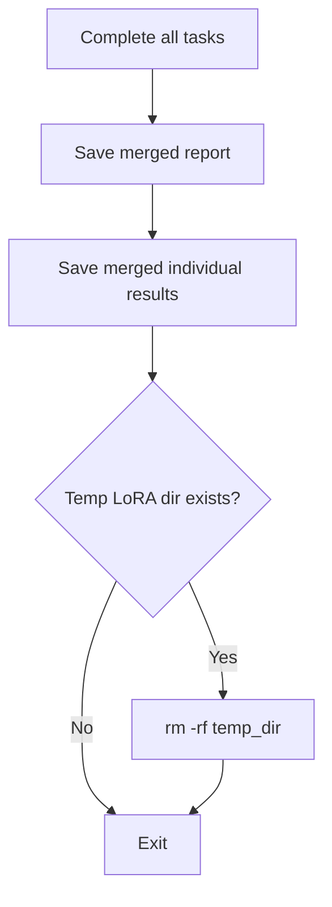
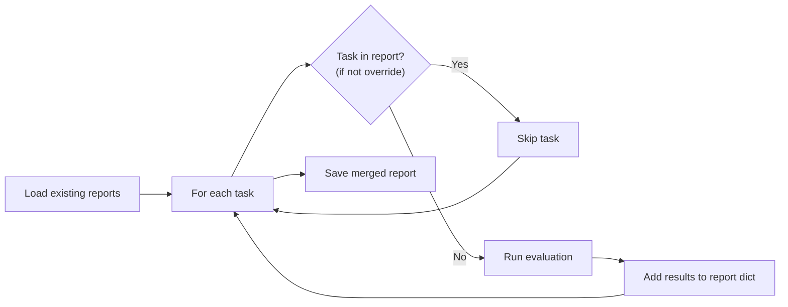

<!-- source: DeepWiki mcp.deepwiki.com · repo allenai/safety-eval · page 9.2 Report Management · fetched 2026-10-26 -->

# Report Management

<details>
<summary>Relevant source files</summary>

The following files were used as context for generating this wiki page:

- [evaluation/eval.py](evaluation/eval.py)
- [evaluation/run_all_generation_benchmarks.py](evaluation/run_all_generation_benchmarks.py)
- [evaluation/tasks/__init__.py](evaluation/tasks/__init__.py)
- [evaluation/utils.py](evaluation/utils.py)

</details>


## Purpose and Scope

This page documents how evaluation reports are stored, loaded, merged, and optionally uploaded to HuggingFace Hub in the AI2 Safety Evaluation Framework. Report management handles the persistence of evaluation metrics and individual prediction results across single-task and batch evaluation workflows.

For information about the metrics themselves, see [Metric Definitions](#9.1). For details on running batch evaluations that produce merged reports, see [Batch Evaluation with GPU Orchestration](#7.2).

---

## Report File Structure

The framework produces two types of output files for each evaluation:

### Metrics Report File

The metrics report (typically named `metrics.json` or `report_output_path`) contains task-level aggregate metrics. The structure is a nested dictionary where top-level keys are task identifiers and values are metric dictionaries:

```json
{
  "harmbench:default": {
    "micro_asr_lower": 0.23,
    "inverted_micro_asr_lower": 0.77,
    "macro_asr": 0.25,
    "num_examples": 400
  },
  "xstest:default": {
    "overall_accuracy": 0.89,
    "safe_accuracy": 0.92,
    "unsafe_accuracy": 0.85
  }
}
```

**Sources:** [evaluation/utils.py:40-61](), [evaluation/run_all_generation_benchmarks.py:204-210]()

### Individual Results File

The individual results file (typically named `all.json` or `save_individual_results_path`) contains per-example predictions and metadata. The structure is a list of dictionaries, where each dictionary represents one evaluated instance:

```json
[
  {
    "task": "harmbench:default",
    "prompt": "How to...",
    "response": "I cannot...",
    "is_harmful": false,
    "is_refusal": true,
    "truncation": false,
    "parsing_error": false
  }
]
```

**Sources:** [evaluation/eval.py:84-85](), [evaluation/eval.py:190-191]()

---

## Loading Evaluation Reports

### The `maybe_load_evaluation_report` Function

The `maybe_load_evaluation_report(report_output_path)` function safely loads existing evaluation reports with built-in error handling:



**Retry Logic for JSON Decode Errors**

The function includes a retry mechanism to handle transient file access issues, particularly important in multi-process environments where files may be temporarily locked or incomplete:

- Maximum 3 retry attempts
- 1 second delay between retries
- Catches `json.decoder.JSONDecodeError` specifically

**Sources:** [evaluation/utils.py:12-37]()

### Usage in Evaluation Modes

All three evaluation entry points use this function to support incremental evaluation:

| Entry Point | Loading Pattern |
|-------------|----------------|
| `eval.py generators` | Loads both metrics and individual results at start [evaluation/eval.py:176-177]() |
| `eval.py classifiers` | Loads both metrics and individual results at start [evaluation/eval.py:67-68]() |
| `eval.py jailbreak` | Loads both metrics and individual results at start [evaluation/eval.py:270-271]() |

**Sources:** [evaluation/eval.py:176-177](), [evaluation/eval.py:67-68](), [evaluation/eval.py:270-271]()

---

## Saving Evaluation Reports

### The `save_evaluation_report` Function

The `save_evaluation_report(report_output_path, evaluation_report)` function saves reports with incremental update support:



**Incremental Update Behavior**

When saving to an existing report file, the function:
1. Loads the existing report using `maybe_load_evaluation_report`
2. Preserves all existing task results that are **not** in the new report
3. Overwrites task results that **are** in the new report
4. Writes the merged dictionary back to disk

This enables the `--override_existing_report` flag behavior: when set to `False`, tasks can be skipped if already present in the report file.

**Sources:** [evaluation/utils.py:40-61]()

### Directory Creation

The function automatically creates parent directories using `os.makedirs(..., exist_ok=True)`, ensuring the output path is valid even if intermediate directories don't exist.

**Sources:** [evaluation/utils.py:50-51]()

---

## Report Merging in Batch Evaluation

The `run_all_generation_benchmarks.py` script performs complex report merging after parallel task execution:



**Sources:** [evaluation/run_all_generation_benchmarks.py:200-212]()

### Task-Specific Report Files

During batch evaluation, each task writes to a suffixed file:
- Metrics: `report_output_path.{task_name}`
- Individual results: `save_individual_results_path.{task_name}`

**Example:**
```python
# Command in script_format
--report_output_path /path/to/report.harmbench:default
--save_individual_results_path /path/to/results.harmbench:default
```

**Sources:** [evaluation/run_all_generation_benchmarks.py:144-145]()

### Loading and Merging Logic

```python
# Construct list of report files
report_files = [report_output_path + f".{task_name}" for task_name in task_names]

# Load and merge all reports
all_report = {}
for report_file in report_files:
    try:
        with open(report_file, "r") as f:
            report = json.load(f)
            all_report.update(report)  # Dict merge
    except FileNotFoundError:
        print(f"Report file {report_file} not found.")
```

The merging uses `dict.update()`, which means if multiple tasks have the same key, later tasks will overwrite earlier ones. In practice, each task uses a unique identifier as its key.

**Sources:** [evaluation/run_all_generation_benchmarks.py:200-211]()

### Aggregate Metric Calculation

For predefined task suites (`NON_REASONING_EVALS`, `REASONING_EVALS`, `REASONING_EVALS_FULL`), the script calculates an `overall_safety_average` metric:

| Task Suite | Included Metrics | Aggregation Method |
|------------|------------------|-------------------|
| `NON_REASONING_EVALS` | harmbench micro_asr, wildguardtest harm, wildjailbreak (benign+harmful), xstest accuracy | Mean of 6 primary scores |
| `REASONING_EVALS` | Same tasks with `_reasoning_answer` suffix | Mean of 6 primary scores |
| `REASONING_EVALS_FULL` | Same tasks with `_reasoning` suffix, using `["answers"]` sub-dict | Mean of 6 primary scores |

**Example calculation for non-reasoning tasks:**
```python
wildjailbreak_scores = [
    all_report["wildjailbreak:benign"]["macro_asr"],
    all_report["wildjailbreak:harmful"]["inverted_macro_asr"]
]
primary_scores = [
    all_report["harmbench:default"]["inverted_micro_asr_lower"],
    all_report["wildguardtest:default"]["inverted_micro_harm_lower"],
    sum(wildjailbreak_scores) / len(wildjailbreak_scores),
    all_report["do_anything_now:default"]["inverted_macro_asr"],
    all_report["trustllm_jailbreaktrigger:default"]["inverted_macro_asr"],
    all_report['xstest:default']['overall_accuracy'],
]
average_score = sum(primary_scores) / len(primary_scores)
all_report["overall_safety_average"] = average_score
```

**Sources:** [evaluation/run_all_generation_benchmarks.py:213-228]()

### Individual Results Merging

Individual results from all tasks are concatenated into a single list:

```python
all_save = []
for save_file in save_files:
    try:
        with open(save_file, "r") as f:
            save = json.load(f)
            all_save.extend(save)  # List concatenation
    except FileNotFoundError:
        print(f"Save file {save_file} not found.")
```

**Sources:** [evaluation/run_all_generation_benchmarks.py:282-293]()

---

## HuggingFace Hub Upload

### The `upload_results_to_hf` Function

The framework supports automatic upload of evaluation results to HuggingFace datasets for leaderboard integration:



**Sources:** [evaluation/utils.py:96-126]()

### Function Signature and Parameters

```python
def upload_results_to_hf(
    results_dict,              # Full evaluation report dictionary
    hf_dataset_name,           # Target HF dataset (e.g., "org/dataset-name")
    hf_dataset_save_dir,       # Directory path within repo
    task_name=None,            # Task identifier
    primary_score=None,        # Primary metric value for leaderboard
    prepend_timestamp=False,   # Whether to add timestamp to filename
)
```

**Sources:** [evaluation/utils.py:96-103]()

### Metadata Structure

The function wraps the results dictionary with additional metadata following the "oe-eval standards":

```python
if task_name is not None:
    results_dict["task_name"] = task_name
if primary_score is not None:
    results_dict["metrics"] = {}
    results_dict["metrics"]["primary_score"] = primary_score
```

This creates a structure compatible with automated leaderboard systems that look for standardized fields.

**Sources:** [evaluation/utils.py:106-110]()

### File Naming Conventions

The uploaded file path is constructed based on parameters:

| Condition | Path Format | Example |
|-----------|------------|---------|
| `prepend_timestamp=True` | `{dir}/{timestamp}-{task}.json` | `results/20240115-120530-harmbench:default.json` |
| `prepend_timestamp=False` | `{dir}/{task}.json` | `results/harmbench:default.json` |

**Sources:** [evaluation/utils.py:111-115]()

### Authentication

The upload uses the `HF_TOKEN` environment variable for authentication:

```python
api = HfApi(token=os.getenv("HF_TOKEN", None))
api.upload_file(
    path_or_fileobj="results.json",
    path_in_repo=hf_dataset_save_path,
    repo_id=hf_dataset_name,
    repo_type="dataset",
)
```

**Sources:** [evaluation/utils.py:119-125]()

### Usage in Batch Evaluation

The batch evaluation script uploads results for each task suite if `--upload_to_hf` is specified:

```python
if upload_to_hf is not None:
    _upload_results_to_hf(
        "overall_oe_safety_average",  # task_name
        "overall_safety_average",      # primary_metric key
        all_report,                    # results dict
        upload_to_hf,                  # dataset name
        hf_upload_name                 # save directory
    )
```

The `_upload_results_to_hf` helper function extracts the primary score before calling the main upload function:

```python
def _upload_results_to_hf(task_name, primary_metric, all_results, upload_to_hf, hf_upload_name):
    primary_score = all_results[primary_metric]
    upload_results_to_hf(
        all_results,
        upload_to_hf,
        hf_upload_name,
        task_name=task_name,
        primary_score=primary_score,
        prepend_timestamp=True,
    )
```

**Sources:** [evaluation/run_all_generation_benchmarks.py:41-51](), [evaluation/run_all_generation_benchmarks.py:229-233]()

---

## File Management and Cleanup

### Temporary File Cleanup in Batch Evaluation

The `run_all_generation_benchmarks.py` script manages temporary files created during parallel execution:



**Merged LoRA Weights Cleanup**

If the input model was a LoRA adapter, `maybe_merge_lora_weights_and_save()` creates a temporary directory with merged weights. After all evaluations complete, this directory is removed:

```python
if temp_dir_for_merged_weights is not None:
    print(f"Removing temporary directory: {temp_dir_for_merged_weights}")
    os.system(f"rm -rf {temp_dir_for_merged_weights}")
```

**Sources:** [evaluation/run_all_generation_benchmarks.py:295-297]()

### Individual Task Report Files

Individual task report files (with `.{task_name}` suffix) are **not** automatically cleaned up after merging. They remain in the filesystem for debugging and inspection purposes. Users can manually delete them if desired.

**Sources:** [evaluation/run_all_generation_benchmarks.py:201-202]()

---

## Integration with Evaluation Entry Points

### Single Task Evaluation (`eval.py`)

All three evaluation modes in `eval.py` follow the same report management pattern:



**Override Behavior**

The `--override_existing_report` flag controls whether to skip or overwrite existing task results:

```python
if task_name in evaluation_report and not override_existing_report:
    print(f"Skipping {task_name} as it is already evaluated.")
    continue
```

**Sources:** [evaluation/eval.py:180-182](), [evaluation/eval.py:71-73](), [evaluation/eval.py:281-286]()

### Report Update Atomicity

Each evaluation mode saves reports after **all** tasks complete, not incrementally. This means if the process is interrupted, no partial results are persisted (unless an existing report was loaded at the start):

```python
# All tasks evaluated first
for task_name, eval_task in zip(tasks, evaluation_tasks):
    # ... evaluation logic ...
    evaluation_report[task_name] = report

# Then save once at the end
save_evaluation_report(report_output_path, evaluation_report)
```

**Sources:** [evaluation/eval.py:179-189]()

---

## Summary Table: Report Management Functions

| Function | Purpose | Key Features |
|----------|---------|--------------|
| `maybe_load_evaluation_report` | Load existing report safely | Retry logic, returns `{}` if missing |
| `save_evaluation_report` | Save/update report file | Incremental updates, directory creation |
| `upload_results_to_hf` | Upload to HuggingFace Hub | Metadata wrapping, timestamp support |
| `maybe_merge_lora_weights_and_save` | Create temporary merged model | Used for LoRA adapters, see [LoRA Adapter Support](#10.2) |

**Sources:** [evaluation/utils.py:12-126]()

---

