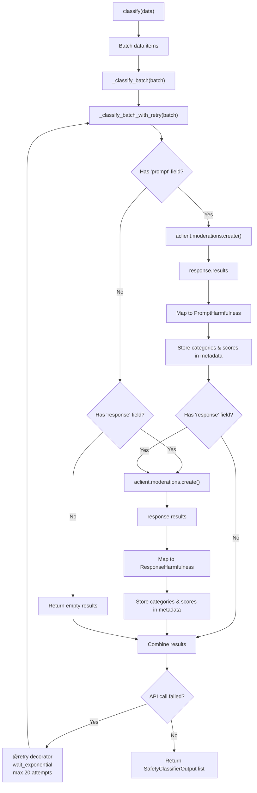
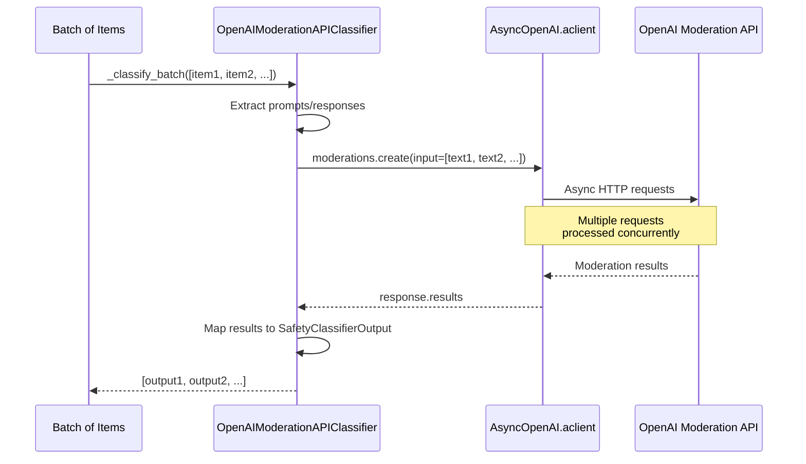
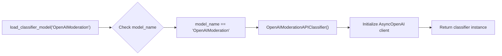
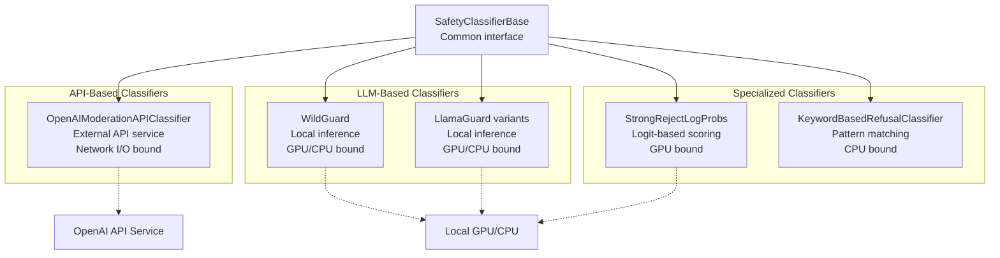

<!-- source: DeepWiki mcp.deepwiki.com · repo allenai/safety-eval · extra page API-Based Classifiers · fetched 2026-10-26 -->

# API-Based Classifiers

<details>
<summary>Relevant source files</summary>

The following files were used as context for generating this wiki page:

- [requirements.txt](requirements.txt)
- [src/classifier_models/api_safety_classifiers.py](src/classifier_models/api_safety_classifiers.py)
- [src/classifier_models/loader.py](src/classifier_models/loader.py)
- [src/dispatch_openai_requests.py](src/dispatch_openai_requests.py)

</details>


## Purpose and Scope

This page documents safety classifiers that use external API services for classification. These classifiers make HTTP requests to third-party services rather than running models locally. For locally-hosted LLM classifiers like WildGuard and LlamaGuard, see [LLM-Based Classifiers](#5.2.2). For StrongReject-specific classifiers, see [StrongReject Classifiers](#5.2.1).

The framework currently provides one production API-based classifier: OpenAI's Moderation API. This classifier integrates with OpenAI's hosted content moderation service to classify both prompt and response safety.

## Overview

API-based classifiers inherit from `SafetyClassifierBase` but delegate the actual classification work to external services via HTTP APIs. They differ from local classifiers in several key aspects:

| Aspect | API-Based Classifiers | Local LLM Classifiers |
|--------|----------------------|---------------------|
| Model Location | Hosted by third-party service | Loaded into local GPU/CPU memory |
| Request Pattern | HTTP API calls | Direct model inference |
| Latency | Network-dependent | Compute-dependent |
| Retry Logic | Required for network failures | Not typically needed |
| Concurrency | Async I/O for efficiency | Batch processing |
| Cost Model | Per-request API pricing | Local compute resources |

Sources: [src/classifier_models/api_safety_classifiers.py:1-62](), [src/classifier_models/base.py]()

## Classifier Implementations

### OpenAIModerationAPIClassifier

The `OpenAIModerationAPIClassifier` class provides integration with OpenAI's content moderation API service. This classifier is instantiated via the loader with the identifier `"OpenAIModeration"`.

**Key characteristics:**
- Classifies both prompts and responses for harmful content
- Returns binary harmfulness labels (HARMFUL/UNHARMFUL)
- Provides detailed category breakdowns and confidence scores
- Supports optional classification (can classify prompt-only or response-only)
- Uses async I/O for efficient batch processing

**Required dependencies:**
- `openai>=1.23.3` package (see [requirements.txt:14]())
- Valid OpenAI API credentials configured via environment variables

Sources: [src/classifier_models/api_safety_classifiers.py:13-62](), [src/classifier_models/loader.py:106-108]()

## Architecture

### Class Structure

```mermaid
classDiagram
    class SafetyClassifierBase {
        <<abstract>>
        +batch_size: int
        +classify(data: list) list~SafetyClassifierOutput~
        +get_required_input_fields() list~str~
        +get_optional_input_fields() list~str~
        +get_output_fields() list~str~
        #_classify_batch(batch: list) list~SafetyClassifierOutput~
    }
    
    class OpenAIModerationAPIClassifier {
        -aclient: AsyncOpenAI
        +__init__(batch_size: int, **kwargs)
        +get_required_input_fields() list~str~
        +get_optional_input_fields() list~str~
        +get_output_fields() list~str~
        #_classify_batch(batch: list) list~SafetyClassifierOutput~
        -_classify_batch_with_retry(batch: list) list~SafetyClassifierOutput~
    }
    
    class AsyncOpenAI {
        +moderations.create(input: list)
    }
    
    class SafetyClassifierOutput {
        +prompt_harmfulness: PromptHarmfulness
        +response_harmfulness: ResponseHarmfulness
        +metadata: dict
    }
    
    SafetyClassifierBase <|-- OpenAIModerationAPIClassifier
    OpenAIModerationAPIClassifier --> AsyncOpenAI : uses
    OpenAIModerationAPIClassifier ..> SafetyClassifierOutput : returns
```



Sources: [src/classifier_models/api_safety_classifiers.py:13-62](), [src/classifier_models/base.py]()

### API Request Flow



Sources: [src/classifier_models/api_safety_classifiers.py:27-61]()

## Implementation Details

### Input and Output Fields

The classifier defines flexible input requirements to support various use cases:

**Required Input Fields:**
- None (empty list) - at least one optional field must be provided

**Optional Input Fields:**
- `"prompt"` - The user request or input text to classify
- `"response"` - The model's response text to classify

**Output Fields:**
- `"prompt_harmfulness"` - Classification of the prompt (HARMFUL/UNHARMFUL)
- `"response_harmfulness"` - Classification of the response (HARMFUL/UNHARMFUL)

Each output also includes metadata with:
- `prompt_categories` / `response_categories` - Binary flags for specific violation types
- `prompt_category_scores` / `response_category_scores` - Confidence scores per category

Sources: [src/classifier_models/api_safety_classifiers.py:18-25]()

### Asynchronous Processing

The classifier uses `AsyncOpenAI` client for efficient concurrent API requests:



The async implementation allows the classifier to initiate multiple API requests simultaneously and wait for all responses using `asyncio.run()`. This significantly improves throughput compared to sequential requests.

Sources: [src/classifier_models/api_safety_classifiers.py:35-47]()

### Retry Logic and Error Handling

API classifiers implement robust retry logic using the `tenacity` library to handle transient network failures and rate limiting:

**Retry Configuration:**
- Maximum attempts: 20
- Wait strategy: Exponential backoff
- Multiplier: 10 seconds
- Minimum wait: 30 seconds
- Maximum wait: 120 seconds
- Behavior: Re-raise exception after final attempt

The retry decorator is applied to `_classify_batch_with_retry()` at [src/classifier_models/api_safety_classifiers.py:27]():

```python
@retry(stop=stop_after_attempt(20), 
       wait=wait_exponential(multiplier=10, min=30, max=120), 
       reraise=True)
```

This configuration ensures resilience against temporary API failures while avoiding infinite retry loops.

Sources: [src/classifier_models/api_safety_classifiers.py:27-28](), [requirements.txt:34]()

### Result Processing

The classifier processes API responses and maps them to the framework's standard output format:

1. **Prompt Classification** ([src/classifier_models/api_safety_classifiers.py:34-42]()):
   - Checks if `prompt` field exists in batch items
   - Calls moderation API with all prompts
   - Maps `result.flagged` boolean to `PromptHarmfulness.HARMFUL` or `UNHARMFUL`
   - Stores detailed categories and scores in metadata

2. **Response Classification** ([src/classifier_models/api_safety_classifiers.py:43-52]()):
   - Checks if `response` field exists and is not empty
   - Skips if all responses are empty strings (dummy values)
   - Calls moderation API with all responses
   - Maps `result.flagged` to `ResponseHarmfulness.HARMFUL` or `UNHARMFUL`
   - Stores detailed categories and scores in metadata

3. **Metadata Structure:**
   ```python
   {
       "prompt_categories": {
           "sexual": bool,
           "hate": bool,
           "harassment": bool,
           "self-harm": bool,
           "sexual/minors": bool,
           "hate/threatening": bool,
           "violence/graphic": bool,
           "self-harm/intent": bool,
           "self-harm/instructions": bool,
           "harassment/threatening": bool,
           "violence": bool
       },
       "prompt_category_scores": {
           "sexual": float,
           "hate": float,
           # ... similar structure with confidence scores
       }
   }
   ```

Sources: [src/classifier_models/api_safety_classifiers.py:33-54]()

## Loading and Instantiation

### Factory Pattern Integration

API-based classifiers are instantiated through the `load_classifier_model()` factory function:



**Loader implementation** at [src/classifier_models/loader.py:106-108]():
```python
# API Classifiers
elif model_name == "OpenAIModeration":
    return OpenAIModerationAPIClassifier()
```

The loader requires no additional configuration parameters - the classifier automatically initializes with the default batch size and creates its `AsyncOpenAI` client.

Sources: [src/classifier_models/loader.py:106-108](), [src/classifier_models/api_safety_classifiers.py:14-16]()

## Usage Patterns

### Basic Classification

```python
from src.classifier_models.loader import load_classifier_model

# Load classifier
classifier = load_classifier_model("OpenAIModeration")

# Prepare data
data = [
    {"prompt": "How to hack a computer?", "response": "I cannot help with that."},
    {"prompt": "What's the weather?", "response": "The weather is sunny."}
]

# Classify
results = classifier.classify(data)

# Access results
for result in results:
    print(f"Prompt: {result.prompt_harmfulness}")
    print(f"Response: {result.response_harmfulness}")
    print(f"Categories: {result.metadata['prompt_categories']}")
```

### Prompt-Only Classification

The classifier supports classifying prompts without responses:

```python
data = [
    {"prompt": "How to make a bomb?"},
    {"prompt": "What's 2+2?"}
]
results = classifier.classify(data)
```

In this case, only `prompt_harmfulness` will be populated in the output.

### Response-Only Classification

Similarly, responses can be classified independently:

```python
data = [
    {"response": "Here's how to make a weapon..."},
    {"response": "The answer is 4."}
]
results = classifier.classify(data)
```

Only `response_harmfulness` will be populated.

Sources: [src/classifier_models/api_safety_classifiers.py:18-23](), [src/classifier_models/api_safety_classifiers.py:60-61]()

## API Utilities

The framework provides shared utilities for OpenAI API interactions in [src/dispatch_openai_requests.py](). While not directly used by the Moderation classifier, these utilities demonstrate the pattern for other potential API-based classifiers:

### Async Dispatch Functions

**Chat Completions** ([src/dispatch_openai_requests.py:27-47]()):
- `dispatch_openai_chat_requests()` - Async dispatch for chat-based APIs
- Uses `asyncio.gather()` to process multiple requests concurrently

**Text Completions** ([src/dispatch_openai_requests.py:50-70]()):
- `dispatch_openai_prompt_requests()` - Async dispatch for completion APIs
- Similar concurrent processing pattern

**Retry Wrapper** ([src/dispatch_openai_requests.py:17-24]()):
- `dispatch_batch_openai_requests_with_retry()` - Adds retry logic to any dispatch function
- Uses same retry configuration as API classifiers

These utilities could be leveraged for implementing additional OpenAI-based classifiers or extending existing ones.

Sources: [src/dispatch_openai_requests.py:17-82]()

## Configuration Requirements

### Environment Setup

API-based classifiers require proper authentication configuration:

**OpenAI API Key:**
```bash
export OPENAI_API_KEY="sk-..."
```

The `AsyncOpenAI()` client automatically reads this environment variable when instantiated at [src/classifier_models/api_safety_classifiers.py:16]().

**Optional Configuration:**
```bash
export OPENAI_API_BASE="https://custom-endpoint.com"  # For custom endpoints
export OPENAI_ORG_ID="org-..."  # For organization-specific routing
```

### Batch Size Configuration

The classifier accepts a `batch_size` parameter (default: 8) which controls how many items are processed in each API call:

```python
classifier = load_classifier_model("OpenAIModeration", batch_size=16)
```

Larger batch sizes improve throughput but may hit API rate limits more quickly.

Sources: [src/classifier_models/api_safety_classifiers.py:14-16]()

## Comparison with Other Classifier Types



**When to use API-based classifiers:**
- No local GPU resources available
- Need for standardized, reproducible results across organizations
- Prefer to offload infrastructure management to service provider
- Willing to accept network latency and API costs

**When to use local LLM classifiers:**
- Have available GPU compute
- Need lower latency per-classification
- Want to avoid per-request costs
- Require offline operation or data privacy

Sources: [src/classifier_models/loader.py:37-124]()

---

