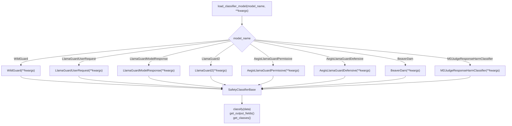
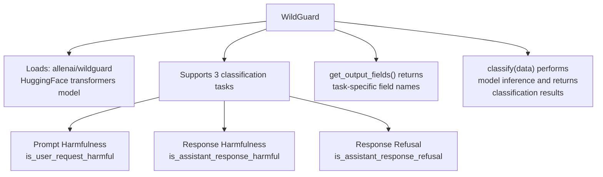
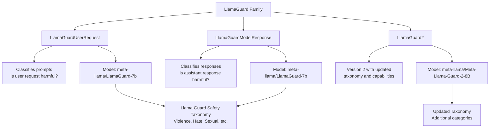
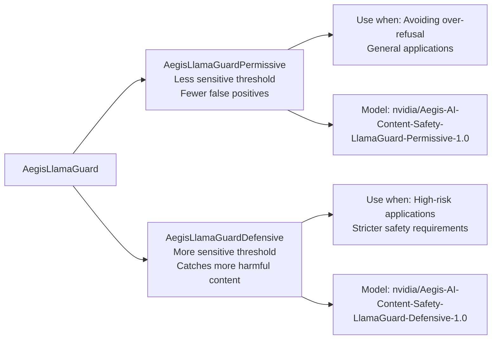
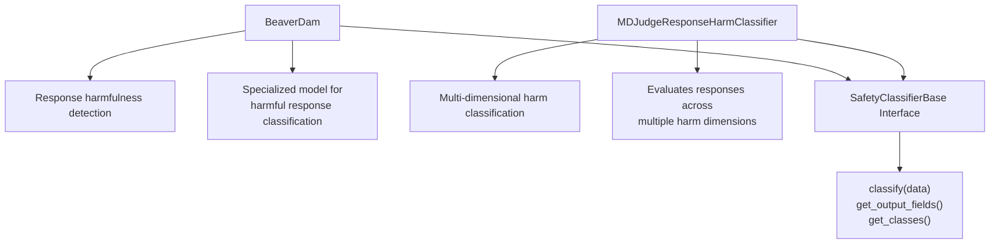
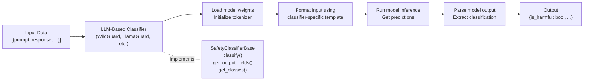
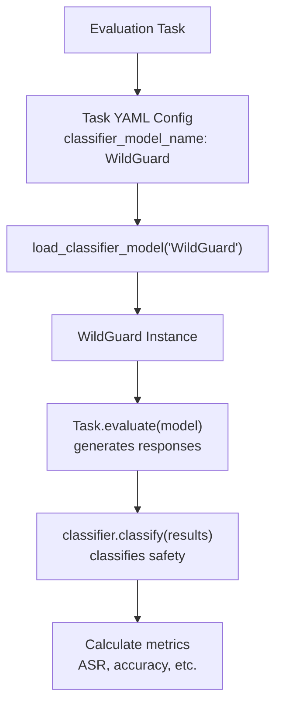
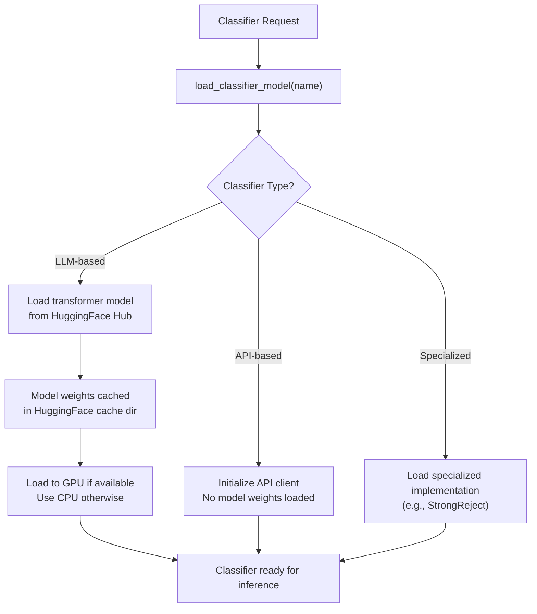
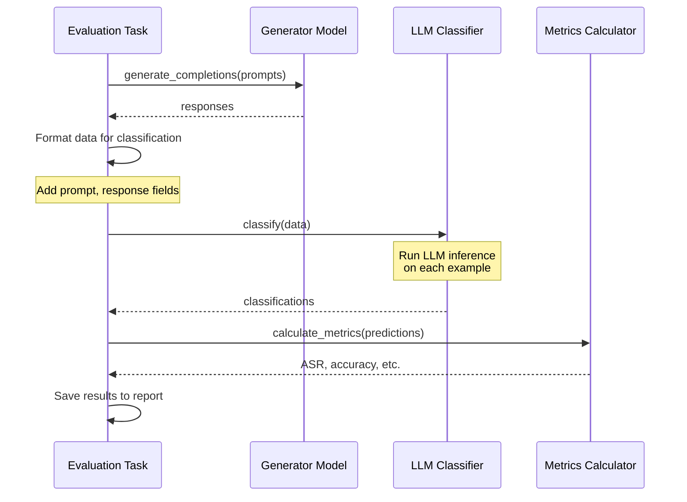

<!-- source: DeepWiki mcp.deepwiki.com · repo allenai/safety-eval · extra page LLM-Based Classifiers · fetched 2026-10-26 -->

# LLM-Based Classifiers

<details>
<summary>Relevant source files</summary>

The following files were used as context for generating this wiki page:

- [README.md](README.md)
- [evaluation/models/__init__.py](evaluation/models/__init__.py)
- [evaluation/tasks/generation/do_anything_now/__init__.py](evaluation/tasks/generation/do_anything_now/__init__.py)
- [evaluation/tasks/generation/trustllm_jailbreaktrigger/__init__.py](evaluation/tasks/generation/trustllm_jailbreaktrigger/__init__.py)
- [evaluation/tasks/generation/trustllm_jailbreaktrigger/gpt4.yaml](evaluation/tasks/generation/trustllm_jailbreaktrigger/gpt4.yaml)
- [evaluation/tasks/generation/wildjailbreak/__init__.py](evaluation/tasks/generation/wildjailbreak/__init__.py)
- [evaluation/tasks/generation/xstest/exaggerated_safety.json](evaluation/tasks/generation/xstest/exaggerated_safety.json)
- [src/classifier_models/loader.py](src/classifier_models/loader.py)

</details>


## Purpose and Scope

This page documents LLM-based safety classifiers that use transformer language models for classification. These classifiers load model weights and perform inference to detect harmful content, assess prompt safety, or identify response refusals.

For specialized classifiers that analyze logits or log probabilities (StrongReject variants), see [StrongReject Classifiers](#5.2.1). For API-based classifiers that call external services (OpenAI Moderation), see [API-Based Classifiers](#5.2.3). For GPT-based classifiers configured via YAML prompts, those are also covered in [API-Based Classifiers](#5.2.3).

## LLM-Based Classifier Families

The framework includes five main families of LLM-based classifiers:

| Classifier Family | Models | Primary Use Case |
|------------------|--------|------------------|
| **WildGuard** | WildGuard | Multi-task safety classification (prompt harm, response harm, refusal detection) |
| **LlamaGuard** | LlamaGuardUserRequest, LlamaGuardModelResponse, LlamaGuard2 | Prompt and response harm classification following Llama Guard taxonomy |
| **AegisLlamaGuard** | AegisLlamaGuardPermissive, AegisLlamaGuardDefensive | Safety classification with configurable sensitivity thresholds |
| **BeaverDam** | BeaverDam | Response harmfulness detection |
| **MDJudge** | MDJudgeResponseHarmClassifier | Multi-dimensional harm classification |

**Sources:** [src/classifier_models/loader.py:37-124]()

## Classifier Loading Architecture



**Classifier Factory Pattern**

The `load_classifier_model` function acts as a factory that instantiates the appropriate classifier based on the `model_name` string. All LLM-based classifiers extend `SafetyClassifierBase` and implement the same interface.

**Sources:** [src/classifier_models/loader.py:37-124](), [src/classifier_models/base.py:5]()

## WildGuard Classifier



**WildGuard** is the default classifier used throughout the framework for safety evaluation. It is a multi-task classifier capable of detecting:

- **Prompt harmfulness**: Whether a user request is harmful
- **Response harmfulness**: Whether an assistant response contains harmful content
- **Response refusal**: Whether an assistant response refuses to answer

The model is loaded from `allenai/wildguard` on HuggingFace Hub and uses a specific prompt format to perform classification.

**Sources:** [src/classifier_models/wildguard.py:31](), [README.md:42](), [src/classifier_models/loader.py:43-44]()

## LlamaGuard Family



**LlamaGuard** classifiers implement Meta's Llama Guard safety taxonomy for content moderation:

- **LlamaGuardUserRequest**: Evaluates whether user prompts request harmful content according to the Llama Guard taxonomy
- **LlamaGuardModelResponse**: Evaluates whether model responses contain harmful content
- **LlamaGuard2**: Second version with an updated taxonomy and improved performance

These classifiers follow a standardized prompt format that includes the safety taxonomy and asks the model to classify content as "safe" or "unsafe" with category labels.

**Sources:** [src/classifier_models/llama_guard.py:23](), [src/classifier_models/loader.py:45-58]()

## AegisLlamaGuard Variants



**AegisLlamaGuard** classifiers provide two variants with different sensitivity thresholds:

- **AegisLlamaGuardPermissive**: Lower sensitivity, designed to minimize false positives and over-refusal
- **AegisLlamaGuardDefensive**: Higher sensitivity, designed for applications requiring stricter safety controls

Both variants use the same underlying architecture but are trained with different safety thresholds.

**Sources:** [src/classifier_models/aegis.py:3-4](), [src/classifier_models/loader.py:53-56]()

## BeaverDam and MDJudge



**BeaverDam** is a specialized classifier for detecting harmful content in model responses. It focuses specifically on response harmfulness evaluation.

**MDJudge** (Multi-Dimensional Judge) provides multi-dimensional harm classification, evaluating responses across various dimensions of potential harm.

**Sources:** [src/classifier_models/beaverdam.py:6](), [src/classifier_models/md_judge.py:24](), [src/classifier_models/loader.py:59-60,115-116]()

## Classification Interface Pattern



**Classification Flow**

All LLM-based classifiers follow a common pattern:

1. **Input formatting**: Convert data items into classifier-specific prompt templates
2. **Model inference**: Pass formatted prompts through the loaded LLM
3. **Output parsing**: Extract classification decisions from model generations
4. **Result standardization**: Return results in a consistent format via the `SafetyClassifierBase` interface

Each classifier implements `classify(data)` which takes a list of data dictionaries and returns classification results. The `get_output_fields()` method returns the names of output fields produced by the classifier, and `get_classes()` returns the possible classification labels.

**Sources:** [src/classifier_models/base.py:5](), [src/classifier_models/loader.py:37-124]()

## Configuration and Usage

### Loading a Classifier

```python
from src.classifier_models.loader import load_classifier_model

# Load WildGuard
classifier = load_classifier_model("WildGuard")

# Load LlamaGuard for user requests
classifier = load_classifier_model("LlamaGuardUserRequest")

# Load with custom parameters
classifier = load_classifier_model("BeaverDam", batch_size=8)
```

### Task Configuration

LLM-based classifiers are specified in task YAML configuration files via the `classifier_model_name` field:

```yaml
task_class: HarmbenchVanilla
classifier_model_name: WildGuard  # Use WildGuard for classification

# Alternative: use LlamaGuard
# classifier_model_name: LlamaGuardModelResponse
```

### Classifier Selection by Task



Each evaluation task configuration specifies which classifier to use. Common patterns:

- **Default**: Most tasks use `WildGuard` as the default classifier
- **Task-specific**: Tasks like Harmbench can specify their own specialized classifier (e.g., `HarmbenchClassifier`)
- **Overridable**: Users can override the classifier via task configuration

**Sources:** [README.md:56-68](), [evaluation/tasks/generation/harmbench/default.yaml:66-67](), [evaluation/tasks/generation/trustllm_jailbreaktrigger/gpt4.yaml:1-6]()

## Model Loading and Resource Management



**Resource Considerations**

LLM-based classifiers load full transformer models into memory:

- **Memory requirements**: Typically 4-16GB depending on model size (7B-13B parameters)
- **GPU acceleration**: Models automatically use GPU if available via CUDA
- **Caching**: HuggingFace transformers cache model weights locally to avoid repeated downloads
- **Batch processing**: Classifiers support batch inference for efficiency

**Sources:** [src/classifier_models/loader.py:37-124](), [evaluation/models/__init__.py:1-79]()

## Integration with Generation Tasks



**Classification in Evaluation Flow**

LLM-based classifiers are integrated into the evaluation pipeline:

1. **Generation**: Generator model produces responses to prompts
2. **Formatting**: Responses are formatted with metadata for classification
3. **Classification**: Classifier evaluates safety of prompts/responses
4. **Metrics**: Classification results are used to compute evaluation metrics (Attack Success Rate, accuracy, etc.)

The classifier's `classify()` method is called on batches of examples, returning safety judgments that determine task performance.

**Sources:** [evaluation/tasks/generation/base.py:4](), [evaluation/tasks/generation/wildjailbreak/__init__.py:1-31](), [evaluation/tasks/generation/trustllm_jailbreaktrigger/__init__.py:1-17]()

## Classifier Output Fields

Different LLM-based classifiers produce different output fields based on their capabilities:

| Classifier | Output Fields | Description |
|-----------|---------------|-------------|
| **WildGuard** | `is_user_request_harmful`, `is_assistant_response_harmful`, `is_assistant_response_refusal` | Multi-task outputs for prompt harm, response harm, and refusal detection |
| **LlamaGuardUserRequest** | `is_user_request_harmful` | Binary classification of prompt harmfulness |
| **LlamaGuardModelResponse** | `is_assistant_response_harmful` | Binary classification of response harmfulness |
| **LlamaGuard2** | `is_user_request_harmful`, `is_assistant_response_harmful` | Both prompt and response classification |
| **BeaverDam** | `is_assistant_response_harmful` | Response harmfulness classification |
| **MDJudge** | Various dimensions | Multi-dimensional harm assessment |

The `get_output_fields()` method returns the field names that will be present in classification results, allowing tasks to know what outputs to expect.

**Sources:** [src/classifier_models/base.py:5](), [src/classifier_models/loader.py:37-124]()

---

