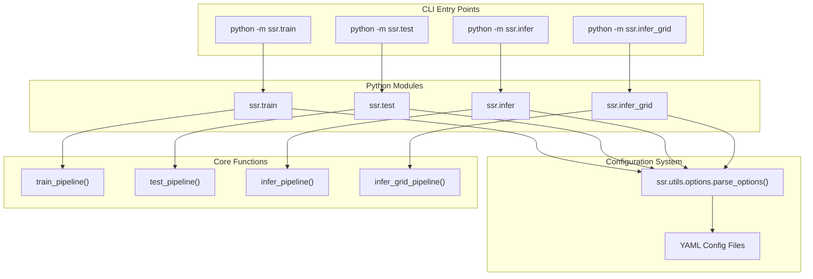
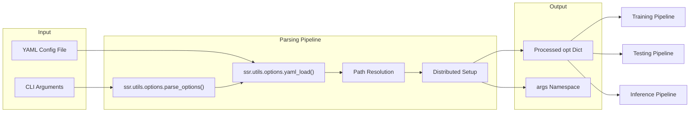
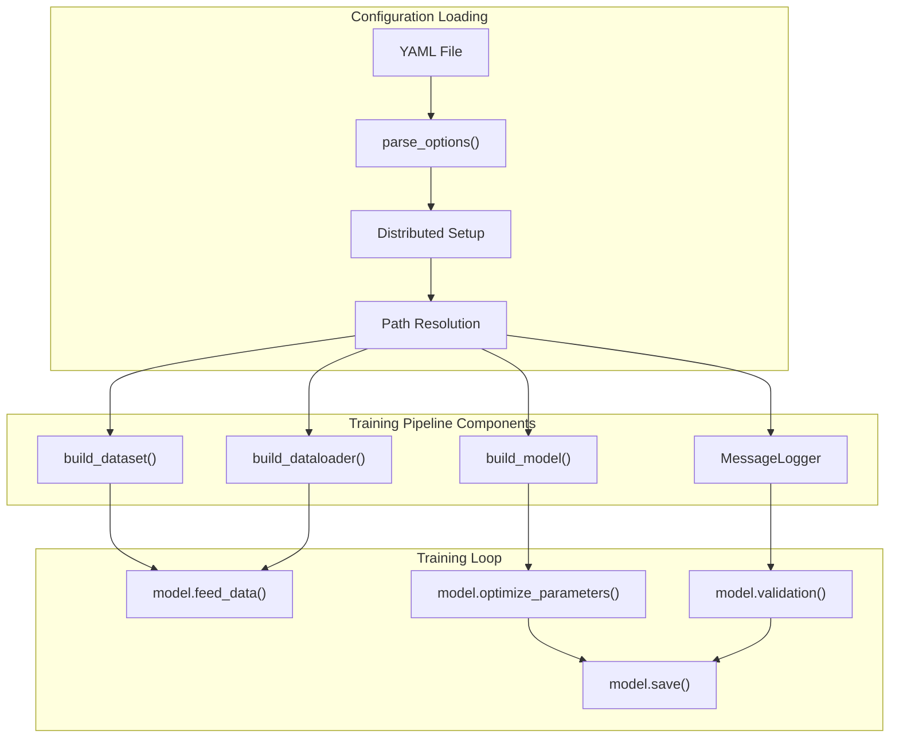

<!-- source: DeepWiki mcp.deepwiki.com · repo allenai/satlas-super-resolution · page 2 Getting Started · fetched 2026-10-26 -->

# Getting Started

<details>
<summary>Relevant source files</summary>

The following files were used as context for generating this wiki page:

- [README.md](README.md)
- [requirements.txt](requirements.txt)
- [ssr/train.py](ssr/train.py)
- [ssr/utils/options.py](ssr/utils/options.py)

</details>


This document provides a comprehensive guide for setting up and running your first super-resolution tasks with the Satlas Super-Resolution system. It covers installation, data setup, configuration basics, and executing the primary workflows of training, testing, and inference.

For detailed information about model architectures, see [Model Architectures](#4). For advanced training configurations and experimental setups, see [Training Configurations](#5.2) and [Experimental Configurations](#8.2).

## System Overview

The Satlas Super-Resolution system provides three primary entry points for different workflows, each driven by YAML configuration files that specify datasets, model parameters, and execution settings.

### Primary Entry Points



**Sources:** [README.md:144-186](), [ssr/train.py:29-156](), [ssr/utils/options.py:50-152]()

## Installation and Dependencies

### Environment Setup

The system requires Python 3.9 and specific dependencies for satellite imagery processing and deep learning.

```bash
conda create --name ssr python==3.9
conda activate ssr
pip install -r requirements.txt
conda install gdal
```

### Core Dependencies

| Package | Purpose |
|---------|---------|
| `basicsr==1.4.2` | Super-resolution training framework |
| `torch==2.1.0` | Deep learning framework |
| `torchvision==0.16.0` | Computer vision utilities |
| `lpips` | Perceptual loss calculations |
| `wandb` | Experiment tracking |
| `gdal` | Geospatial data processing |

**Sources:** [README.md:24-31](), [requirements.txt:1-13]()

### Configuration System Flow

The system uses YAML configuration files to control all aspects of training, testing, and inference. The configuration parsing system handles distributed training setup, path resolution, and parameter validation.



**Sources:** [ssr/utils/options.py:50-152](), [ssr/train.py:31-32]()

## Data and Model Downloads

### Training Datasets

The system provides multiple datasets for different use cases:

| Dataset | Size | Purpose | Download Links |
|---------|------|---------|----------------|
| `train_urban_set` | ~1.1M pairs | Primary training on urban areas | [part1-4 links in README]() |
| `train_full_set` | ~44M pairs | Complete dataset (large scale) | [tar link in README]() |
| `val_set` | 8,192 pairs | Standard validation | [tar link in README]() |
| `small_val_set` | 256 pairs | Quick validation/testing | [tar link in README]() |
| `test_set` | 8 grids (16x16) | Comprehensive evaluation | [tar link in README]() |

### Pre-trained Model Weights

| Model Type | Variants | Configuration Files |
|------------|----------|-------------------|
| ESRGAN | 1, 2, 4, 8, 16 S2 images | `esrgan_baseline_*.yml` |
| ESRGAN | 10m, 20m, 60m bands | `esrgan_baseline_*m.yml` |
| SRCNN | Baseline CNN | `srcnn_s2naip_urban.yml` |
| HighResNet | Enhanced CNN | `highresnet_s2naip_urban.yml` |

**Sources:** [README.md:33-85]()

### Dataset Structure

The system expects a specific directory structure for Sentinel-2 and NAIP imagery pairs:

```
dataset/
├── naip/
│   └── {image_uuid}/
│       └── {tile}/
│           └── rgb.png
└── sentinel2/
    └── {tile}/
        ├── tci.png
        ├── b01.png
        └── ...
```

**Sources:** [README.md:86-114]()

## Running Your First Tasks

### Training a Model

Start with the urban dataset and ESRGAN configuration for your first training run:

```bash
python -m ssr.train -opt ssr/options/esrgan_s2naip_urban.yml
```

Key configuration elements to verify in your YAML file:
- Dataset paths point to downloaded data
- Model parameters match your hardware capabilities  
- Pretrained weights paths (if using transfer learning)

For debugging without logging overhead:
```bash
python -m ssr.train -opt ssr/options/esrgan_s2naip_urban.yml --debug
```

**Sources:** [README.md:144-159](), [ssr/train.py:29-156]()

### Testing a Trained Model

Evaluate model performance on validation/test sets with ground truth:

```bash
python -m ssr.test -opt ssr/options/esrgan_s2naip_urban.yml
```

This will:
- Load the trained model specified in the configuration
- Process test data from `['datasets']['test']` section
- Save output images to `results/` directory
- Display computed metrics (PSNR, SSIM, etc.)

**Sources:** [README.md:161-169]()

### Running Inference

For inference on new data without ground truth:

```bash
python -m ssr.infer -opt ssr/options/infer_example.yml
```

For processing complete Sentinel-2 tiles (16x16 grids) with automatic stitching:

```bash
python -m ssr.infer_grid -opt ssr/options/infer_grid_example.yml
```

**Sources:** [README.md:170-189]()

## Configuration Workflow

The training pipeline follows a structured configuration-driven approach where YAML files control every aspect of the process.



**Sources:** [ssr/train.py:29-151](), [ssr/utils/options.py:50-152]()

## Multi-GPU Training

For distributed training across multiple GPUs:

```bash
PYTHONPATH=. python -m torch.distributed.launch --nproc_per_node=8 --master_port=1234 ssr/train.py -opt ssr/options/esrgan_s2naip_urban.yml --launcher pytorch
```

The configuration system automatically handles distributed setup when the `--launcher pytorch` flag is specified.

**Sources:** [README.md:157-159](), [ssr/utils/options.py:64-74]()

## Next Steps

After completing your first training and inference runs:

1. **Explore Model Architectures** - See [Model Architectures](#4) for detailed information about ESRGAN, SRCNN, and HighResNet implementations
2. **Advanced Training** - Check [Training](#5) for comprehensive training strategies and [Training Configurations](#5.2) for specialized setups
3. **Large-Scale Processing** - Learn about [Grid Inference and Stitching](#6.2) for processing entire Sentinel-2 tiles
4. **Evaluation Methods** - Review [Evaluation and Testing](#7) for comprehensive model assessment techniques
5. **Experimental Features** - Explore [OSM Object-Aware Training](#8.1) for geographic feature-aware models

**Sources:** [README.md:1-239]()

---

