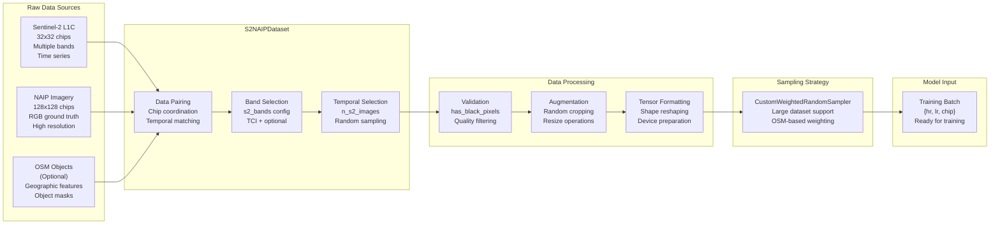
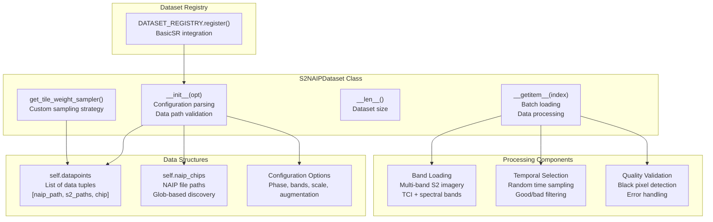
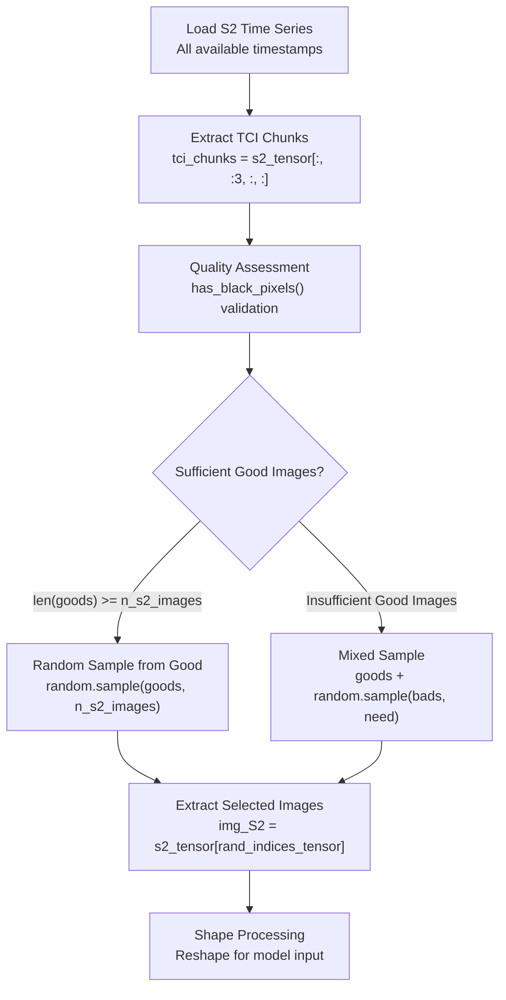
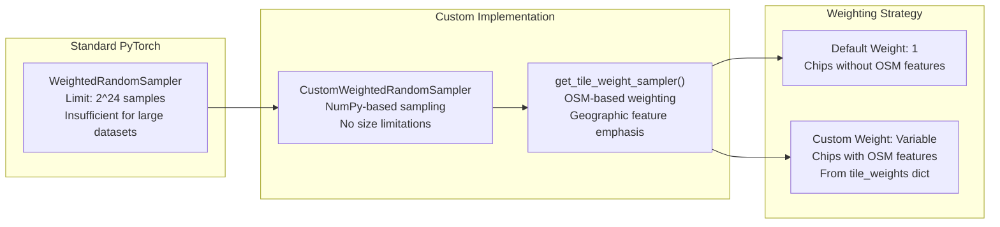

<!-- source: DeepWiki mcp.deepwiki.com · repo allenai/satlas-super-resolution · page 3 Data Pipeline · fetched 2026-10-26 -->

# Data Pipeline

<details>
<summary>Relevant source files</summary>

The following files were used as context for generating this wiki page:

- [ssr/data/s2-naip_dataset.py](ssr/data/s2-naip_dataset.py)
- [ssr/utils/data_utils.py](ssr/utils/data_utils.py)

</details>


This document explains how satellite imagery data flows through the system, from raw Sentinel-2 and NAIP inputs to processed training pairs ready for model consumption. The data pipeline handles the pairing, loading, validation, and augmentation of multi-temporal satellite imagery with high-resolution aerial imagery ground truth.

For information about model training using this processed data, see [Training](#5). For details on inference pipeline processing, see [Inference](#6).

## Data Flow Overview

The data pipeline transforms raw satellite and aerial imagery into paired training samples through a series of processing stages:



**Data Pipeline Flow Diagram**

Sources: [ssr/data/s2-naip_dataset.py:35-249](), [ssr/utils/data_utils.py:3-10]()

## Core Dataset Implementation

The `S2NAIPDataset` class serves as the primary data loading mechanism, registered with BasicSR's dataset registry system:



**S2NAIPDataset Class Architecture**

Sources: [ssr/data/s2-naip_dataset.py:34-50](), [ssr/data/s2-naip_dataset.py:152-246]()

## Data Loading and Pairing Process

The dataset pairs Sentinel-2 time series with corresponding NAIP imagery based on geographic chip coordinates:

| Component | Description | Configuration Key | File Reference |
|-----------|-------------|-------------------|----------------|
| **Chip Extraction** | Extract X,Y coordinates from file paths | N/A | [ssr/data/s2-naip_dataset.py:107-109]() |
| **S2 Band Loading** | Load multiple spectral bands per chip | `s2_bands` | [ssr/data/s2-naip_dataset.py:120-121]() |
| **Temporal Sampling** | Select N images from time series | `n_s2_images` | [ssr/data/s2-naip_dataset.py:216-225]() |
| **NAIP Loading** | Load high-resolution ground truth | N/A | [ssr/data/s2-naip_dataset.py:171-177]() |
| **Shape Formatting** | Reshape tensors for model input | `use_3d` | [ssr/data/s2-naip_dataset.py:237-239]() |

The pairing process handles several data scenarios:

- **Standard Pairing**: Current S2 time series with contemporary NAIP imagery
- **Historical Pairing**: Optional older NAIP imagery for temporal analysis via `old_naip_path` [ssr/data/s2-naip_dataset.py:65-67]()
- **OSM Filtering**: Geographic feature-based filtering using `osm_objs_path` [ssr/data/s2-naip_dataset.py:69-70]()

Sources: [ssr/data/s2-naip_dataset.py:105-127](), [ssr/data/s2-naip_dataset.py:181-196]()

## Data Processing and Augmentation

The pipeline includes several processing steps to prepare data for training:

### Temporal Selection Strategy



**Temporal Selection Algorithm**

Sources: [ssr/data/s2-naip_dataset.py:208-225](), [ssr/data/s2-naip_dataset.py:237-239]()

### Augmentation Pipeline

The system supports training-time augmentation through random cropping:

- **Random Crop Size**: Selects crop size between 24-32 pixels for low-resolution input [ssr/data/s2-naip_dataset.py:230]()
- **Proportional HR Cropping**: Maintains 4x scale relationship with high-resolution crop [ssr/data/s2-naip_dataset.py:231]()
- **Resize Back**: Uses `F.interpolate` to restore original dimensions [ssr/data/s2-naip_dataset.py:234-235]()

Sources: [ssr/data/s2-naip_dataset.py:227-235]()

## Custom Sampling Strategy

The `CustomWeightedRandomSampler` addresses PyTorch's limitation for large datasets:



**Custom Sampling Architecture**

The weighting system enables emphasis on geographic features:

- **Base Weight**: Chips without OSM features receive weight of 1 [ssr/data/s2-naip_dataset.py:145]()
- **Enhanced Weight**: Chips with OSM features use `tile_weights` dictionary values [ssr/data/s2-naip_dataset.py:147]()
- **Weight Statistics**: System reports min/max/mean weights for monitoring [ssr/data/s2-naip_dataset.py:149]()

Sources: [ssr/data/s2-naip_dataset.py:18-32](), [ssr/data/s2-naip_dataset.py:132-150]()

## Data Validation and Quality Control

The pipeline implements robust quality control through several validation mechanisms:

### Black Pixel Detection

The `has_black_pixels` utility function identifies invalid imagery:

```python
# From ssr/utils/data_utils.py:3-10
def has_black_pixels(tensor):
    channel_sum = torch.sum(tensor, dim=0)
    black_pixels = (channel_sum.view(-1) == 0).any()
    return black_pixels
```

This validation applies at multiple stages:
- **NAIP Validation**: Skip chips with invalid ground truth [ssr/data/s2-naip_dataset.py:174-176]()
- **S2 Temporal Validation**: Classify time series images as good/bad [ssr/data/s2-naip_dataset.py:210-214]()

### Error Handling Strategy

The `__getitem__` method uses a retry loop to handle data loading failures:

- **Counter-based Retry**: Increment index when errors occur [ssr/data/s2-naip_dataset.py:157-161]()
- **Multiple Validation Points**: Check data quality at each processing stage
- **Graceful Fallback**: Continue to next sample on validation failure

Sources: [ssr/utils/data_utils.py:3-10](), [ssr/data/s2-naip_dataset.py:157-204]()

## Configuration Parameters

The dataset supports extensive configuration through the `opt` dictionary:

| Parameter | Type | Description | Default | Reference |
|-----------|------|-------------|---------|-----------|
| `sentinel2_path` | str | Path to S2 imagery directory | Required | [ssr/data/s2-naip_dataset.py:94]() |
| `naip_path` | str | Path to NAIP imagery directory | Required | [ssr/data/s2-naip_dataset.py:95]() |
| `n_s2_images` | int | Number of S2 timesteps to use | Required | [ssr/data/s2-naip_dataset.py:58]() |
| `scale` | int | Upsampling factor (4x supported) | 4 | [ssr/data/s2-naip_dataset.py:59]() |
| `phase` | str | Training phase ('train' or 'val') | Required | [ssr/data/s2-naip_dataset.py:52]() |
| `use_3d` | bool | Maintain temporal dimension | False | [ssr/data/s2-naip_dataset.py:63]() |
| `rand_crop` | bool | Enable random crop augmentation | False | [ssr/data/s2-naip_dataset.py:56]() |
| `s2_bands` | list | S2 spectral bands to load | ['tci'] | [ssr/data/s2-naip_dataset.py:73]() |
| `train_samples` | int | Limit training set size | None | [ssr/data/s2-naip_dataset.py:102-103]() |
| `old_naip_path` | str | Path to historical NAIP imagery | None | [ssr/data/s2-naip_dataset.py:67]() |
| `osm_objs_path` | str | Path to OSM object masks | None | [ssr/data/s2-naip_dataset.py:70]() |
| `n_osm_objs` | int | Minimum OSM objects per chip | None | [ssr/data/s2-naip_dataset.py:117]() |

### Band Configuration

The system supports multiple Sentinel-2 spectral bands with automatic TCI prioritization:

- **TCI Priority**: TCI band moved to front of band list [ssr/data/s2-naip_dataset.py:75]()
- **Multi-band Support**: Additional spectral bands concatenated as channels [ssr/data/s2-naip_dataset.py:196]()
- **Missing Band Handling**: Zero tensors used when bands unavailable [ssr/data/s2-naip_dataset.py:186-188]()

Sources: [ssr/data/s2-naip_dataset.py:48-103](), [ssr/data/s2-naip_dataset.py:183-196]()

---

