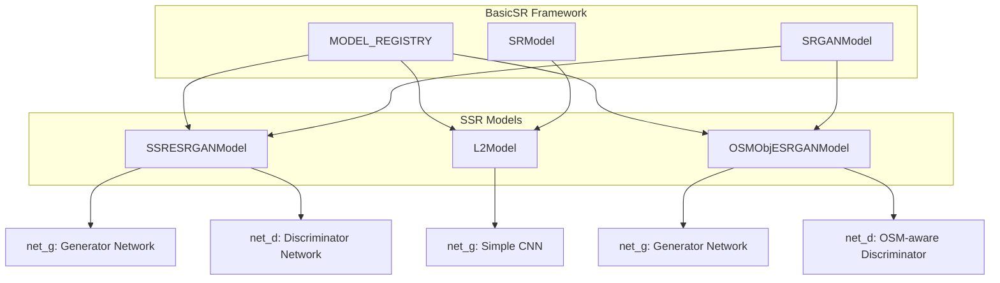
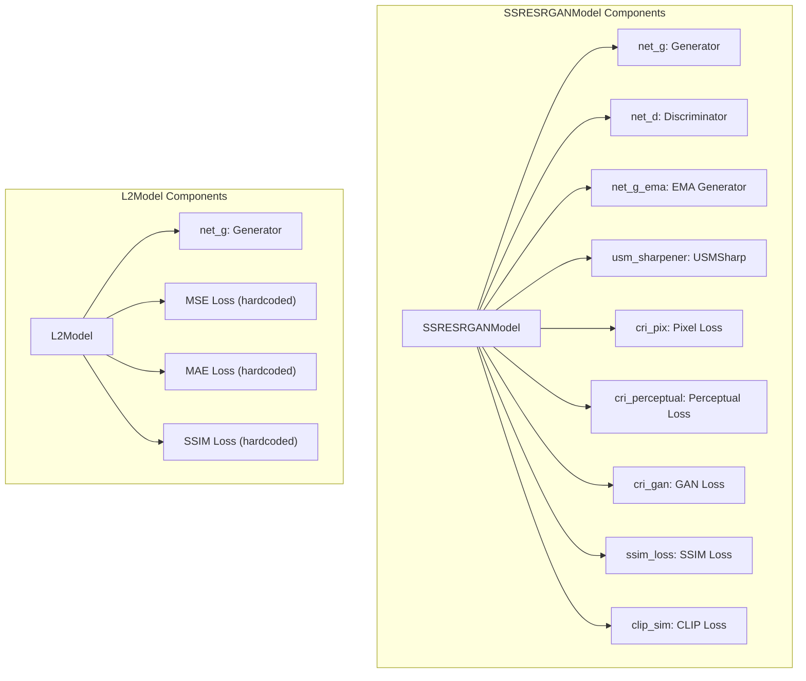
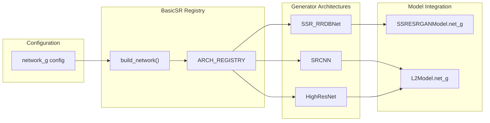
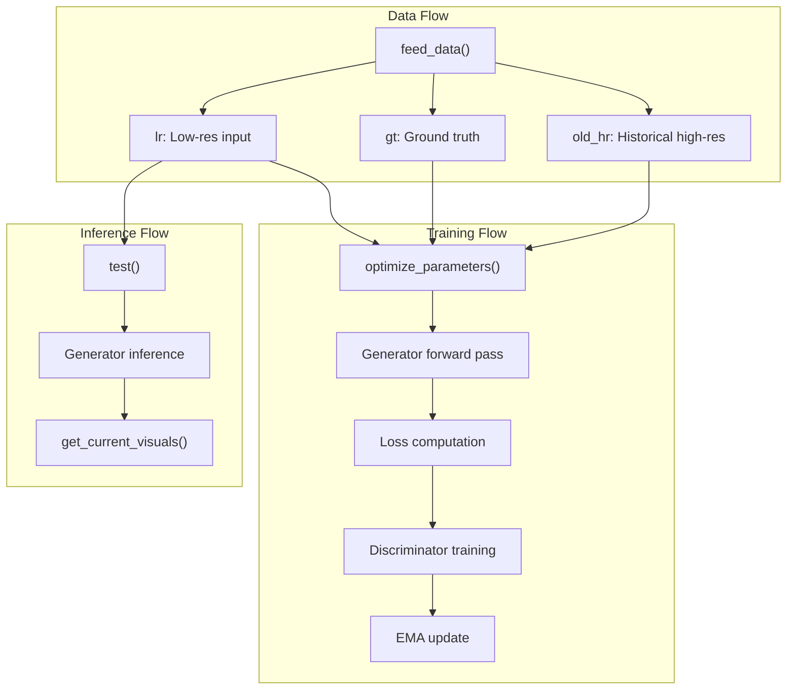
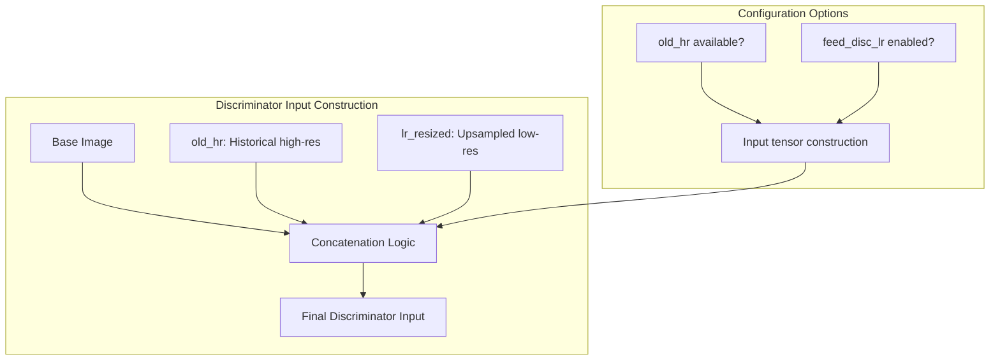

<!-- source: DeepWiki mcp.deepwiki.com · repo allenai/satlas-super-resolution · page 4 Model Architectures · fetched 2026-10-26 -->

# Model Architectures

Relevant source files

The following files were used as context for generating this wiki page:

- [ssr/models/ssr_esrgan_model.py](ssr/models/ssr_esrgan_model.py)
- [ssr/models/ssr_l2_model.py](ssr/models/ssr_l2_model.py)

This document provides an overview of the neural network model architectures available in the Satlas Super-Resolution system. It covers the high-level model organization, inheritance hierarchy, and the relationship between different architectural components.

For detailed information about specific ESRGAN implementations, see [ESRGAN Models](#4.1). For simple CNN baseline architectures, see [CNN Baselines](#4.2). For comprehensive coverage of training objectives, see [Loss Functions](#4.3).

## Model Registry System

The system uses BasicSR's model registry pattern to dynamically discover and instantiate models at runtime. All model classes are decorated with `@MODEL_REGISTRY.register()` and inherit from BasicSR's base model classes.

**Sources**: [ssr/models/ssr_esrgan_model.py:13,18](), [ssr/models/ssr_l2_model.py:10,14]()

## Architecture Overview

The system provides three primary model architectures, each designed for different use cases and complexity requirements:

| Model Class | Base Class | Primary Use Case | Complexity | Networks |
|-------------|------------|------------------|------------|----------|
| `SSRESRGANModel` | `SRGANModel` | Production super-resolution | High | Generator + Discriminator |
| `L2Model` | `SRModel` | Baseline comparison | Low | Generator only |
| `OSMObjESRGANModel` | `SRGANModel` | Geographic feature-aware | High | Generator + OSM-aware Discriminator |

**Sources**: [ssr/models/ssr_esrgan_model.py:19](), [ssr/models/ssr_l2_model.py:15]()

## Model Component Architecture

**Sources**: [ssr/models/ssr_esrgan_model.py:31,43,53,67-95](), [ssr/models/ssr_l2_model.py:37-40]()

## Generator Network Integration

The models support different generator architectures through BasicSR's network building system:

**Sources**: [ssr/models/ssr_esrgan_model.py:43](), [ssr/models/ssr_l2_model.py:34]()

## Training and Inference Flow

The models implement standardized interfaces for training and inference:

**Sources**: [ssr/models/ssr_esrgan_model.py:105-117,119-233,235-244](), [ssr/models/ssr_l2_model.py:25-28,30-54,56-60]()

## Discriminator Input Augmentation

The `SSRESRGANModel` supports feeding additional context to the discriminator beyond just the generated/real images:

**Sources**: [ssr/models/ssr_esrgan_model.py:171-178,202-213]()

## Model-Specific Features

### SSRESRGANModel Features
- **Exponential Moving Average (EMA)**: Maintains `net_g_ema` for stable inference [ssr/models/ssr_esrgan_model.py:36-50]()
- **USM Sharpening**: Applies unsharp masking to ground truth images [ssr/models/ssr_esrgan_model.py:31,109]()
- **Multi-loss Training**: Supports pixel, perceptual, GAN, SSIM, and CLIP losses [ssr/models/ssr_esrgan_model.py:67-95]()
- **Flexible Discriminator Input**: Can incorporate historical images and low-res context [ssr/models/ssr_esrgan_model.py:112-117]()

### L2Model Features
- **Hardcoded Loss Combination**: Uses fixed weights (0.3×MSE + 0.4×MAE + 0.3×SSIM) from WorldStrat paper [ssr/models/ssr_l2_model.py:37-40]()
- **Simple Training Loop**: No discriminator, straightforward generator training [ssr/models/ssr_l2_model.py:30-54]()
- **PSNR Loss Logging**: Computes PSNR in dB scale for monitoring [ssr/models/ssr_l2_model.py:43]()

**Sources**: [ssr/models/ssr_esrgan_model.py:1-354](), [ssr/models/ssr_l2_model.py:1-162]()

---

