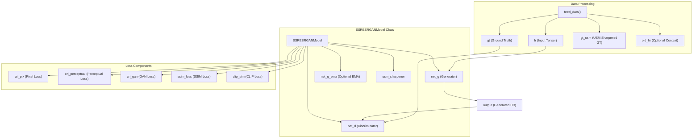
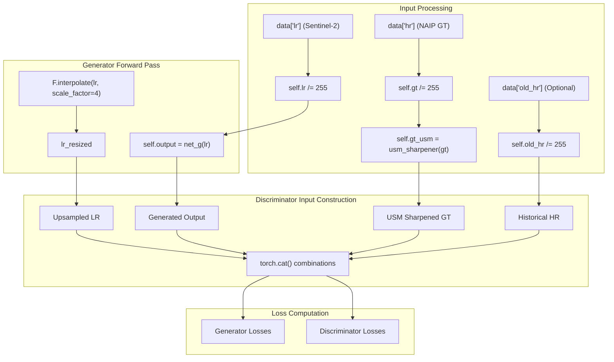
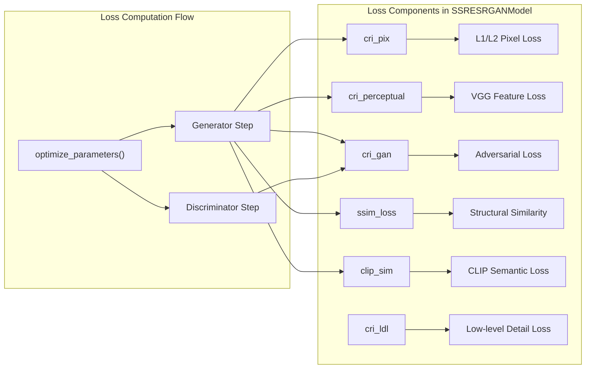
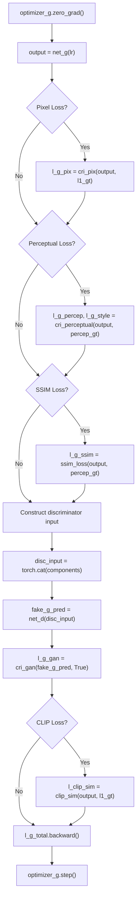
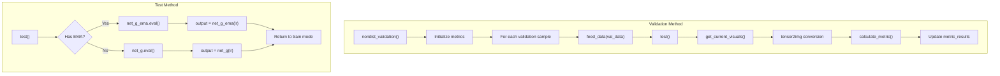

<!-- source: DeepWiki mcp.deepwiki.com · repo allenai/satlas-super-resolution · page 4.1 ESRGAN Models · fetched 2026-10-26 -->

# ESRGAN Models

<details>
<summary>Relevant source files</summary>

The following files were used as context for generating this wiki page:

- [figures/esrgan_generator.svg](figures/esrgan_generator.svg)
- [ssr/models/ssr_esrgan_model.py](ssr/models/ssr_esrgan_model.py)
- [ssr/models/ssr_l2_model.py](ssr/models/ssr_l2_model.py)

</details>


This document covers the Enhanced Super-Resolution Generative Adversarial Network (ESRGAN) models in the satellite super-resolution system. These models represent the primary production architecture for generating high-resolution satellite imagery from low-resolution Sentinel-2 inputs.

For information about simpler CNN baseline models (SRCNN, HighResNet), see [CNN Baselines](#4.2). For details about loss functions used in training, see [Loss Functions](#4.3).

## Architecture Overview

The ESRGAN models in this system are based on the Real-ESRGAN architecture, adapted specifically for satellite imagery super-resolution. The implementation consists of a generator-discriminator pair that learns to upscale low-resolution Sentinel-2 time series to high-resolution outputs matching NAIP aerial imagery quality.

### Core Model Components



**Sources:** [ssr/models/ssr_esrgan_model.py:19-31]()

## SSRESRGANModel Implementation

The `SSRESRGANModel` class extends BasicSR's `SRGANModel` and serves as the main ESRGAN implementation for satellite imagery. It handles the complete training and inference pipeline for adversarial super-resolution.

### Key Features

| Feature | Description | Configuration |
|---------|-------------|---------------|
| **Multi-channel Input** | Handles Sentinel-2 time series (36+ channels) | Defined in generator network config |
| **USM Sharpening** | Applies unsharp masking to ground truth | `usm_sharpener` instance |
| **EMA Support** | Optional exponential moving average | `ema_decay` parameter |
| **Temporal Context** | Can use older high-res images as discriminator input | `old_hr` data field |
| **Multi-loss Training** | Combines pixel, perceptual, adversarial, and semantic losses | Various `*_opt` configurations |

### Training Data Flow



**Sources:** [ssr/models/ssr_esrgan_model.py:105-118](), [ssr/models/ssr_esrgan_model.py:132-178]()

## Loss Function Integration

The ESRGAN model supports multiple loss functions that can be combined during training. Each loss type is conditionally initialized based on the training configuration.

### Supported Loss Types



The loss computation in `optimize_parameters()` follows this pattern:

1. **Generator optimization**: Combines pixel, perceptual, SSIM, and CLIP losses
2. **Discriminator optimization**: Uses adversarial loss on real/fake pairs
3. **USM variants**: Separate GT targets for different loss types (`l1_gt`, `percep_gt`, `gan_gt`)

**Sources:** [ssr/models/ssr_esrgan_model.py:67-96](), [ssr/models/ssr_esrgan_model.py:144-191]()

## Training Process Details

### Generator Training Step

The generator training involves multiple loss components that are conditionally applied based on configuration:



### Discriminator Input Construction

The discriminator receives different input combinations based on available data:

| Configuration | Input Composition |
|---------------|-------------------|
| **Basic** | `output` only |
| **With LR context** | `torch.cat((output, lr_resized), dim=1)` |
| **With temporal context** | `torch.cat((output, old_hr), dim=1)` |
| **Full context** | `torch.cat((output, lr_resized, old_hr), dim=1)` |

**Sources:** [ssr/models/ssr_esrgan_model.py:171-178](), [ssr/models/ssr_esrgan_model.py:202-213]()

## Validation and Testing

The model implements comprehensive validation capabilities with metric computation and visualization support.

### Validation Pipeline



### Output Management

The model provides structured output through `get_current_visuals()`:

- **`lr`**: Low-resolution input tensor
- **`result`**: Generated high-resolution output  
- **`gt`**: Ground truth (when available)

**Sources:** [ssr/models/ssr_esrgan_model.py:235-244](), [ssr/models/ssr_esrgan_model.py:246-252](), [ssr/models/ssr_esrgan_model.py:269-352]()

## Model Registry Integration

The `SSRESRGANModel` is registered with BasicSR's model registry system using the `@MODEL_REGISTRY.register()` decorator, enabling dynamic instantiation through configuration files.

```python
@MODEL_REGISTRY.register()
class SSRESRGANModel(SRGANModel):
```

This registration allows the model to be specified in YAML configuration files and automatically instantiated by the training framework.

**Sources:** [ssr/models/ssr_esrgan_model.py:18-19]()

---

