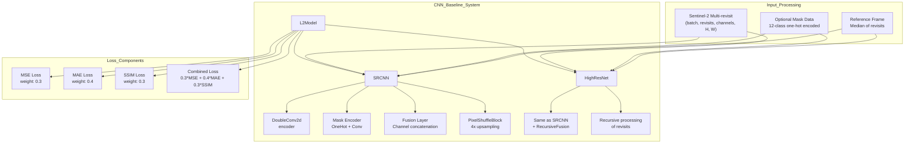
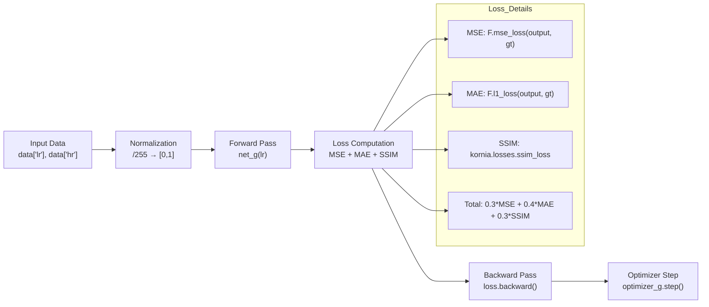
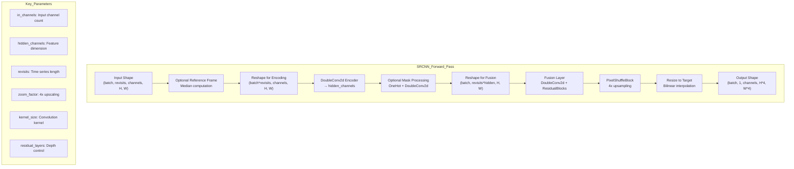
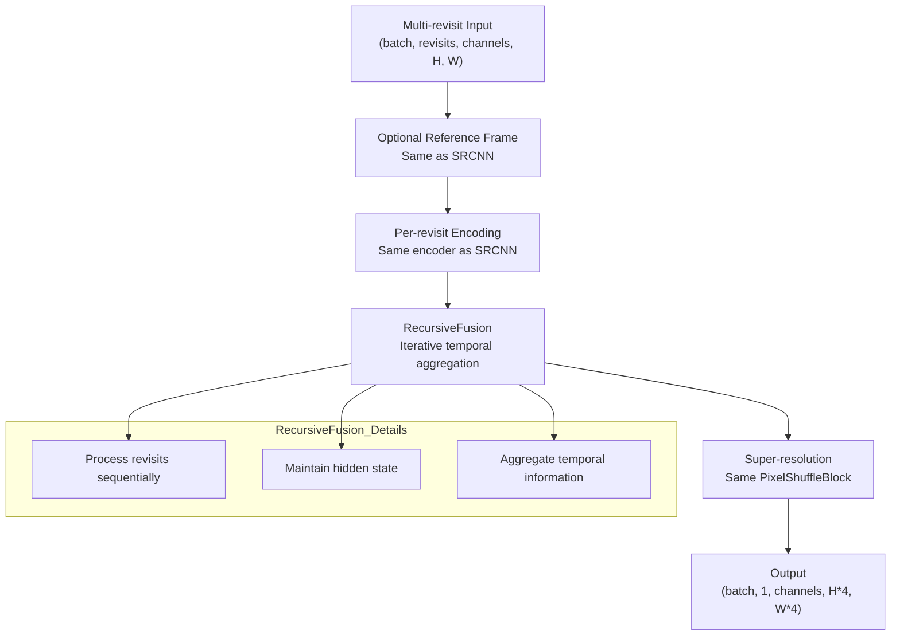
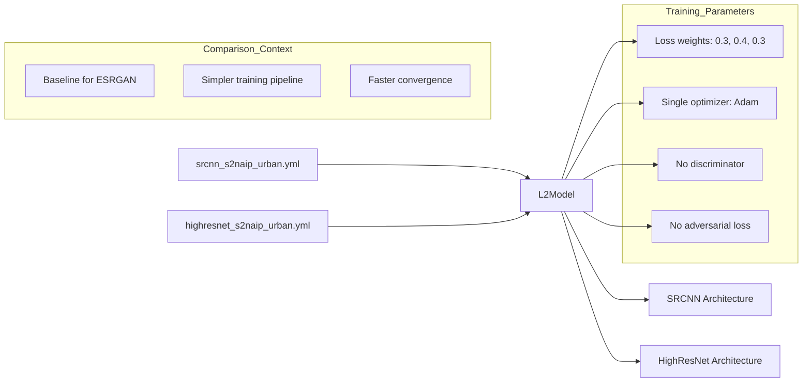

<!-- source: DeepWiki mcp.deepwiki.com · repo allenai/satlas-super-resolution · page 4.2 CNN Baselines · fetched 2026-10-26 -->

# CNN Baselines

<details>
<summary>Relevant source files</summary>

The following files were used as context for generating this wiki page:

- [figures/teaser.svg](figures/teaser.svg)
- [ssr/archs/highresnet_arch.py](ssr/archs/highresnet_arch.py)
- [ssr/archs/srcnn_arch.py](ssr/archs/srcnn_arch.py)
- [ssr/models/ssr_esrgan_model.py](ssr/models/ssr_esrgan_model.py)
- [ssr/models/ssr_l2_model.py](ssr/models/ssr_l2_model.py)

</details>


This document covers the simpler CNN architectures used as baseline models in the satellite super-resolution system. These include SRCNN and HighResNet, which serve as comparison baselines against the more complex ESRGAN models. For information about the primary ESRGAN production models, see [ESRGAN Models](#4.1). For details about loss function implementations, see [Loss Functions](#4.3).

## Architecture Overview

The CNN baseline system provides simpler alternatives to the ESRGAN models for satellite imagery super-resolution. These models use L2-based training with hardcoded loss combinations derived from the WorldStrat paper, making them suitable for establishing performance baselines and conducting comparative studies.



**Sources:** [ssr/models/ssr_l2_model.py:14-22](), [ssr/archs/srcnn_arch.py:12-33](), [ssr/archs/highresnet_arch.py:9-26]()

## L2Model Wrapper

The `L2Model` class serves as a training wrapper for both SRCNN and HighResNet architectures, implementing the L2-based loss function approach from the WorldStrat paper.

| Component | Purpose | Implementation |
|-----------|---------|----------------|
| **Loss Function** | Combined MSE + MAE + SSIM | Hardcoded weights: 0.3, 0.4, 0.3 |
| **Input Normalization** | Scale input to [0,1] | Division by 255 |
| **Output Processing** | Remove batch dimension | `.squeeze(1)` operation |
| **Training Loop** | Standard gradient descent | Single optimizer step per iteration |

### Key Training Characteristics



**Sources:** [ssr/models/ssr_l2_model.py:30-54]()

## SRCNN Architecture

The `SRCNN` class implements a straightforward super-resolution CNN that processes multi-revisit satellite imagery through a series of encoding, fusion, and super-resolution stages.

### Architecture Components



### Reference Frame Processing

The SRCNN architecture supports optional reference frame computation, which creates a temporal baseline by computing the median across all revisits:

```python
# Reference frame computation
reference_frame = x.median(dim=-4, keepdim=True).values
x = torch.cat([x, reference_frame], dim=-3)  # Double channels
```

**Sources:** [ssr/archs/srcnn_arch.py:125-141](), [ssr/archs/srcnn_arch.py:197-202]()

## HighResNet Architecture 

The `HighResNet` class extends SRCNN with recursive fusion capabilities, providing enhanced processing of multi-revisit data through temporal aggregation.

### Key Differences from SRCNN

| Aspect | SRCNN | HighResNet |
|--------|-------|------------|
| **Fusion Method** | Channel concatenation | `RecursiveFusion` |
| **Temporal Processing** | Treats revisits as channels | Recursive processing per revisit |
| **Data Flow** | Reshape → fuse all at once | Iterative revisit processing |
| **Inheritance** | Base class | Inherits from SRCNN |

### Architecture Flow



The `RecursiveFusion` module enables HighResNet to process temporal sequences more effectively than SRCNN's simple channel concatenation approach.

**Sources:** [ssr/archs/highresnet_arch.py:10-26](), [ssr/archs/highresnet_arch.py:27-77]()

## Training Configuration Integration

CNN baselines integrate with the broader training system through specific YAML configurations that specify the L2-based training approach:



**Sources:** [ssr/models/ssr_l2_model.py:36-40]()

## Performance Characteristics

The CNN baselines offer distinct advantages for certain use cases:

| Characteristic | CNN Baselines | ESRGAN Models |
|----------------|---------------|---------------|
| **Training Complexity** | Simple L2 loss only | Multi-loss with adversarial training |
| **Computational Cost** | Lower memory usage | Higher memory requirements |
| **Training Stability** | More stable convergence | Requires careful balancing |
| **Output Quality** | Good baseline performance | Superior perceptual quality |
| **Use Case** | Research baselines, rapid prototyping | Production deployment |

The hardcoded loss weights in `L2Model` (0.3 MSE + 0.4 MAE + 0.3 SSIM) are derived from empirical studies in the WorldStrat paper, providing a proven baseline for satellite imagery super-resolution tasks.

**Sources:** [ssr/models/ssr_l2_model.py:36-40](), [ssr/models/ssr_l2_model.py:17-19]()

---

