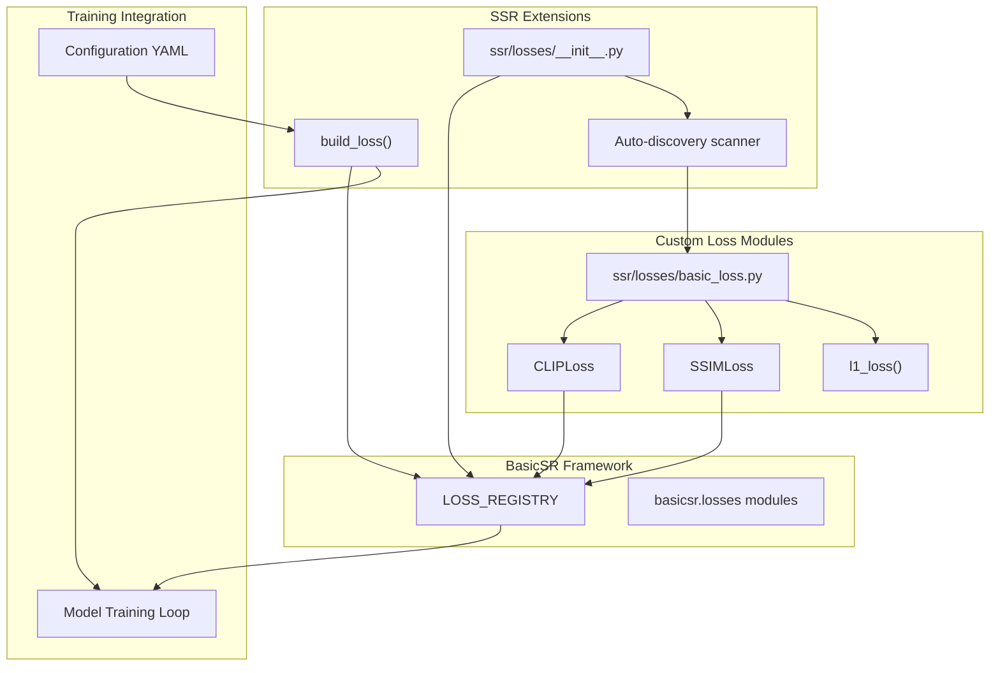
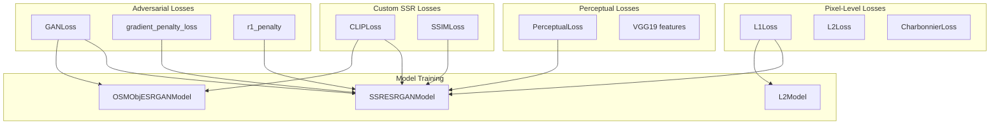
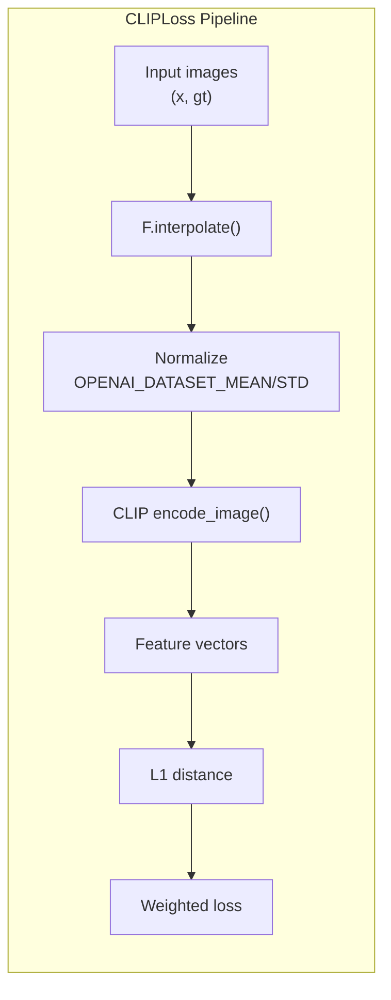
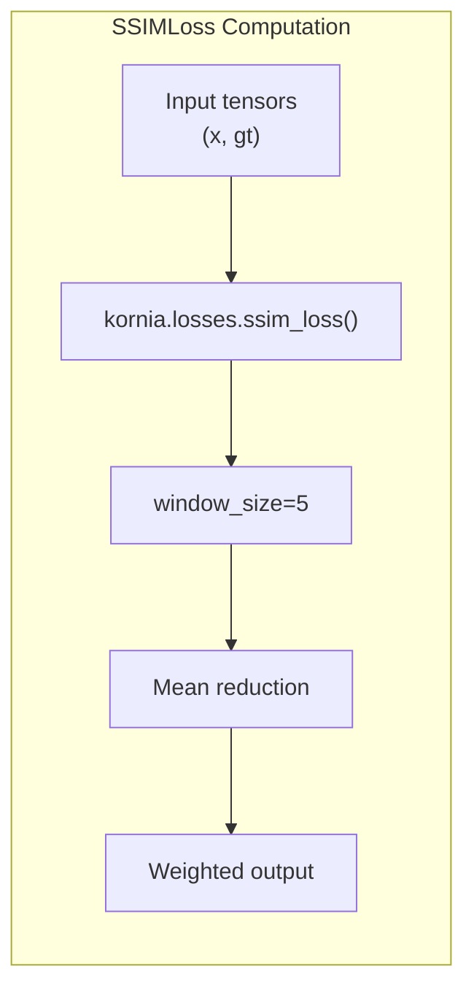

<!-- source: DeepWiki mcp.deepwiki.com · repo allenai/satlas-super-resolution · page 4.3 Loss Functions · fetched 2026-10-26 -->

# Loss Functions

<details>
<summary>Relevant source files</summary>

The following files were used as context for generating this wiki page:

- [ssr/losses/__init__.py](ssr/losses/__init__.py)
- [ssr/losses/basic_loss.py](ssr/losses/basic_loss.py)

</details>


This document covers the loss function system used for training super-resolution models in the Satlas repository. Loss functions define the optimization objectives that guide model training, including pixel-level accuracy, perceptual quality, adversarial training, and semantic similarity.

For information about model architectures that use these losses, see [4.1](#4.1) and [4.2](#4.2). For training configuration details, see [5.1](#5.1).

## System Architecture

The loss function system is built on top of the BasicSR framework's registry pattern, with custom extensions for satellite imagery super-resolution tasks. The system automatically discovers and registers loss modules, allowing for flexible configuration-driven training.

### Loss Registry and Discovery



The system uses automatic module discovery to scan for loss functions ending with `_loss.py` and imports them into the registry. The `build_loss` function creates loss instances from YAML configuration specifications.

**Sources:** [ssr/losses/__init__.py:13-18](), [ssr/losses/__init__.py:21-33]()

### Loss Function Composition



**Sources:** [ssr/losses/__init__.py:7](), [ssr/losses/basic_loss.py:19-61]()

## Available Loss Functions

### CLIP-Based Semantic Loss

The `CLIPLoss` class implements semantic similarity loss using pre-trained CLIP models. This loss function measures perceptual similarity in the CLIP feature space rather than pixel space.

| Property | Value |
|----------|-------|
| Registry Name | `CLIPLoss` |
| Input Requirements | RGB images (converted from multi-band) |
| Supported Models | EVA02-E-14-plus, ViT-B-16-SigLIP-256, RN50 |
| Output Size | 224x224 or 256x256 (model-dependent) |



The implementation supports three CLIP model variants with different input sizes and pre-training datasets. Images are automatically resized and normalized using OpenAI's standard preprocessing before feature extraction.

**Sources:** [ssr/losses/basic_loss.py:20-48]()

### Structural Similarity Loss

The `SSIMLoss` class implements loss based on the Structural Similarity Index (SSIM), which measures structural information preservation between images.



The SSIM loss uses a 5x5 sliding window to compute structural similarity and applies mean reduction across spatial and channel dimensions.

**Sources:** [ssr/losses/basic_loss.py:51-60]()

### Basic Pixel Losses

The system provides wrapped versions of standard pixel-level losses:

- **L1 Loss**: `l1_loss` function with weighting support
- Inherits additional losses from BasicSR (L2, Charbonnier, etc.)

**Sources:** [ssr/losses/basic_loss.py:15-17]()

## Loss Configuration

### YAML Configuration Format

Loss functions are configured in training YAML files using the following structure:

```yaml
# Example loss configuration
losses:
  pixel_opt:
    type: L1Loss
    loss_weight: 1.0
  perceptual_opt:
    type: PerceptualLoss
    layer_weights:
      'conv5_4': 1.0
    loss_weight: 1.0
  clip_opt:
    type: CLIPLoss
    clip_loss_model: 'ViT-B-16-SigLIP-256'
    loss_weight: 0.1
  ssim_opt:
    type: SSIMLoss
    loss_weight: 0.1
```

### Registry Integration

The `build_loss` function creates loss instances by:

1. Extracting the `type` field from configuration
2. Looking up the loss class in `LOSS_REGISTRY`
3. Instantiating with remaining configuration parameters
4. Returning the configured loss instance

**Sources:** [ssr/losses/__init__.py:21-33]()

## Integration Points

### Model Integration

Loss functions integrate with model classes through the BasicSR training framework:

- **SSRESRGANModel**: Uses pixel + perceptual + adversarial losses
- **L2Model**: Primarily uses pixel losses (L1/L2)
- **OSMObjESRGANModel**: Can use CLIP loss for semantic fidelity

### Training Loop Integration

The registry system allows models to dynamically instantiate configured losses during training initialization, enabling flexible experimentation with different loss combinations without code changes.

**Sources:** [ssr/losses/__init__.py:1-11]()

---

