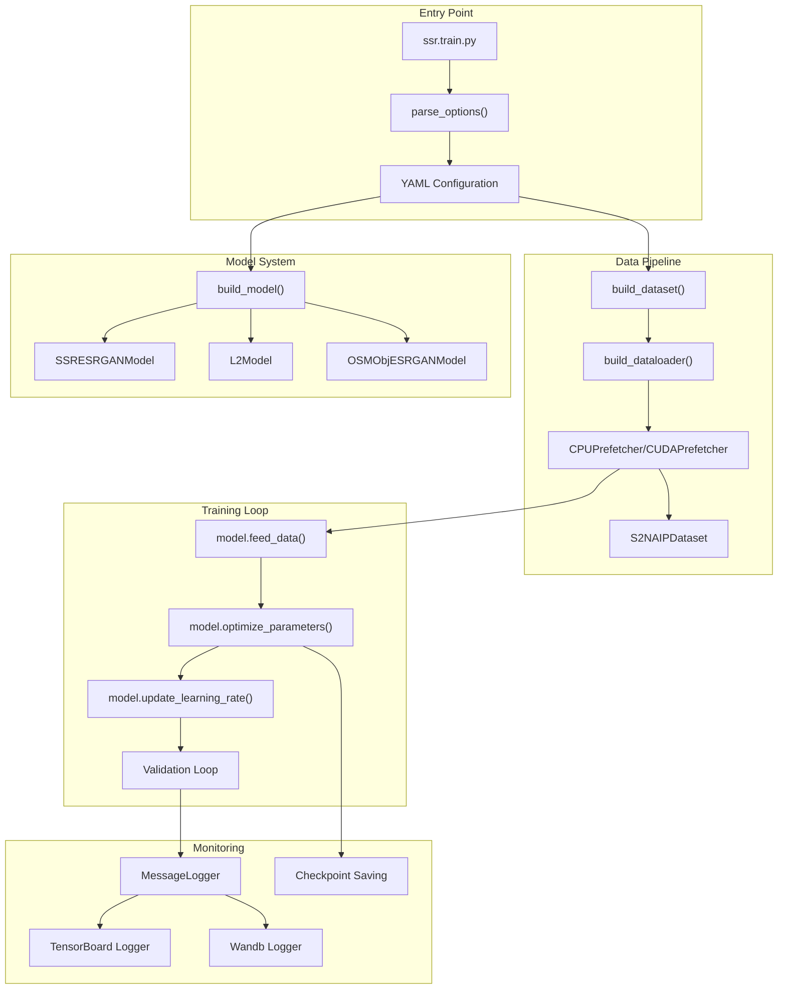
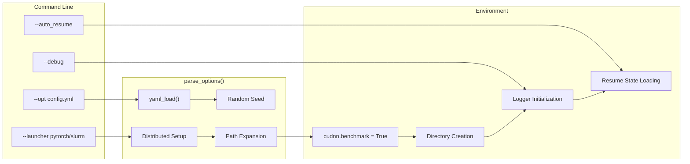
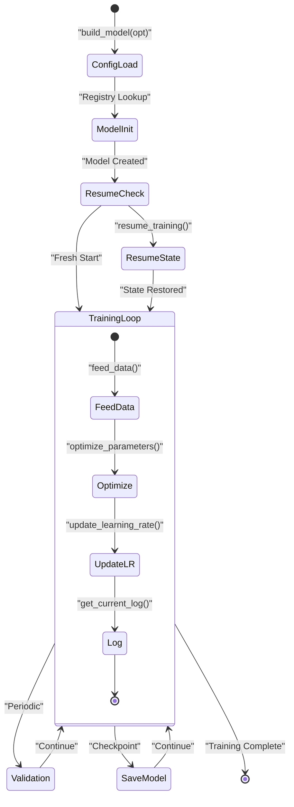
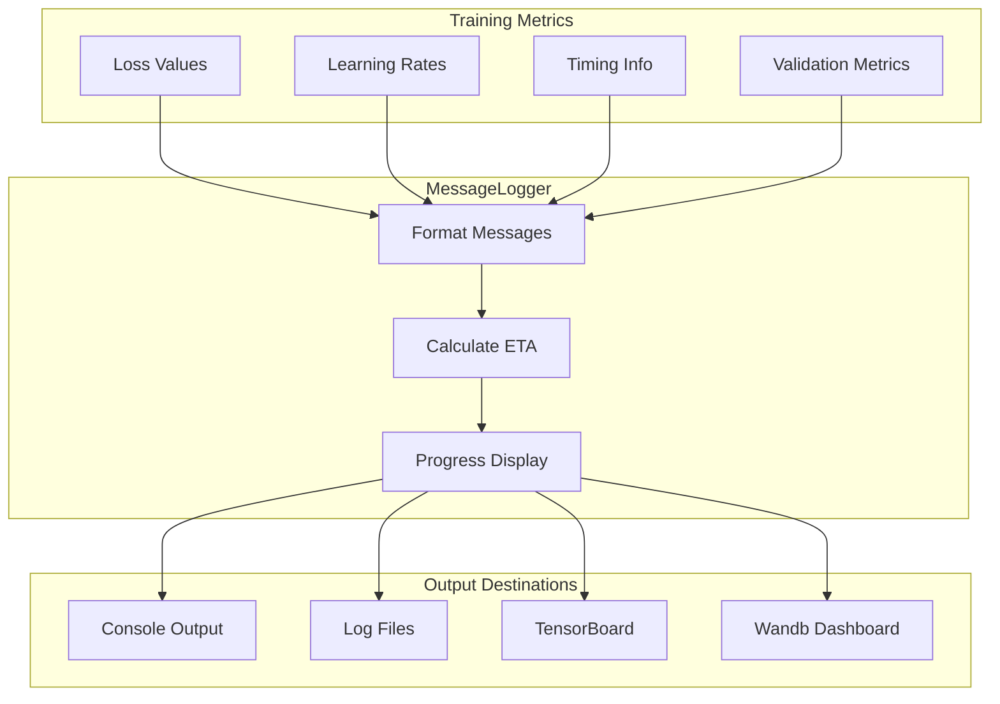
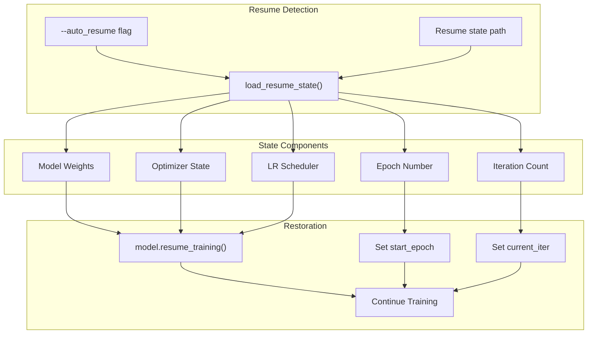

<!-- source: DeepWiki mcp.deepwiki.com · repo allenai/satlas-super-resolution · page 5 Training · fetched 2026-10-26 -->

# Training

<details>
<summary>Relevant source files</summary>

The following files were used as context for generating this wiki page:

- [requirements.txt](requirements.txt)
- [ssr/train.py](ssr/train.py)
- [ssr/utils/options.py](ssr/utils/options.py)

</details>


This document provides a comprehensive guide to training super-resolution models using the Satlas Super-Resolution pipeline. It covers the training entry point, configuration system, training loop mechanics, model optimization, and monitoring capabilities. For information about specific model architectures, see [Model Architectures](#4). For configuration details, see [Configuration System](#5.1).

## Training Pipeline Overview

The training system is built on the BasicSR framework and provides a comprehensive pipeline for training various super-resolution models. The system supports distributed training, automatic resumption, extensive logging, and flexible configuration through YAML files.

**Training Pipeline Architecture**



Sources: [ssr/train.py:1-156](), [ssr/utils/options.py:50-152]()

## Entry Point and Configuration Loading

The training process begins with the `train_pipeline()` function in `ssr/train.py`, which handles argument parsing, configuration loading, and environment setup.

| Component | Function | Description |
|-----------|----------|-------------|
| **Configuration Parser** | `parse_options()` | Loads YAML config, handles CLI args, sets up distributed training |
| **Environment Setup** | `torch.backends.cudnn.benchmark` | Enables CuDNN optimization for performance |
| **Resume Handling** | `load_resume_state()` | Loads previous training state if resuming |
| **Directory Creation** | `make_exp_dirs()` | Creates experiment directories for outputs |

**Configuration and Setup Flow**



Sources: [ssr/train.py:29-74](), [ssr/utils/options.py:50-152]()

## Training Process Flow

The core training loop follows a standard pattern with data prefetching, model optimization, and periodic validation. The system supports both CPU and CUDA prefetching for optimal performance.

**Main Training Loop Components**

| Component | Function | Purpose |
|-----------|----------|---------|
| **Data Prefetcher** | `CPUPrefetcher`/`CUDAPrefetcher` | Asynchronous data loading |
| **Model Training** | `model.feed_data()` | Loads batch into model |
| **Optimization** | `model.optimize_parameters()` | Performs forward/backward pass |
| **Learning Rate** | `model.update_learning_rate()` | Updates learning rate schedule |
| **Validation** | `model.validation()` | Runs validation on test sets |

```python
# Core training loop structure from ssr/train.py
for epoch in range(start_epoch, total_epochs + 1):
    prefetcher.reset()
    train_data = prefetcher.next()
    
    while train_data is not None:
        current_iter += 1
        model.update_learning_rate(current_iter, warmup_iter=opt['train'].get('warmup_iter', -1))
        model.feed_data(train_data)
        model.optimize_parameters(current_iter)
        # Logging, validation, and checkpointing...
```

Sources: [ssr/train.py:88-148]()

## Model Building and Optimization

The training system uses the BasicSR model registry to dynamically build models based on configuration. Models handle their own optimization, loss computation, and learning rate scheduling.

**Model Lifecycle in Training**



Sources: [ssr/train.py:61-71](), [ssr/train.py:105-126]()

## Logging and Monitoring

The system provides comprehensive logging through multiple channels including console output, TensorBoard, and Weights & Biases. The `MessageLogger` formats and distributes log messages across these systems.

| Logger Type | Class | Purpose |
|-------------|-------|---------|
| **Console** | `get_root_logger()` | Standard Python logging to file/console |
| **TensorBoard** | `init_tb_loggers()` | Scalar metrics and visualization |
| **Weights & Biases** | `init_wandb_logger()` | Experiment tracking and comparison |
| **Message Logger** | `MessageLogger` | Formatted training progress output |

**Logging Information Flow**



Sources: [ssr/train.py:48-55](), [ssr/train.py:114-122]()

## Validation and Checkpointing

The training pipeline supports periodic validation on test datasets and automatic model checkpointing. Validation frequency and checkpoint saving intervals are configurable through the YAML configuration.

**Validation and Saving Schedule**

| Operation | Trigger | Configuration Key |
|-----------|---------|-------------------|
| **Logging** | Every N iterations | `logger.print_freq` |
| **Checkpointing** | Every N iterations | `logger.save_checkpoint_freq` |
| **Validation** | Every N iterations | `val.val_freq` |
| **Debug Mode** | Accelerated schedule | `debug` in experiment name |

The system automatically saves the latest model at training completion and runs final validation on all test datasets.

```python
# Validation and checkpoint logic from ssr/train.py
if current_iter % opt['logger']['save_checkpoint_freq'] == 0:
    logger.info('Saving models and training states.')
    model.save(epoch, current_iter)

if opt.get('val') is not None and (current_iter % opt['val']['val_freq'] == 0):
    for val_loader in val_loaders:
        model.validation(val_loader, current_iter, tb_logger, opt['val']['save_img'])
```

Sources: [ssr/train.py:123-134](), [ssr/train.py:142-150]()

## Resume Training Functionality

The training system supports automatic resume functionality through the `--auto_resume` flag and manual resume by specifying a resume state path. The system saves and restores complete training state including model weights, optimizer states, and learning rate schedulers.

**Resume State Management**



The resume functionality ensures seamless continuation of interrupted training runs while maintaining exact reproducibility of the training process.

Sources: [ssr/train.py:37-38](), [ssr/train.py:64-71](), [ssr/utils/options.py:54](), [ssr/utils/options.py:97]()

---

