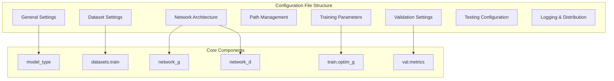
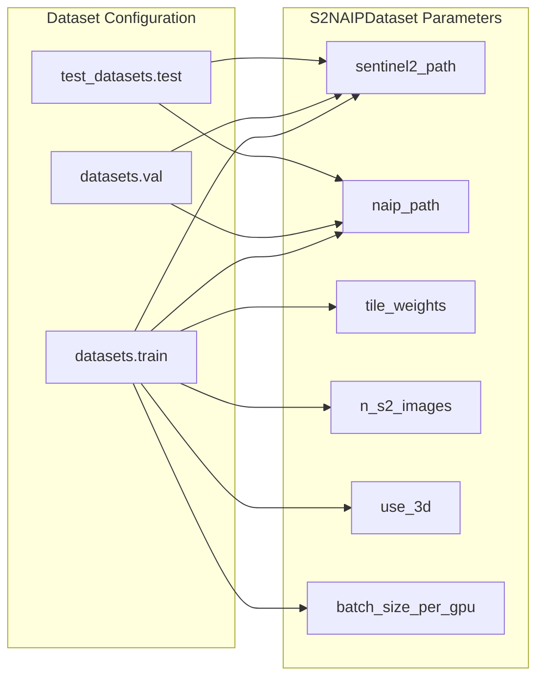
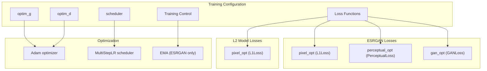
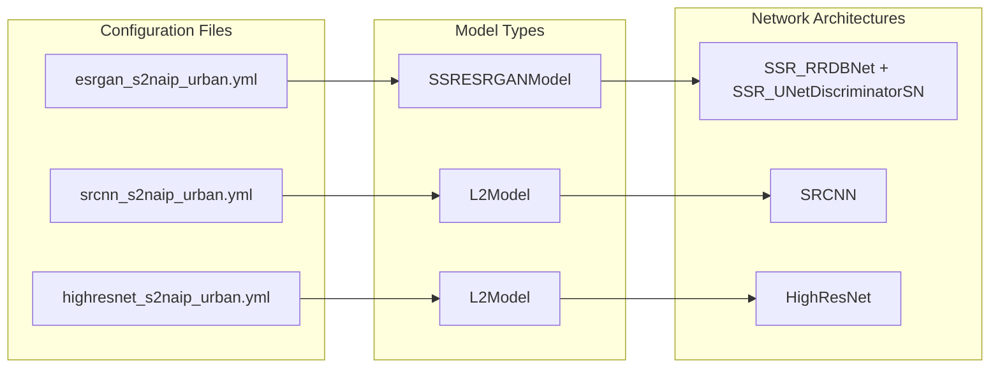

<!-- source: DeepWiki mcp.deepwiki.com · repo allenai/satlas-super-resolution · page 5.1 Configuration System · fetched 2026-10-26 -->

# Configuration System

<details>
<summary>Relevant source files</summary>

The following files were used as context for generating this wiki page:

- [ssr/options/esrgan_s2naip_urban.yml](ssr/options/esrgan_s2naip_urban.yml)
- [ssr/options/highresnet_s2naip_urban.yml](ssr/options/highresnet_s2naip_urban.yml)
- [ssr/options/srcnn_s2naip_urban.yml](ssr/options/srcnn_s2naip_urban.yml)

</details>


The configuration system in Satlas Super-Resolution provides a comprehensive YAML-based approach to defining training, validation, and testing parameters for super-resolution models. This system enables researchers to experiment with different model architectures, training strategies, and datasets through declarative configuration files without modifying code.

For information about specific training configurations and their use cases, see [Training Configurations](#5.2). For details about model architectures referenced in configurations, see [Model Architectures](#4).

## Configuration File Structure

The configuration system uses YAML files located in [ssr/options/]() to define all aspects of the training and inference pipeline. Each configuration file follows a standardized structure with eight main sections:



**Configuration Structure Overview**

Sources: [ssr/options/esrgan_s2naip_urban.yml:1-201](), [ssr/options/srcnn_s2naip_urban.yml:1-163](), [ssr/options/highresnet_s2naip_urban.yml:1-163]()

## General Settings

The general settings section defines experiment metadata and basic training parameters:

| Parameter | Purpose | Example Values |
|-----------|---------|----------------|
| `name` | Experiment identifier | `esrgan_s2naip_urban` |
| `model_type` | Model class to instantiate | `SSRESRGANModel`, `L2Model` |
| `scale` | Super-resolution scale factor | `4` |
| `num_gpu` | GPU allocation | `auto`, specific number |
| `manual_seed` | Reproducibility seed | `0` |

Additional ESRGAN-specific settings control training behavior:

```yaml
# USM sharpening applied to ground truth
l1_gt_usm: True
percep_gt_usm: True  
gan_gt_usm: False

# Feed discriminator low-resolution images
feed_disc_lr: True
```

Sources: [ssr/options/esrgan_s2naip_urban.yml:1-14](), [ssr/options/srcnn_s2naip_urban.yml:1-6](), [ssr/options/highresnet_s2naip_urban.yml:1-6]()

## Dataset Configuration

Dataset settings define the data pipeline for training, validation, and testing phases. All configurations use the `S2NAIPDataset` type for Sentinel-2 to NAIP image pairs:



**Dataset Configuration Structure**

Key dataset parameters include:

- **`sentinel2_path`** and **`naip_path`**: Data directory paths
- **`tile_weights`**: JSON file defining sampling weights for tiles
- **`n_s2_images`**: Number of Sentinel-2 images in temporal sequence (typically 8)
- **`use_3d`**: Enable 3D tensor processing for multi-temporal data
- **`use_shuffle`**: Must be `False` when using `tile_weights`

Sources: [ssr/options/esrgan_s2naip_urban.yml:17-67](), [ssr/options/srcnn_s2naip_urban.yml:9-65](), [ssr/options/highresnet_s2naip_urban.yml:9-65]()

## Network Architecture Configuration

Network architecture settings define the generator and discriminator models. The configuration varies significantly between model types:

### ESRGAN Architecture

ESRGAN configurations define both generator (`network_g`) and discriminator (`network_d`):

```yaml
network_g:
  type: SSR_RRDBNet
  num_in_ch: 36    # 8 Sentinel-2 images * 3 channels + 12 additional channels
  num_out_ch: 3
  num_feat: 64
  num_block: 23
  num_grow_ch: 32

network_d:
  type: SSR_UNetDiscriminatorSN
  num_in_ch: 3
  num_feat: 64
  skip_connection: True
```

### L2 Model Architecture  

L2 models (SRCNN, HighResNet) only define the generator:

```yaml
network_g:
  type: SRCNN  # or HighResNet
  in_channels: 3
  mask_channels: 0
  hidden_channels: 128
  out_channels: 3
  kernel_size: 3
  residual_layers: 1
  output_size: 128
  revisits: 8
  zoom_factor: 4
  sr_kernel_size: 1
```

Sources: [ssr/options/esrgan_s2naip_urban.yml:69-83](), [ssr/options/srcnn_s2naip_urban.yml:67-79](), [ssr/options/highresnet_s2naip_urban.yml:67-79]()

## Training Configuration

Training settings control optimization, scheduling, and loss functions. The configuration differs between GAN-based and L2-based models:



**Training Configuration Components**

### Optimizer Configuration

Both generator and discriminator (when present) use Adam optimization:

```yaml
optim_g:
  type: Adam
  lr: !!float 1e-4
  weight_decay: 0
  betas: [0.9, 0.99]
```

### Loss Function Configuration

ESRGAN models combine multiple loss types with specific weights:

- **Pixel Loss**: L1 loss for pixel-level accuracy (`loss_weight: 1.0`)
- **Perceptual Loss**: VGG19-based feature matching (`perceptual_weight: 1.0`)
- **GAN Loss**: Adversarial loss (`loss_weight: 1e-1`)

L2 models use only pixel loss, with actual implementation in the model class rather than configuration.

Sources: [ssr/options/esrgan_s2naip_urban.yml:95-148](), [ssr/options/srcnn_s2naip_urban.yml:89-109](), [ssr/options/highresnet_s2naip_urban.yml:89-109]()

## Validation and Testing Configuration

Validation and testing configurations define evaluation metrics and frequencies:

### Validation Settings

```yaml
val:
  val_freq: !!float 5e3  # Validate every 5000 iterations
  save_img: True
  
  metrics:
    psnr: 
      type: calculate_psnr
      crop_border: 4
      test_y_channel: false
    ssim: 
      type: calculate_ssim
      crop_border: 4
      test_y_channel: false
```

### Testing Metrics

Testing configurations include comprehensive evaluation metrics:

| Metric | Purpose | Implementation |
|--------|---------|----------------|
| `psnr` | Peak Signal-to-Noise Ratio | `calculate_psnr` |
| `ssim` | Structural Similarity Index | `calculate_ssim` |
| `cpsnr` | Color-aware PSNR | `calculate_cpsnr` |
| `lpips` | Learned Perceptual Image Patch Similarity | `calculate_lpips` |
| `clipscore` | CLIP-based semantic similarity | `calculate_clipscore` |

Sources: [ssr/options/esrgan_s2naip_urban.yml:149-186](), [ssr/options/srcnn_s2naip_urban.yml:111-148](), [ssr/options/highresnet_s2naip_urban.yml:111-148]()

## Model Type Mapping

The configuration system maps different `model_type` values to specific model implementations:



**Model Configuration Mapping**

This mapping enables the training system to instantiate the correct model class and architecture based on the configuration file selection.

## Logging and Distribution Settings

Configuration files include settings for experiment tracking and distributed training:

### Logging Configuration

```yaml
logger:
  print_freq: 100                    # Print frequency during training
  save_checkpoint_freq: !!float 5e3 # Checkpoint saving frequency
  use_tb_logger: true               # Enable TensorBoard logging
  wandb:
    project: ~                      # Weights & Biases project name
    resume_id: ~                    # Resume existing experiment
```

### Distributed Training

```yaml
dist_params:
  backend: nccl  # NVIDIA Collective Communications Library
  port: 29500    # Communication port for multi-GPU training
```

Sources: [ssr/options/esrgan_s2naip_urban.yml:188-201](), [ssr/options/srcnn_s2naip_urban.yml:150-163](), [ssr/options/highresnet_s2naip_urban.yml:150-163]()

## Configuration Customization

To create custom configurations:

1. **Copy an existing configuration** that matches your desired model type
2. **Modify dataset paths** to point to your data directories
3. **Adjust network parameters** for your specific requirements
4. **Configure loss functions** based on training objectives
5. **Set appropriate learning rates and schedules** for your dataset size
6. **Update logging settings** for your experiment tracking preferences

The configuration system provides flexibility while maintaining consistency across different model architectures and training strategies.

---

