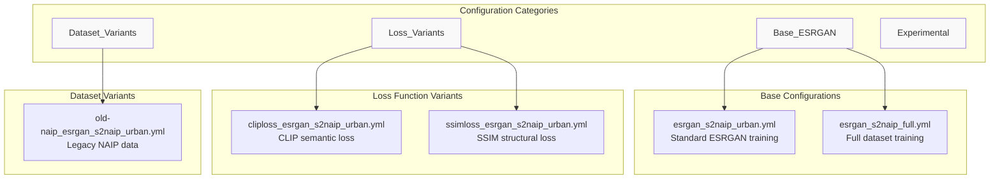
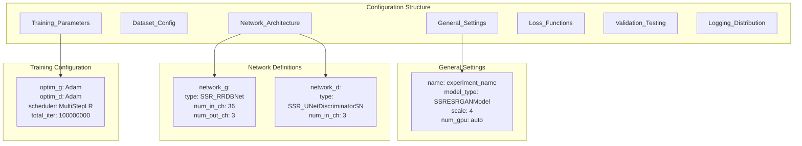
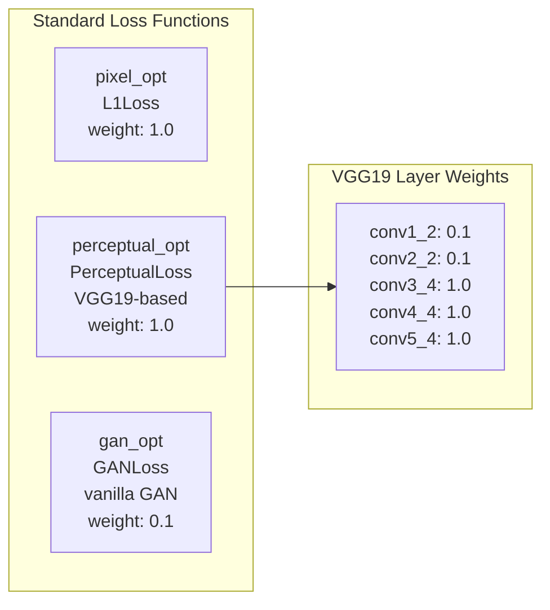
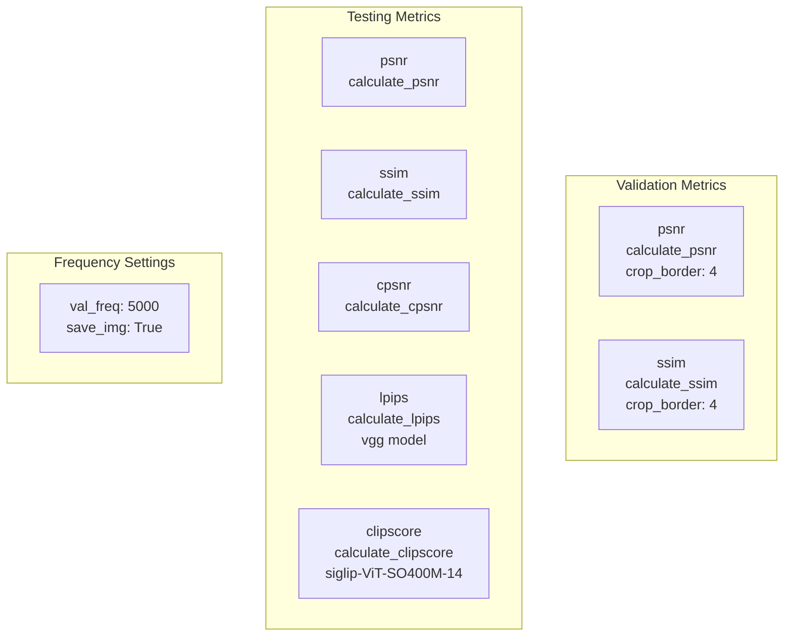

<!-- source: DeepWiki mcp.deepwiki.com · repo allenai/satlas-super-resolution · page 5.2 Training Configurations · fetched 2026-10-26 -->

# Training Configurations

<details>
<summary>Relevant source files</summary>

The following files were used as context for generating this wiki page:

- [ssr/options/cliploss_esrgan_s2naip_urban.yml](ssr/options/cliploss_esrgan_s2naip_urban.yml)
- [ssr/options/esrgan_s2naip_full.yml](ssr/options/esrgan_s2naip_full.yml)
- [ssr/options/old-naip_esrgan_s2naip_urban.yml](ssr/options/old-naip_esrgan_s2naip_urban.yml)
- [ssr/options/ssimloss_esrgan_s2naip_urban.yml](ssr/options/ssimloss_esrgan_s2naip_urban.yml)

</details>


This document provides a comprehensive reference for all available training configurations in the Satlas Super-Resolution repository. These YAML configuration files define the complete training pipeline, including model architectures, datasets, loss functions, and hyperparameters. For information about the configuration system mechanics and how to customize parameters, see [Configuration System](#5.1).

## Overview

The training configurations are stored as YAML files in the `ssr/options/` directory. Each configuration defines a complete training setup that can be used with the `ssr.train` command. The configurations are organized by model type, dataset variant, and experimental objectives.



**Sources:** [ssr/options/cliploss_esrgan_s2naip_urban.yml:1-205](), [ssr/options/esrgan_s2naip_full.yml:1-201](), [ssr/options/old-naip_esrgan_s2naip_urban.yml:1-205](), [ssr/options/ssimloss_esrgan_s2naip_urban.yml:1-205]()

## Available Training Configurations

### Base ESRGAN Configurations

| Configuration | Purpose | Dataset | Key Features |
|---------------|---------|---------|--------------|
| `esrgan_s2naip_urban.yml` | Standard urban training | Urban subset (~1.1M pairs) | L1 + Perceptual + GAN losses |
| `esrgan_s2naip_full.yml` | Large-scale training | Full dataset (~44M pairs) | Production-ready configuration |

**Sources:** [ssr/options/esrgan_s2naip_full.yml:1-24]()

### Loss Function Variants

| Configuration | Additional Loss | Purpose | Weight |
|---------------|----------------|---------|--------|
| `cliploss_esrgan_s2naip_urban.yml` | `CLIPLoss` | Semantic similarity | Default |
| `ssimloss_esrgan_s2naip_urban.yml` | `SSIMLoss` | Structural preservation | 0.1 |

**Sources:** [ssr/options/cliploss_esrgan_s2naip_urban.yml:145-149](), [ssr/options/ssimloss_esrgan_s2naip_urban.yml:145-149]()

### Dataset Variants

| Configuration | Dataset Type | Special Features |
|---------------|--------------|------------------|
| `old-naip_esrgan_s2naip_urban.yml` | `SSRDataset` | Includes legacy NAIP data via `old_naip_path` |

**Sources:** [ssr/options/old-naip_esrgan_s2naip_urban.yml:20-26]()

## Configuration Structure

All training configurations follow a standardized YAML structure with the following main sections:



**Sources:** [ssr/options/cliploss_esrgan_s2naip_urban.yml:1-7](), [ssr/options/cliploss_esrgan_s2naip_urban.yml:70-83](), [ssr/options/cliploss_esrgan_s2naip_urban.yml:96-115]()

### Model Architecture Settings

All configurations use consistent network architectures:

| Component | Type | Key Parameters |
|-----------|------|----------------|
| Generator | `SSR_RRDBNet` | 36 input channels, 3 output channels, 23 blocks |
| Discriminator | `SSR_UNetDiscriminatorSN` | 3 input channels, spectral normalization |

**Sources:** [ssr/options/cliploss_esrgan_s2naip_urban.yml:70-83]()

### Training Parameters

Standard training parameters across all configurations:

| Parameter | Value | Purpose |
|-----------|-------|---------|
| `ema_decay` | 0.999 | Exponential moving average for generator |
| `optim_g.lr` | 1e-4 | Generator learning rate |
| `optim_d.lr` | 1e-4 | Discriminator learning rate |
| `scheduler.type` | `MultiStepLR` | Learning rate scheduling |
| `scheduler.milestones` | [400000] | LR reduction at 400k iterations |
| `scheduler.gamma` | 0.5 | LR reduction factor |

**Sources:** [ssr/options/cliploss_esrgan_s2naip_urban.yml:96-115]()

## Loss Function Configurations

### Standard Loss Combination

All configurations include the base loss functions:



**Sources:** [ssr/options/cliploss_esrgan_s2naip_urban.yml:118-144]()

### Specialized Loss Variants

#### CLIP Loss Configuration

The `cliploss_esrgan_s2naip_urban.yml` adds semantic similarity:

| Parameter | Value | Purpose |
|-----------|-------|---------|
| `clip_opt.type` | `CLIPLoss` | Semantic similarity loss |
| `clip_opt.clip_loss_model` | `ViT-B-16-SigLIP-256` | CLIP model variant |

**Sources:** [ssr/options/cliploss_esrgan_s2naip_urban.yml:145-149]()

#### SSIM Loss Configuration

The `ssimloss_esrgan_s2naip_urban.yml` adds structural similarity:

| Parameter | Value | Purpose |
|-----------|-------|---------|
| `ssim_opt.type` | `SSIMLoss` | Structural similarity loss |
| `ssim_opt.loss_weight` | 0.1 | Loss weighting factor |

**Sources:** [ssr/options/ssimloss_esrgan_s2naip_urban.yml:145-149]()

## Dataset Configuration Variants

### Standard S2NAIP Dataset

Most configurations use the `S2NAIPDataset` type:

| Setting | Urban Config | Full Config |
|---------|-------------|-------------|
| `sentinel2_path` | `train_urban_set/sentinel2` | `train_full_set/sentinel2` |
| `naip_path` | `train_urban_set/naip` | `train_full_set/naip` |
| `tile_weights` | `urban_set_weights.json` | `full_dataset_weights.json` |
| `n_s2_images` | 8 | 8 |
| `batch_size_per_gpu` | 32 | 32 |

**Sources:** [ssr/options/cliploss_esrgan_s2naip_urban.yml:17-36](), [ssr/options/esrgan_s2naip_full.yml:17-36]()

### Legacy Dataset Configuration

The `old-naip_esrgan_s2naip_urban.yml` uses `SSRDataset` with additional NAIP data:

| Setting | Value | Purpose |
|---------|-------|---------|
| `type` | `SSRDataset` | Legacy dataset handler |
| `old_naip_path` | `super_resolution_2023-12-08/old_naip/` | Historical NAIP imagery |

**Sources:** [ssr/options/old-naip_esrgan_s2naip_urban.yml:20-26]()

## Evaluation Metrics Configuration

All configurations include comprehensive evaluation metrics:



**Sources:** [ssr/options/cliploss_esrgan_s2naip_urban.yml:154-190]()

## Usage Examples

### Training with Standard Configuration

```bash
python -m ssr.train -opt ssr/options/esrgan_s2naip_urban.yml
```

### Training with CLIP Loss Enhancement

```bash
python -m ssr.train -opt ssr/options/cliploss_esrgan_s2naip_urban.yml
```

### Training with Full Dataset

```bash
python -m ssr.train -opt ssr/options/esrgan_s2naip_full.yml
```

**Sources:** Configuration file paths from directory structure

## Configuration Inheritance and Customization

### Common Parameters Across Configurations

| Parameter Category | Shared Values |
|-------------------|---------------|
| USM Ground Truth | `l1_gt_usm: True`, `percep_gt_usm: True`, `gan_gt_usm: False` |
| Discriminator Input | `feed_disc_lr: True` |
| Manual Seed | `manual_seed: 0` |
| Scale Factor | `scale: 4` |
| EMA Decay | `ema_decay: 0.999` |

**Sources:** [ssr/options/cliploss_esrgan_s2naip_urban.yml:8-14](), [ssr/options/cliploss_esrgan_s2naip_urban.yml:97]()

### Logging and Distribution Settings

All configurations include consistent logging and distributed training settings:

| Setting | Value | Purpose |
|---------|-------|---------|
| `print_freq` | 100 | Training progress logging frequency |
| `save_checkpoint_freq` | 5000 | Model checkpoint saving frequency |
| `use_tb_logger` | true | TensorBoard logging enabled |
| `dist_params.backend` | nccl | Distributed training backend |
| `dist_params.port` | 29500 | Distributed training port |

**Sources:** [ssr/options/cliploss_esrgan_s2naip_urban.yml:193-204]()

---

