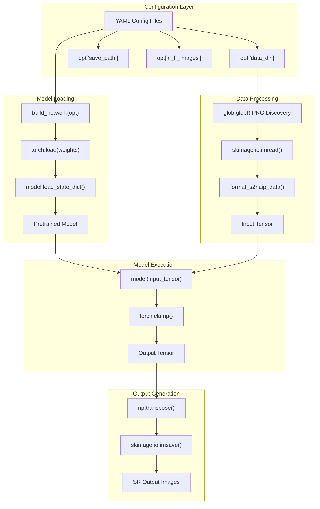
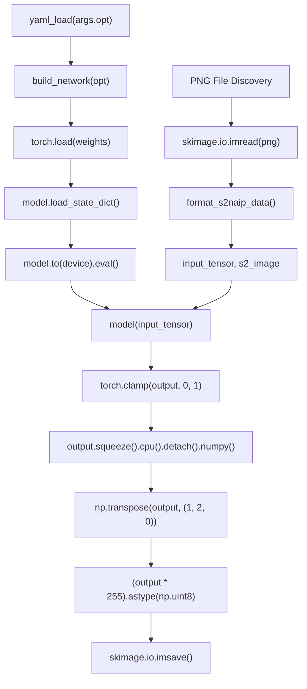

<!-- source: DeepWiki mcp.deepwiki.com · repo allenai/satlas-super-resolution · page 6 Inference · fetched 2026-10-26 -->

# Inference

Relevant source files

The following files were used as context for generating this wiki page:

- [ssr/infer.py](ssr/infer.py)

This page documents the inference capabilities of the Satlas Super-Resolution system, which allows you to run trained super-resolution models on satellite imagery to generate high-resolution outputs. The inference system supports both single image processing and large-scale grid-based processing for production use cases.

For detailed information about processing individual images, see [Single Image Inference](#6.1). For large-scale processing and stitching operations, see [Grid Inference and Stitching](#6.2).

## Overview

The inference system provides two main entry points for running trained super-resolution models:

| Entry Point | Purpose | Use Case |
|-------------|---------|----------|
| `ssr.infer` | Single image processing | Development, testing, small-scale processing |
| `ssr.infer_grid` | Grid-based batch processing | Production, large-scale dataset generation |

Both entry points use the same underlying model loading and execution framework but differ in their input handling and output organization strategies.

## Inference Architecture

The following diagram shows the high-level inference architecture and how different components interact:

**Inference System Architecture**

Sources: [ssr/infer.py:1-69]()

## Configuration Requirements

Inference operations require a YAML configuration file that specifies the model architecture, pretrained weights, and processing parameters. The key configuration parameters are:

| Parameter | Purpose | Example |
|-----------|---------|---------|
| `data_dir` | Root directory containing input PNG files | `/path/to/sentinel2/images/` |
| `n_lr_images` | Number of low-resolution input images | `36` for multi-temporal input |
| `save_path` | Directory for saving super-resolved outputs | `/path/to/output/` |
| `path.pretrain_network_g` | Path to generator model weights | `models/esrgan_weights.pth` |
| `path.param_key_g` | Key for generator parameters in state dict | `"params"` |
| `path.strict_load_g` | Whether to enforce strict weight loading | `true` |

Sources: [ssr/infer.py:22-37]()

## Model Loading and Execution Flow

The inference system follows a standardized model loading and execution workflow:

**Model Loading and Execution Workflow**

Sources: [ssr/infer.py:28-67]()

## Input Data Format

The inference system expects input data in a specific format:

- **File Format**: PNG images located in subdirectories under `data_dir`
- **Directory Structure**: `{data_dir}/sentinel2/{subdir}/*.png`
- **Image Shape**: `[n_s2_images * 32, 32, 3]` where images are vertically stacked
- **Discovery Pattern**: Recursive PNG search using `glob.glob(data_dir + "/**/*.png", recursive=True)`

The `format_s2naip_data()` function handles the conversion from the stacked PNG format to model-ready tensors.

Sources: [ssr/infer.py:40-53]()

## Output Organization

The inference system organizes outputs in a structured manner:

- **Output Directory**: Specified by `save_path` in configuration
- **Per-Image Subdirectories**: Numbered directories (`0/`, `1/`, `2/`, etc.)
- **Output Files**: 
  - `lr.png`: Low-resolution input image for comparison
  - `sr.png`: Super-resolved output image

The output images are processed to ensure proper format:
- Values clamped to `[0, 1]` range using `torch.clamp()`
- Tensor converted to numpy array with shape `[H, W, 3]`
- Pixel values scaled to `[0, 255]` and converted to `uint8`

Sources: [ssr/infer.py:47-67]()

## Device and Performance Considerations

The inference system is designed for GPU acceleration:

- **Default Device**: CUDA GPU (`torch.device('cuda')`)
- **Model Evaluation Mode**: Models set to evaluation mode with `model.eval()`
- **Memory Management**: Tensors moved to device and gradients detached for memory efficiency
- **Batch Processing**: Single image processing per inference call

The system processes images sequentially, making it suitable for both development workflows and production batch processing when combined with external orchestration.

Sources: [ssr/infer.py:19, 38, 62]()

---

