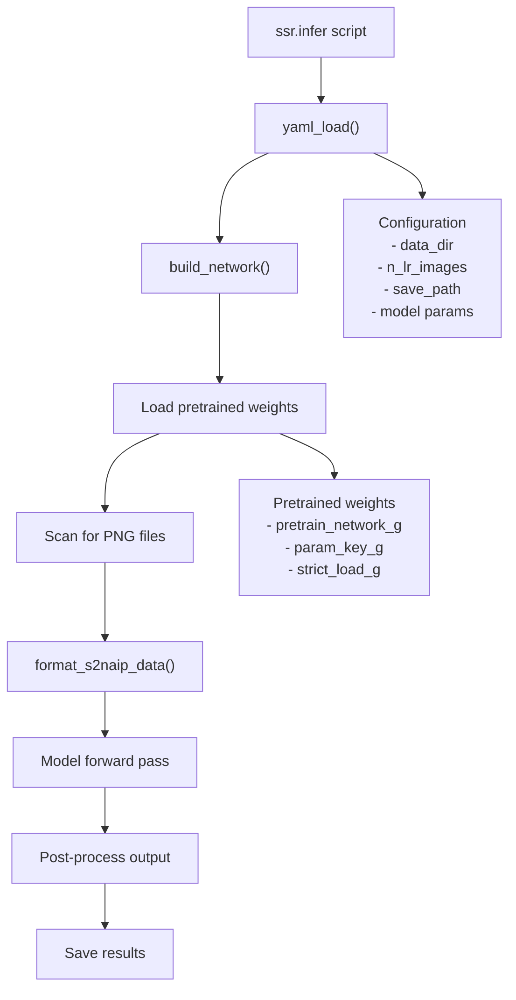
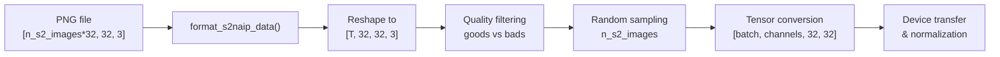
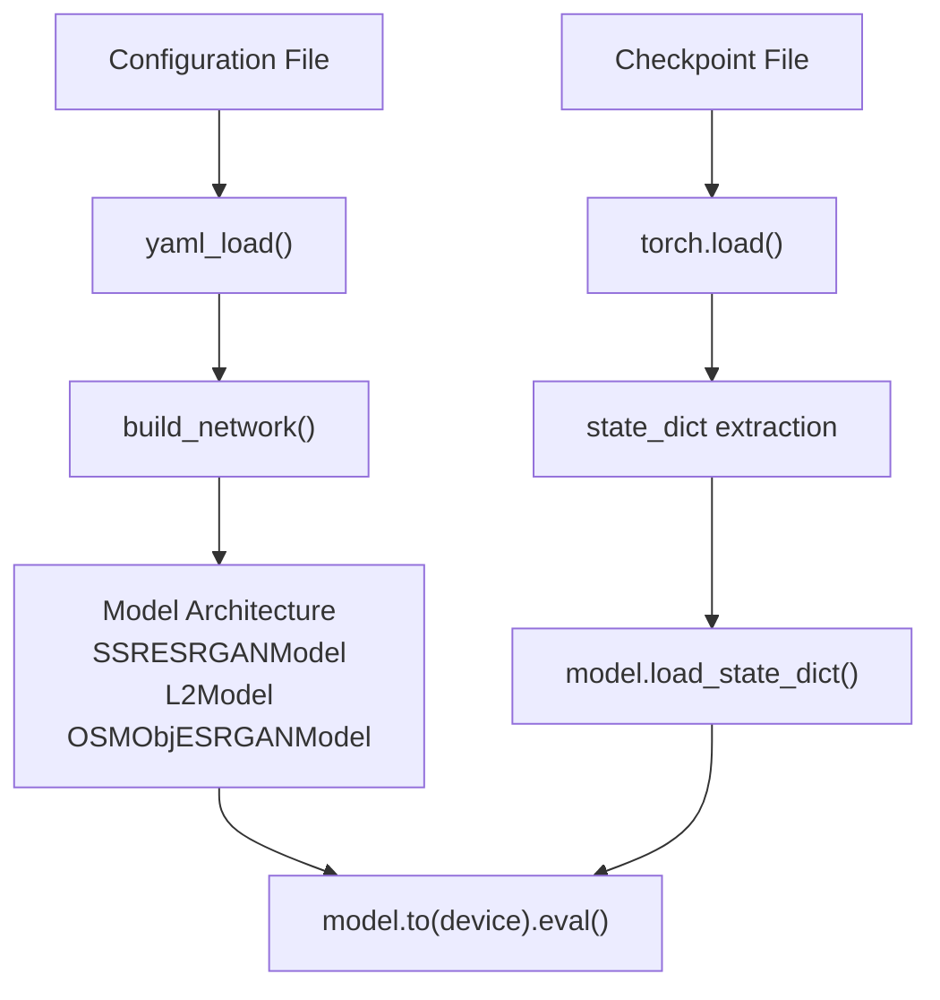
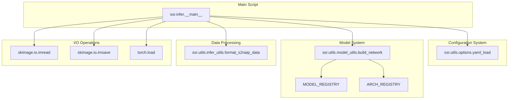

<!-- source: DeepWiki mcp.deepwiki.com · repo allenai/satlas-super-resolution · page 6.1 Single Image Inference · fetched 2026-10-26 -->

# Single Image Inference

<details>
<summary>Relevant source files</summary>

The following files were used as context for generating this wiki page:

- [ssr/infer.py](ssr/infer.py)
- [ssr/utils/infer_utils.py](ssr/utils/infer_utils.py)

</details>


This document covers the single image inference functionality for running super-resolution on individual satellite images using pre-trained models. The inference system processes Sentinel-2 imagery through trained neural networks to generate high-resolution outputs.

For large-scale processing of multiple Sentinel-2 tiles with automatic stitching, see [Grid Inference and Stitching](#6.2). For training new models, see [Training](#5).

## Overview

The single image inference system is implemented through the `ssr.infer` script, which provides a command-line interface for processing individual satellite images. The system loads a pre-trained super-resolution model and applies it to input Sentinel-2 imagery organized in a specific directory structure.

**Inference Process Flow**



Sources: [ssr/infer.py:14-69]()

## Input Requirements

### Directory Structure

The inference system expects input images organized in a specific directory structure:

```
{data_dir}/
└── sentinel2/
    └── {subdir}/
        └── *.png
```

Each PNG file must contain stacked Sentinel-2 images with shape `[n_s2_images * 32, 32, 3]`, where multiple 32x32 timesteps are vertically concatenated into a single image file.

**Data Format Processing**



Sources: [ssr/infer.py:40-42](), [ssr/utils/infer_utils.py:6-39]()

### Configuration Requirements

The inference script requires a YAML configuration file specified via the `-opt` argument. Key configuration parameters include:

| Parameter | Description | Example |
|-----------|-------------|---------|
| `data_dir` | Root directory containing input images | `/path/to/input/data` |
| `n_lr_images` | Number of Sentinel-2 timesteps to use | `12` |
| `save_path` | Output directory for results | `/path/to/output` |
| `path.pretrain_network_g` | Path to generator weights | `weights/esrgan_model.pth` |
| `path.param_key_g` | Key for generator in state dict | `params_ema` |
| `path.strict_load_g` | Strict loading flag | `true` |

Sources: [ssr/infer.py:21-37]()

## Execution Flow

### Model Initialization

The inference system initializes the model through several key steps:

1. **Configuration Loading**: Uses `yaml_load()` to parse the configuration file
2. **Network Building**: Calls `build_network()` to instantiate the model architecture based on config parameters
3. **Weight Loading**: Loads pre-trained weights from the specified checkpoint file
4. **Device Setup**: Transfers model to CUDA device and sets to evaluation mode



Sources: [ssr/infer.py:28-38]()

### Image Processing Loop

For each PNG file found in the input directory:

1. **Image Loading**: Reads PNG file using `skimage.io.imread()`
2. **Data Formatting**: Processes through `format_s2naip_data()` which:
   - Reshapes stacked image into separate timesteps
   - Filters out corrupted/black images
   - Randomly samples the required number of timesteps
   - Converts to PyTorch tensor and normalizes
3. **Inference**: Passes formatted tensor through the model
4. **Post-processing**: Clamps output values and converts back to image format
5. **Saving**: Saves both low-resolution input and super-resolution output

Sources: [ssr/infer.py:45-67]()

## Data Processing Pipeline

The `format_s2naip_data()` function implements sophisticated data preprocessing:

### Quality Assessment
Images are categorized as "good" or "bad" based on the presence of black pixels `[0, 0, 0]`, which indicate missing or corrupted data in Sentinel-2 imagery.

### Sampling Strategy
- If sufficient good images exist: randomly sample `n_s2_images` from good images
- If insufficient good images: use all good images plus randomly sampled bad images to reach `n_s2_images`

### Tensor Preparation
The function outputs a tensor of shape `[batch, n_s2_images * channels, 32, 32]` where multiple timesteps are concatenated along the channel dimension.

Sources: [ssr/utils/infer_utils.py:6-39]()

## Output Format

### Directory Structure
For each input image `i`, the system creates a subdirectory `{save_path}/{i}/` containing:

- `lr.png`: Low-resolution input image (32x32x3)
- `sr.png`: Super-resolution output image (128x128x3, assuming 4x upscaling)

### Image Processing
Output tensors undergo the following transformations:
1. **Clamping**: Values constrained to [0, 1] range using `torch.clamp()`
2. **Tensor Conversion**: GPU tensor converted to CPU numpy array
3. **Dimension Reordering**: Transposed from `[C, H, W]` to `[H, W, C]`
4. **Range Scaling**: Normalized values scaled to [0, 255] uint8 range

Sources: [ssr/infer.py:56-67]()

## Code Structure

**Core Components Mapping**



Sources: [ssr/infer.py:1-12](), [ssr/utils/infer_utils.py:1-5]()

---

