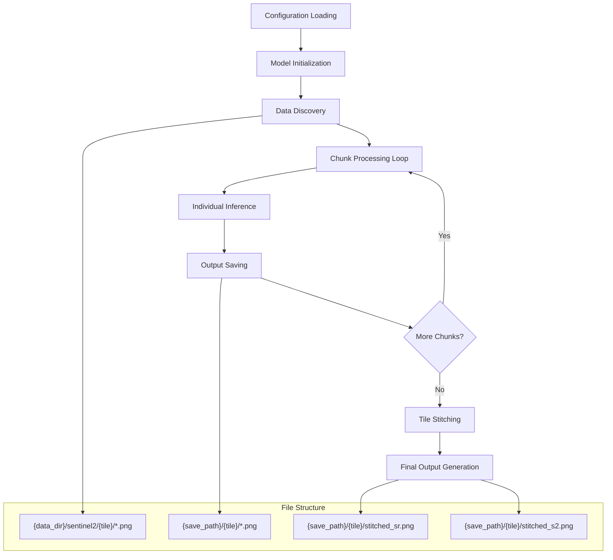
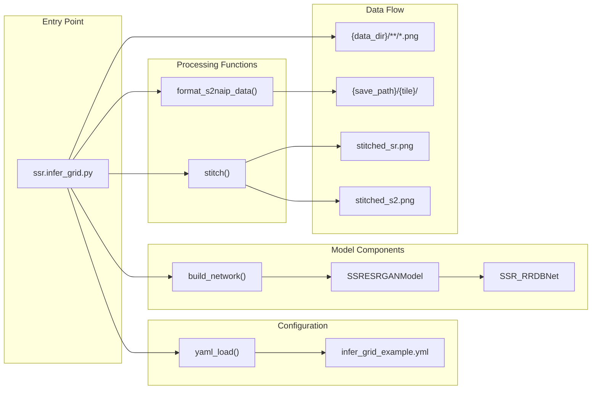
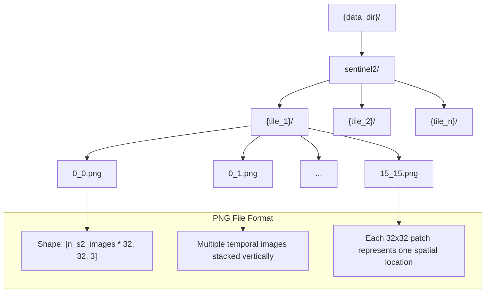
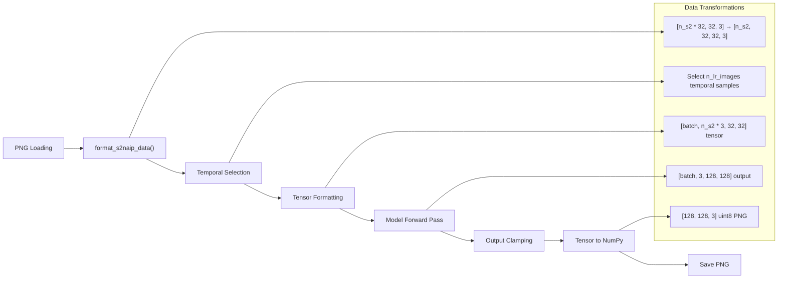
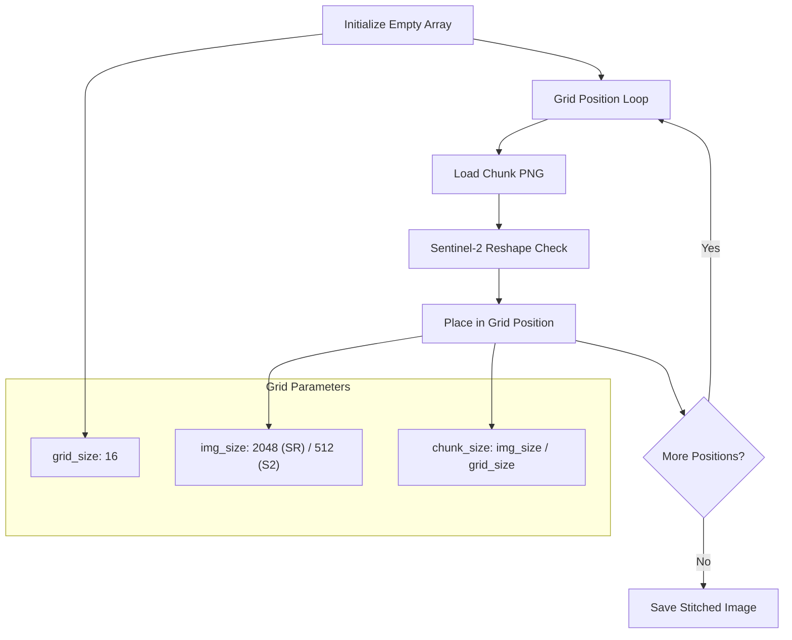
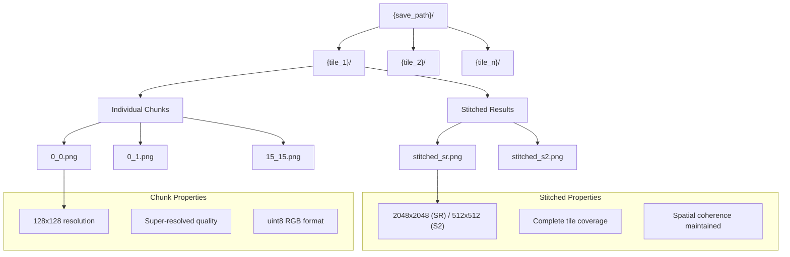

<!-- source: DeepWiki mcp.deepwiki.com · repo allenai/satlas-super-resolution · page 6.2 Grid Inference and Stitching · fetched 2026-10-26 -->

# Grid Inference and Stitching

<details>
<summary>Relevant source files</summary>

The following files were used as context for generating this wiki page:

- [ssr/infer_grid.py](ssr/infer_grid.py)
- [ssr/options/infer_example.yml](ssr/options/infer_example.yml)
- [ssr/options/infer_grid_example.yml](ssr/options/infer_grid_example.yml)
- [ssr/utils/infer_utils.py](ssr/utils/infer_utils.py)

</details>


This document covers the large-scale grid-based inference system for processing entire Sentinel-2 tiles using trained super-resolution models. Grid inference processes satellite imagery organized as 16x16 grids of image chunks, performs super-resolution on each chunk, and stitches the results back together into complete high-resolution images.

For single image inference operations, see [Single Image Inference](#6.1). For training model configurations, see [Configuration System](#5.1).

## System Overview

The grid inference pipeline processes satellite imagery data organized into structured tile grids, where each tile contains 256 image chunks (16x16 grid). This approach enables efficient processing of large geographical areas while maintaining spatial coherence through the stitching process.

### Grid Inference Workflow



**Grid Inference Processing Pipeline**

Sources: [ssr/infer_grid.py:15-87]()

### Code Entity Mapping



**Code Entity Relationships**

Sources: [ssr/infer_grid.py:10-12](), [ssr/utils/infer_utils.py:6-61]()

## Configuration System

Grid inference uses YAML configuration files that specify model architecture, data paths, and processing parameters. The configuration system extends the standard model configurations with inference-specific settings.

### Configuration Parameters

| Parameter | Purpose | Example Value |
|-----------|---------|---------------|
| `data_dir` | Root directory containing input PNG files | `super_resolution_2023-12-08/test_set/sentinel2/` |
| `n_lr_images` | Number of Sentinel-2 temporal images to use | `8` |
| `save_path` | Output directory for super-resolved results | `testing_infer_grid/` |
| `pretrain_network_g` | Path to trained model weights | `experiments/sample_net_g.pth` |
| `param_key_g` | Parameter key in state dict | `params_ema` |

### Example Configuration Structure

The configuration file format follows the standard training configuration structure with inference-specific additions:

```yaml
# Model specification
model_type: SSRESRGANModel
network_g:
  type: SSR_RRDBNet
  num_in_ch: 24  # n_lr_images * 3 channels
  num_out_ch: 3
  
# Inference-specific settings
data_dir: path/to/input/data/
n_lr_images: 8
save_path: path/to/output/
```

Sources: [ssr/options/infer_grid_example.yml:1-31]()

## Data Organization Requirements

Grid inference expects a specific directory structure for input data. Understanding this structure is critical for successful processing.

### Input Directory Structure



**Required Data Organization Structure**

### File Naming Convention

The system expects PNG files with specific naming patterns that encode spatial positioning:

- Pattern: `{row}_{col}.png` where `row` and `col` are integers from 0-15
- Each PNG contains multiple temporal Sentinel-2 images stacked vertically
- File dimensions: `[n_lr_images * 32, 32, 3]`

Sources: [ssr/infer_grid.py:41-54](), [ssr/utils/infer_utils.py:6-11]()

## Inference Process

The inference process handles each image chunk individually while preserving spatial organization for subsequent stitching.

### Chunk Processing Pipeline



**Chunk Processing Data Flow**

### Temporal Image Selection

The `format_s2naip_data` function implements intelligent temporal image selection:

1. **Quality Assessment**: Identifies "good" images (no black pixels) vs "bad" images (partial black pixels)
2. **Smart Sampling**: Prioritizes good images, uses bad images only if necessary
3. **Random Selection**: Randomly samples from available good images to reach `n_lr_images`

Sources: [ssr/infer_grid.py:55-65](), [ssr/utils/infer_utils.py:6-39]()

## Stitching Process

After individual chunk inference, the system reconstructs complete tile images by stitching the super-resolved chunks back together in their original spatial arrangement.

### Stitching Algorithm



**Stitching Process Flow**

### Stitching Function Parameters

The `stitch` function handles both super-resolved and original Sentinel-2 image reconstruction:

| Parameter | Purpose | SR Value | S2 Value |
|-----------|---------|----------|----------|
| `img_size` | Final stitched image dimension | 2048 | 512 |
| `scale` | Upsampling factor | 4 | N/A |
| `grid_size` | Grid dimension (chunks per side) | 16 | 16 |
| `sentinel2` | Special handling for S2 format | False | True |

### Output Generation

The stitching process generates two primary outputs per tile:

1. **Super-resolved Image**: `stitched_sr.png` at 2048x2048 resolution
2. **Original Sentinel-2**: `stitched_s2.png` at 512x512 resolution for comparison

Sources: [ssr/infer_grid.py:67-86](), [ssr/utils/infer_utils.py:41-61]()

## Output Structure

Grid inference produces a structured output directory that preserves the tile organization while adding processed results.

### Output Directory Layout



**Output Directory Structure and Properties**

### Processing Validation

The system includes validation checks to ensure complete tile processing:

- **Chunk Count Validation**: Verifies 256 chunks (16x16) exist before stitching
- **File Existence Checks**: Confirms all expected chunk files are present
- **Error Handling**: Skips incomplete tiles with appropriate logging

Sources: [ssr/infer_grid.py:70-86]()

---

