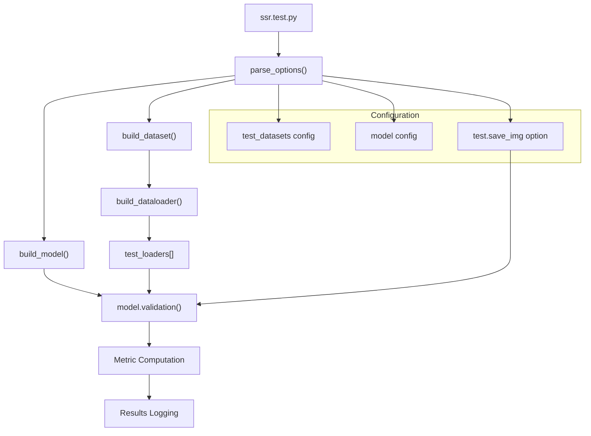
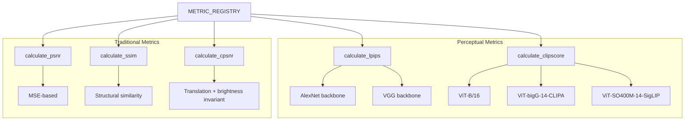
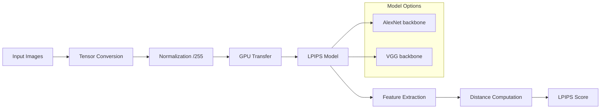
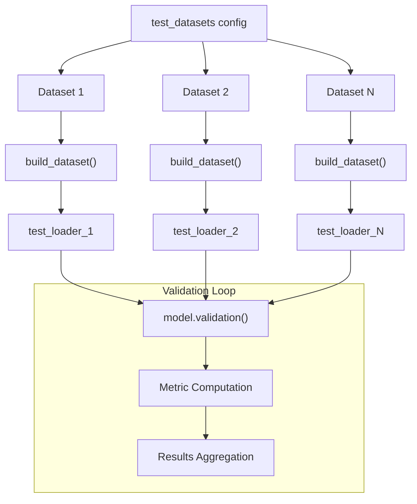

<!-- source: DeepWiki mcp.deepwiki.com · repo allenai/satlas-super-resolution · page 7 Evaluation and Testing · fetched 2026-10-26 -->

# Evaluation and Testing

<details>
<summary>Relevant source files</summary>

The following files were used as context for generating this wiki page:

- [ssr/metrics/__init__.py](ssr/metrics/__init__.py)
- [ssr/metrics/clipscore.py](ssr/metrics/clipscore.py)
- [ssr/metrics/cpsnr.py](ssr/metrics/cpsnr.py)
- [ssr/metrics/lpips.py](ssr/metrics/lpips.py)
- [ssr/test.py](ssr/test.py)

</details>


This page covers the evaluation and testing infrastructure for measuring super-resolution model performance. The system provides comprehensive metrics for assessing image quality, perceptual similarity, and semantic consistency between generated high-resolution outputs and ground truth images.

For information about training model configurations, see [Training Configurations](#5.2). For details about inference workflows that utilize these metrics, see [Inference](#6).

## Overview

The evaluation system is built around a standardized testing pipeline that integrates with the BasicSR framework while providing custom metrics specifically designed for satellite imagery super-resolution evaluation. The system supports both automated testing during training validation and standalone evaluation of trained models.

## Testing Pipeline Architecture

The core testing infrastructure revolves around the `test_pipeline` function which orchestrates dataset loading, model initialization, and metric computation.



**Testing Pipeline Flow**

The testing process follows this sequence:

1. **Configuration Parsing**: Load test configuration from YAML files
2. **Dataset Construction**: Build test datasets using `build_dataset()`
3. **Model Loading**: Initialize trained model using `build_model()`
4. **Dataloader Creation**: Create dataloaders for each test dataset
5. **Validation Execution**: Run `model.validation()` for each test set
6. **Metric Computation**: Calculate all configured metrics
7. **Results Logging**: Output results to log files and optionally save images

Sources: [ssr/test.py:15-45]()

## Available Metrics

The system provides five main categories of evaluation metrics, each registered in the `METRIC_REGISTRY` for dynamic discovery and execution.

| Metric | Purpose | Source | Key Features |
|--------|---------|---------|-------------|
| **PSNR** | Pixel-level accuracy | BasicSR | Peak Signal-to-Noise Ratio |
| **SSIM** | Structural similarity | BasicSR | Human perceptual similarity |
| **LPIPS** | Perceptual distance | `ssr.metrics.lpips` | Deep learning based perceptual loss |
| **CLIPScore** | Semantic similarity | `ssr.metrics.clipscore` | Vision-language model similarity |
| **cPSNR** | Translation-invariant PSNR | `ssr.metrics.cpsnr` | PROBA-V challenge metric |



**Metric Registry System**

Sources: [ssr/metrics/__init__.py:13-23](), [ssr/metrics/lpips.py:6-21](), [ssr/metrics/clipscore.py:8-38](), [ssr/metrics/cpsnr.py:7-59]()

## Metric Implementation Details

### LPIPS (Learned Perceptual Image Patch Similarity)

The LPIPS metric measures perceptual similarity using deep features from pre-trained networks. It supports two backbone architectures:

- **AlexNet**: Optimized for best forward scores
- **VGG**: Closer to traditional perceptual loss for optimization

The implementation normalizes inputs to [0,1] range and computes features on GPU for efficiency.



**LPIPS Computation Pipeline**

Sources: [ssr/metrics/lpips.py:7-21]()

### CLIPScore

CLIPScore measures semantic similarity between images using vision-language models. The implementation supports three CLIP variants with different input resolutions:

- **ViT-B/16**: 224×224 input, standard CLIP model
- **ViT-bigG-14-CLIPA**: 336×336 input, enhanced CLIPA model  
- **ViT-SO400M-14-SigLIP**: 384×384 input, SigLIP model

The metric computes cosine similarity between encoded image features.

Sources: [ssr/metrics/clipscore.py:9-38]()

### cPSNR (Corrected PSNR)

The cPSNR metric implements the PROBA-V challenge evaluation protocol, adding robustness to small spatial translations and brightness variations. It searches over translation offsets up to 8 pixels and optimizes brightness bias per channel.

**cPSNR Algorithm**:
1. Try translation offsets from 0 to `max_offset` (8 pixels)
2. For each offset pair, crop both images appropriately
3. Compute per-channel brightness bias and apply correction
4. Calculate MSE and select minimum across all offsets
5. Convert to PSNR: `10 * log10(255² / best_mse)`

Sources: [ssr/metrics/cpsnr.py:8-59]()

## Running Tests

### Command Line Testing

The primary testing interface is through the `ssr.test` module:

```bash
cd /path/to/satlas-super-resolution
python -m ssr.test --opt configs/test_config.yml
```

### Configuration Requirements

Test configurations must specify:
- **test_datasets**: Dictionary of test dataset configurations
- **model**: Model architecture and checkpoint path
- **test.save_img**: Whether to save output images
- **num_gpu**: Number of GPUs for distributed testing

### Integration with Training

The metrics are automatically computed during training validation phases through the `model.validation()` method, which internally calls the metric registry system for each configured metric.

Sources: [ssr/test.py:41-44]()

## Test Dataset Organization

The testing system supports multiple test datasets simultaneously, allowing comprehensive evaluation across different data distributions:



**Multi-Dataset Testing Architecture**

Each test dataset is processed independently with results logged separately, enabling comparative analysis across different evaluation scenarios such as urban vs. rural regions or different seasonal conditions.

Sources: [ssr/test.py:29-44]()

---

