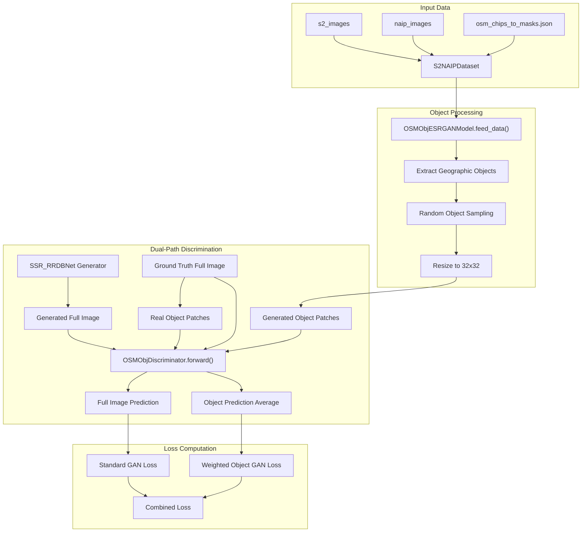
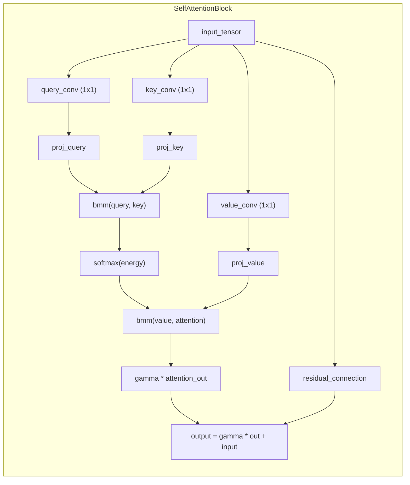
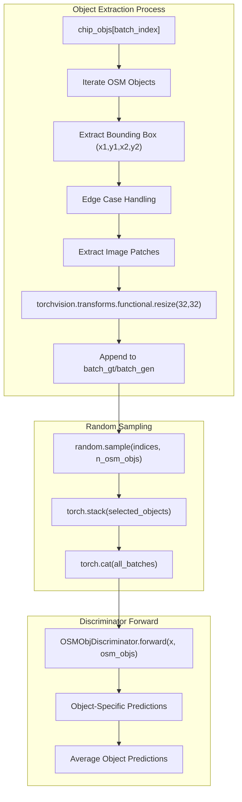
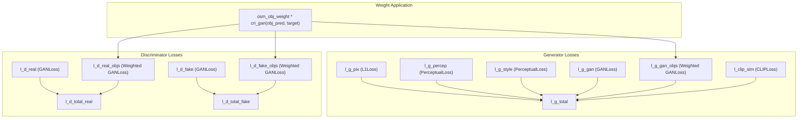
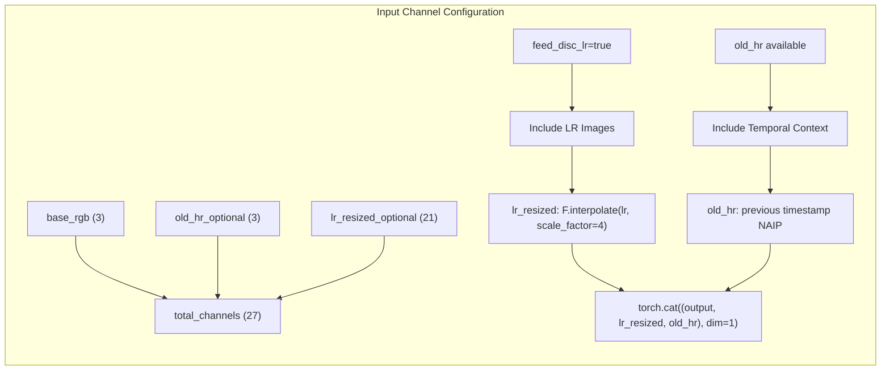

<!-- source: DeepWiki mcp.deepwiki.com · repo allenai/satlas-super-resolution · page 8 Advanced Features · fetched 2026-10-26 -->

# Advanced Features

Relevant source files

The following files were used as context for generating this wiki page:

- [ssr/archs/osm_obj_discriminator_arch.py](ssr/archs/osm_obj_discriminator_arch.py)
- [ssr/models/osm_objs_esrgan_model.py](ssr/models/osm_objs_esrgan_model.py)
- [ssr/options/osm_obj_esrgan.yml](ssr/options/osm_obj_esrgan.yml)

This document covers specialized features designed for advanced use cases and research applications in the Satlas Super-Resolution system. These features extend beyond the standard training and inference workflows to enable sophisticated experiments and enhanced model capabilities.

For basic training procedures, see [Training](#5). For standard model architectures, see [Model Architectures](#4). For experimental configuration details, see [Experimental Configurations](#8.2).

## Overview

The system provides several advanced features that enable research-oriented applications and specialized training scenarios:

| Feature Category | Components | Purpose |
|-----------------|------------|---------|
| Geographic Awareness | OSM Object-Aware Training | Incorporate OpenStreetMap geographic features into discriminator training |
| Attention Mechanisms | Self-Attention Blocks | Enhanced discriminator capability for spatial feature relationships |
| Multi-Path Discriminators | Dual-Path Architecture | Separate processing for full images and extracted geographic objects |
| Advanced Loss Functions | CLIP, SSIM Integration | Semantic and structural similarity optimization |
| Preprocessing Variants | USM Sharpening Options | Configurable ground truth enhancement strategies |

## OSM Object-Aware Training Architecture

The primary advanced feature is the OSM (OpenStreetMap) object-aware training system, which incorporates geographic feature awareness into the discriminator training process.

**OSM Object-Aware Training Pipeline**

Sources: [ssr/models/osm_objs_esrgan_model.py:1-427](), [ssr/archs/osm_obj_discriminator_arch.py:1-109]()

## OSM Discriminator Architecture

The `OSMObjDiscriminator` implements a dual-path architecture that processes both full images and extracted geographic objects through separate pathways.

**OSMObjDiscriminator Internal Architecture**

```mermaid
graph TB
    subgraph full_image["Full Image Path"]
        A["conv0"] --> B["conv1 (spectral_norm)"]
        B --> C["conv2 (spectral_norm)"]
        C --> D["conv3 (spectral_norm)"]
        D --> E["conv4 (upsample)"]
        E --> F["conv5 (upsample)"]
        F --> G["conv6 (upsample)"]
        G --> H["conv7"]
        H --> I["conv8"]
        I --> J["conv9"]
        J --> K["full_image_prediction"]
    end
    
    subgraph osm_path["OSM Object Path"]
        L["o_conv1"] --> M["o_conv2"]
        M --> N["SelfAttentionBlock"]
        N --> O["o_conv3"]
        O --> P["SelfAttentionBlock"]
        P --> Q["o_conv4"]
        Q --> R["object_prediction"]
    end
    
    subgraph attention["Self-Attention Details"]
        S["query_conv"] --> T["attention_computation"]
        U["key_conv"] --> T
        V["value_conv"] --> T
        T --> W["gamma_weighted_output"]
    end
```

Sources: [ssr/archs/osm_obj_discriminator_arch.py:34-109]()

## Self-Attention Implementation

The discriminator incorporates `SelfAttentionBlock` components that enhance spatial feature relationship modeling within geographic objects.

**Self-Attention Block Structure**

Sources: [ssr/archs/osm_obj_discriminator_arch.py:8-31]()

## Object Extraction and Processing

The OSM-aware training extracts geographic objects from both generated and ground truth images based on OpenStreetMap feature boundaries.

**Object Extraction Pipeline**

Sources: [ssr/models/osm_objs_esrgan_model.py:163-201]()

## Configuration Parameters

The OSM object-aware training introduces several specialized configuration parameters that control the geographic feature integration.

| Parameter | Location | Purpose | Default Value |
|-----------|----------|---------|---------------|
| `osm_obj_weight` | Root level | Weight for OSM object loss in total loss | 0.3 |
| `osm_objs_path` | datasets.train | Path to OSM chips-to-masks JSON file | Required |
| `n_osm_objs` | datasets.train | Number of objects sampled per image | 1 |
| `feed_disc_lr` | Root level | Feed low-res images to discriminator | true |

Sources: [ssr/options/osm_obj_esrgan.yml:17](), [ssr/options/osm_obj_esrgan.yml:30](), [ssr/options/osm_obj_esrgan.yml:34](), [ssr/options/osm_obj_esrgan.yml:14]()

## Loss Function Integration

The OSM-aware model extends the standard GAN loss computation to include object-specific adversarial training.

**Loss Computation Flow**

Sources: [ssr/models/osm_objs_esrgan_model.py:244-251](), [ssr/models/osm_objs_esrgan_model.py:284-308]()

## Network Input Configuration

The OSM discriminator requires specialized input channel configuration to accommodate additional contextual information beyond standard RGB inputs.

**Discriminator Input Channel Configuration**

Sources: [ssr/options/osm_obj_esrgan.yml:92](), [ssr/models/osm_objs_esrgan_model.py:231-238](), [ssr/models/osm_objs_esrgan_model.py:269-280]()

## Model Registration and Usage

The OSM object-aware model integrates with the existing model registry system and follows the standard training interface.

**Model Integration Pattern**

```mermaid
graph TB
    subgraph registry["Model Registry"]
        A["@MODEL_REGISTRY.register()"] --> B["OSMObjESRGANModel"]
        B --> C["Inherits from SRGANModel"]
    end
    
    subgraph initialization["Model Initialization"]
        D["opt['model_type']: OSMObjESRGANModel"] --> E["Load osm_objs_path"]
        E --> F["Initialize osm_obj_weight"]
        F --> G["Load n_osm_objs parameter"]
        G --> H["Call super().__init__(opt)"]
    end
    
    subgraph training_hooks["Training Hooks"]
        I["feed_data()"] --> J["Load chip_objs from JSON"]
        K["optimize_parameters()"] --> L["Extract and process objects"]
        L --> M["Dual-path discrimination"]
        M --> N["Weighted loss computation"]
    end
```

Sources: [ssr/models/osm_objs_esrgan_model.py:22-23](), [ssr/models/osm_objs_esrgan_model.py:36-47](), [ssr/models/osm_objs_esrgan_model.py:135-138]()

---

