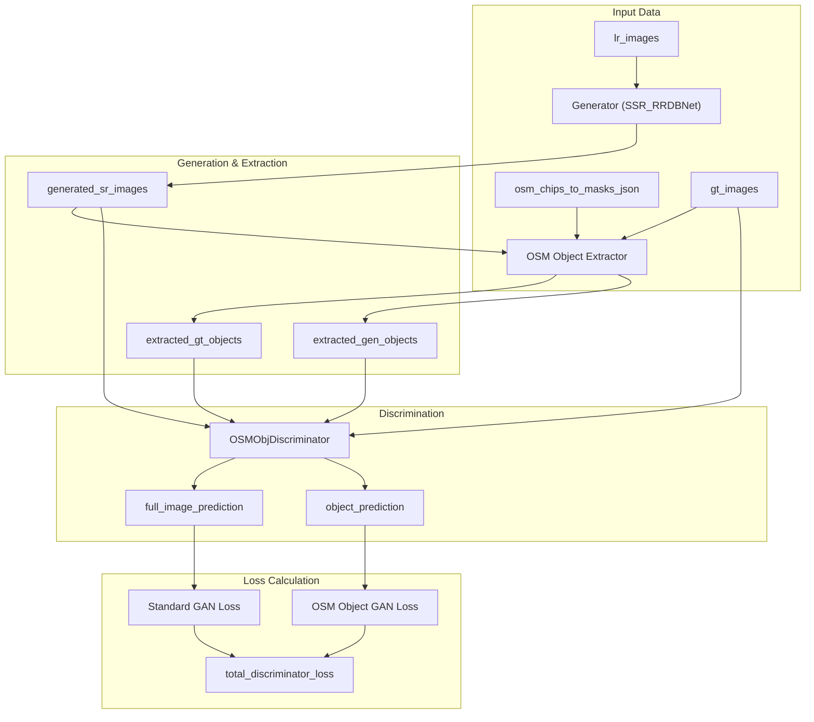
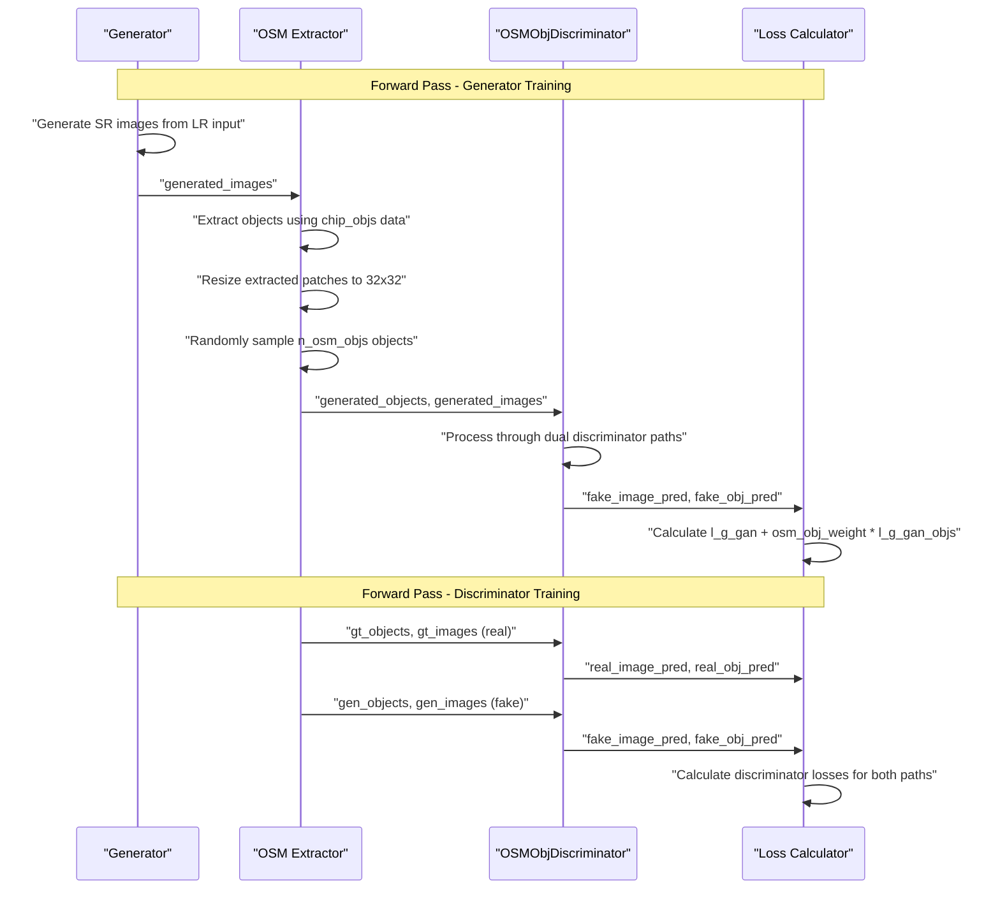
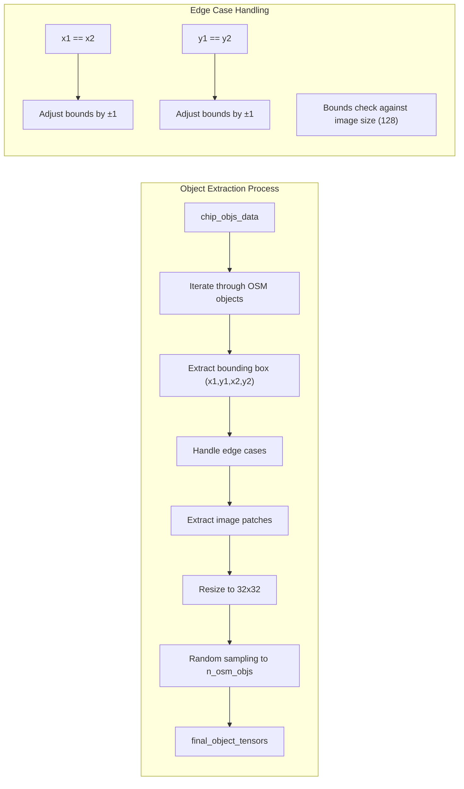

<!-- source: DeepWiki mcp.deepwiki.com · repo allenai/satlas-super-resolution · page 8.1 OSM Object-Aware Training · fetched 2026-10-26 -->

# OSM Object-Aware Training

<details>
<summary>Relevant source files</summary>

The following files were used as context for generating this wiki page:

- [ssr/archs/osm_obj_discriminator_arch.py](ssr/archs/osm_obj_discriminator_arch.py)
- [ssr/models/osm_objs_esrgan_model.py](ssr/models/osm_objs_esrgan_model.py)
- [ssr/options/osm_obj_esrgan.yml](ssr/options/osm_obj_esrgan.yml)

</details>


This page documents the OpenStreetMap (OSM) object-aware training system, which enhances super-resolution model training by incorporating geographic feature awareness. This specialized training approach uses dual discriminators to evaluate both full images and extracted geographic objects, improving the model's ability to preserve geographic structures and features.

For general training information, see [Training](#5). For standard ESRGAN models without OSM awareness, see [ESRGAN Models](#4.1).

## Purpose and Overview

The OSM object-aware training system extends the standard ESRGAN training pipeline by incorporating geographic context from OpenStreetMap data. Instead of only discriminating full images, this approach additionally extracts specific geographic objects (buildings, roads, etc.) from both generated and ground truth images, feeding them to a specialized discriminator with self-attention mechanisms.

This dual-discriminator approach helps the model learn to preserve geographic structures more accurately, particularly important for satellite imagery where maintaining the spatial relationships and appearance of geographic features is critical.

## Architecture Overview

The OSM object-aware system consists of three main components: the standard generator network, a dual-path discriminator, and an object extraction pipeline that interfaces with OpenStreetMap data.



**Architecture Flow Diagram**

The system processes low-resolution Sentinel-2 images through a generator to produce super-resolved outputs. Simultaneously, it extracts geographic objects from both generated and ground truth images based on OSM bounding boxes, then feeds both full images and object patches to the discriminator for evaluation.

Sources: [ssr/models/osm_objs_esrgan_model.py:163-201](), [ssr/models/osm_objs_esrgan_model.py:240-251]()

## OSM Object Discriminator Architecture

The `OSMObjDiscriminator` implements a dual-path discriminator with self-attention mechanisms specifically designed for geographic object evaluation.

```mermaid
flowchart TB
    subgraph "OSM Object Path"
        A[osm_objects_32x32] --> B["o_conv1 (3→64)"]
        B --> C["o_conv2 (64→128)"]
        C --> D["SelfAttentionBlock(128)"]
        D --> E["o_conv3 (128→256)"]
        E --> F["SelfAttentionBlock(256)"]
        F --> G["o_conv4 (256→1)"]
        G --> H[object_prediction]
    end
    
    subgraph "Full Image Path"
        I[full_images] --> J["conv0 (num_in_ch→64)"]
        J --> K["Downsample Blocks"]
        K --> L["conv1,conv2,conv3"]
        L --> M["Upsample Blocks"]
        M --> N["conv4,conv5,conv6"]
        N --> O["Extra Convolutions"]
        O --> P["conv7,conv8,conv9"]
        P --> Q[image_prediction]
    end
    
    subgraph "Self-Attention Details"
        R["SelfAttentionBlock"] --> S["Query Conv (ch→ch/8)"]
        R --> T["Key Conv (ch→ch/8)"]
        R --> U["Value Conv (ch→ch)"]
        S --> V["Attention Calculation"]
        T --> V
        U --> V
        V --> W["Gamma * Attention + Input"]
    end
```



**OSMObjDiscriminator Network Structure**

The discriminator processes OSM objects through a dedicated convolutional path with self-attention blocks at 128 and 256 channel stages, while full images pass through a U-Net style architecture with skip connections.

Sources: [ssr/archs/osm_obj_discriminator_arch.py:8-31](), [ssr/archs/osm_obj_discriminator_arch.py:35-108]()

## Training Process with OSM Objects

The training process involves extracting geographic objects from both generated and ground truth images, then training dual discriminators on both full images and object patches.



**OSM Object-Aware Training Sequence**

The training alternates between generator and discriminator optimization, with the discriminator receiving both full images and extracted OSM objects for evaluation. Object extraction uses bounding boxes from the `osm_chips_to_masks.json` file.

Sources: [ssr/models/osm_objs_esrgan_model.py:140-315](), [ssr/models/osm_objs_esrgan_model.py:163-200]()

## Configuration and Data Requirements

### Required Data Structure

The OSM object-aware training requires a JSON file mapping image chips to OSM object bounding boxes:

```yaml
datasets:
  train:
    type: S2NAIPDataset
    osm_objs_path: "path/to/osm_chips_to_masks.json"
    n_osm_objs: 1  # Number of objects to sample per image
```

### Key Configuration Parameters

| Parameter | Type | Description | Default |
|-----------|------|-------------|---------|
| `osm_obj_weight` | float | Weight for OSM object loss component | 0.3 |
| `n_osm_objs` | int | Number of OSM objects to sample per training image | 1 |
| `osm_objs_path` | string | Path to JSON file containing chip-to-objects mapping | Required |

### Network Configuration

The discriminator must be configured to handle both full images and OSM objects:

```yaml
network_d:
  type: OSMObjDiscriminator
  num_in_ch: 27  # RGB + optional old HR + optional LR channels
  num_feat: 64
  skip_connection: true
```

Sources: [ssr/options/osm_obj_esrgan.yml:16-17](), [ssr/options/osm_obj_esrgan.yml:30-34](), [ssr/options/osm_obj_esrgan.yml:90-94]()

## Object Extraction Pipeline

The system extracts geographic objects during training using bounding boxes defined in the OSM data file.



**Object Extraction Pipeline**

The extraction process handles various edge cases in bounding box data and ensures consistent 32×32 object patches for discriminator input.

Sources: [ssr/models/osm_objs_esrgan_model.py:164-200](), [ssr/models/osm_objs_esrgan_model.py:172-176]()

## Loss Function Integration

The OSM object-aware loss extends the standard GAN loss with an additional object-specific component:

### Generator Loss Components

- **Standard pixel loss**: L1 loss between generated and ground truth images
- **Perceptual loss**: VGG19 feature-based loss  
- **Standard GAN loss**: Adversarial loss for full image discrimination
- **OSM object GAN loss**: Adversarial loss for object-level discrimination (weighted by `osm_obj_weight`)

### Discriminator Loss Components

- **Real/fake image loss**: Standard discriminator loss for full images
- **Real/fake object loss**: Additional discriminator loss for OSM object patches

```python
# Generator loss calculation
l_g_gan = self.cri_gan(fake_g_pred, True, is_disc=False)
l_g_gan_objs = self.osm_obj_weight * self.cri_gan(obj_pred_avg, True, is_disc=False)
l_g_total += l_g_gan + l_g_gan_objs

# Discriminator loss calculation  
l_d_real_objs = self.osm_obj_weight * self.cri_gan(real_obj_pred_avg, True, is_disc=True)
l_d_fake_objs = self.osm_obj_weight * self.cri_gan(fake_obj_pred_avg, False, is_disc=True)
```

Sources: [ssr/models/osm_objs_esrgan_model.py:244-251](), [ssr/models/osm_objs_esrgan_model.py:288-307]()

## Usage and Training Commands

To train an OSM object-aware model, use the standard training command with the OSM configuration:

```bash
python ssr/train.py -opt ssr/options/osm_obj_esrgan.yml
```

Ensure your dataset includes the required `osm_chips_to_masks.json` file mapping image chips to OSM object bounding boxes. The training process will automatically extract and process OSM objects during each training iteration.

Sources: [ssr/options/osm_obj_esrgan.yml:1-213]()

---

