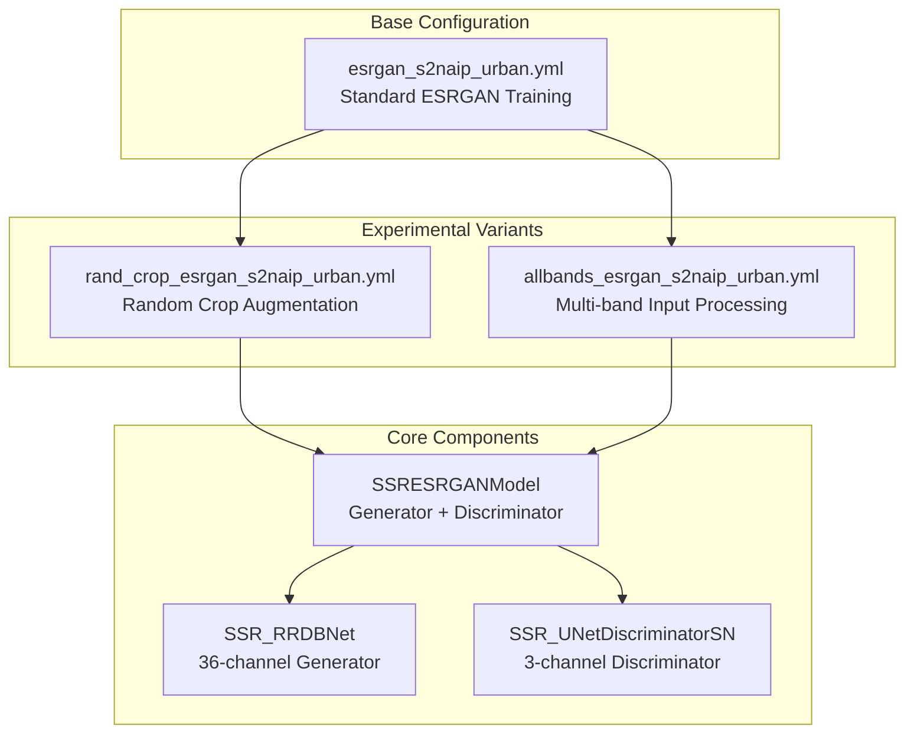
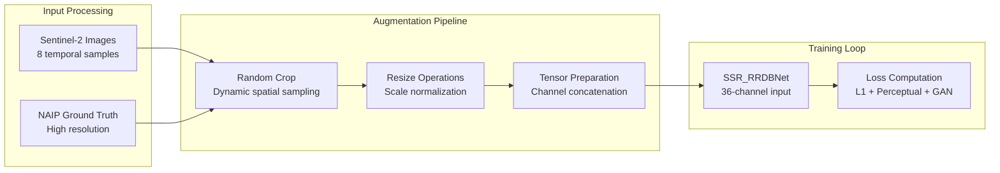
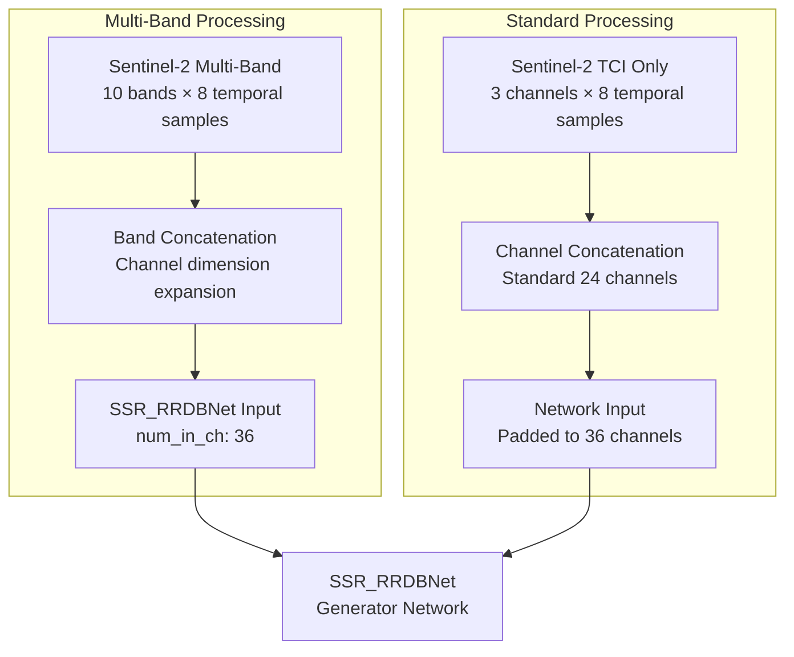
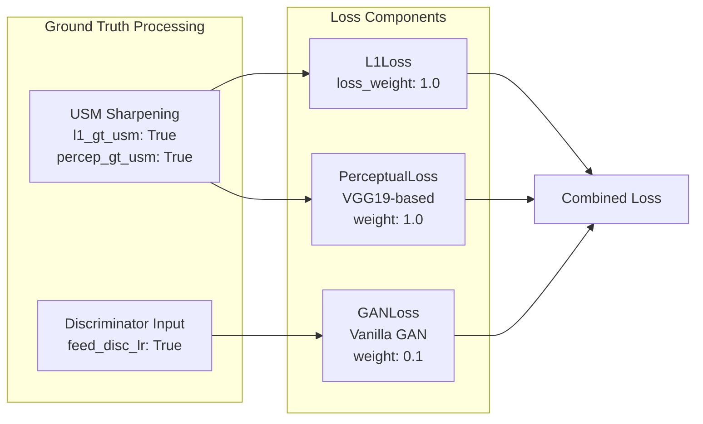
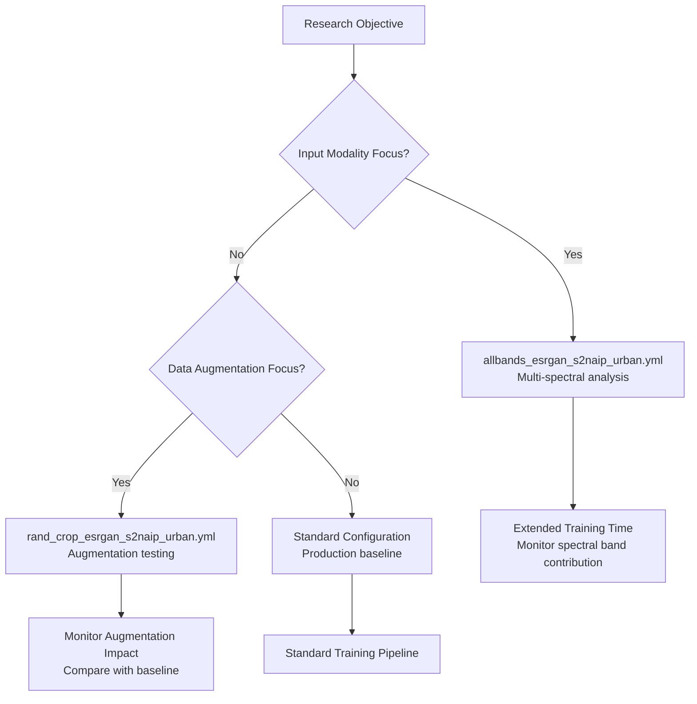

<!-- source: DeepWiki mcp.deepwiki.com · repo allenai/satlas-super-resolution · page 8.2 Experimental Configurations · fetched 2026-10-26 -->

# Experimental Configurations

<details>
<summary>Relevant source files</summary>

The following files were used as context for generating this wiki page:

- [ssr/options/allbands_esrgan_s2naip_urban.yml](ssr/options/allbands_esrgan_s2naip_urban.yml)
- [ssr/options/rand_crop_esrgan_s2naip_urban.yml](ssr/options/rand_crop_esrgan_s2naip_urban.yml)

</details>


This page documents experimental training configurations that are used for research purposes and testing advanced features not included in standard production configurations. These configurations explore variations in data augmentation, input modalities, and training strategies.

For standard production configurations, see [Training Configurations](#5.2). For details on the configuration system structure, see [Configuration System](#5.1).

## Overview

Experimental configurations extend the base ESRGAN architecture with research-oriented features that may not be stable enough for production use. These configurations are primarily used for:

- Testing new data augmentation strategies
- Exploring multi-band satellite imagery inputs
- Validating training improvements before production deployment
- Research paper experiments and ablation studies

## Available Experimental Configurations

The experimental configuration system provides several specialized variants that modify core training behavior:



**Sources:** [ssr/options/rand_crop_esrgan_s2naip_urban.yml](), [ssr/options/allbands_esrgan_s2naip_urban.yml]()

## Random Crop Configuration

The random crop experimental configuration (`rand_crop_esrgan_s2naip_urban.yml`) enables dynamic data augmentation during training through random cropping and resizing operations.

### Configuration Details

| Parameter | Value | Purpose |
|-----------|-------|---------|
| `rand_crop` | `True` | Enables random cropping augmentation |
| `use_shuffle` | `False` | Required when using tile weights |
| `tile_weights` | `urban_set_weights.json` | Weighted sampling strategy |

The key experimental feature is enabled at [ssr/options/rand_crop_esrgan_s2naip_urban.yml:28]():

```yaml
rand_crop: True  # random cropping and resizing augmentation (training only)
```

### Training Behavior



This augmentation strategy increases training data diversity by sampling different spatial regions and scales during each epoch, potentially improving model generalization.

**Sources:** [ssr/options/rand_crop_esrgan_s2naip_urban.yml:28]()

## Multi-Band Input Configuration

The all-bands experimental configuration (`allbands_esrgan_s2naip_urban.yml`) extends input processing to use multiple Sentinel-2 spectral bands beyond the standard True Color Image (TCI).

### Spectral Band Configuration

The configuration specifies an extended set of Sentinel-2 bands at [ssr/options/allbands_esrgan_s2naip_urban.yml:34]():

```yaml
s2_bands: [tci, b01, b05, b06, b07, b08, b09, b10, b11, b12]
```

| Band | Wavelength | Purpose |
|------|------------|---------|
| `tci` | RGB composite | Standard visual representation |
| `b01` | 443 nm | Coastal aerosol |
| `b05` | 705 nm | Red edge vegetation |
| `b06` | 740 nm | Red edge vegetation |
| `b07` | 783 nm | Red edge vegetation |
| `b08` | 842 nm | Near infrared |
| `b09` | 945 nm | Water vapor |
| `b10` | 1375 nm | Shortwave infrared |
| `b11` | 1610 nm | Shortwave infrared |
| `b12` | 2190 nm | Shortwave infrared |

### Network Architecture Implications



The generator network maintains `num_in_ch: 36` at [ssr/options/allbands_esrgan_s2naip_urban.yml:78](), suggesting that multi-band inputs are processed to fit the existing 36-channel architecture through band selection or channel mapping strategies.

**Sources:** [ssr/options/allbands_esrgan_s2naip_urban.yml:34](), [ssr/options/allbands_esrgan_s2naip_urban.yml:78]()

## Common Experimental Features

Both experimental configurations share several advanced training features that distinguish them from baseline configurations:

### Enhanced Loss Configuration



### Advanced Training Parameters

| Parameter | Value | Purpose |
|-----------|-------|---------|
| `ema_decay` | `0.999` | Exponential moving average for stable training |
| `total_iter` | `100000000` | Extended training duration |
| `val_freq` | `5000` | Frequent validation for monitoring |
| `feed_disc_lr` | `True` | Discriminator receives low-resolution inputs |

**Sources:** [ssr/options/rand_crop_esrgan_s2naip_urban.yml:98](), [ssr/options/rand_crop_esrgan_s2naip_urban.yml:14](), [ssr/options/allbands_esrgan_s2naip_urban.yml:102]()

## Usage Guidelines

### When to Use Experimental Configurations

- **Research Studies**: Testing new augmentation or input strategies
- **Ablation Analysis**: Comparing performance against baseline models
- **Dataset Exploration**: Understanding optimal input modalities
- **Pre-production Validation**: Testing features before production deployment

### Configuration Selection



### Execution Commands

To run experimental configurations:

```bash
# Random crop experiment
python ssr/train.py -opt ssr/options/rand_crop_esrgan_s2naip_urban.yml

# Multi-band input experiment  
python ssr/train.py -opt ssr/options/allbands_esrgan_s2naip_urban.yml
```

**Sources:** [ssr/options/rand_crop_esrgan_s2naip_urban.yml](), [ssr/options/allbands_esrgan_s2naip_urban.yml]()

---

