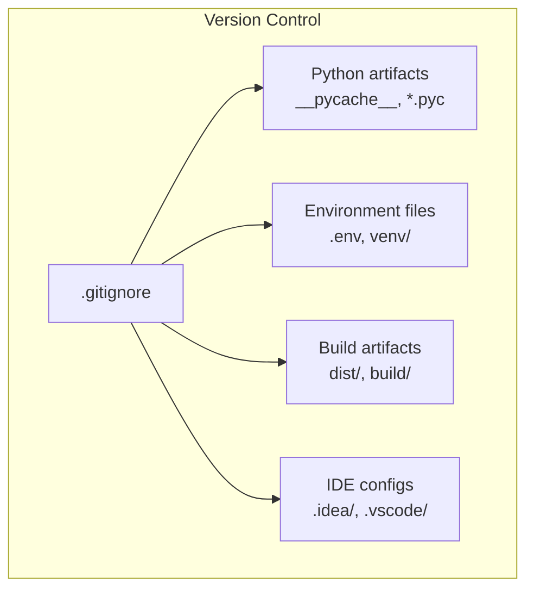
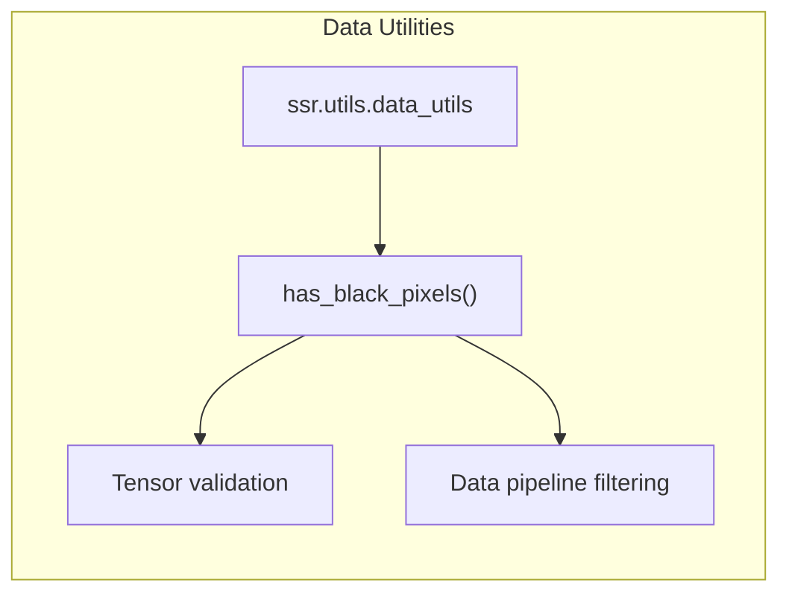
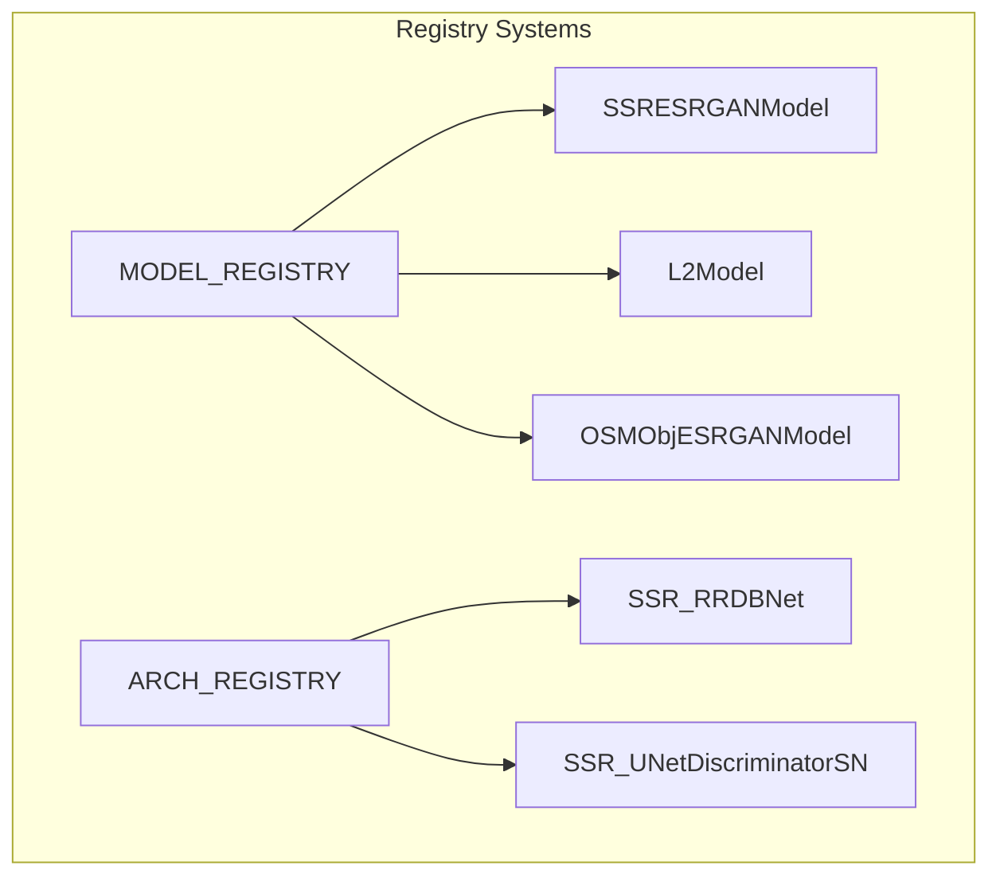
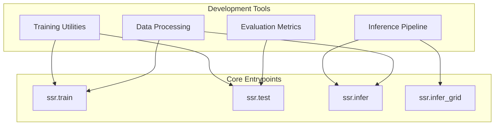
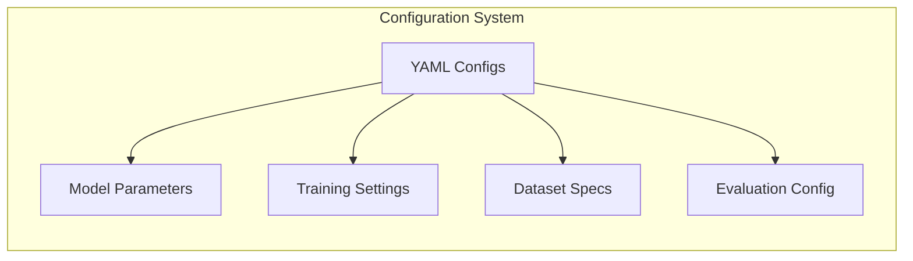

<!-- source: DeepWiki mcp.deepwiki.com · repo allenai/satlas-super-resolution · page 9 Development and Utilities · fetched 2026-10-26 -->

# Development and Utilities

Relevant source files

The following files were used as context for generating this wiki page:

- [.gitignore](.gitignore)
- [ssr/utils/data_utils.py](ssr/utils/data_utils.py)

This document covers development tools, utility functions, and resources for contributors working on the Satlas Super-Resolution codebase. It provides guidance on code organization, available utility modules, and development workflows.

For information about training configurations and model setup, see [Configuration System](#5.1). For evaluation and testing procedures, see [Evaluation and Testing](#7).

## Development Environment Setup

The codebase follows standard Python development practices with dependency management and version control configurations. The development environment is designed to support machine learning workflows with GPU acceleration and distributed training capabilities.

### Version Control Configuration

The repository uses Git with comprehensive exclusion patterns for Python development artifacts, model checkpoints, and temporary files.

**Key Exclusions:**
- Python bytecode and cache files (`__pycache__/`, `*.pyc`)
- Virtual environments (`venv/`, `.env`)
- Model outputs and logs (`*.log`, `.coverage`)
- Jupyter notebook checkpoints (`.ipynb_checkpoints`)
- IDE configurations (`.idea/`, `.vscode/`)

**Sources:** [.gitignore:1-161]()

## Utility Module Organization

The codebase includes several utility modules that provide common functionality across training, inference, and data processing pipelines. These utilities are organized to support the core machine learning workflows while maintaining modularity.

### Data Processing Utilities

The `ssr.utils.data_utils` module contains helper functions for tensor operations and data validation during processing pipelines.

**Key Functions:**
- `has_black_pixels()`: Validates tensor data by detecting completely black pixels, useful for filtering corrupted or invalid image patches

The `has_black_pixels()` function implements efficient tensor validation by summing across channel dimensions and checking for zero-valued pixels, which indicates corrupted or invalid image data.

**Sources:** [ssr/utils/data_utils.py:1-11]()

### Registry and Configuration Utilities

Based on the system architecture, the codebase employs registry patterns for dynamic model and architecture discovery:

**Core Registry Systems:**
- `MODEL_REGISTRY`: Dynamic registration of model classes
- `ARCH_REGISTRY`: Registration of network architectures
- Configuration parsing utilities for YAML-based setup

**Sources:** System architecture diagrams from context

## Development Workflow Tools

The development environment supports multiple workflow patterns for machine learning experimentation and production deployment.

### Training and Experimentation

The codebase provides utilities for managing training experiments, model checkpointing, and performance monitoring:

**Training Utilities:**
- Configuration validation and parsing
- Model checkpointing and restoration
- Metric computation and logging
- Distributed training coordination

### Inference Pipeline Utilities

Specialized utilities support both single-image and large-scale grid processing workflows:

**Inference Tools:**
- Image preprocessing and normalization utilities
- Grid tiling and stitching functions
- Batch processing optimization
- Output format conversion

**Sources:** System architecture diagrams from context

## Code Organization Patterns

The codebase follows a modular architecture with clear separation of concerns between different functional areas:

### Module Structure

| Module Category | Purpose | Key Components |
|----------------|---------|----------------|
| Models | Neural network definitions | `SSRESRGANModel`, `L2Model`, `OSMObjESRGANModel` |
| Architectures | Network architectures | `SSR_RRDBNet`, `SSR_UNetDiscriminatorSN` |
| Data | Dataset and preprocessing | `S2NAIPDataset`, `CustomWeightedRandomSampler` |
| Utils | Common utilities | Data validation, tensor operations |
| Losses | Loss functions | `L1Loss`, `PerceptualLoss`, `GANLoss`, `CLIPLoss` |

### Configuration-Driven Development

The system uses YAML configuration files to control all aspects of training and inference, enabling reproducible experiments and easy parameter tuning without code changes.

**Configuration Categories:**
- Model architecture parameters
- Training hyperparameters  
- Dataset specifications
- Inference settings
- Evaluation metrics

**Sources:** System architecture diagrams from context

## Debugging and Validation Tools

The utility modules provide several functions for debugging and validating data throughout the processing pipeline:

### Data Validation

Data validation utilities help identify and filter problematic inputs before they reach training or inference pipelines:

- **Tensor validation**: Check for invalid pixel values, NaN detection
- **Dimension verification**: Ensure correct tensor shapes and channel counts
- **Range validation**: Verify pixel value ranges are within expected bounds

### Model Debugging

Development utilities support model debugging and performance analysis:

- **Gradient monitoring**: Track gradient flow during training
- **Activation visualization**: Inspect intermediate layer outputs
- **Memory profiling**: Monitor GPU memory usage during training

**Sources:** [ssr/utils/data_utils.py:3-10](), system architecture analysis

## Contribution Guidelines

When contributing to the codebase, developers should follow established patterns for modularity and extensibility:

### Adding New Models

New models should be registered using the `MODEL_REGISTRY` pattern and follow the established interface contracts for training and inference.

### Utility Function Development

New utility functions should be placed in appropriate modules within `ssr.utils` and include comprehensive docstrings and type hints.

### Configuration Management

New features should be configurable through YAML files rather than requiring code changes, maintaining the configuration-driven architecture.

**Sources:** Development patterns inferred from system architecture