# Page: Overview

# Overview

<details>
<summary>Relevant source files</summary>

The following files were used as context for generating this wiki page:

- [README.md](README.md)

</details>


## Purpose and Scope

This document provides comprehensive documentation for the Satlas Super-Resolution repository, a machine learning system designed to generate high-resolution satellite imagery from low-resolution Sentinel-2 satellite data. The repository implements state-of-the-art super-resolution neural networks to produce globally available, AI-generated geospatial data that is updated monthly as part of the broader [Satlas project](https://satlas.allen.ai/).

The system transforms 32x32 pixel Sentinel-2 imagery into 128x128 pixel super-resolved outputs, providing a 4x upsampling factor. This documentation covers the complete pipeline from data processing through model training to large-scale inference deployment.

For specific implementation details about training procedures, see [Training](#5). For inference workflows, see [Inference](#6). For detailed model architecture information, see [Model Architectures](#4).

## System Architecture

The Satlas Super-Resolution system is built around four main entry points that provide different operational modes, each supported by a comprehensive configuration system and modular component architecture.

### Main Entry Points

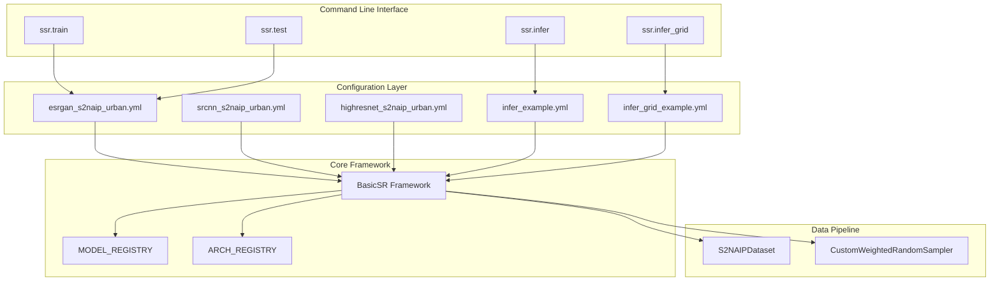

**System Entry Points and Configuration Flow**

The system provides four primary modes of operation accessible through Python module commands, each driven by YAML configuration files that specify model architecture, training parameters, and data paths.

Sources: [README.md:147-148](), [README.md:165-166](), [README.md:173-174](), [README.md:185-186]()

### Core Components Architecture

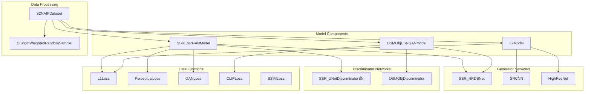

**Core Model and Data Architecture**

The system implements a modular architecture where models (`SSRESRGANModel`, `L2Model`, `OSMObjESRGANModel`) compose different generator networks, discriminators, and loss functions to create various super-resolution approaches optimized for different use cases.

Sources: Based on system diagrams and README model descriptions [README.md:132-143]()

## Data Flow Pipeline

The system processes satellite imagery through a structured pipeline that pairs low-resolution Sentinel-2 time series with high-resolution NAIP ground truth images for training, then applies trained models for inference on new Sentinel-2 data.

### Training Data Flow

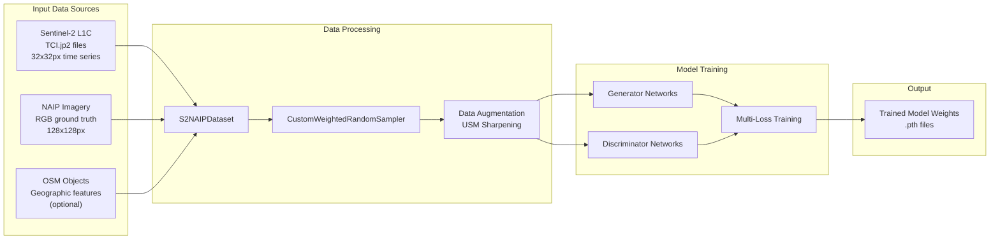

**Training Pipeline Data Flow**

The training pipeline processes paired Sentinel-2 and NAIP imagery through the `S2NAIPDataset` class, applies weighted sampling and augmentation, then trains generator-discriminator pairs using multiple loss functions to produce model weights for inference.

Sources: [README.md:87-114](), [README.md:36-42]()

### Inference Data Flow

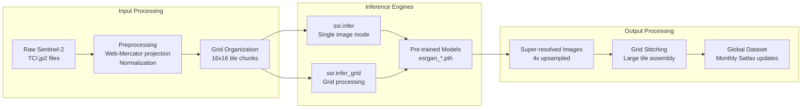

**Inference Pipeline Data Flow**

The inference pipeline processes raw Sentinel-2 imagery through preprocessing and grid organization, applies trained models via `ssr.infer` or `ssr.infer_grid` modules, then produces super-resolved outputs that can be stitched into large-scale datasets for the global Satlas platform.

Sources: [README.md:171-189](), [README.md:115-129]()

## Dataset Structure

The system operates on the S2-NAIP dataset structure, which pairs time series of Sentinel-2 imagery with corresponding NAIP aerial photographs. The dataset uses the Web-Mercator tile system for spatial organization and supports multiple training configurations.

| Dataset Component | Resolution | Format | Coverage |
|-------------------|------------|--------|----------|
| Sentinel-2 Time Series | 32x32px | PNG stacks | Multiple temporal acquisitions |
| NAIP Ground Truth | 128x128px | RGB PNG | Single high-resolution reference |
| Urban Training Set | ~1.1M pairs | - | USA cities ≥50k population |
| Full Training Set | ~44M pairs | - | Complete NAIP coverage 2019-2020 |
| Validation Set | 8,192 pairs | - | General validation |
| Test Set | 8 grids (16x16) | - | Comprehensive evaluation |

The system supports multiple Sentinel-2 band configurations including TCI (RGB), 10m bands, 20m bands, and 60m bands, with models trained to handle 1-16 input temporal acquisitions per location.

Sources: [README.md:86-114](), [README.md:36-50]()

## Key Features and Capabilities

The repository provides several key capabilities that support both research experimentation and production deployment:

**Model Architectures**: Implementation of ESRGAN (primary production model), SRCNN (baseline), and HighResNet (enhanced CNN) with support for different input configurations and loss functions.

**Training Flexibility**: Comprehensive configuration system supporting different datasets, model variants, loss combinations, and experimental setups including OSM object-aware training and CLIP-enhanced semantic loss.

**Inference Modes**: Both single-image processing via `ssr.infer` and large-scale grid processing via `ssr.infer_grid` with automatic stitching capabilities for global dataset generation.

**Production Integration**: Direct integration with the Satlas platform for monthly global super-resolution dataset updates, supporting the publicly available AI-generated geospatial data at satlas.allen.ai.

**Research Support**: Extensive experimental configurations and model variants documented in the associated research paper "Zooming Out on Zooming In: Advancing Super-Resolution for Remote Sensing".

Sources: [README.md:1-21](), [README.md:132-142](), [README.md:170-189]()

---

# Page: Getting Started

# Getting Started

<details>
<summary>Relevant source files</summary>

The following files were used as context for generating this wiki page:

- [README.md](README.md)
- [requirements.txt](requirements.txt)
- [ssr/train.py](ssr/train.py)
- [ssr/utils/options.py](ssr/utils/options.py)

</details>


This document provides a comprehensive guide for setting up and running your first super-resolution tasks with the Satlas Super-Resolution system. It covers installation, data setup, configuration basics, and executing the primary workflows of training, testing, and inference.

For detailed information about model architectures, see [Model Architectures](#4). For advanced training configurations and experimental setups, see [Training Configurations](#5.2) and [Experimental Configurations](#8.2).

## System Overview

The Satlas Super-Resolution system provides three primary entry points for different workflows, each driven by YAML configuration files that specify datasets, model parameters, and execution settings.

### Primary Entry Points

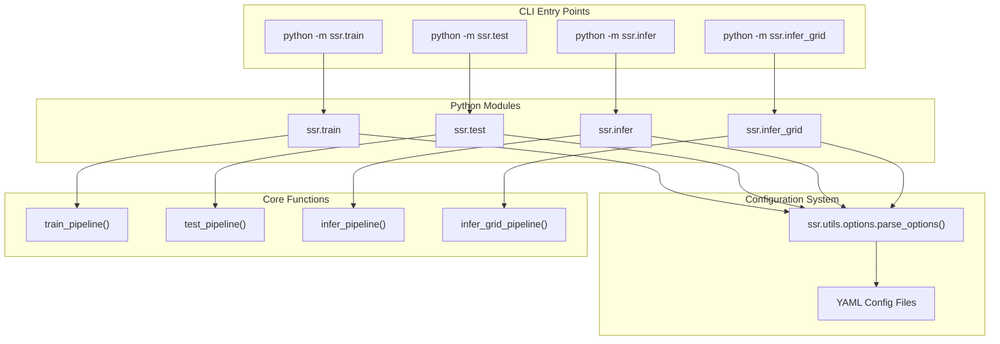

**Sources:** [README.md:144-186](), [ssr/train.py:29-156](), [ssr/utils/options.py:50-152]()

## Installation and Dependencies

### Environment Setup

The system requires Python 3.9 and specific dependencies for satellite imagery processing and deep learning.

```bash
conda create --name ssr python==3.9
conda activate ssr
pip install -r requirements.txt
conda install gdal
```

### Core Dependencies

| Package | Purpose |
|---------|---------|
| `basicsr==1.4.2` | Super-resolution training framework |
| `torch==2.1.0` | Deep learning framework |
| `torchvision==0.16.0` | Computer vision utilities |
| `lpips` | Perceptual loss calculations |
| `wandb` | Experiment tracking |
| `gdal` | Geospatial data processing |

**Sources:** [README.md:24-31](), [requirements.txt:1-13]()

### Configuration System Flow

The system uses YAML configuration files to control all aspects of training, testing, and inference. The configuration parsing system handles distributed training setup, path resolution, and parameter validation.

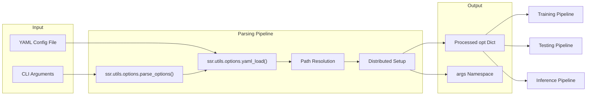

**Sources:** [ssr/utils/options.py:50-152](), [ssr/train.py:31-32]()

## Data and Model Downloads

### Training Datasets

The system provides multiple datasets for different use cases:

| Dataset | Size | Purpose | Download Links |
|---------|------|---------|----------------|
| `train_urban_set` | ~1.1M pairs | Primary training on urban areas | [part1-4 links in README]() |
| `train_full_set` | ~44M pairs | Complete dataset (large scale) | [tar link in README]() |
| `val_set` | 8,192 pairs | Standard validation | [tar link in README]() |
| `small_val_set` | 256 pairs | Quick validation/testing | [tar link in README]() |
| `test_set` | 8 grids (16x16) | Comprehensive evaluation | [tar link in README]() |

### Pre-trained Model Weights

| Model Type | Variants | Configuration Files |
|------------|----------|-------------------|
| ESRGAN | 1, 2, 4, 8, 16 S2 images | `esrgan_baseline_*.yml` |
| ESRGAN | 10m, 20m, 60m bands | `esrgan_baseline_*m.yml` |
| SRCNN | Baseline CNN | `srcnn_s2naip_urban.yml` |
| HighResNet | Enhanced CNN | `highresnet_s2naip_urban.yml` |

**Sources:** [README.md:33-85]()

### Dataset Structure

The system expects a specific directory structure for Sentinel-2 and NAIP imagery pairs:

```
dataset/
├── naip/
│   └── {image_uuid}/
│       └── {tile}/
│           └── rgb.png
└── sentinel2/
    └── {tile}/
        ├── tci.png
        ├── b01.png
        └── ...
```

**Sources:** [README.md:86-114]()

## Running Your First Tasks

### Training a Model

Start with the urban dataset and ESRGAN configuration for your first training run:

```bash
python -m ssr.train -opt ssr/options/esrgan_s2naip_urban.yml
```

Key configuration elements to verify in your YAML file:
- Dataset paths point to downloaded data
- Model parameters match your hardware capabilities  
- Pretrained weights paths (if using transfer learning)

For debugging without logging overhead:
```bash
python -m ssr.train -opt ssr/options/esrgan_s2naip_urban.yml --debug
```

**Sources:** [README.md:144-159](), [ssr/train.py:29-156]()

### Testing a Trained Model

Evaluate model performance on validation/test sets with ground truth:

```bash
python -m ssr.test -opt ssr/options/esrgan_s2naip_urban.yml
```

This will:
- Load the trained model specified in the configuration
- Process test data from `['datasets']['test']` section
- Save output images to `results/` directory
- Display computed metrics (PSNR, SSIM, etc.)

**Sources:** [README.md:161-169]()

### Running Inference

For inference on new data without ground truth:

```bash
python -m ssr.infer -opt ssr/options/infer_example.yml
```

For processing complete Sentinel-2 tiles (16x16 grids) with automatic stitching:

```bash
python -m ssr.infer_grid -opt ssr/options/infer_grid_example.yml
```

**Sources:** [README.md:170-189]()

## Configuration Workflow

The training pipeline follows a structured configuration-driven approach where YAML files control every aspect of the process.

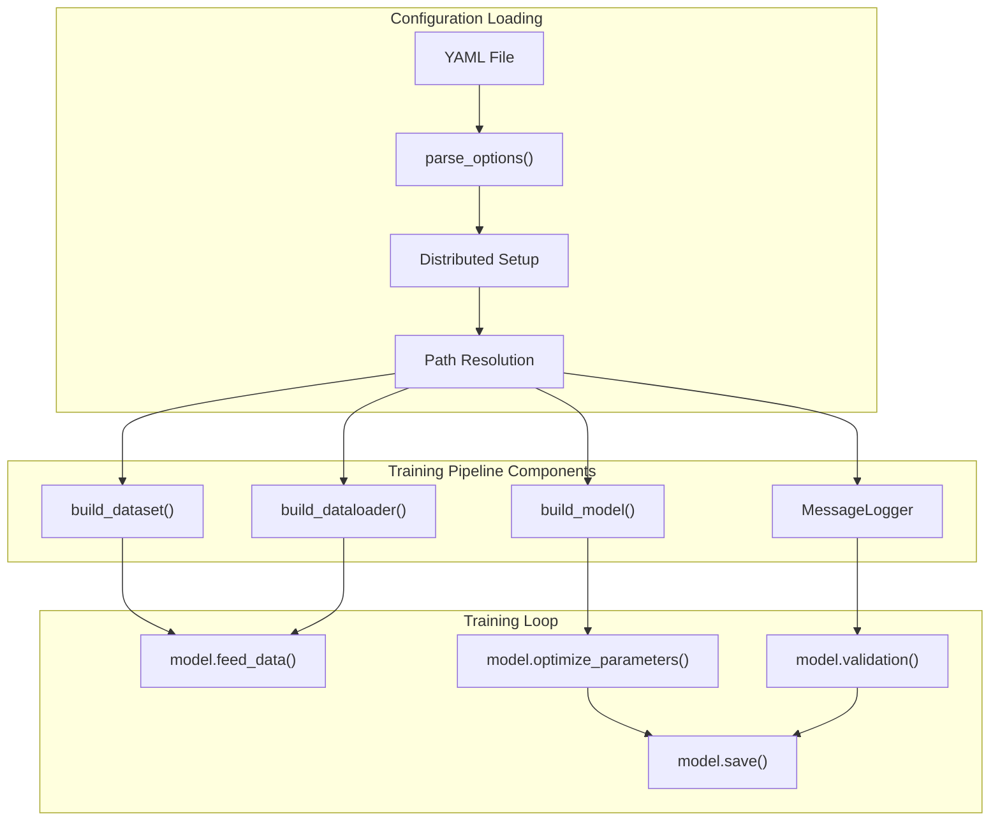

**Sources:** [ssr/train.py:29-151](), [ssr/utils/options.py:50-152]()

## Multi-GPU Training

For distributed training across multiple GPUs:

```bash
PYTHONPATH=. python -m torch.distributed.launch --nproc_per_node=8 --master_port=1234 ssr/train.py -opt ssr/options/esrgan_s2naip_urban.yml --launcher pytorch
```

The configuration system automatically handles distributed setup when the `--launcher pytorch` flag is specified.

**Sources:** [README.md:157-159](), [ssr/utils/options.py:64-74]()

## Next Steps

After completing your first training and inference runs:

1. **Explore Model Architectures** - See [Model Architectures](#4) for detailed information about ESRGAN, SRCNN, and HighResNet implementations
2. **Advanced Training** - Check [Training](#5) for comprehensive training strategies and [Training Configurations](#5.2) for specialized setups
3. **Large-Scale Processing** - Learn about [Grid Inference and Stitching](#6.2) for processing entire Sentinel-2 tiles
4. **Evaluation Methods** - Review [Evaluation and Testing](#7) for comprehensive model assessment techniques
5. **Experimental Features** - Explore [OSM Object-Aware Training](#8.1) for geographic feature-aware models

**Sources:** [README.md:1-239]()

---

# Page: Data Pipeline

# Data Pipeline

<details>
<summary>Relevant source files</summary>

The following files were used as context for generating this wiki page:

- [ssr/data/s2-naip_dataset.py](ssr/data/s2-naip_dataset.py)
- [ssr/utils/data_utils.py](ssr/utils/data_utils.py)

</details>


This document explains how satellite imagery data flows through the system, from raw Sentinel-2 and NAIP inputs to processed training pairs ready for model consumption. The data pipeline handles the pairing, loading, validation, and augmentation of multi-temporal satellite imagery with high-resolution aerial imagery ground truth.

For information about model training using this processed data, see [Training](#5). For details on inference pipeline processing, see [Inference](#6).

## Data Flow Overview

The data pipeline transforms raw satellite and aerial imagery into paired training samples through a series of processing stages:

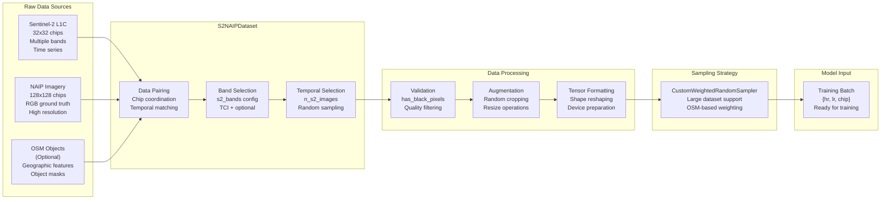

**Data Pipeline Flow Diagram**

Sources: [ssr/data/s2-naip_dataset.py:35-249](), [ssr/utils/data_utils.py:3-10]()

## Core Dataset Implementation

The `S2NAIPDataset` class serves as the primary data loading mechanism, registered with BasicSR's dataset registry system:

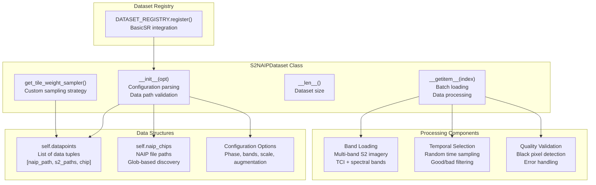

**S2NAIPDataset Class Architecture**

Sources: [ssr/data/s2-naip_dataset.py:34-50](), [ssr/data/s2-naip_dataset.py:152-246]()

## Data Loading and Pairing Process

The dataset pairs Sentinel-2 time series with corresponding NAIP imagery based on geographic chip coordinates:

| Component | Description | Configuration Key | File Reference |
|-----------|-------------|-------------------|----------------|
| **Chip Extraction** | Extract X,Y coordinates from file paths | N/A | [ssr/data/s2-naip_dataset.py:107-109]() |
| **S2 Band Loading** | Load multiple spectral bands per chip | `s2_bands` | [ssr/data/s2-naip_dataset.py:120-121]() |
| **Temporal Sampling** | Select N images from time series | `n_s2_images` | [ssr/data/s2-naip_dataset.py:216-225]() |
| **NAIP Loading** | Load high-resolution ground truth | N/A | [ssr/data/s2-naip_dataset.py:171-177]() |
| **Shape Formatting** | Reshape tensors for model input | `use_3d` | [ssr/data/s2-naip_dataset.py:237-239]() |

The pairing process handles several data scenarios:

- **Standard Pairing**: Current S2 time series with contemporary NAIP imagery
- **Historical Pairing**: Optional older NAIP imagery for temporal analysis via `old_naip_path` [ssr/data/s2-naip_dataset.py:65-67]()
- **OSM Filtering**: Geographic feature-based filtering using `osm_objs_path` [ssr/data/s2-naip_dataset.py:69-70]()

Sources: [ssr/data/s2-naip_dataset.py:105-127](), [ssr/data/s2-naip_dataset.py:181-196]()

## Data Processing and Augmentation

The pipeline includes several processing steps to prepare data for training:

### Temporal Selection Strategy

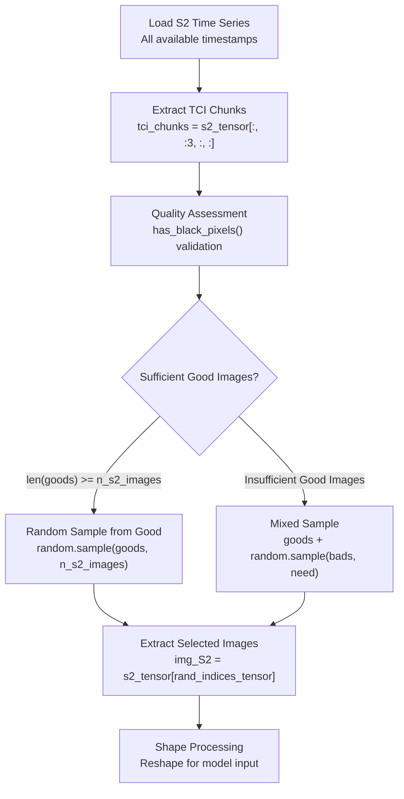

**Temporal Selection Algorithm**

Sources: [ssr/data/s2-naip_dataset.py:208-225](), [ssr/data/s2-naip_dataset.py:237-239]()

### Augmentation Pipeline

The system supports training-time augmentation through random cropping:

- **Random Crop Size**: Selects crop size between 24-32 pixels for low-resolution input [ssr/data/s2-naip_dataset.py:230]()
- **Proportional HR Cropping**: Maintains 4x scale relationship with high-resolution crop [ssr/data/s2-naip_dataset.py:231]()
- **Resize Back**: Uses `F.interpolate` to restore original dimensions [ssr/data/s2-naip_dataset.py:234-235]()

Sources: [ssr/data/s2-naip_dataset.py:227-235]()

## Custom Sampling Strategy

The `CustomWeightedRandomSampler` addresses PyTorch's limitation for large datasets:

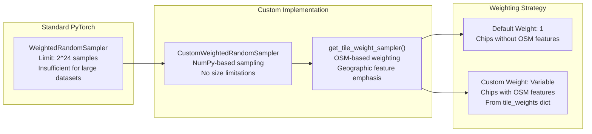

**Custom Sampling Architecture**

The weighting system enables emphasis on geographic features:

- **Base Weight**: Chips without OSM features receive weight of 1 [ssr/data/s2-naip_dataset.py:145]()
- **Enhanced Weight**: Chips with OSM features use `tile_weights` dictionary values [ssr/data/s2-naip_dataset.py:147]()
- **Weight Statistics**: System reports min/max/mean weights for monitoring [ssr/data/s2-naip_dataset.py:149]()

Sources: [ssr/data/s2-naip_dataset.py:18-32](), [ssr/data/s2-naip_dataset.py:132-150]()

## Data Validation and Quality Control

The pipeline implements robust quality control through several validation mechanisms:

### Black Pixel Detection

The `has_black_pixels` utility function identifies invalid imagery:

```python
# From ssr/utils/data_utils.py:3-10
def has_black_pixels(tensor):
    channel_sum = torch.sum(tensor, dim=0)
    black_pixels = (channel_sum.view(-1) == 0).any()
    return black_pixels
```

This validation applies at multiple stages:
- **NAIP Validation**: Skip chips with invalid ground truth [ssr/data/s2-naip_dataset.py:174-176]()
- **S2 Temporal Validation**: Classify time series images as good/bad [ssr/data/s2-naip_dataset.py:210-214]()

### Error Handling Strategy

The `__getitem__` method uses a retry loop to handle data loading failures:

- **Counter-based Retry**: Increment index when errors occur [ssr/data/s2-naip_dataset.py:157-161]()
- **Multiple Validation Points**: Check data quality at each processing stage
- **Graceful Fallback**: Continue to next sample on validation failure

Sources: [ssr/utils/data_utils.py:3-10](), [ssr/data/s2-naip_dataset.py:157-204]()

## Configuration Parameters

The dataset supports extensive configuration through the `opt` dictionary:

| Parameter | Type | Description | Default | Reference |
|-----------|------|-------------|---------|-----------|
| `sentinel2_path` | str | Path to S2 imagery directory | Required | [ssr/data/s2-naip_dataset.py:94]() |
| `naip_path` | str | Path to NAIP imagery directory | Required | [ssr/data/s2-naip_dataset.py:95]() |
| `n_s2_images` | int | Number of S2 timesteps to use | Required | [ssr/data/s2-naip_dataset.py:58]() |
| `scale` | int | Upsampling factor (4x supported) | 4 | [ssr/data/s2-naip_dataset.py:59]() |
| `phase` | str | Training phase ('train' or 'val') | Required | [ssr/data/s2-naip_dataset.py:52]() |
| `use_3d` | bool | Maintain temporal dimension | False | [ssr/data/s2-naip_dataset.py:63]() |
| `rand_crop` | bool | Enable random crop augmentation | False | [ssr/data/s2-naip_dataset.py:56]() |
| `s2_bands` | list | S2 spectral bands to load | ['tci'] | [ssr/data/s2-naip_dataset.py:73]() |
| `train_samples` | int | Limit training set size | None | [ssr/data/s2-naip_dataset.py:102-103]() |
| `old_naip_path` | str | Path to historical NAIP imagery | None | [ssr/data/s2-naip_dataset.py:67]() |
| `osm_objs_path` | str | Path to OSM object masks | None | [ssr/data/s2-naip_dataset.py:70]() |
| `n_osm_objs` | int | Minimum OSM objects per chip | None | [ssr/data/s2-naip_dataset.py:117]() |

### Band Configuration

The system supports multiple Sentinel-2 spectral bands with automatic TCI prioritization:

- **TCI Priority**: TCI band moved to front of band list [ssr/data/s2-naip_dataset.py:75]()
- **Multi-band Support**: Additional spectral bands concatenated as channels [ssr/data/s2-naip_dataset.py:196]()
- **Missing Band Handling**: Zero tensors used when bands unavailable [ssr/data/s2-naip_dataset.py:186-188]()

Sources: [ssr/data/s2-naip_dataset.py:48-103](), [ssr/data/s2-naip_dataset.py:183-196]()

---

# Page: Model Architectures

# Model Architectures

<details>
<summary>Relevant source files</summary>

The following files were used as context for generating this wiki page:

- [ssr/models/ssr_esrgan_model.py](ssr/models/ssr_esrgan_model.py)
- [ssr/models/ssr_l2_model.py](ssr/models/ssr_l2_model.py)

</details>


This document provides an overview of the neural network model architectures available in the Satlas Super-Resolution system. It covers the high-level model organization, inheritance hierarchy, and the relationship between different architectural components.

For detailed information about specific ESRGAN implementations, see [ESRGAN Models](#4.1). For simple CNN baseline architectures, see [CNN Baselines](#4.2). For comprehensive coverage of training objectives, see [Loss Functions](#4.3).

## Model Registry System

The system uses BasicSR's model registry pattern to dynamically discover and instantiate models at runtime. All model classes are decorated with `@MODEL_REGISTRY.register()` and inherit from BasicSR's base model classes.

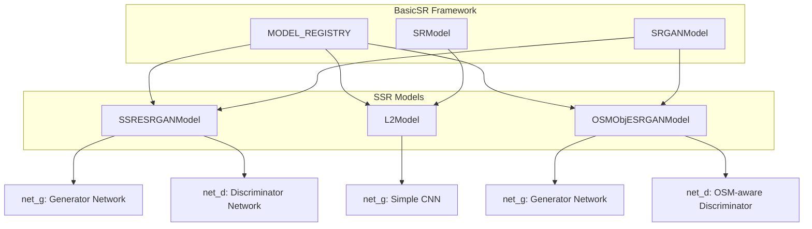

**Sources**: [ssr/models/ssr_esrgan_model.py:13,18](), [ssr/models/ssr_l2_model.py:10,14]()

## Architecture Overview

The system provides three primary model architectures, each designed for different use cases and complexity requirements:

| Model Class | Base Class | Primary Use Case | Complexity | Networks |
|-------------|------------|------------------|------------|----------|
| `SSRESRGANModel` | `SRGANModel` | Production super-resolution | High | Generator + Discriminator |
| `L2Model` | `SRModel` | Baseline comparison | Low | Generator only |
| `OSMObjESRGANModel` | `SRGANModel` | Geographic feature-aware | High | Generator + OSM-aware Discriminator |

**Sources**: [ssr/models/ssr_esrgan_model.py:19](), [ssr/models/ssr_l2_model.py:15]()

## Model Component Architecture

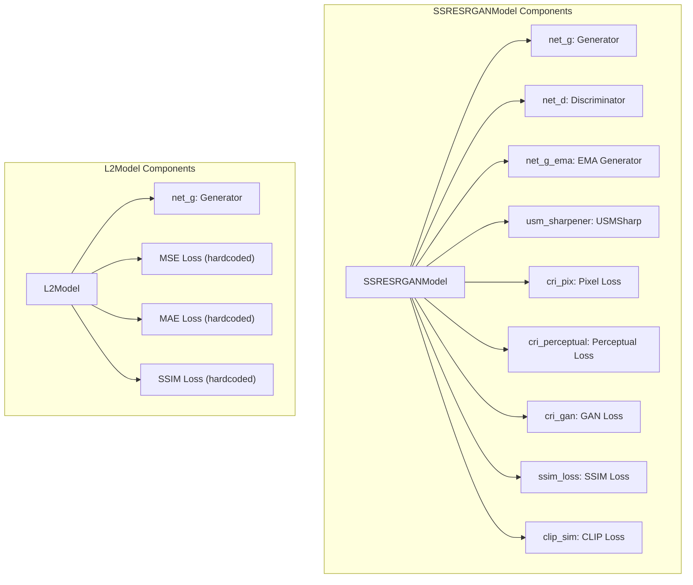

**Sources**: [ssr/models/ssr_esrgan_model.py:31,43,53,67-95](), [ssr/models/ssr_l2_model.py:37-40]()

## Generator Network Integration

The models support different generator architectures through BasicSR's network building system:

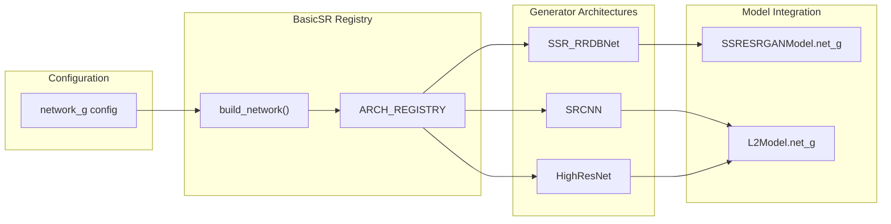

**Sources**: [ssr/models/ssr_esrgan_model.py:43](), [ssr/models/ssr_l2_model.py:34]()

## Training and Inference Flow

The models implement standardized interfaces for training and inference:

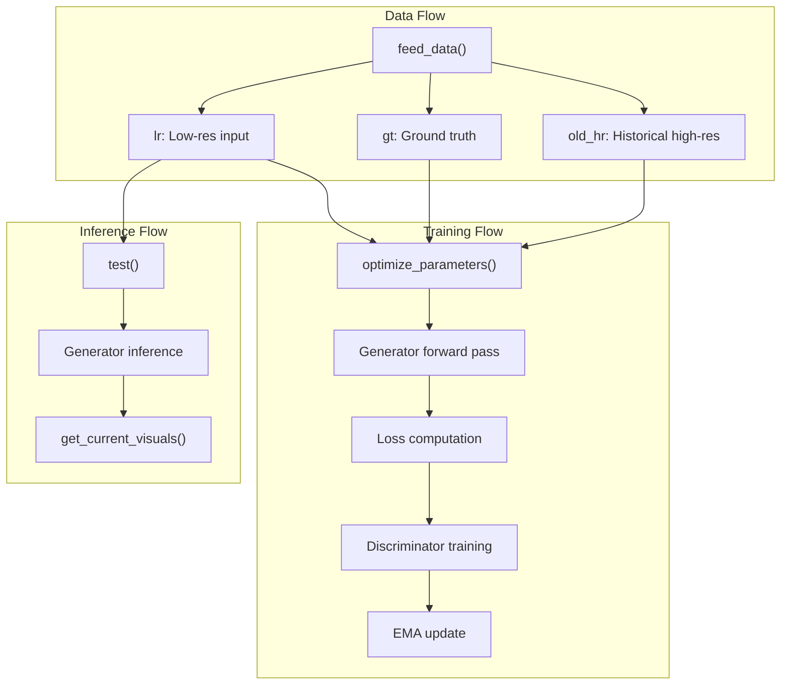

**Sources**: [ssr/models/ssr_esrgan_model.py:105-117,119-233,235-244](), [ssr/models/ssr_l2_model.py:25-28,30-54,56-60]()

## Discriminator Input Augmentation

The `SSRESRGANModel` supports feeding additional context to the discriminator beyond just the generated/real images:

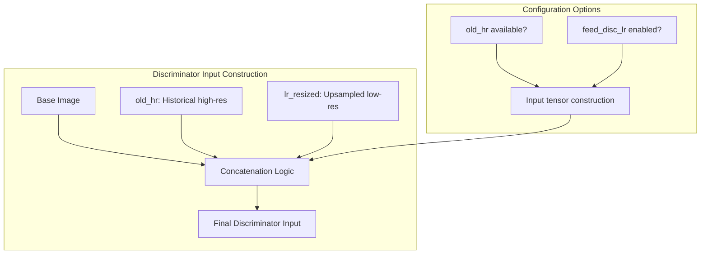

**Sources**: [ssr/models/ssr_esrgan_model.py:171-178,202-213]()

## Model-Specific Features

### SSRESRGANModel Features
- **Exponential Moving Average (EMA)**: Maintains `net_g_ema` for stable inference [ssr/models/ssr_esrgan_model.py:36-50]()
- **USM Sharpening**: Applies unsharp masking to ground truth images [ssr/models/ssr_esrgan_model.py:31,109]()
- **Multi-loss Training**: Supports pixel, perceptual, GAN, SSIM, and CLIP losses [ssr/models/ssr_esrgan_model.py:67-95]()
- **Flexible Discriminator Input**: Can incorporate historical images and low-res context [ssr/models/ssr_esrgan_model.py:112-117]()

### L2Model Features
- **Hardcoded Loss Combination**: Uses fixed weights (0.3×MSE + 0.4×MAE + 0.3×SSIM) from WorldStrat paper [ssr/models/ssr_l2_model.py:37-40]()
- **Simple Training Loop**: No discriminator, straightforward generator training [ssr/models/ssr_l2_model.py:30-54]()
- **PSNR Loss Logging**: Computes PSNR in dB scale for monitoring [ssr/models/ssr_l2_model.py:43]()

**Sources**: [ssr/models/ssr_esrgan_model.py:1-354](), [ssr/models/ssr_l2_model.py:1-162]()

---

# Page: ESRGAN Models

# ESRGAN Models

<details>
<summary>Relevant source files</summary>

The following files were used as context for generating this wiki page:

- [figures/esrgan_generator.svg](figures/esrgan_generator.svg)
- [ssr/models/ssr_esrgan_model.py](ssr/models/ssr_esrgan_model.py)
- [ssr/models/ssr_l2_model.py](ssr/models/ssr_l2_model.py)

</details>


This document covers the Enhanced Super-Resolution Generative Adversarial Network (ESRGAN) models in the satellite super-resolution system. These models represent the primary production architecture for generating high-resolution satellite imagery from low-resolution Sentinel-2 inputs.

For information about simpler CNN baseline models (SRCNN, HighResNet), see [CNN Baselines](#4.2). For details about loss functions used in training, see [Loss Functions](#4.3).

## Architecture Overview

The ESRGAN models in this system are based on the Real-ESRGAN architecture, adapted specifically for satellite imagery super-resolution. The implementation consists of a generator-discriminator pair that learns to upscale low-resolution Sentinel-2 time series to high-resolution outputs matching NAIP aerial imagery quality.

### Core Model Components

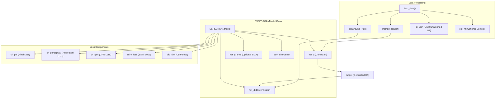

**Sources:** [ssr/models/ssr_esrgan_model.py:19-31]()

## SSRESRGANModel Implementation

The `SSRESRGANModel` class extends BasicSR's `SRGANModel` and serves as the main ESRGAN implementation for satellite imagery. It handles the complete training and inference pipeline for adversarial super-resolution.

### Key Features

| Feature | Description | Configuration |
|---------|-------------|---------------|
| **Multi-channel Input** | Handles Sentinel-2 time series (36+ channels) | Defined in generator network config |
| **USM Sharpening** | Applies unsharp masking to ground truth | `usm_sharpener` instance |
| **EMA Support** | Optional exponential moving average | `ema_decay` parameter |
| **Temporal Context** | Can use older high-res images as discriminator input | `old_hr` data field |
| **Multi-loss Training** | Combines pixel, perceptual, adversarial, and semantic losses | Various `*_opt` configurations |

### Training Data Flow

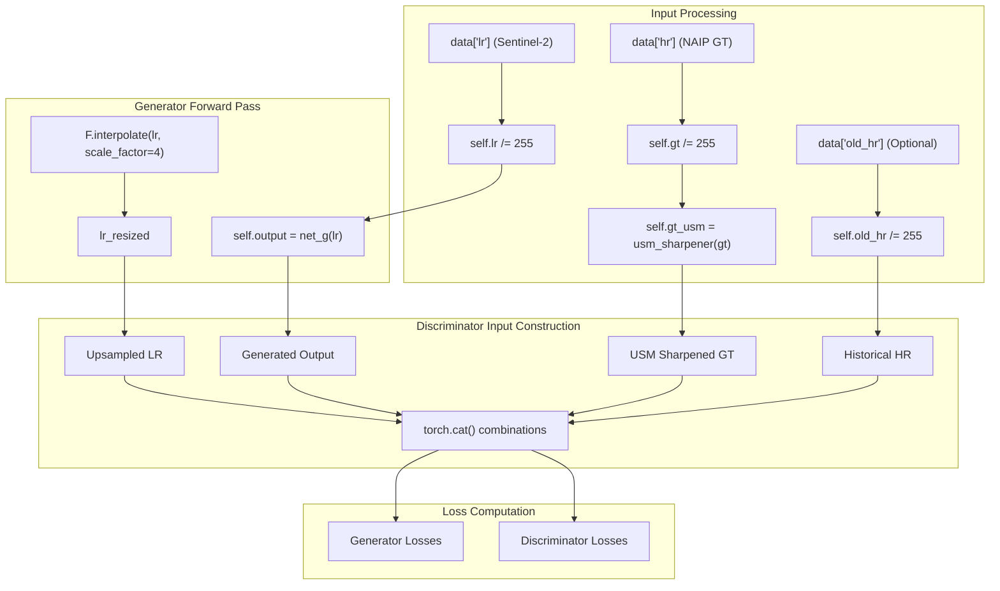

**Sources:** [ssr/models/ssr_esrgan_model.py:105-118](), [ssr/models/ssr_esrgan_model.py:132-178]()

## Loss Function Integration

The ESRGAN model supports multiple loss functions that can be combined during training. Each loss type is conditionally initialized based on the training configuration.

### Supported Loss Types

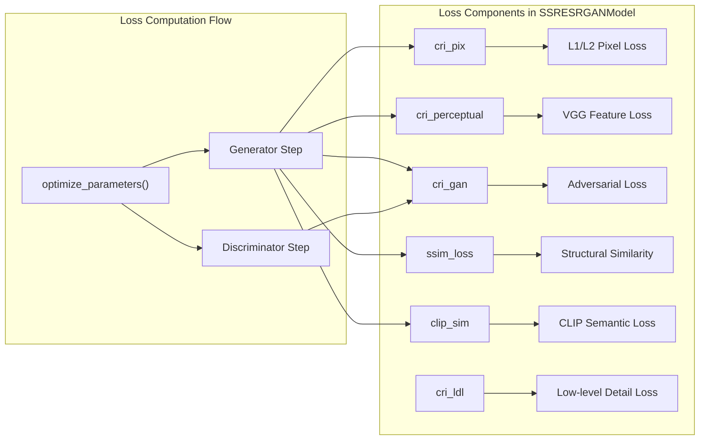

The loss computation in `optimize_parameters()` follows this pattern:

1. **Generator optimization**: Combines pixel, perceptual, SSIM, and CLIP losses
2. **Discriminator optimization**: Uses adversarial loss on real/fake pairs
3. **USM variants**: Separate GT targets for different loss types (`l1_gt`, `percep_gt`, `gan_gt`)

**Sources:** [ssr/models/ssr_esrgan_model.py:67-96](), [ssr/models/ssr_esrgan_model.py:144-191]()

## Training Process Details

### Generator Training Step

The generator training involves multiple loss components that are conditionally applied based on configuration:

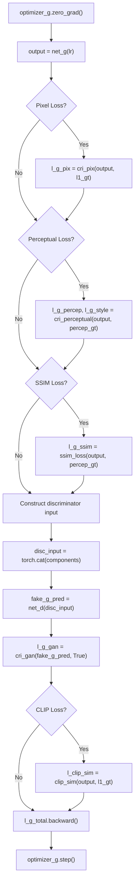

### Discriminator Input Construction

The discriminator receives different input combinations based on available data:

| Configuration | Input Composition |
|---------------|-------------------|
| **Basic** | `output` only |
| **With LR context** | `torch.cat((output, lr_resized), dim=1)` |
| **With temporal context** | `torch.cat((output, old_hr), dim=1)` |
| **Full context** | `torch.cat((output, lr_resized, old_hr), dim=1)` |

**Sources:** [ssr/models/ssr_esrgan_model.py:171-178](), [ssr/models/ssr_esrgan_model.py:202-213]()

## Validation and Testing

The model implements comprehensive validation capabilities with metric computation and visualization support.

### Validation Pipeline

```mermaid
flowchart TD
    subgraph "Validation Method"
        A["nondist_validation()"] --> B["Initialize metrics"]
        B --> C["For each validation sample"]
        C --> D["feed_data(val_data)"]
        D --> E["test()"]
        E --> F["get_current_visuals()"]
        F --> G["tensor2img conversion"]
        G --> H["calculate_metric()"]
        H --> I["Update metric_results"]
    end
    
    subgraph "Test Method"
        J["test()"] --> K{"Has EMA?"}
        K -->|Yes| L["net_g_ema.eval()"]
        K -->|No| M["net_g.eval()"]
        L --> N["output = net_g_ema(lr)"]
        M --> O["output = net_g(lr)"]
        N --> P["Return to train mode"]
        O --> P
    end
```

### Output Management

The model provides structured output through `get_current_visuals()`:

- **`lr`**: Low-resolution input tensor
- **`result`**: Generated high-resolution output  
- **`gt`**: Ground truth (when available)

**Sources:** [ssr/models/ssr_esrgan_model.py:235-244](), [ssr/models/ssr_esrgan_model.py:246-252](), [ssr/models/ssr_esrgan_model.py:269-352]()

## Model Registry Integration

The `SSRESRGANModel` is registered with BasicSR's model registry system using the `@MODEL_REGISTRY.register()` decorator, enabling dynamic instantiation through configuration files.

```python
@MODEL_REGISTRY.register()
class SSRESRGANModel(SRGANModel):
```

This registration allows the model to be specified in YAML configuration files and automatically instantiated by the training framework.

**Sources:** [ssr/models/ssr_esrgan_model.py:18-19]()

---

# Page: CNN Baselines

# CNN Baselines

<details>
<summary>Relevant source files</summary>

The following files were used as context for generating this wiki page:

- [figures/teaser.svg](figures/teaser.svg)
- [ssr/archs/highresnet_arch.py](ssr/archs/highresnet_arch.py)
- [ssr/archs/srcnn_arch.py](ssr/archs/srcnn_arch.py)
- [ssr/models/ssr_esrgan_model.py](ssr/models/ssr_esrgan_model.py)
- [ssr/models/ssr_l2_model.py](ssr/models/ssr_l2_model.py)

</details>


This document covers the simpler CNN architectures used as baseline models in the satellite super-resolution system. These include SRCNN and HighResNet, which serve as comparison baselines against the more complex ESRGAN models. For information about the primary ESRGAN production models, see [ESRGAN Models](#4.1). For details about loss function implementations, see [Loss Functions](#4.3).

## Architecture Overview

The CNN baseline system provides simpler alternatives to the ESRGAN models for satellite imagery super-resolution. These models use L2-based training with hardcoded loss combinations derived from the WorldStrat paper, making them suitable for establishing performance baselines and conducting comparative studies.

```mermaid
graph TB
    subgraph "CNN_Baseline_System"
        A[L2Model] --> B[SRCNN]
        A --> C[HighResNet]
        
        B --> D["DoubleConv2d<br/>encoder"]
        B --> E["Mask Encoder<br/>OneHot + Conv"]
        B --> F["Fusion Layer<br/>Channel concatenation"]
        B --> G["PixelShuffleBlock<br/>4x upsampling"]
        
        C --> H["Same as SRCNN<br/>+ RecursiveFusion"]
        C --> I["Recursive processing<br/>of revisits"]
    end
    
    subgraph "Loss_Components"
        J["MSE Loss<br/>weight: 0.3"]
        K["MAE Loss<br/>weight: 0.4"] 
        L["SSIM Loss<br/>weight: 0.3"]
        M["Combined Loss<br/>0.3*MSE + 0.4*MAE + 0.3*SSIM"]
    end
    
    A --> J
    A --> K
    A --> L
    A --> M
    
    subgraph "Input_Processing"
        N["Sentinel-2 Multi-revisit<br/>(batch, revisits, channels, H, W)"]
        O["Optional Mask Data<br/>12-class one-hot encoded"]
        P["Reference Frame<br/>Median of revisits"]
    end
    
    N --> B
    N --> C
    O --> B
    O --> C
    P --> B
    P --> C
```

**Sources:** [ssr/models/ssr_l2_model.py:14-22](), [ssr/archs/srcnn_arch.py:12-33](), [ssr/archs/highresnet_arch.py:9-26]()

## L2Model Wrapper

The `L2Model` class serves as a training wrapper for both SRCNN and HighResNet architectures, implementing the L2-based loss function approach from the WorldStrat paper.

| Component | Purpose | Implementation |
|-----------|---------|----------------|
| **Loss Function** | Combined MSE + MAE + SSIM | Hardcoded weights: 0.3, 0.4, 0.3 |
| **Input Normalization** | Scale input to [0,1] | Division by 255 |
| **Output Processing** | Remove batch dimension | `.squeeze(1)` operation |
| **Training Loop** | Standard gradient descent | Single optimizer step per iteration |

### Key Training Characteristics

```mermaid
flowchart LR
    A["Input Data<br/>data['lr'], data['hr']"] --> B["Normalization<br/>/255 → [0,1]"]
    B --> C["Forward Pass<br/>net_g(lr)"]
    C --> D["Loss Computation<br/>MSE + MAE + SSIM"]
    D --> E["Backward Pass<br/>loss.backward()"]
    E --> F["Optimizer Step<br/>optimizer_g.step()"]
    
    subgraph "Loss_Details"
        G["MSE: F.mse_loss(output, gt)"]
        H["MAE: F.l1_loss(output, gt)"] 
        I["SSIM: kornia.losses.ssim_loss"]
        J["Total: 0.3*MSE + 0.4*MAE + 0.3*SSIM"]
    end
    
    D --> G
    D --> H
    D --> I
    D --> J
```

**Sources:** [ssr/models/ssr_l2_model.py:30-54]()

## SRCNN Architecture

The `SRCNN` class implements a straightforward super-resolution CNN that processes multi-revisit satellite imagery through a series of encoding, fusion, and super-resolution stages.

### Architecture Components

```mermaid
graph TB
    subgraph "SRCNN_Forward_Pass"
        A["Input Shape<br/>(batch, revisits, channels, H, W)"] --> B["Optional Reference Frame<br/>Median computation"]
        B --> C["Reshape for Encoding<br/>(batch*revisits, channels, H, W)"]
        C --> D["DoubleConv2d Encoder<br/>→ hidden_channels"]
        D --> E["Optional Mask Processing<br/>OneHot + DoubleConv2d"]
        E --> F["Reshape for Fusion<br/>(batch, revisits*hidden, H, W)"]
        F --> G["Fusion Layer<br/>DoubleConv2d + ResidualBlocks"]
        G --> H["PixelShuffleBlock<br/>4x upsampling"]
        H --> I["Resize to Target<br/>Bilinear interpolation"]
        I --> J["Output Shape<br/>(batch, 1, channels, H*4, W*4)"]
    end
    
    subgraph "Key_Parameters"
        K["in_channels: Input channel count"]
        L["hidden_channels: Feature dimension"]
        M["revisits: Time series length"]
        N["zoom_factor: 4x upscaling"]
        O["kernel_size: Convolution kernel"]
        P["residual_layers: Depth control"]
    end
```

### Reference Frame Processing

The SRCNN architecture supports optional reference frame computation, which creates a temporal baseline by computing the median across all revisits:

```python
# Reference frame computation
reference_frame = x.median(dim=-4, keepdim=True).values
x = torch.cat([x, reference_frame], dim=-3)  # Double channels
```

**Sources:** [ssr/archs/srcnn_arch.py:125-141](), [ssr/archs/srcnn_arch.py:197-202]()

## HighResNet Architecture 

The `HighResNet` class extends SRCNN with recursive fusion capabilities, providing enhanced processing of multi-revisit data through temporal aggregation.

### Key Differences from SRCNN

| Aspect | SRCNN | HighResNet |
|--------|-------|------------|
| **Fusion Method** | Channel concatenation | `RecursiveFusion` |
| **Temporal Processing** | Treats revisits as channels | Recursive processing per revisit |
| **Data Flow** | Reshape → fuse all at once | Iterative revisit processing |
| **Inheritance** | Base class | Inherits from SRCNN |

### Architecture Flow

```mermaid
flowchart TD
    A["Multi-revisit Input<br/>(batch, revisits, channels, H, W)"] --> B["Optional Reference Frame<br/>Same as SRCNN"]
    B --> C["Per-revisit Encoding<br/>Same encoder as SRCNN"]
    C --> D["RecursiveFusion<br/>Iterative temporal aggregation"]
    D --> E["Super-resolution<br/>Same PixelShuffleBlock"]
    E --> F["Output<br/>(batch, 1, channels, H*4, W*4)"]
    
    subgraph "RecursiveFusion_Details"
        G["Process revisits sequentially"]
        H["Maintain hidden state"]
        I["Aggregate temporal information"]
    end
    
    D --> G
    D --> H
    D --> I
```

The `RecursiveFusion` module enables HighResNet to process temporal sequences more effectively than SRCNN's simple channel concatenation approach.

**Sources:** [ssr/archs/highresnet_arch.py:10-26](), [ssr/archs/highresnet_arch.py:27-77]()

## Training Configuration Integration

CNN baselines integrate with the broader training system through specific YAML configurations that specify the L2-based training approach:

```mermaid
graph LR
    A["srcnn_s2naip_urban.yml"] --> B["L2Model"]
    C["highresnet_s2naip_urban.yml"] --> B
    
    B --> D["SRCNN Architecture"]
    B --> E["HighResNet Architecture"]
    
    subgraph "Training_Parameters"
        F["Loss weights: 0.3, 0.4, 0.3"]
        G["Single optimizer: Adam"]
        H["No discriminator"]
        I["No adversarial loss"]
    end
    
    B --> F
    B --> G
    B --> H
    B --> I
    
    subgraph "Comparison_Context"
        J["Baseline for ESRGAN"]
        K["Simpler training pipeline"]
        L["Faster convergence"]
    end
```

**Sources:** [ssr/models/ssr_l2_model.py:36-40]()

## Performance Characteristics

The CNN baselines offer distinct advantages for certain use cases:

| Characteristic | CNN Baselines | ESRGAN Models |
|----------------|---------------|---------------|
| **Training Complexity** | Simple L2 loss only | Multi-loss with adversarial training |
| **Computational Cost** | Lower memory usage | Higher memory requirements |
| **Training Stability** | More stable convergence | Requires careful balancing |
| **Output Quality** | Good baseline performance | Superior perceptual quality |
| **Use Case** | Research baselines, rapid prototyping | Production deployment |

The hardcoded loss weights in `L2Model` (0.3 MSE + 0.4 MAE + 0.3 SSIM) are derived from empirical studies in the WorldStrat paper, providing a proven baseline for satellite imagery super-resolution tasks.

**Sources:** [ssr/models/ssr_l2_model.py:36-40](), [ssr/models/ssr_l2_model.py:17-19]()

---

# Page: Loss Functions

# Loss Functions

<details>
<summary>Relevant source files</summary>

The following files were used as context for generating this wiki page:

- [ssr/losses/__init__.py](ssr/losses/__init__.py)
- [ssr/losses/basic_loss.py](ssr/losses/basic_loss.py)

</details>


This document covers the loss function system used for training super-resolution models in the Satlas repository. Loss functions define the optimization objectives that guide model training, including pixel-level accuracy, perceptual quality, adversarial training, and semantic similarity.

For information about model architectures that use these losses, see [4.1](#4.1) and [4.2](#4.2). For training configuration details, see [5.1](#5.1).

## System Architecture

The loss function system is built on top of the BasicSR framework's registry pattern, with custom extensions for satellite imagery super-resolution tasks. The system automatically discovers and registers loss modules, allowing for flexible configuration-driven training.

### Loss Registry and Discovery

```mermaid
flowchart TD
    subgraph "BasicSR Framework"
        A[LOSS_REGISTRY]
        B["basicsr.losses modules"]
    end
    
    subgraph "SSR Extensions"
        C[ssr/losses/__init__.py]
        D["build_loss()"]
        E["Auto-discovery scanner"]
    end
    
    subgraph "Custom Loss Modules"
        F[ssr/losses/basic_loss.py]
        G[CLIPLoss]
        H[SSIMLoss]
        I["l1_loss()"]
    end
    
    subgraph "Training Integration"
        J["Configuration YAML"]
        K["Model Training Loop"]
    end
    
    C --> A
    C --> E
    E --> F
    F --> G
    F --> H
    F --> I
    G --> A
    H --> A
    
    J --> D
    D --> A
    D --> K
    
    A --> K
```

The system uses automatic module discovery to scan for loss functions ending with `_loss.py` and imports them into the registry. The `build_loss` function creates loss instances from YAML configuration specifications.

**Sources:** [ssr/losses/__init__.py:13-18](), [ssr/losses/__init__.py:21-33]()

### Loss Function Composition

```mermaid
graph TB
    subgraph "Pixel-Level Losses"
        A[L1Loss]
        B[L2Loss]
        C[CharbonnierLoss]
    end
    
    subgraph "Perceptual Losses"
        D[PerceptualLoss]
        E["VGG19 features"]
    end
    
    subgraph "Adversarial Losses"
        F[GANLoss]
        G[gradient_penalty_loss]
        H[r1_penalty]
    end
    
    subgraph "Custom SSR Losses"
        I[CLIPLoss]
        J[SSIMLoss]
    end
    
    subgraph "Model Training"
        K[SSRESRGANModel]
        L[L2Model]
        M[OSMObjESRGANModel]
    end
    
    A --> K
    A --> L
    D --> K
    F --> K
    F --> M
    I --> K
    I --> M
    J --> K
    G --> K
    H --> K
```

**Sources:** [ssr/losses/__init__.py:7](), [ssr/losses/basic_loss.py:19-61]()

## Available Loss Functions

### CLIP-Based Semantic Loss

The `CLIPLoss` class implements semantic similarity loss using pre-trained CLIP models. This loss function measures perceptual similarity in the CLIP feature space rather than pixel space.

| Property | Value |
|----------|-------|
| Registry Name | `CLIPLoss` |
| Input Requirements | RGB images (converted from multi-band) |
| Supported Models | EVA02-E-14-plus, ViT-B-16-SigLIP-256, RN50 |
| Output Size | 224x224 or 256x256 (model-dependent) |

```mermaid
flowchart LR
    subgraph "CLIPLoss Pipeline"
        A["Input images<br/>(x, gt)"]
        B["F.interpolate()"]
        C["Normalize<br/>OPENAI_DATASET_MEAN/STD"]
        D["CLIP encode_image()"]
        E["Feature vectors"]
        F["L1 distance"]
        G["Weighted loss"]
    end
    
    A --> B
    B --> C
    C --> D
    D --> E
    E --> F
    F --> G
```

The implementation supports three CLIP model variants with different input sizes and pre-training datasets. Images are automatically resized and normalized using OpenAI's standard preprocessing before feature extraction.

**Sources:** [ssr/losses/basic_loss.py:20-48]()

### Structural Similarity Loss

The `SSIMLoss` class implements loss based on the Structural Similarity Index (SSIM), which measures structural information preservation between images.

```mermaid
graph LR
    subgraph "SSIMLoss Computation"
        A["Input tensors<br/>(x, gt)"]
        B["kornia.losses.ssim_loss()"]
        C["window_size=5"]
        D["Mean reduction"]
        E["Weighted output"]
    end
    
    A --> B
    B --> C
    C --> D
    D --> E
```

The SSIM loss uses a 5x5 sliding window to compute structural similarity and applies mean reduction across spatial and channel dimensions.

**Sources:** [ssr/losses/basic_loss.py:51-60]()

### Basic Pixel Losses

The system provides wrapped versions of standard pixel-level losses:

- **L1 Loss**: `l1_loss` function with weighting support
- Inherits additional losses from BasicSR (L2, Charbonnier, etc.)

**Sources:** [ssr/losses/basic_loss.py:15-17]()

## Loss Configuration

### YAML Configuration Format

Loss functions are configured in training YAML files using the following structure:

```yaml
# Example loss configuration
losses:
  pixel_opt:
    type: L1Loss
    loss_weight: 1.0
  perceptual_opt:
    type: PerceptualLoss
    layer_weights:
      'conv5_4': 1.0
    loss_weight: 1.0
  clip_opt:
    type: CLIPLoss
    clip_loss_model: 'ViT-B-16-SigLIP-256'
    loss_weight: 0.1
  ssim_opt:
    type: SSIMLoss
    loss_weight: 0.1
```

### Registry Integration

The `build_loss` function creates loss instances by:

1. Extracting the `type` field from configuration
2. Looking up the loss class in `LOSS_REGISTRY`
3. Instantiating with remaining configuration parameters
4. Returning the configured loss instance

**Sources:** [ssr/losses/__init__.py:21-33]()

## Integration Points

### Model Integration

Loss functions integrate with model classes through the BasicSR training framework:

- **SSRESRGANModel**: Uses pixel + perceptual + adversarial losses
- **L2Model**: Primarily uses pixel losses (L1/L2)
- **OSMObjESRGANModel**: Can use CLIP loss for semantic fidelity

### Training Loop Integration

The registry system allows models to dynamically instantiate configured losses during training initialization, enabling flexible experimentation with different loss combinations without code changes.

**Sources:** [ssr/losses/__init__.py:1-11]()

---

# Page: Training

# Training

<details>
<summary>Relevant source files</summary>

The following files were used as context for generating this wiki page:

- [requirements.txt](requirements.txt)
- [ssr/train.py](ssr/train.py)
- [ssr/utils/options.py](ssr/utils/options.py)

</details>


This document provides a comprehensive guide to training super-resolution models using the Satlas Super-Resolution pipeline. It covers the training entry point, configuration system, training loop mechanics, model optimization, and monitoring capabilities. For information about specific model architectures, see [Model Architectures](#4). For configuration details, see [Configuration System](#5.1).

## Training Pipeline Overview

The training system is built on the BasicSR framework and provides a comprehensive pipeline for training various super-resolution models. The system supports distributed training, automatic resumption, extensive logging, and flexible configuration through YAML files.

**Training Pipeline Architecture**

```mermaid
flowchart TD
    subgraph "Entry Point"
        A[ssr.train.py]
        B["parse_options()"]
        C["YAML Configuration"]
    end
    
    subgraph "Data Pipeline"
        D["build_dataset()"]
        E["build_dataloader()"]
        F["CPUPrefetcher/CUDAPrefetcher"]
        G["S2NAIPDataset"]
    end
    
    subgraph "Model System"
        H["build_model()"]
        I["SSRESRGANModel"]
        J["L2Model"]
        K["OSMObjESRGANModel"]
    end
    
    subgraph "Training Loop"
        L["model.feed_data()"]
        M["model.optimize_parameters()"]
        N["model.update_learning_rate()"]
        O["Validation Loop"]
    end
    
    subgraph "Monitoring"
        P["MessageLogger"]
        Q["TensorBoard Logger"]
        R["Wandb Logger"]
        S["Checkpoint Saving"]
    end
    
    A --> B
    B --> C
    C --> D
    C --> H
    D --> E
    E --> F
    F --> G
    H --> I
    H --> J
    H --> K
    F --> L
    L --> M
    M --> N
    N --> O
    O --> P
    P --> Q
    P --> R
    M --> S
```

Sources: [ssr/train.py:1-156](), [ssr/utils/options.py:50-152]()

## Entry Point and Configuration Loading

The training process begins with the `train_pipeline()` function in `ssr/train.py`, which handles argument parsing, configuration loading, and environment setup.

| Component | Function | Description |
|-----------|----------|-------------|
| **Configuration Parser** | `parse_options()` | Loads YAML config, handles CLI args, sets up distributed training |
| **Environment Setup** | `torch.backends.cudnn.benchmark` | Enables CuDNN optimization for performance |
| **Resume Handling** | `load_resume_state()` | Loads previous training state if resuming |
| **Directory Creation** | `make_exp_dirs()` | Creates experiment directories for outputs |

**Configuration and Setup Flow**

```mermaid
flowchart LR
    subgraph "Command Line"
        A["--opt config.yml"]
        B["--launcher pytorch/slurm"]
        C["--auto_resume"]
        D["--debug"]
    end
    
    subgraph "parse_options()"
        E["yaml_load()"]
        F["Distributed Setup"]
        G["Random Seed"]
        H["Path Expansion"]
    end
    
    subgraph "Environment"
        I["cudnn.benchmark = True"]
        J["Directory Creation"]
        K["Logger Initialization"]
        L["Resume State Loading"]
    end
    
    A --> E
    B --> F
    C --> L
    D --> K
    E --> G
    F --> H
    H --> I
    I --> J
    J --> K
    K --> L
```

Sources: [ssr/train.py:29-74](), [ssr/utils/options.py:50-152]()

## Training Process Flow

The core training loop follows a standard pattern with data prefetching, model optimization, and periodic validation. The system supports both CPU and CUDA prefetching for optimal performance.

**Main Training Loop Components**

| Component | Function | Purpose |
|-----------|----------|---------|
| **Data Prefetcher** | `CPUPrefetcher`/`CUDAPrefetcher` | Asynchronous data loading |
| **Model Training** | `model.feed_data()` | Loads batch into model |
| **Optimization** | `model.optimize_parameters()` | Performs forward/backward pass |
| **Learning Rate** | `model.update_learning_rate()` | Updates learning rate schedule |
| **Validation** | `model.validation()` | Runs validation on test sets |

```python
# Core training loop structure from ssr/train.py
for epoch in range(start_epoch, total_epochs + 1):
    prefetcher.reset()
    train_data = prefetcher.next()
    
    while train_data is not None:
        current_iter += 1
        model.update_learning_rate(current_iter, warmup_iter=opt['train'].get('warmup_iter', -1))
        model.feed_data(train_data)
        model.optimize_parameters(current_iter)
        # Logging, validation, and checkpointing...
```

Sources: [ssr/train.py:88-148]()

## Model Building and Optimization

The training system uses the BasicSR model registry to dynamically build models based on configuration. Models handle their own optimization, loss computation, and learning rate scheduling.

**Model Lifecycle in Training**

```mermaid
stateDiagram-v2
    [*] --> ConfigLoad: "build_model(opt)"
    ConfigLoad --> ModelInit: "Registry Lookup"
    ModelInit --> ResumeCheck: "Model Created"
    ResumeCheck --> TrainingLoop: "Fresh Start"
    ResumeCheck --> ResumeState: "resume_training()"
    ResumeState --> TrainingLoop: "State Restored"
    
    state TrainingLoop {
        [*] --> FeedData: "feed_data()"
        FeedData --> Optimize: "optimize_parameters()"
        Optimize --> UpdateLR: "update_learning_rate()"
        UpdateLR --> Log: "get_current_log()"
        Log --> [*]
    }
    
    TrainingLoop --> Validation: "Periodic"
    Validation --> TrainingLoop: "Continue"
    TrainingLoop --> SaveModel: "Checkpoint"
    SaveModel --> TrainingLoop: "Continue"
    TrainingLoop --> [*]: "Training Complete"
```

Sources: [ssr/train.py:61-71](), [ssr/train.py:105-126]()

## Logging and Monitoring

The system provides comprehensive logging through multiple channels including console output, TensorBoard, and Weights & Biases. The `MessageLogger` formats and distributes log messages across these systems.

| Logger Type | Class | Purpose |
|-------------|-------|---------|
| **Console** | `get_root_logger()` | Standard Python logging to file/console |
| **TensorBoard** | `init_tb_loggers()` | Scalar metrics and visualization |
| **Weights & Biases** | `init_wandb_logger()` | Experiment tracking and comparison |
| **Message Logger** | `MessageLogger` | Formatted training progress output |

**Logging Information Flow**

```mermaid
flowchart TB
    subgraph "Training Metrics"
        A["Loss Values"]
        B["Learning Rates"]
        C["Timing Info"]
        D["Validation Metrics"]
    end
    
    subgraph "MessageLogger"
        E["Format Messages"]
        F["Calculate ETA"]
        G["Progress Display"]
    end
    
    subgraph "Output Destinations"
        H["Console Output"]
        I["Log Files"]
        J["TensorBoard"]
        K["Wandb Dashboard"]
    end
    
    A --> E
    B --> E
    C --> E
    D --> E
    E --> F
    F --> G
    G --> H
    G --> I
    G --> J
    G --> K
```

Sources: [ssr/train.py:48-55](), [ssr/train.py:114-122]()

## Validation and Checkpointing

The training pipeline supports periodic validation on test datasets and automatic model checkpointing. Validation frequency and checkpoint saving intervals are configurable through the YAML configuration.

**Validation and Saving Schedule**

| Operation | Trigger | Configuration Key |
|-----------|---------|-------------------|
| **Logging** | Every N iterations | `logger.print_freq` |
| **Checkpointing** | Every N iterations | `logger.save_checkpoint_freq` |
| **Validation** | Every N iterations | `val.val_freq` |
| **Debug Mode** | Accelerated schedule | `debug` in experiment name |

The system automatically saves the latest model at training completion and runs final validation on all test datasets.

```python
# Validation and checkpoint logic from ssr/train.py
if current_iter % opt['logger']['save_checkpoint_freq'] == 0:
    logger.info('Saving models and training states.')
    model.save(epoch, current_iter)

if opt.get('val') is not None and (current_iter % opt['val']['val_freq'] == 0):
    for val_loader in val_loaders:
        model.validation(val_loader, current_iter, tb_logger, opt['val']['save_img'])
```

Sources: [ssr/train.py:123-134](), [ssr/train.py:142-150]()

## Resume Training Functionality

The training system supports automatic resume functionality through the `--auto_resume` flag and manual resume by specifying a resume state path. The system saves and restores complete training state including model weights, optimizer states, and learning rate schedulers.

**Resume State Management**

```mermaid
flowchart TD
    subgraph "Resume Detection"
        A["--auto_resume flag"]
        B["Resume state path"]
        C["load_resume_state()"]
    end
    
    subgraph "State Components"
        D["Model Weights"]
        E["Optimizer State"]
        F["LR Scheduler"]
        G["Epoch Number"]
        H["Iteration Count"]
    end
    
    subgraph "Restoration"
        I["model.resume_training()"]
        J["Set start_epoch"]
        K["Set current_iter"]
        L["Continue Training"]
    end
    
    A --> C
    B --> C
    C --> D
    C --> E
    C --> F
    C --> G
    C --> H
    D --> I
    E --> I
    F --> I
    G --> J
    H --> K
    I --> L
    J --> L
    K --> L
```

The resume functionality ensures seamless continuation of interrupted training runs while maintaining exact reproducibility of the training process.

Sources: [ssr/train.py:37-38](), [ssr/train.py:64-71](), [ssr/utils/options.py:54](), [ssr/utils/options.py:97]()

---

# Page: Configuration System

# Configuration System

<details>
<summary>Relevant source files</summary>

The following files were used as context for generating this wiki page:

- [ssr/options/esrgan_s2naip_urban.yml](ssr/options/esrgan_s2naip_urban.yml)
- [ssr/options/highresnet_s2naip_urban.yml](ssr/options/highresnet_s2naip_urban.yml)
- [ssr/options/srcnn_s2naip_urban.yml](ssr/options/srcnn_s2naip_urban.yml)

</details>


The configuration system in Satlas Super-Resolution provides a comprehensive YAML-based approach to defining training, validation, and testing parameters for super-resolution models. This system enables researchers to experiment with different model architectures, training strategies, and datasets through declarative configuration files without modifying code.

For information about specific training configurations and their use cases, see [Training Configurations](#5.2). For details about model architectures referenced in configurations, see [Model Architectures](#4).

## Configuration File Structure

The configuration system uses YAML files located in [ssr/options/]() to define all aspects of the training and inference pipeline. Each configuration file follows a standardized structure with eight main sections:

```mermaid
graph TB
    subgraph "Configuration File Structure"
        A["General Settings"]
        B["Dataset Settings"] 
        C["Network Architecture"]
        D["Path Management"]
        E["Training Parameters"]
        F["Validation Settings"]
        G["Testing Configuration"]
        H["Logging & Distribution"]
    end
    
    subgraph "Core Components"
        I["model_type"]
        J["datasets.train"]
        K["network_g"]
        L["network_d"]
        M["train.optim_g"]
        N["val.metrics"]
    end
    
    A --> I
    B --> J
    C --> K
    C --> L
    E --> M
    F --> N
```

**Configuration Structure Overview**

Sources: [ssr/options/esrgan_s2naip_urban.yml:1-201](), [ssr/options/srcnn_s2naip_urban.yml:1-163](), [ssr/options/highresnet_s2naip_urban.yml:1-163]()

## General Settings

The general settings section defines experiment metadata and basic training parameters:

| Parameter | Purpose | Example Values |
|-----------|---------|----------------|
| `name` | Experiment identifier | `esrgan_s2naip_urban` |
| `model_type` | Model class to instantiate | `SSRESRGANModel`, `L2Model` |
| `scale` | Super-resolution scale factor | `4` |
| `num_gpu` | GPU allocation | `auto`, specific number |
| `manual_seed` | Reproducibility seed | `0` |

Additional ESRGAN-specific settings control training behavior:

```yaml
# USM sharpening applied to ground truth
l1_gt_usm: True
percep_gt_usm: True  
gan_gt_usm: False

# Feed discriminator low-resolution images
feed_disc_lr: True
```

Sources: [ssr/options/esrgan_s2naip_urban.yml:1-14](), [ssr/options/srcnn_s2naip_urban.yml:1-6](), [ssr/options/highresnet_s2naip_urban.yml:1-6]()

## Dataset Configuration

Dataset settings define the data pipeline for training, validation, and testing phases. All configurations use the `S2NAIPDataset` type for Sentinel-2 to NAIP image pairs:

```mermaid
graph LR
    subgraph "Dataset Configuration"
        A["datasets.train"]
        B["datasets.val"] 
        C["test_datasets.test"]
    end
    
    subgraph "S2NAIPDataset Parameters"
        D["sentinel2_path"]
        E["naip_path"]
        F["tile_weights"]
        G["n_s2_images"]
        H["use_3d"]
        I["batch_size_per_gpu"]
    end
    
    A --> D
    A --> E
    A --> F
    B --> D
    B --> E
    C --> D
    C --> E
    
    A --> G
    A --> H
    A --> I
```

**Dataset Configuration Structure**

Key dataset parameters include:

- **`sentinel2_path`** and **`naip_path`**: Data directory paths
- **`tile_weights`**: JSON file defining sampling weights for tiles
- **`n_s2_images`**: Number of Sentinel-2 images in temporal sequence (typically 8)
- **`use_3d`**: Enable 3D tensor processing for multi-temporal data
- **`use_shuffle`**: Must be `False` when using `tile_weights`

Sources: [ssr/options/esrgan_s2naip_urban.yml:17-67](), [ssr/options/srcnn_s2naip_urban.yml:9-65](), [ssr/options/highresnet_s2naip_urban.yml:9-65]()

## Network Architecture Configuration

Network architecture settings define the generator and discriminator models. The configuration varies significantly between model types:

### ESRGAN Architecture

ESRGAN configurations define both generator (`network_g`) and discriminator (`network_d`):

```yaml
network_g:
  type: SSR_RRDBNet
  num_in_ch: 36    # 8 Sentinel-2 images * 3 channels + 12 additional channels
  num_out_ch: 3
  num_feat: 64
  num_block: 23
  num_grow_ch: 32

network_d:
  type: SSR_UNetDiscriminatorSN
  num_in_ch: 3
  num_feat: 64
  skip_connection: True
```

### L2 Model Architecture  

L2 models (SRCNN, HighResNet) only define the generator:

```yaml
network_g:
  type: SRCNN  # or HighResNet
  in_channels: 3
  mask_channels: 0
  hidden_channels: 128
  out_channels: 3
  kernel_size: 3
  residual_layers: 1
  output_size: 128
  revisits: 8
  zoom_factor: 4
  sr_kernel_size: 1
```

Sources: [ssr/options/esrgan_s2naip_urban.yml:69-83](), [ssr/options/srcnn_s2naip_urban.yml:67-79](), [ssr/options/highresnet_s2naip_urban.yml:67-79]()

## Training Configuration

Training settings control optimization, scheduling, and loss functions. The configuration differs between GAN-based and L2-based models:

```mermaid
graph TB
    subgraph "Training Configuration"
        A["optim_g"]
        B["optim_d"]
        C["scheduler"]
        D["Loss Functions"]
        E["Training Control"]
    end
    
    subgraph "ESRGAN Losses"
        F["pixel_opt (L1Loss)"]
        G["perceptual_opt (PerceptualLoss)"]
        H["gan_opt (GANLoss)"]
    end
    
    subgraph "L2 Model Losses"
        I["pixel_opt (L1Loss)"]
    end
    
    subgraph "Optimization"
        J["Adam optimizer"]
        K["MultiStepLR scheduler"]
        L["EMA (ESRGAN only)"]
    end
    
    A --> J
    B --> J
    C --> K
    D --> F
    D --> G
    D --> H
    D --> I
    E --> L
```

**Training Configuration Components**

### Optimizer Configuration

Both generator and discriminator (when present) use Adam optimization:

```yaml
optim_g:
  type: Adam
  lr: !!float 1e-4
  weight_decay: 0
  betas: [0.9, 0.99]
```

### Loss Function Configuration

ESRGAN models combine multiple loss types with specific weights:

- **Pixel Loss**: L1 loss for pixel-level accuracy (`loss_weight: 1.0`)
- **Perceptual Loss**: VGG19-based feature matching (`perceptual_weight: 1.0`)
- **GAN Loss**: Adversarial loss (`loss_weight: 1e-1`)

L2 models use only pixel loss, with actual implementation in the model class rather than configuration.

Sources: [ssr/options/esrgan_s2naip_urban.yml:95-148](), [ssr/options/srcnn_s2naip_urban.yml:89-109](), [ssr/options/highresnet_s2naip_urban.yml:89-109]()

## Validation and Testing Configuration

Validation and testing configurations define evaluation metrics and frequencies:

### Validation Settings

```yaml
val:
  val_freq: !!float 5e3  # Validate every 5000 iterations
  save_img: True
  
  metrics:
    psnr: 
      type: calculate_psnr
      crop_border: 4
      test_y_channel: false
    ssim: 
      type: calculate_ssim
      crop_border: 4
      test_y_channel: false
```

### Testing Metrics

Testing configurations include comprehensive evaluation metrics:

| Metric | Purpose | Implementation |
|--------|---------|----------------|
| `psnr` | Peak Signal-to-Noise Ratio | `calculate_psnr` |
| `ssim` | Structural Similarity Index | `calculate_ssim` |
| `cpsnr` | Color-aware PSNR | `calculate_cpsnr` |
| `lpips` | Learned Perceptual Image Patch Similarity | `calculate_lpips` |
| `clipscore` | CLIP-based semantic similarity | `calculate_clipscore` |

Sources: [ssr/options/esrgan_s2naip_urban.yml:149-186](), [ssr/options/srcnn_s2naip_urban.yml:111-148](), [ssr/options/highresnet_s2naip_urban.yml:111-148]()

## Model Type Mapping

The configuration system maps different `model_type` values to specific model implementations:

```mermaid
graph LR
    subgraph "Configuration Files"
        A["esrgan_s2naip_urban.yml"]
        B["srcnn_s2naip_urban.yml"]
        C["highresnet_s2naip_urban.yml"]
    end
    
    subgraph "Model Types"
        D["SSRESRGANModel"]
        E["L2Model"]
        F["L2Model"]
    end
    
    subgraph "Network Architectures"
        G["SSR_RRDBNet + SSR_UNetDiscriminatorSN"]
        H["SRCNN"]
        I["HighResNet"]
    end
    
    A --> D
    B --> E
    C --> F
    
    D --> G
    E --> H
    F --> I
```

**Model Configuration Mapping**

This mapping enables the training system to instantiate the correct model class and architecture based on the configuration file selection.

## Logging and Distribution Settings

Configuration files include settings for experiment tracking and distributed training:

### Logging Configuration

```yaml
logger:
  print_freq: 100                    # Print frequency during training
  save_checkpoint_freq: !!float 5e3 # Checkpoint saving frequency
  use_tb_logger: true               # Enable TensorBoard logging
  wandb:
    project: ~                      # Weights & Biases project name
    resume_id: ~                    # Resume existing experiment
```

### Distributed Training

```yaml
dist_params:
  backend: nccl  # NVIDIA Collective Communications Library
  port: 29500    # Communication port for multi-GPU training
```

Sources: [ssr/options/esrgan_s2naip_urban.yml:188-201](), [ssr/options/srcnn_s2naip_urban.yml:150-163](), [ssr/options/highresnet_s2naip_urban.yml:150-163]()

## Configuration Customization

To create custom configurations:

1. **Copy an existing configuration** that matches your desired model type
2. **Modify dataset paths** to point to your data directories
3. **Adjust network parameters** for your specific requirements
4. **Configure loss functions** based on training objectives
5. **Set appropriate learning rates and schedules** for your dataset size
6. **Update logging settings** for your experiment tracking preferences

The configuration system provides flexibility while maintaining consistency across different model architectures and training strategies.

---

# Page: Training Configurations

# Training Configurations

<details>
<summary>Relevant source files</summary>

The following files were used as context for generating this wiki page:

- [ssr/options/cliploss_esrgan_s2naip_urban.yml](ssr/options/cliploss_esrgan_s2naip_urban.yml)
- [ssr/options/esrgan_s2naip_full.yml](ssr/options/esrgan_s2naip_full.yml)
- [ssr/options/old-naip_esrgan_s2naip_urban.yml](ssr/options/old-naip_esrgan_s2naip_urban.yml)
- [ssr/options/ssimloss_esrgan_s2naip_urban.yml](ssr/options/ssimloss_esrgan_s2naip_urban.yml)

</details>


This document provides a comprehensive reference for all available training configurations in the Satlas Super-Resolution repository. These YAML configuration files define the complete training pipeline, including model architectures, datasets, loss functions, and hyperparameters. For information about the configuration system mechanics and how to customize parameters, see [Configuration System](#5.1).

## Overview

The training configurations are stored as YAML files in the `ssr/options/` directory. Each configuration defines a complete training setup that can be used with the `ssr.train` command. The configurations are organized by model type, dataset variant, and experimental objectives.

```mermaid
graph TB
    subgraph "Configuration Categories"
        A[Base_ESRGAN]
        B[Loss_Variants] 
        C[Dataset_Variants]
        D[Experimental]
    end
    
    subgraph "Base Configurations"
        E["esrgan_s2naip_urban.yml<br/>Standard ESRGAN training"]
        F["esrgan_s2naip_full.yml<br/>Full dataset training"]
    end
    
    subgraph "Loss Function Variants"
        G["cliploss_esrgan_s2naip_urban.yml<br/>CLIP semantic loss"]
        H["ssimloss_esrgan_s2naip_urban.yml<br/>SSIM structural loss"]
    end
    
    subgraph "Dataset Variants" 
        I["old-naip_esrgan_s2naip_urban.yml<br/>Legacy NAIP data"]
    end
    
    A --> E
    A --> F
    B --> G
    B --> H
    C --> I
    
    style A fill:#f9f9f9
    style B fill:#f9f9f9  
    style C fill:#f9f9f9
    style D fill:#f9f9f9
```

**Sources:** [ssr/options/cliploss_esrgan_s2naip_urban.yml:1-205](), [ssr/options/esrgan_s2naip_full.yml:1-201](), [ssr/options/old-naip_esrgan_s2naip_urban.yml:1-205](), [ssr/options/ssimloss_esrgan_s2naip_urban.yml:1-205]()

## Available Training Configurations

### Base ESRGAN Configurations

| Configuration | Purpose | Dataset | Key Features |
|---------------|---------|---------|--------------|
| `esrgan_s2naip_urban.yml` | Standard urban training | Urban subset (~1.1M pairs) | L1 + Perceptual + GAN losses |
| `esrgan_s2naip_full.yml` | Large-scale training | Full dataset (~44M pairs) | Production-ready configuration |

**Sources:** [ssr/options/esrgan_s2naip_full.yml:1-24]()

### Loss Function Variants

| Configuration | Additional Loss | Purpose | Weight |
|---------------|----------------|---------|--------|
| `cliploss_esrgan_s2naip_urban.yml` | `CLIPLoss` | Semantic similarity | Default |
| `ssimloss_esrgan_s2naip_urban.yml` | `SSIMLoss` | Structural preservation | 0.1 |

**Sources:** [ssr/options/cliploss_esrgan_s2naip_urban.yml:145-149](), [ssr/options/ssimloss_esrgan_s2naip_urban.yml:145-149]()

### Dataset Variants

| Configuration | Dataset Type | Special Features |
|---------------|--------------|------------------|
| `old-naip_esrgan_s2naip_urban.yml` | `SSRDataset` | Includes legacy NAIP data via `old_naip_path` |

**Sources:** [ssr/options/old-naip_esrgan_s2naip_urban.yml:20-26]()

## Configuration Structure

All training configurations follow a standardized YAML structure with the following main sections:

```mermaid
graph TB
    subgraph "Configuration Structure"
        A[General_Settings]
        B[Dataset_Config]
        C[Network_Architecture] 
        D[Training_Parameters]
        E[Loss_Functions]
        F[Validation_Testing]
        G[Logging_Distribution]
    end
    
    subgraph "General Settings"
        H["name: experiment_name<br/>model_type: SSRESRGANModel<br/>scale: 4<br/>num_gpu: auto"]
    end
    
    subgraph "Network Definitions"
        I["network_g:<br/>  type: SSR_RRDBNet<br/>  num_in_ch: 36<br/>  num_out_ch: 3"]
        J["network_d:<br/>  type: SSR_UNetDiscriminatorSN<br/>  num_in_ch: 3"]
    end
    
    subgraph "Training Configuration"
        K["optim_g: Adam<br/>optim_d: Adam<br/>scheduler: MultiStepLR<br/>total_iter: 100000000"]
    end
    
    A --> H
    C --> I
    C --> J
    D --> K
```

**Sources:** [ssr/options/cliploss_esrgan_s2naip_urban.yml:1-7](), [ssr/options/cliploss_esrgan_s2naip_urban.yml:70-83](), [ssr/options/cliploss_esrgan_s2naip_urban.yml:96-115]()

### Model Architecture Settings

All configurations use consistent network architectures:

| Component | Type | Key Parameters |
|-----------|------|----------------|
| Generator | `SSR_RRDBNet` | 36 input channels, 3 output channels, 23 blocks |
| Discriminator | `SSR_UNetDiscriminatorSN` | 3 input channels, spectral normalization |

**Sources:** [ssr/options/cliploss_esrgan_s2naip_urban.yml:70-83]()

### Training Parameters

Standard training parameters across all configurations:

| Parameter | Value | Purpose |
|-----------|-------|---------|
| `ema_decay` | 0.999 | Exponential moving average for generator |
| `optim_g.lr` | 1e-4 | Generator learning rate |
| `optim_d.lr` | 1e-4 | Discriminator learning rate |
| `scheduler.type` | `MultiStepLR` | Learning rate scheduling |
| `scheduler.milestones` | [400000] | LR reduction at 400k iterations |
| `scheduler.gamma` | 0.5 | LR reduction factor |

**Sources:** [ssr/options/cliploss_esrgan_s2naip_urban.yml:96-115]()

## Loss Function Configurations

### Standard Loss Combination

All configurations include the base loss functions:

```mermaid
graph LR
    subgraph "Standard Loss Functions"
        A["pixel_opt<br/>L1Loss<br/>weight: 1.0"]
        B["perceptual_opt<br/>PerceptualLoss<br/>VGG19-based<br/>weight: 1.0"]
        C["gan_opt<br/>GANLoss<br/>vanilla GAN<br/>weight: 0.1"]
    end
    
    subgraph "VGG19 Layer Weights"
        D["conv1_2: 0.1<br/>conv2_2: 0.1<br/>conv3_4: 1.0<br/>conv4_4: 1.0<br/>conv5_4: 1.0"]
    end
    
    B --> D
```

**Sources:** [ssr/options/cliploss_esrgan_s2naip_urban.yml:118-144]()

### Specialized Loss Variants

#### CLIP Loss Configuration

The `cliploss_esrgan_s2naip_urban.yml` adds semantic similarity:

| Parameter | Value | Purpose |
|-----------|-------|---------|
| `clip_opt.type` | `CLIPLoss` | Semantic similarity loss |
| `clip_opt.clip_loss_model` | `ViT-B-16-SigLIP-256` | CLIP model variant |

**Sources:** [ssr/options/cliploss_esrgan_s2naip_urban.yml:145-149]()

#### SSIM Loss Configuration

The `ssimloss_esrgan_s2naip_urban.yml` adds structural similarity:

| Parameter | Value | Purpose |
|-----------|-------|---------|
| `ssim_opt.type` | `SSIMLoss` | Structural similarity loss |
| `ssim_opt.loss_weight` | 0.1 | Loss weighting factor |

**Sources:** [ssr/options/ssimloss_esrgan_s2naip_urban.yml:145-149]()

## Dataset Configuration Variants

### Standard S2NAIP Dataset

Most configurations use the `S2NAIPDataset` type:

| Setting | Urban Config | Full Config |
|---------|-------------|-------------|
| `sentinel2_path` | `train_urban_set/sentinel2` | `train_full_set/sentinel2` |
| `naip_path` | `train_urban_set/naip` | `train_full_set/naip` |
| `tile_weights` | `urban_set_weights.json` | `full_dataset_weights.json` |
| `n_s2_images` | 8 | 8 |
| `batch_size_per_gpu` | 32 | 32 |

**Sources:** [ssr/options/cliploss_esrgan_s2naip_urban.yml:17-36](), [ssr/options/esrgan_s2naip_full.yml:17-36]()

### Legacy Dataset Configuration

The `old-naip_esrgan_s2naip_urban.yml` uses `SSRDataset` with additional NAIP data:

| Setting | Value | Purpose |
|---------|-------|---------|
| `type` | `SSRDataset` | Legacy dataset handler |
| `old_naip_path` | `super_resolution_2023-12-08/old_naip/` | Historical NAIP imagery |

**Sources:** [ssr/options/old-naip_esrgan_s2naip_urban.yml:20-26]()

## Evaluation Metrics Configuration

All configurations include comprehensive evaluation metrics:

```mermaid
graph TB
    subgraph "Validation Metrics"
        A["psnr<br/>calculate_psnr<br/>crop_border: 4"]
        B["ssim<br/>calculate_ssim<br/>crop_border: 4"]
    end
    
    subgraph "Testing Metrics"
        C["psnr<br/>calculate_psnr"]
        D["ssim<br/>calculate_ssim"] 
        E["cpsnr<br/>calculate_cpsnr"]
        F["lpips<br/>calculate_lpips<br/>vgg model"]
        G["clipscore<br/>calculate_clipscore<br/>siglip-ViT-SO400M-14"]
    end
    
    subgraph "Frequency Settings"
        H["val_freq: 5000<br/>save_img: True"]
    end
```

**Sources:** [ssr/options/cliploss_esrgan_s2naip_urban.yml:154-190]()

## Usage Examples

### Training with Standard Configuration

```bash
python -m ssr.train -opt ssr/options/esrgan_s2naip_urban.yml
```

### Training with CLIP Loss Enhancement

```bash
python -m ssr.train -opt ssr/options/cliploss_esrgan_s2naip_urban.yml
```

### Training with Full Dataset

```bash
python -m ssr.train -opt ssr/options/esrgan_s2naip_full.yml
```

**Sources:** Configuration file paths from directory structure

## Configuration Inheritance and Customization

### Common Parameters Across Configurations

| Parameter Category | Shared Values |
|-------------------|---------------|
| USM Ground Truth | `l1_gt_usm: True`, `percep_gt_usm: True`, `gan_gt_usm: False` |
| Discriminator Input | `feed_disc_lr: True` |
| Manual Seed | `manual_seed: 0` |
| Scale Factor | `scale: 4` |
| EMA Decay | `ema_decay: 0.999` |

**Sources:** [ssr/options/cliploss_esrgan_s2naip_urban.yml:8-14](), [ssr/options/cliploss_esrgan_s2naip_urban.yml:97]()

### Logging and Distribution Settings

All configurations include consistent logging and distributed training settings:

| Setting | Value | Purpose |
|---------|-------|---------|
| `print_freq` | 100 | Training progress logging frequency |
| `save_checkpoint_freq` | 5000 | Model checkpoint saving frequency |
| `use_tb_logger` | true | TensorBoard logging enabled |
| `dist_params.backend` | nccl | Distributed training backend |
| `dist_params.port` | 29500 | Distributed training port |

**Sources:** [ssr/options/cliploss_esrgan_s2naip_urban.yml:193-204]()

---

# Page: Inference

# Inference

<details>
<summary>Relevant source files</summary>

The following files were used as context for generating this wiki page:

- [ssr/infer.py](ssr/infer.py)

</details>


This page documents the inference capabilities of the Satlas Super-Resolution system, which allows you to run trained super-resolution models on satellite imagery to generate high-resolution outputs. The inference system supports both single image processing and large-scale grid-based processing for production use cases.

For detailed information about processing individual images, see [Single Image Inference](#6.1). For large-scale processing and stitching operations, see [Grid Inference and Stitching](#6.2).

## Overview

The inference system provides two main entry points for running trained super-resolution models:

| Entry Point | Purpose | Use Case |
|-------------|---------|----------|
| `ssr.infer` | Single image processing | Development, testing, small-scale processing |
| `ssr.infer_grid` | Grid-based batch processing | Production, large-scale dataset generation |

Both entry points use the same underlying model loading and execution framework but differ in their input handling and output organization strategies.

## Inference Architecture

The following diagram shows the high-level inference architecture and how different components interact:

**Inference System Architecture**
```mermaid
graph TB
    subgraph "Configuration Layer"
        A["YAML Config Files"]
        B["opt['data_dir']"]
        C["opt['save_path']"]
        D["opt['n_lr_images']"]
    end
    
    subgraph "Model Loading"
        E["build_network(opt)"]
        F["torch.load(weights)"]
        G["model.load_state_dict()"]
        H["Pretrained Model"]
    end
    
    subgraph "Data Processing"
        I["glob.glob() PNG Discovery"]
        J["skimage.io.imread()"]
        K["format_s2naip_data()"]
        L["Input Tensor"]
    end
    
    subgraph "Model Execution"
        M["model(input_tensor)"]
        N["torch.clamp()"]
        O["Output Tensor"]
    end
    
    subgraph "Output Generation"
        P["np.transpose()"]
        Q["skimage.io.imsave()"]
        R["SR Output Images"]
    end
    
    A --> E
    A --> B
    A --> C
    A --> D
    E --> F
    F --> G
    G --> H
    
    B --> I
    I --> J
    J --> K
    K --> L
    
    H --> M
    L --> M
    M --> N
    N --> O
    
    O --> P
    P --> Q
    Q --> R
```

Sources: [ssr/infer.py:1-69]()

## Configuration Requirements

Inference operations require a YAML configuration file that specifies the model architecture, pretrained weights, and processing parameters. The key configuration parameters are:

| Parameter | Purpose | Example |
|-----------|---------|---------|
| `data_dir` | Root directory containing input PNG files | `/path/to/sentinel2/images/` |
| `n_lr_images` | Number of low-resolution input images | `36` for multi-temporal input |
| `save_path` | Directory for saving super-resolved outputs | `/path/to/output/` |
| `path.pretrain_network_g` | Path to generator model weights | `models/esrgan_weights.pth` |
| `path.param_key_g` | Key for generator parameters in state dict | `"params"` |
| `path.strict_load_g` | Whether to enforce strict weight loading | `true` |

Sources: [ssr/infer.py:22-37]()

## Model Loading and Execution Flow

The inference system follows a standardized model loading and execution workflow:

**Model Loading and Execution Workflow**
```mermaid
flowchart TD
    A["yaml_load(args.opt)"] --> B["build_network(opt)"]
    B --> C["torch.load(weights)"]
    C --> D["model.load_state_dict()"]
    D --> E["model.to(device).eval()"]
    
    F["PNG File Discovery"] --> G["skimage.io.imread(png)"]
    G --> H["format_s2naip_data()"]
    H --> I["input_tensor, s2_image"]
    
    E --> J["model(input_tensor)"]
    I --> J
    J --> K["torch.clamp(output, 0, 1)"]
    K --> L["output.squeeze().cpu().detach().numpy()"]
    L --> M["np.transpose(output, (1, 2, 0))"]
    M --> N["(output * 255).astype(np.uint8)"]
    N --> O["skimage.io.imsave()"]
```

Sources: [ssr/infer.py:28-67]()

## Input Data Format

The inference system expects input data in a specific format:

- **File Format**: PNG images located in subdirectories under `data_dir`
- **Directory Structure**: `{data_dir}/sentinel2/{subdir}/*.png`
- **Image Shape**: `[n_s2_images * 32, 32, 3]` where images are vertically stacked
- **Discovery Pattern**: Recursive PNG search using `glob.glob(data_dir + "/**/*.png", recursive=True)`

The `format_s2naip_data()` function handles the conversion from the stacked PNG format to model-ready tensors.

Sources: [ssr/infer.py:40-53]()

## Output Organization

The inference system organizes outputs in a structured manner:

- **Output Directory**: Specified by `save_path` in configuration
- **Per-Image Subdirectories**: Numbered directories (`0/`, `1/`, `2/`, etc.)
- **Output Files**: 
  - `lr.png`: Low-resolution input image for comparison
  - `sr.png`: Super-resolved output image

The output images are processed to ensure proper format:
- Values clamped to `[0, 1]` range using `torch.clamp()`
- Tensor converted to numpy array with shape `[H, W, 3]`
- Pixel values scaled to `[0, 255]` and converted to `uint8`

Sources: [ssr/infer.py:47-67]()

## Device and Performance Considerations

The inference system is designed for GPU acceleration:

- **Default Device**: CUDA GPU (`torch.device('cuda')`)
- **Model Evaluation Mode**: Models set to evaluation mode with `model.eval()`
- **Memory Management**: Tensors moved to device and gradients detached for memory efficiency
- **Batch Processing**: Single image processing per inference call

The system processes images sequentially, making it suitable for both development workflows and production batch processing when combined with external orchestration.

Sources: [ssr/infer.py:19, 38, 62]()

---

# Page: Single Image Inference

# Single Image Inference

<details>
<summary>Relevant source files</summary>

The following files were used as context for generating this wiki page:

- [ssr/infer.py](ssr/infer.py)
- [ssr/utils/infer_utils.py](ssr/utils/infer_utils.py)

</details>


This document covers the single image inference functionality for running super-resolution on individual satellite images using pre-trained models. The inference system processes Sentinel-2 imagery through trained neural networks to generate high-resolution outputs.

For large-scale processing of multiple Sentinel-2 tiles with automatic stitching, see [Grid Inference and Stitching](#6.2). For training new models, see [Training](#5).

## Overview

The single image inference system is implemented through the `ssr.infer` script, which provides a command-line interface for processing individual satellite images. The system loads a pre-trained super-resolution model and applies it to input Sentinel-2 imagery organized in a specific directory structure.

**Inference Process Flow**

```mermaid
flowchart TD
    A["ssr.infer script"] --> B["yaml_load()"]
    B --> C["build_network()"]
    C --> D["Load pretrained weights"]
    D --> E["Scan for PNG files"]
    E --> F["format_s2naip_data()"]
    F --> G["Model forward pass"]
    G --> H["Post-process output"]
    H --> I["Save results"]
    
    B --> J["Configuration<br/>- data_dir<br/>- n_lr_images<br/>- save_path<br/>- model params"]
    D --> K["Pretrained weights<br/>- pretrain_network_g<br/>- param_key_g<br/>- strict_load_g"]
```

Sources: [ssr/infer.py:14-69]()

## Input Requirements

### Directory Structure

The inference system expects input images organized in a specific directory structure:

```
{data_dir}/
└── sentinel2/
    └── {subdir}/
        └── *.png
```

Each PNG file must contain stacked Sentinel-2 images with shape `[n_s2_images * 32, 32, 3]`, where multiple 32x32 timesteps are vertically concatenated into a single image file.

**Data Format Processing**

```mermaid
flowchart LR
    A["PNG file<br/>[n_s2_images*32, 32, 3]"] --> B["format_s2naip_data()"]
    B --> C["Reshape to<br/>[T, 32, 32, 3]"]
    C --> D["Quality filtering<br/>goods vs bads"]
    D --> E["Random sampling<br/>n_s2_images"]
    E --> F["Tensor conversion<br/>[batch, channels, 32, 32]"]
    F --> G["Device transfer<br/>& normalization"]
```

Sources: [ssr/infer.py:40-42](), [ssr/utils/infer_utils.py:6-39]()

### Configuration Requirements

The inference script requires a YAML configuration file specified via the `-opt` argument. Key configuration parameters include:

| Parameter | Description | Example |
|-----------|-------------|---------|
| `data_dir` | Root directory containing input images | `/path/to/input/data` |
| `n_lr_images` | Number of Sentinel-2 timesteps to use | `12` |
| `save_path` | Output directory for results | `/path/to/output` |
| `path.pretrain_network_g` | Path to generator weights | `weights/esrgan_model.pth` |
| `path.param_key_g` | Key for generator in state dict | `params_ema` |
| `path.strict_load_g` | Strict loading flag | `true` |

Sources: [ssr/infer.py:21-37]()

## Execution Flow

### Model Initialization

The inference system initializes the model through several key steps:

1. **Configuration Loading**: Uses `yaml_load()` to parse the configuration file
2. **Network Building**: Calls `build_network()` to instantiate the model architecture based on config parameters
3. **Weight Loading**: Loads pre-trained weights from the specified checkpoint file
4. **Device Setup**: Transfers model to CUDA device and sets to evaluation mode

```mermaid
graph TB
    A["Configuration File"] --> B["yaml_load()"]
    B --> C["build_network()"]
    C --> D["Model Architecture<br/>SSRESRGANModel<br/>L2Model<br/>OSMObjESRGANModel"]
    
    E["Checkpoint File"] --> F["torch.load()"]
    F --> G["state_dict extraction"]
    G --> H["model.load_state_dict()"]
    
    D --> I["model.to(device).eval()"]
    H --> I
```

Sources: [ssr/infer.py:28-38]()

### Image Processing Loop

For each PNG file found in the input directory:

1. **Image Loading**: Reads PNG file using `skimage.io.imread()`
2. **Data Formatting**: Processes through `format_s2naip_data()` which:
   - Reshapes stacked image into separate timesteps
   - Filters out corrupted/black images
   - Randomly samples the required number of timesteps
   - Converts to PyTorch tensor and normalizes
3. **Inference**: Passes formatted tensor through the model
4. **Post-processing**: Clamps output values and converts back to image format
5. **Saving**: Saves both low-resolution input and super-resolution output

Sources: [ssr/infer.py:45-67]()

## Data Processing Pipeline

The `format_s2naip_data()` function implements sophisticated data preprocessing:

### Quality Assessment
Images are categorized as "good" or "bad" based on the presence of black pixels `[0, 0, 0]`, which indicate missing or corrupted data in Sentinel-2 imagery.

### Sampling Strategy
- If sufficient good images exist: randomly sample `n_s2_images` from good images
- If insufficient good images: use all good images plus randomly sampled bad images to reach `n_s2_images`

### Tensor Preparation
The function outputs a tensor of shape `[batch, n_s2_images * channels, 32, 32]` where multiple timesteps are concatenated along the channel dimension.

Sources: [ssr/utils/infer_utils.py:6-39]()

## Output Format

### Directory Structure
For each input image `i`, the system creates a subdirectory `{save_path}/{i}/` containing:

- `lr.png`: Low-resolution input image (32x32x3)
- `sr.png`: Super-resolution output image (128x128x3, assuming 4x upscaling)

### Image Processing
Output tensors undergo the following transformations:
1. **Clamping**: Values constrained to [0, 1] range using `torch.clamp()`
2. **Tensor Conversion**: GPU tensor converted to CPU numpy array
3. **Dimension Reordering**: Transposed from `[C, H, W]` to `[H, W, C]`
4. **Range Scaling**: Normalized values scaled to [0, 255] uint8 range

Sources: [ssr/infer.py:56-67]()

## Code Structure

**Core Components Mapping**

```mermaid
graph TB
    subgraph "Main Script"
        A["ssr.infer.__main__"]
    end
    
    subgraph "Configuration System"
        B["ssr.utils.options.yaml_load"]
    end
    
    subgraph "Model System"
        C["ssr.utils.model_utils.build_network"]
        D["MODEL_REGISTRY"]
        E["ARCH_REGISTRY"]
    end
    
    subgraph "Data Processing"
        F["ssr.utils.infer_utils.format_s2naip_data"]
    end
    
    subgraph "I/O Operations"
        G["skimage.io.imread"]
        H["skimage.io.imsave"]
        I["torch.load"]
    end
    
    A --> B
    A --> C
    A --> F
    A --> G
    A --> H
    A --> I
    
    C --> D
    C --> E
```

Sources: [ssr/infer.py:1-12](), [ssr/utils/infer_utils.py:1-5]()

---

# Page: Grid Inference and Stitching

# Grid Inference and Stitching

<details>
<summary>Relevant source files</summary>

The following files were used as context for generating this wiki page:

- [ssr/infer_grid.py](ssr/infer_grid.py)
- [ssr/options/infer_example.yml](ssr/options/infer_example.yml)
- [ssr/options/infer_grid_example.yml](ssr/options/infer_grid_example.yml)
- [ssr/utils/infer_utils.py](ssr/utils/infer_utils.py)

</details>


This document covers the large-scale grid-based inference system for processing entire Sentinel-2 tiles using trained super-resolution models. Grid inference processes satellite imagery organized as 16x16 grids of image chunks, performs super-resolution on each chunk, and stitches the results back together into complete high-resolution images.

For single image inference operations, see [Single Image Inference](#6.1). For training model configurations, see [Configuration System](#5.1).

## System Overview

The grid inference pipeline processes satellite imagery data organized into structured tile grids, where each tile contains 256 image chunks (16x16 grid). This approach enables efficient processing of large geographical areas while maintaining spatial coherence through the stitching process.

### Grid Inference Workflow

```mermaid
flowchart TD
    A["Configuration Loading"] --> B["Model Initialization"]
    B --> C["Data Discovery"]
    C --> D["Chunk Processing Loop"]
    D --> E["Individual Inference"]
    E --> F["Output Saving"]
    F --> G{"More Chunks?"}
    G -->|Yes| D
    G -->|No| H["Tile Stitching"]
    H --> I["Final Output Generation"]
    
    subgraph "File Structure"
        J["{data_dir}/sentinel2/{tile}/*.png"]
        K["{save_path}/{tile}/*.png"]
        L["{save_path}/{tile}/stitched_sr.png"]
        M["{save_path}/{tile}/stitched_s2.png"]
    end
    
    C --> J
    F --> K
    I --> L
    I --> M
```

**Grid Inference Processing Pipeline**

Sources: [ssr/infer_grid.py:15-87]()

### Code Entity Mapping

```mermaid
graph LR
    subgraph "Entry Point"
        A["ssr.infer_grid.py"]
    end
    
    subgraph "Configuration"
        B["yaml_load()"]
        C["infer_grid_example.yml"]
    end
    
    subgraph "Model Components"
        D["build_network()"]
        E["SSRESRGANModel"]
        F["SSR_RRDBNet"]
    end
    
    subgraph "Processing Functions"
        G["format_s2naip_data()"]
        H["stitch()"]
    end
    
    subgraph "Data Flow"
        I["{data_dir}/**/*.png"]
        J["{save_path}/{tile}/"]
        K["stitched_sr.png"]
        L["stitched_s2.png"]
    end
    
    A --> B
    B --> C
    A --> D
    D --> E
    E --> F
    A --> G
    A --> H
    
    A --> I
    G --> J
    H --> K
    H --> L
```

**Code Entity Relationships**

Sources: [ssr/infer_grid.py:10-12](), [ssr/utils/infer_utils.py:6-61]()

## Configuration System

Grid inference uses YAML configuration files that specify model architecture, data paths, and processing parameters. The configuration system extends the standard model configurations with inference-specific settings.

### Configuration Parameters

| Parameter | Purpose | Example Value |
|-----------|---------|---------------|
| `data_dir` | Root directory containing input PNG files | `super_resolution_2023-12-08/test_set/sentinel2/` |
| `n_lr_images` | Number of Sentinel-2 temporal images to use | `8` |
| `save_path` | Output directory for super-resolved results | `testing_infer_grid/` |
| `pretrain_network_g` | Path to trained model weights | `experiments/sample_net_g.pth` |
| `param_key_g` | Parameter key in state dict | `params_ema` |

### Example Configuration Structure

The configuration file format follows the standard training configuration structure with inference-specific additions:

```yaml
# Model specification
model_type: SSRESRGANModel
network_g:
  type: SSR_RRDBNet
  num_in_ch: 24  # n_lr_images * 3 channels
  num_out_ch: 3
  
# Inference-specific settings
data_dir: path/to/input/data/
n_lr_images: 8
save_path: path/to/output/
```

Sources: [ssr/options/infer_grid_example.yml:1-31]()

## Data Organization Requirements

Grid inference expects a specific directory structure for input data. Understanding this structure is critical for successful processing.

### Input Directory Structure

```mermaid
graph TD
    A["{data_dir}/"] --> B["sentinel2/"]
    B --> C["{tile_1}/"]
    B --> D["{tile_2}/"]
    B --> E["{tile_n}/"]
    
    C --> F["0_0.png"]
    C --> G["0_1.png"]
    C --> H["..."]
    C --> I["15_15.png"]
    
    subgraph "PNG File Format"
        J["Shape: [n_s2_images * 32, 32, 3]"]
        K["Multiple temporal images stacked vertically"]
        L["Each 32x32 patch represents one spatial location"]
    end
    
    F --> J
    G --> K
    I --> L
```

**Required Data Organization Structure**

### File Naming Convention

The system expects PNG files with specific naming patterns that encode spatial positioning:

- Pattern: `{row}_{col}.png` where `row` and `col` are integers from 0-15
- Each PNG contains multiple temporal Sentinel-2 images stacked vertically
- File dimensions: `[n_lr_images * 32, 32, 3]`

Sources: [ssr/infer_grid.py:41-54](), [ssr/utils/infer_utils.py:6-11]()

## Inference Process

The inference process handles each image chunk individually while preserving spatial organization for subsequent stitching.

### Chunk Processing Pipeline

```mermaid
flowchart LR
    A["PNG Loading"] --> B["format_s2naip_data()"]
    B --> C["Temporal Selection"]
    C --> D["Tensor Formatting"]
    D --> E["Model Forward Pass"]
    E --> F["Output Clamping"]
    F --> G["Tensor to NumPy"]
    G --> H["Save PNG"]
    
    subgraph "Data Transformations"
        I["[n_s2 * 32, 32, 3] → [n_s2, 32, 32, 3]"]
        J["Select n_lr_images temporal samples"]
        K["[batch, n_s2 * 3, 32, 32] tensor"]
        L["[batch, 3, 128, 128] output"]
        M["[128, 128, 3] uint8 PNG"]
    end
    
    B --> I
    C --> J
    D --> K
    E --> L
    G --> M
```

**Chunk Processing Data Flow**

### Temporal Image Selection

The `format_s2naip_data` function implements intelligent temporal image selection:

1. **Quality Assessment**: Identifies "good" images (no black pixels) vs "bad" images (partial black pixels)
2. **Smart Sampling**: Prioritizes good images, uses bad images only if necessary
3. **Random Selection**: Randomly samples from available good images to reach `n_lr_images`

Sources: [ssr/infer_grid.py:55-65](), [ssr/utils/infer_utils.py:6-39]()

## Stitching Process

After individual chunk inference, the system reconstructs complete tile images by stitching the super-resolved chunks back together in their original spatial arrangement.

### Stitching Algorithm

```mermaid
flowchart TD
    A["Initialize Empty Array"] --> B["Grid Position Loop"]
    B --> C["Load Chunk PNG"]
    C --> D["Sentinel-2 Reshape Check"]
    D --> E["Place in Grid Position"]
    E --> F{"More Positions?"}
    F -->|Yes| B
    F -->|No| G["Save Stitched Image"]
    
    subgraph "Grid Parameters"
        H["grid_size: 16"]
        I["img_size: 2048 (SR) / 512 (S2)"]
        J["chunk_size: img_size / grid_size"]
    end
    
    A --> H
    E --> I
    E --> J
```

**Stitching Process Flow**

### Stitching Function Parameters

The `stitch` function handles both super-resolved and original Sentinel-2 image reconstruction:

| Parameter | Purpose | SR Value | S2 Value |
|-----------|---------|----------|----------|
| `img_size` | Final stitched image dimension | 2048 | 512 |
| `scale` | Upsampling factor | 4 | N/A |
| `grid_size` | Grid dimension (chunks per side) | 16 | 16 |
| `sentinel2` | Special handling for S2 format | False | True |

### Output Generation

The stitching process generates two primary outputs per tile:

1. **Super-resolved Image**: `stitched_sr.png` at 2048x2048 resolution
2. **Original Sentinel-2**: `stitched_s2.png` at 512x512 resolution for comparison

Sources: [ssr/infer_grid.py:67-86](), [ssr/utils/infer_utils.py:41-61]()

## Output Structure

Grid inference produces a structured output directory that preserves the tile organization while adding processed results.

### Output Directory Layout

```mermaid
graph TD
    A["{save_path}/"] --> B["{tile_1}/"]
    A --> C["{tile_2}/"]
    A --> D["{tile_n}/"]
    
    B --> E["Individual Chunks"]
    B --> F["Stitched Results"]
    
    E --> G["0_0.png"]
    E --> H["0_1.png"]
    E --> I["15_15.png"]
    
    F --> J["stitched_sr.png"]
    F --> K["stitched_s2.png"]
    
    subgraph "Chunk Properties"
        L["128x128 resolution"]
        M["Super-resolved quality"]
        N["uint8 RGB format"]
    end
    
    subgraph "Stitched Properties"
        O["2048x2048 (SR) / 512x512 (S2)"]
        P["Complete tile coverage"]
        Q["Spatial coherence maintained"]
    end
    
    G --> L
    J --> O
```

**Output Directory Structure and Properties**

### Processing Validation

The system includes validation checks to ensure complete tile processing:

- **Chunk Count Validation**: Verifies 256 chunks (16x16) exist before stitching
- **File Existence Checks**: Confirms all expected chunk files are present
- **Error Handling**: Skips incomplete tiles with appropriate logging

Sources: [ssr/infer_grid.py:70-86]()

---

# Page: Evaluation and Testing

# Evaluation and Testing

<details>
<summary>Relevant source files</summary>

The following files were used as context for generating this wiki page:

- [ssr/metrics/__init__.py](ssr/metrics/__init__.py)
- [ssr/metrics/clipscore.py](ssr/metrics/clipscore.py)
- [ssr/metrics/cpsnr.py](ssr/metrics/cpsnr.py)
- [ssr/metrics/lpips.py](ssr/metrics/lpips.py)
- [ssr/test.py](ssr/test.py)

</details>


This page covers the evaluation and testing infrastructure for measuring super-resolution model performance. The system provides comprehensive metrics for assessing image quality, perceptual similarity, and semantic consistency between generated high-resolution outputs and ground truth images.

For information about training model configurations, see [Training Configurations](#5.2). For details about inference workflows that utilize these metrics, see [Inference](#6).

## Overview

The evaluation system is built around a standardized testing pipeline that integrates with the BasicSR framework while providing custom metrics specifically designed for satellite imagery super-resolution evaluation. The system supports both automated testing during training validation and standalone evaluation of trained models.

## Testing Pipeline Architecture

The core testing infrastructure revolves around the `test_pipeline` function which orchestrates dataset loading, model initialization, and metric computation.

```mermaid
flowchart TD
    A["ssr.test.py"] --> B["parse_options()"]
    B --> C["build_dataset()"]
    B --> D["build_model()"]
    C --> E["build_dataloader()"]
    E --> F["test_loaders[]"]
    D --> G["model.validation()"]
    F --> G
    G --> H["Metric Computation"]
    H --> I["Results Logging"]
    
    subgraph "Configuration"
        J["test_datasets config"]
        K["model config"]
        L["test.save_img option"]
    end
    
    B --> J
    B --> K
    B --> L
    L --> G
```

**Testing Pipeline Flow**

The testing process follows this sequence:

1. **Configuration Parsing**: Load test configuration from YAML files
2. **Dataset Construction**: Build test datasets using `build_dataset()`
3. **Model Loading**: Initialize trained model using `build_model()`
4. **Dataloader Creation**: Create dataloaders for each test dataset
5. **Validation Execution**: Run `model.validation()` for each test set
6. **Metric Computation**: Calculate all configured metrics
7. **Results Logging**: Output results to log files and optionally save images

Sources: [ssr/test.py:15-45]()

## Available Metrics

The system provides five main categories of evaluation metrics, each registered in the `METRIC_REGISTRY` for dynamic discovery and execution.

| Metric | Purpose | Source | Key Features |
|--------|---------|---------|-------------|
| **PSNR** | Pixel-level accuracy | BasicSR | Peak Signal-to-Noise Ratio |
| **SSIM** | Structural similarity | BasicSR | Human perceptual similarity |
| **LPIPS** | Perceptual distance | `ssr.metrics.lpips` | Deep learning based perceptual loss |
| **CLIPScore** | Semantic similarity | `ssr.metrics.clipscore` | Vision-language model similarity |
| **cPSNR** | Translation-invariant PSNR | `ssr.metrics.cpsnr` | PROBA-V challenge metric |

```mermaid
graph TB
    A["METRIC_REGISTRY"] --> B["calculate_psnr"]
    A --> C["calculate_ssim"] 
    A --> D["calculate_lpips"]
    A --> E["calculate_clipscore"]
    A --> F["calculate_cpsnr"]
    
    subgraph "Perceptual Metrics"
        D --> G["AlexNet backbone"]
        D --> H["VGG backbone"]
        E --> I["ViT-B/16"]
        E --> J["ViT-bigG-14-CLIPA"]
        E --> K["ViT-SO400M-14-SigLIP"]
    end
    
    subgraph "Traditional Metrics"
        B --> L["MSE-based"]
        C --> M["Structural similarity"]
        F --> N["Translation + brightness invariant"]
    end
```

**Metric Registry System**

Sources: [ssr/metrics/__init__.py:13-23](), [ssr/metrics/lpips.py:6-21](), [ssr/metrics/clipscore.py:8-38](), [ssr/metrics/cpsnr.py:7-59]()

## Metric Implementation Details

### LPIPS (Learned Perceptual Image Patch Similarity)

The LPIPS metric measures perceptual similarity using deep features from pre-trained networks. It supports two backbone architectures:

- **AlexNet**: Optimized for best forward scores
- **VGG**: Closer to traditional perceptual loss for optimization

The implementation normalizes inputs to [0,1] range and computes features on GPU for efficiency.

```mermaid
flowchart LR
    A["Input Images"] --> B["Tensor Conversion"]
    B --> C["Normalization /255"]
    C --> D["GPU Transfer"]
    D --> E["LPIPS Model"]
    E --> F["Feature Extraction"]
    F --> G["Distance Computation"]
    G --> H["LPIPS Score"]
    
    subgraph "Model Options"
        I["AlexNet backbone"]
        J["VGG backbone"]
    end
    
    E --> I
    E --> J
```

**LPIPS Computation Pipeline**

Sources: [ssr/metrics/lpips.py:7-21]()

### CLIPScore

CLIPScore measures semantic similarity between images using vision-language models. The implementation supports three CLIP variants with different input resolutions:

- **ViT-B/16**: 224×224 input, standard CLIP model
- **ViT-bigG-14-CLIPA**: 336×336 input, enhanced CLIPA model  
- **ViT-SO400M-14-SigLIP**: 384×384 input, SigLIP model

The metric computes cosine similarity between encoded image features.

Sources: [ssr/metrics/clipscore.py:9-38]()

### cPSNR (Corrected PSNR)

The cPSNR metric implements the PROBA-V challenge evaluation protocol, adding robustness to small spatial translations and brightness variations. It searches over translation offsets up to 8 pixels and optimizes brightness bias per channel.

**cPSNR Algorithm**:
1. Try translation offsets from 0 to `max_offset` (8 pixels)
2. For each offset pair, crop both images appropriately
3. Compute per-channel brightness bias and apply correction
4. Calculate MSE and select minimum across all offsets
5. Convert to PSNR: `10 * log10(255² / best_mse)`

Sources: [ssr/metrics/cpsnr.py:8-59]()

## Running Tests

### Command Line Testing

The primary testing interface is through the `ssr.test` module:

```bash
cd /path/to/satlas-super-resolution
python -m ssr.test --opt configs/test_config.yml
```

### Configuration Requirements

Test configurations must specify:
- **test_datasets**: Dictionary of test dataset configurations
- **model**: Model architecture and checkpoint path
- **test.save_img**: Whether to save output images
- **num_gpu**: Number of GPUs for distributed testing

### Integration with Training

The metrics are automatically computed during training validation phases through the `model.validation()` method, which internally calls the metric registry system for each configured metric.

Sources: [ssr/test.py:41-44]()

## Test Dataset Organization

The testing system supports multiple test datasets simultaneously, allowing comprehensive evaluation across different data distributions:

```mermaid
graph TD
    A["test_datasets config"] --> B["Dataset 1"]
    A --> C["Dataset 2"] 
    A --> D["Dataset N"]
    
    B --> E["build_dataset()"]
    C --> F["build_dataset()"]
    D --> G["build_dataset()"]
    
    E --> H["test_loader_1"]
    F --> I["test_loader_2"]
    G --> J["test_loader_N"]
    
    subgraph "Validation Loop"
        K["model.validation()"]
        L["Metric Computation"]
        M["Results Aggregation"]
    end
    
    H --> K
    I --> K
    J --> K
    K --> L
    L --> M
```

**Multi-Dataset Testing Architecture**

Each test dataset is processed independently with results logged separately, enabling comparative analysis across different evaluation scenarios such as urban vs. rural regions or different seasonal conditions.

Sources: [ssr/test.py:29-44]()

---

# Page: Advanced Features

# Advanced Features

<details>
<summary>Relevant source files</summary>

The following files were used as context for generating this wiki page:

- [ssr/archs/osm_obj_discriminator_arch.py](ssr/archs/osm_obj_discriminator_arch.py)
- [ssr/models/osm_objs_esrgan_model.py](ssr/models/osm_objs_esrgan_model.py)
- [ssr/options/osm_obj_esrgan.yml](ssr/options/osm_obj_esrgan.yml)

</details>


This document covers specialized features designed for advanced use cases and research applications in the Satlas Super-Resolution system. These features extend beyond the standard training and inference workflows to enable sophisticated experiments and enhanced model capabilities.

For basic training procedures, see [Training](#5). For standard model architectures, see [Model Architectures](#4). For experimental configuration details, see [Experimental Configurations](#8.2).

## Overview

The system provides several advanced features that enable research-oriented applications and specialized training scenarios:

| Feature Category | Components | Purpose |
|-----------------|------------|---------|
| Geographic Awareness | OSM Object-Aware Training | Incorporate OpenStreetMap geographic features into discriminator training |
| Attention Mechanisms | Self-Attention Blocks | Enhanced discriminator capability for spatial feature relationships |
| Multi-Path Discriminators | Dual-Path Architecture | Separate processing for full images and extracted geographic objects |
| Advanced Loss Functions | CLIP, SSIM Integration | Semantic and structural similarity optimization |
| Preprocessing Variants | USM Sharpening Options | Configurable ground truth enhancement strategies |

## OSM Object-Aware Training Architecture

The primary advanced feature is the OSM (OpenStreetMap) object-aware training system, which incorporates geographic feature awareness into the discriminator training process.

**OSM Object-Aware Training Pipeline**

```mermaid
flowchart TD
    subgraph input["Input Data"]
        A[s2_images] --> B["S2NAIPDataset"]
        C[naip_images] --> B
        D[osm_chips_to_masks.json] --> B
    end
    
    subgraph processing["Object Processing"]
        B --> E["OSMObjESRGANModel.feed_data()"]
        E --> F["Extract Geographic Objects"]
        F --> G["Random Object Sampling"]
        G --> H["Resize to 32x32"]
    end
    
    subgraph discrimination["Dual-Path Discrimination"]
        I["SSR_RRDBNet Generator"] --> J["Generated Full Image"]
        H --> K["Generated Object Patches"]
        L["Ground Truth Full Image"] --> M["Real Object Patches"]
        
        J --> N["OSMObjDiscriminator.forward()"]
        K --> N
        L --> N
        M --> N
        
        N --> O["Full Image Prediction"]
        N --> P["Object Prediction Average"]
    end
    
    subgraph losses["Loss Computation"]
        O --> Q["Standard GAN Loss"]
        P --> R["Weighted Object GAN Loss"]
        Q --> S["Combined Loss"]
        R --> S
    end
```

Sources: [ssr/models/osm_objs_esrgan_model.py:1-427](), [ssr/archs/osm_obj_discriminator_arch.py:1-109]()

## OSM Discriminator Architecture

The `OSMObjDiscriminator` implements a dual-path architecture that processes both full images and extracted geographic objects through separate pathways.

**OSMObjDiscriminator Internal Architecture**

```mermaid
graph TB
    subgraph full_image["Full Image Path"]
        A["conv0"] --> B["conv1 (spectral_norm)"]
        B --> C["conv2 (spectral_norm)"]
        C --> D["conv3 (spectral_norm)"]
        D --> E["conv4 (upsample)"]
        E --> F["conv5 (upsample)"]
        F --> G["conv6 (upsample)"]
        G --> H["conv7"]
        H --> I["conv8"]
        I --> J["conv9"]
        J --> K["full_image_prediction"]
    end
    
    subgraph osm_path["OSM Object Path"]
        L["o_conv1"] --> M["o_conv2"]
        M --> N["SelfAttentionBlock"]
        N --> O["o_conv3"]
        O --> P["SelfAttentionBlock"]
        P --> Q["o_conv4"]
        Q --> R["object_prediction"]
    end
    
    subgraph attention["Self-Attention Details"]
        S["query_conv"] --> T["attention_computation"]
        U["key_conv"] --> T
        V["value_conv"] --> T
        T --> W["gamma_weighted_output"]
    end
```

Sources: [ssr/archs/osm_obj_discriminator_arch.py:34-109]()

## Self-Attention Implementation

The discriminator incorporates `SelfAttentionBlock` components that enhance spatial feature relationship modeling within geographic objects.

**Self-Attention Block Structure**

```mermaid
graph LR
    subgraph attention_block["SelfAttentionBlock"]
        A["input_tensor"] --> B["query_conv (1x1)"]
        A --> C["key_conv (1x1)"]
        A --> D["value_conv (1x1)"]
        
        B --> E["proj_query"]
        C --> F["proj_key"]
        D --> G["proj_value"]
        
        E --> H["bmm(query, key)"]
        F --> H
        H --> I["softmax(energy)"]
        
        I --> J["bmm(value, attention)"]
        G --> J
        
        J --> K["gamma * attention_out"]
        A --> L["residual_connection"]
        K --> M["output = gamma * out + input"]
        L --> M
    end
```

Sources: [ssr/archs/osm_obj_discriminator_arch.py:8-31]()

## Object Extraction and Processing

The OSM-aware training extracts geographic objects from both generated and ground truth images based on OpenStreetMap feature boundaries.

**Object Extraction Pipeline**

```mermaid
flowchart TD
    subgraph extraction["Object Extraction Process"]
        A["chip_objs[batch_index]"] --> B["Iterate OSM Objects"]
        B --> C["Extract Bounding Box (x1,y1,x2,y2)"]
        C --> D["Edge Case Handling"]
        D --> E["Extract Image Patches"]
        E --> F["torchvision.transforms.functional.resize(32,32)"]
        F --> G["Append to batch_gt/batch_gen"]
    end
    
    subgraph sampling["Random Sampling"]
        G --> H["random.sample(indices, n_osm_objs)"]
        H --> I["torch.stack(selected_objects)"]
        I --> J["torch.cat(all_batches)"]
    end
    
    subgraph discrimination["Discriminator Forward"]
        J --> K["OSMObjDiscriminator.forward(x, osm_objs)"]
        K --> L["Object-Specific Predictions"]
        L --> M["Average Object Predictions"]
    end
```

Sources: [ssr/models/osm_objs_esrgan_model.py:163-201]()

## Configuration Parameters

The OSM object-aware training introduces several specialized configuration parameters that control the geographic feature integration.

| Parameter | Location | Purpose | Default Value |
|-----------|----------|---------|---------------|
| `osm_obj_weight` | Root level | Weight for OSM object loss in total loss | 0.3 |
| `osm_objs_path` | datasets.train | Path to OSM chips-to-masks JSON file | Required |
| `n_osm_objs` | datasets.train | Number of objects sampled per image | 1 |
| `feed_disc_lr` | Root level | Feed low-res images to discriminator | true |

Sources: [ssr/options/osm_obj_esrgan.yml:17](), [ssr/options/osm_obj_esrgan.yml:30](), [ssr/options/osm_obj_esrgan.yml:34](), [ssr/options/osm_obj_esrgan.yml:14]()

## Loss Function Integration

The OSM-aware model extends the standard GAN loss computation to include object-specific adversarial training.

**Loss Computation Flow**

```mermaid
graph TB
    subgraph generator_losses["Generator Losses"]
        A["l_g_pix (L1Loss)"] --> G["l_g_total"]
        B["l_g_percep (PerceptualLoss)"] --> G
        C["l_g_style (PerceptualLoss)"] --> G
        D["l_g_gan (GANLoss)"] --> G
        E["l_g_gan_objs (Weighted GANLoss)"] --> G
        F["l_clip_sim (CLIPLoss)"] --> G
    end
    
    subgraph discriminator_losses["Discriminator Losses"]
        H["l_d_real (GANLoss)"] --> K["l_d_total_real"]
        I["l_d_real_objs (Weighted GANLoss)"] --> K
        
        J["l_d_fake (GANLoss)"] --> L["l_d_total_fake"]
        M["l_d_fake_objs (Weighted GANLoss)"] --> L
    end
    
    subgraph weight_application["Weight Application"]
        N["osm_obj_weight * cri_gan(obj_pred, target)"] --> E
        N --> I
        N --> M
    end
```

Sources: [ssr/models/osm_objs_esrgan_model.py:244-251](), [ssr/models/osm_objs_esrgan_model.py:284-308]()

## Network Input Configuration

The OSM discriminator requires specialized input channel configuration to accommodate additional contextual information beyond standard RGB inputs.

**Discriminator Input Channel Configuration**

```mermaid
graph LR
    subgraph channel_config["Input Channel Configuration"]
        A["base_rgb (3)"] --> D["total_channels (27)"]
        B["old_hr_optional (3)"] --> D
        C["lr_resized_optional (21)"] --> D
        
        E["feed_disc_lr=true"] --> F["Include LR Images"]
        G["old_hr available"] --> H["Include Temporal Context"]
        
        F --> I["lr_resized: F.interpolate(lr, scale_factor=4)"]
        H --> J["old_hr: previous timestamp NAIP"]
        
        I --> K["torch.cat((output, lr_resized, old_hr), dim=1)"]
        J --> K
    end
```

Sources: [ssr/options/osm_obj_esrgan.yml:92](), [ssr/models/osm_objs_esrgan_model.py:231-238](), [ssr/models/osm_objs_esrgan_model.py:269-280]()

## Model Registration and Usage

The OSM object-aware model integrates with the existing model registry system and follows the standard training interface.

**Model Integration Pattern**

```mermaid
graph TB
    subgraph registry["Model Registry"]
        A["@MODEL_REGISTRY.register()"] --> B["OSMObjESRGANModel"]
        B --> C["Inherits from SRGANModel"]
    end
    
    subgraph initialization["Model Initialization"]
        D["opt['model_type']: OSMObjESRGANModel"] --> E["Load osm_objs_path"]
        E --> F["Initialize osm_obj_weight"]
        F --> G["Load n_osm_objs parameter"]
        G --> H["Call super().__init__(opt)"]
    end
    
    subgraph training_hooks["Training Hooks"]
        I["feed_data()"] --> J["Load chip_objs from JSON"]
        K["optimize_parameters()"] --> L["Extract and process objects"]
        L --> M["Dual-path discrimination"]
        M --> N["Weighted loss computation"]
    end
```

Sources: [ssr/models/osm_objs_esrgan_model.py:22-23](), [ssr/models/osm_objs_esrgan_model.py:36-47](), [ssr/models/osm_objs_esrgan_model.py:135-138]()

---

# Page: OSM Object-Aware Training

# OSM Object-Aware Training

<details>
<summary>Relevant source files</summary>

The following files were used as context for generating this wiki page:

- [ssr/archs/osm_obj_discriminator_arch.py](ssr/archs/osm_obj_discriminator_arch.py)
- [ssr/models/osm_objs_esrgan_model.py](ssr/models/osm_objs_esrgan_model.py)
- [ssr/options/osm_obj_esrgan.yml](ssr/options/osm_obj_esrgan.yml)

</details>


This page documents the OpenStreetMap (OSM) object-aware training system, which enhances super-resolution model training by incorporating geographic feature awareness. This specialized training approach uses dual discriminators to evaluate both full images and extracted geographic objects, improving the model's ability to preserve geographic structures and features.

For general training information, see [Training](#5). For standard ESRGAN models without OSM awareness, see [ESRGAN Models](#4.1).

## Purpose and Overview

The OSM object-aware training system extends the standard ESRGAN training pipeline by incorporating geographic context from OpenStreetMap data. Instead of only discriminating full images, this approach additionally extracts specific geographic objects (buildings, roads, etc.) from both generated and ground truth images, feeding them to a specialized discriminator with self-attention mechanisms.

This dual-discriminator approach helps the model learn to preserve geographic structures more accurately, particularly important for satellite imagery where maintaining the spatial relationships and appearance of geographic features is critical.

## Architecture Overview

The OSM object-aware system consists of three main components: the standard generator network, a dual-path discriminator, and an object extraction pipeline that interfaces with OpenStreetMap data.

```mermaid
flowchart TD
    subgraph "Input Data"
        A[lr_images] --> B["Generator (SSR_RRDBNet)"]
        C[osm_chips_to_masks_json] --> D["OSM Object Extractor"]
        E[gt_images] --> D
    end
    
    subgraph "Generation & Extraction"
        B --> F[generated_sr_images]
        F --> D
        D --> G[extracted_gt_objects]
        D --> H[extracted_gen_objects]
    end
    
    subgraph "Discrimination"
        I["OSMObjDiscriminator"] --> J[full_image_prediction]
        I --> K[object_prediction]
        F --> I
        E --> I
        G --> I
        H --> I
    end
    
    subgraph "Loss Calculation"
        J --> L["Standard GAN Loss"]
        K --> M["OSM Object GAN Loss"]
        L --> N[total_discriminator_loss]
        M --> N
    end
```

**Architecture Flow Diagram**

The system processes low-resolution Sentinel-2 images through a generator to produce super-resolved outputs. Simultaneously, it extracts geographic objects from both generated and ground truth images based on OSM bounding boxes, then feeds both full images and object patches to the discriminator for evaluation.

Sources: [ssr/models/osm_objs_esrgan_model.py:163-201](), [ssr/models/osm_objs_esrgan_model.py:240-251]()

## OSM Object Discriminator Architecture

The `OSMObjDiscriminator` implements a dual-path discriminator with self-attention mechanisms specifically designed for geographic object evaluation.

```mermaid
flowchart TB
    subgraph "OSM Object Path"
        A[osm_objects_32x32] --> B["o_conv1 (3→64)"]
        B --> C["o_conv2 (64→128)"]
        C --> D["SelfAttentionBlock(128)"]
        D --> E["o_conv3 (128→256)"]
        E --> F["SelfAttentionBlock(256)"]
        F --> G["o_conv4 (256→1)"]
        G --> H[object_prediction]
    end
    
    subgraph "Full Image Path"
        I[full_images] --> J["conv0 (num_in_ch→64)"]
        J --> K["Downsample Blocks"]
        K --> L["conv1,conv2,conv3"]
        L --> M["Upsample Blocks"]
        M --> N["conv4,conv5,conv6"]
        N --> O["Extra Convolutions"]
        O --> P["conv7,conv8,conv9"]
        P --> Q[image_prediction]
    end
    
    subgraph "Self-Attention Details"
        R["SelfAttentionBlock"] --> S["Query Conv (ch→ch/8)"]
        R --> T["Key Conv (ch→ch/8)"]
        R --> U["Value Conv (ch→ch)"]
        S --> V["Attention Calculation"]
        T --> V
        U --> V
        V --> W["Gamma * Attention + Input"]
    end
```

**OSMObjDiscriminator Network Structure**

The discriminator processes OSM objects through a dedicated convolutional path with self-attention blocks at 128 and 256 channel stages, while full images pass through a U-Net style architecture with skip connections.

Sources: [ssr/archs/osm_obj_discriminator_arch.py:8-31](), [ssr/archs/osm_obj_discriminator_arch.py:35-108]()

## Training Process with OSM Objects

The training process involves extracting geographic objects from both generated and ground truth images, then training dual discriminators on both full images and object patches.

```mermaid
sequenceDiagram
    participant G as "Generator"
    participant E as "OSM Extractor" 
    participant D as "OSMObjDiscriminator"
    participant L as "Loss Calculator"
    
    Note over G,L: Forward Pass - Generator Training
    G->>G: "Generate SR images from LR input"
    G->>E: "generated_images"
    E->>E: "Extract objects using chip_objs data"
    E->>E: "Resize extracted patches to 32x32"
    E->>E: "Randomly sample n_osm_objs objects"
    E->>D: "generated_objects, generated_images"
    D->>D: "Process through dual discriminator paths"
    D->>L: "fake_image_pred, fake_obj_pred"
    L->>L: "Calculate l_g_gan + osm_obj_weight * l_g_gan_objs"
    
    Note over G,L: Forward Pass - Discriminator Training  
    E->>D: "gt_objects, gt_images (real)"
    D->>L: "real_image_pred, real_obj_pred"
    E->>D: "gen_objects, gen_images (fake)"
    D->>L: "fake_image_pred, fake_obj_pred"
    L->>L: "Calculate discriminator losses for both paths"
```

**OSM Object-Aware Training Sequence**

The training alternates between generator and discriminator optimization, with the discriminator receiving both full images and extracted OSM objects for evaluation. Object extraction uses bounding boxes from the `osm_chips_to_masks.json` file.

Sources: [ssr/models/osm_objs_esrgan_model.py:140-315](), [ssr/models/osm_objs_esrgan_model.py:163-200]()

## Configuration and Data Requirements

### Required Data Structure

The OSM object-aware training requires a JSON file mapping image chips to OSM object bounding boxes:

```yaml
datasets:
  train:
    type: S2NAIPDataset
    osm_objs_path: "path/to/osm_chips_to_masks.json"
    n_osm_objs: 1  # Number of objects to sample per image
```

### Key Configuration Parameters

| Parameter | Type | Description | Default |
|-----------|------|-------------|---------|
| `osm_obj_weight` | float | Weight for OSM object loss component | 0.3 |
| `n_osm_objs` | int | Number of OSM objects to sample per training image | 1 |
| `osm_objs_path` | string | Path to JSON file containing chip-to-objects mapping | Required |

### Network Configuration

The discriminator must be configured to handle both full images and OSM objects:

```yaml
network_d:
  type: OSMObjDiscriminator
  num_in_ch: 27  # RGB + optional old HR + optional LR channels
  num_feat: 64
  skip_connection: true
```

Sources: [ssr/options/osm_obj_esrgan.yml:16-17](), [ssr/options/osm_obj_esrgan.yml:30-34](), [ssr/options/osm_obj_esrgan.yml:90-94]()

## Object Extraction Pipeline

The system extracts geographic objects during training using bounding boxes defined in the OSM data file.

```mermaid
flowchart LR
    subgraph "Object Extraction Process"
        A[chip_objs_data] --> B["Iterate through OSM objects"]
        B --> C["Extract bounding box (x1,y1,x2,y2)"]
        C --> D["Handle edge cases"]
        D --> E["Extract image patches"]
        E --> F["Resize to 32x32"]
        F --> G["Random sampling to n_osm_objs"]
        G --> H[final_object_tensors]
    end
    
    subgraph "Edge Case Handling"
        I["x1 == x2"] --> J["Adjust bounds by ±1"]
        K["y1 == y2"] --> L["Adjust bounds by ±1"]
        M["Bounds check against image size (128)"]
    end
```

**Object Extraction Pipeline**

The extraction process handles various edge cases in bounding box data and ensures consistent 32×32 object patches for discriminator input.

Sources: [ssr/models/osm_objs_esrgan_model.py:164-200](), [ssr/models/osm_objs_esrgan_model.py:172-176]()

## Loss Function Integration

The OSM object-aware loss extends the standard GAN loss with an additional object-specific component:

### Generator Loss Components

- **Standard pixel loss**: L1 loss between generated and ground truth images
- **Perceptual loss**: VGG19 feature-based loss  
- **Standard GAN loss**: Adversarial loss for full image discrimination
- **OSM object GAN loss**: Adversarial loss for object-level discrimination (weighted by `osm_obj_weight`)

### Discriminator Loss Components

- **Real/fake image loss**: Standard discriminator loss for full images
- **Real/fake object loss**: Additional discriminator loss for OSM object patches

```python
# Generator loss calculation
l_g_gan = self.cri_gan(fake_g_pred, True, is_disc=False)
l_g_gan_objs = self.osm_obj_weight * self.cri_gan(obj_pred_avg, True, is_disc=False)
l_g_total += l_g_gan + l_g_gan_objs

# Discriminator loss calculation  
l_d_real_objs = self.osm_obj_weight * self.cri_gan(real_obj_pred_avg, True, is_disc=True)
l_d_fake_objs = self.osm_obj_weight * self.cri_gan(fake_obj_pred_avg, False, is_disc=True)
```

Sources: [ssr/models/osm_objs_esrgan_model.py:244-251](), [ssr/models/osm_objs_esrgan_model.py:288-307]()

## Usage and Training Commands

To train an OSM object-aware model, use the standard training command with the OSM configuration:

```bash
python ssr/train.py -opt ssr/options/osm_obj_esrgan.yml
```

Ensure your dataset includes the required `osm_chips_to_masks.json` file mapping image chips to OSM object bounding boxes. The training process will automatically extract and process OSM objects during each training iteration.

Sources: [ssr/options/osm_obj_esrgan.yml:1-213]()

---

# Page: Experimental Configurations

# Experimental Configurations

<details>
<summary>Relevant source files</summary>

The following files were used as context for generating this wiki page:

- [ssr/options/allbands_esrgan_s2naip_urban.yml](ssr/options/allbands_esrgan_s2naip_urban.yml)
- [ssr/options/rand_crop_esrgan_s2naip_urban.yml](ssr/options/rand_crop_esrgan_s2naip_urban.yml)

</details>


This page documents experimental training configurations that are used for research purposes and testing advanced features not included in standard production configurations. These configurations explore variations in data augmentation, input modalities, and training strategies.

For standard production configurations, see [Training Configurations](#5.2). For details on the configuration system structure, see [Configuration System](#5.1).

## Overview

Experimental configurations extend the base ESRGAN architecture with research-oriented features that may not be stable enough for production use. These configurations are primarily used for:

- Testing new data augmentation strategies
- Exploring multi-band satellite imagery inputs
- Validating training improvements before production deployment
- Research paper experiments and ablation studies

## Available Experimental Configurations

The experimental configuration system provides several specialized variants that modify core training behavior:

```mermaid
graph TB
    subgraph "Base Configuration"
        A["esrgan_s2naip_urban.yml<br/>Standard ESRGAN Training"]
    end
    
    subgraph "Experimental Variants"
        B["rand_crop_esrgan_s2naip_urban.yml<br/>Random Crop Augmentation"]
        C["allbands_esrgan_s2naip_urban.yml<br/>Multi-band Input Processing"]
    end
    
    subgraph "Core Components"
        D["SSRESRGANModel<br/>Generator + Discriminator"]
        E["SSR_RRDBNet<br/>36-channel Generator"]
        F["SSR_UNetDiscriminatorSN<br/>3-channel Discriminator"]
    end
    
    A --> B
    A --> C
    B --> D
    C --> D
    D --> E
    D --> F
```

**Sources:** [ssr/options/rand_crop_esrgan_s2naip_urban.yml](), [ssr/options/allbands_esrgan_s2naip_urban.yml]()

## Random Crop Configuration

The random crop experimental configuration (`rand_crop_esrgan_s2naip_urban.yml`) enables dynamic data augmentation during training through random cropping and resizing operations.

### Configuration Details

| Parameter | Value | Purpose |
|-----------|-------|---------|
| `rand_crop` | `True` | Enables random cropping augmentation |
| `use_shuffle` | `False` | Required when using tile weights |
| `tile_weights` | `urban_set_weights.json` | Weighted sampling strategy |

The key experimental feature is enabled at [ssr/options/rand_crop_esrgan_s2naip_urban.yml:28]():

```yaml
rand_crop: True  # random cropping and resizing augmentation (training only)
```

### Training Behavior

```mermaid
flowchart LR
    subgraph "Input Processing"
        A["Sentinel-2 Images<br/>8 temporal samples"]
        B["NAIP Ground Truth<br/>High resolution"]
    end
    
    subgraph "Augmentation Pipeline"
        C["Random Crop<br/>Dynamic spatial sampling"]
        D["Resize Operations<br/>Scale normalization"]
        E["Tensor Preparation<br/>Channel concatenation"]
    end
    
    subgraph "Training Loop"
        F["SSR_RRDBNet<br/>36-channel input"]
        G["Loss Computation<br/>L1 + Perceptual + GAN"]
    end
    
    A --> C
    B --> C
    C --> D
    D --> E
    E --> F
    F --> G
```

This augmentation strategy increases training data diversity by sampling different spatial regions and scales during each epoch, potentially improving model generalization.

**Sources:** [ssr/options/rand_crop_esrgan_s2naip_urban.yml:28]()

## Multi-Band Input Configuration

The all-bands experimental configuration (`allbands_esrgan_s2naip_urban.yml`) extends input processing to use multiple Sentinel-2 spectral bands beyond the standard True Color Image (TCI).

### Spectral Band Configuration

The configuration specifies an extended set of Sentinel-2 bands at [ssr/options/allbands_esrgan_s2naip_urban.yml:34]():

```yaml
s2_bands: [tci, b01, b05, b06, b07, b08, b09, b10, b11, b12]
```

| Band | Wavelength | Purpose |
|------|------------|---------|
| `tci` | RGB composite | Standard visual representation |
| `b01` | 443 nm | Coastal aerosol |
| `b05` | 705 nm | Red edge vegetation |
| `b06` | 740 nm | Red edge vegetation |
| `b07` | 783 nm | Red edge vegetation |
| `b08` | 842 nm | Near infrared |
| `b09` | 945 nm | Water vapor |
| `b10` | 1375 nm | Shortwave infrared |
| `b11` | 1610 nm | Shortwave infrared |
| `b12` | 2190 nm | Shortwave infrared |

### Network Architecture Implications

```mermaid
graph TD
    subgraph "Multi-Band Processing"
        A["Sentinel-2 Multi-Band<br/>10 bands × 8 temporal samples"]
        B["Band Concatenation<br/>Channel dimension expansion"]
        C["SSR_RRDBNet Input<br/>num_in_ch: 36"]
    end
    
    subgraph "Standard Processing"
        D["Sentinel-2 TCI Only<br/>3 channels × 8 temporal samples"]
        E["Channel Concatenation<br/>Standard 24 channels"]
        F["Network Input<br/>Padded to 36 channels"]
    end
    
    A --> B
    B --> C
    D --> E
    E --> F
    
    C --> G["SSR_RRDBNet<br/>Generator Network"]
    F --> G
```

The generator network maintains `num_in_ch: 36` at [ssr/options/allbands_esrgan_s2naip_urban.yml:78](), suggesting that multi-band inputs are processed to fit the existing 36-channel architecture through band selection or channel mapping strategies.

**Sources:** [ssr/options/allbands_esrgan_s2naip_urban.yml:34](), [ssr/options/allbands_esrgan_s2naip_urban.yml:78]()

## Common Experimental Features

Both experimental configurations share several advanced training features that distinguish them from baseline configurations:

### Enhanced Loss Configuration

```mermaid
graph LR
    subgraph "Loss Components"
        A["L1Loss<br/>loss_weight: 1.0"]
        B["PerceptualLoss<br/>VGG19-based<br/>weight: 1.0"]
        C["GANLoss<br/>Vanilla GAN<br/>weight: 0.1"]
    end
    
    subgraph "Ground Truth Processing"
        D["USM Sharpening<br/>l1_gt_usm: True<br/>percep_gt_usm: True"]
        E["Discriminator Input<br/>feed_disc_lr: True"]
    end
    
    A --> F["Combined Loss"]
    B --> F
    C --> F
    D --> A
    D --> B
    E --> C
```

### Advanced Training Parameters

| Parameter | Value | Purpose |
|-----------|-------|---------|
| `ema_decay` | `0.999` | Exponential moving average for stable training |
| `total_iter` | `100000000` | Extended training duration |
| `val_freq` | `5000` | Frequent validation for monitoring |
| `feed_disc_lr` | `True` | Discriminator receives low-resolution inputs |

**Sources:** [ssr/options/rand_crop_esrgan_s2naip_urban.yml:98](), [ssr/options/rand_crop_esrgan_s2naip_urban.yml:14](), [ssr/options/allbands_esrgan_s2naip_urban.yml:102]()

## Usage Guidelines

### When to Use Experimental Configurations

- **Research Studies**: Testing new augmentation or input strategies
- **Ablation Analysis**: Comparing performance against baseline models
- **Dataset Exploration**: Understanding optimal input modalities
- **Pre-production Validation**: Testing features before production deployment

### Configuration Selection

```mermaid
flowchart TD
    A["Research Objective"] --> B{"Input Modality Focus?"}
    B -->|Yes| C["allbands_esrgan_s2naip_urban.yml<br/>Multi-spectral analysis"]
    B -->|No| D{"Data Augmentation Focus?"}
    D -->|Yes| E["rand_crop_esrgan_s2naip_urban.yml<br/>Augmentation testing"]
    D -->|No| F["Standard Configuration<br/>Production baseline"]
    
    C --> G["Extended Training Time<br/>Monitor spectral band contribution"]
    E --> H["Monitor Augmentation Impact<br/>Compare with baseline"]
    F --> I["Standard Training Pipeline"]
```

### Execution Commands

To run experimental configurations:

```bash
# Random crop experiment
python ssr/train.py -opt ssr/options/rand_crop_esrgan_s2naip_urban.yml

# Multi-band input experiment  
python ssr/train.py -opt ssr/options/allbands_esrgan_s2naip_urban.yml
```

**Sources:** [ssr/options/rand_crop_esrgan_s2naip_urban.yml](), [ssr/options/allbands_esrgan_s2naip_urban.yml]()

---

# Page: Development and Utilities

# Development and Utilities

<details>
<summary>Relevant source files</summary>

The following files were used as context for generating this wiki page:

- [.gitignore](.gitignore)
- [ssr/utils/data_utils.py](ssr/utils/data_utils.py)

</details>


This document covers development tools, utility functions, and resources for contributors working on the Satlas Super-Resolution codebase. It provides guidance on code organization, available utility modules, and development workflows.

For information about training configurations and model setup, see [Configuration System](#5.1). For evaluation and testing procedures, see [Evaluation and Testing](#7).

## Development Environment Setup

The codebase follows standard Python development practices with dependency management and version control configurations. The development environment is designed to support machine learning workflows with GPU acceleration and distributed training capabilities.

### Version Control Configuration

The repository uses Git with comprehensive exclusion patterns for Python development artifacts, model checkpoints, and temporary files.

**Key Exclusions:**
- Python bytecode and cache files (`__pycache__/`, `*.pyc`)
- Virtual environments (`venv/`, `.env`)
- Model outputs and logs (`*.log`, `.coverage`)
- Jupyter notebook checkpoints (`.ipynb_checkpoints`)
- IDE configurations (`.idea/`, `.vscode/`)

```mermaid
graph TB
    subgraph "Version Control"
        A[".gitignore"]
        B["Python artifacts<br/>__pycache__, *.pyc"]
        C["Environment files<br/>.env, venv/"]
        D["Build artifacts<br/>dist/, build/"]
        E["IDE configs<br/>.idea/, .vscode/"]
    end
    
    A --> B
    A --> C  
    A --> D
    A --> E
```

**Sources:** [.gitignore:1-161]()

## Utility Module Organization

The codebase includes several utility modules that provide common functionality across training, inference, and data processing pipelines. These utilities are organized to support the core machine learning workflows while maintaining modularity.

### Data Processing Utilities

The `ssr.utils.data_utils` module contains helper functions for tensor operations and data validation during processing pipelines.

**Key Functions:**
- `has_black_pixels()`: Validates tensor data by detecting completely black pixels, useful for filtering corrupted or invalid image patches

```mermaid
graph LR
    subgraph "Data Utilities"
        A["ssr.utils.data_utils"]
        B["has_black_pixels()"]
        C["Tensor validation"]
        D["Data pipeline filtering"]
    end
    
    A --> B
    B --> C
    B --> D
```

The `has_black_pixels()` function implements efficient tensor validation by summing across channel dimensions and checking for zero-valued pixels, which indicates corrupted or invalid image data.

**Sources:** [ssr/utils/data_utils.py:1-11]()

### Registry and Configuration Utilities

Based on the system architecture, the codebase employs registry patterns for dynamic model and architecture discovery:

**Core Registry Systems:**
- `MODEL_REGISTRY`: Dynamic registration of model classes
- `ARCH_REGISTRY`: Registration of network architectures
- Configuration parsing utilities for YAML-based setup

```mermaid
graph TB
    subgraph "Registry Systems"
        A["MODEL_REGISTRY"]
        B["ARCH_REGISTRY"] 
        C["SSRESRGANModel"]
        D["L2Model"]
        E["OSMObjESRGANModel"]
        F["SSR_RRDBNet"]
        G["SSR_UNetDiscriminatorSN"]
    end
    
    A --> C
    A --> D
    A --> E
    B --> F
    B --> G
```

**Sources:** System architecture diagrams from context

## Development Workflow Tools

The development environment supports multiple workflow patterns for machine learning experimentation and production deployment.

### Training and Experimentation

The codebase provides utilities for managing training experiments, model checkpointing, and performance monitoring:

**Training Utilities:**
- Configuration validation and parsing
- Model checkpointing and restoration
- Metric computation and logging
- Distributed training coordination

### Inference Pipeline Utilities

Specialized utilities support both single-image and large-scale grid processing workflows:

**Inference Tools:**
- Image preprocessing and normalization utilities
- Grid tiling and stitching functions
- Batch processing optimization
- Output format conversion

```mermaid
graph TD
    subgraph "Development Tools"
        A["Training Utilities"]
        B["Inference Pipeline"]
        C["Data Processing"]
        D["Evaluation Metrics"]
    end
    
    subgraph "Core Entrypoints"
        E["ssr.train"]
        F["ssr.test"]
        G["ssr.infer"]
        H["ssr.infer_grid"]
    end
    
    A --> E
    A --> F
    B --> G
    B --> H
    C --> E
    C --> G
    D --> F
```

**Sources:** System architecture diagrams from context

## Code Organization Patterns

The codebase follows a modular architecture with clear separation of concerns between different functional areas:

### Module Structure

| Module Category | Purpose | Key Components |
|----------------|---------|----------------|
| Models | Neural network definitions | `SSRESRGANModel`, `L2Model`, `OSMObjESRGANModel` |
| Architectures | Network architectures | `SSR_RRDBNet`, `SSR_UNetDiscriminatorSN` |
| Data | Dataset and preprocessing | `S2NAIPDataset`, `CustomWeightedRandomSampler` |
| Utils | Common utilities | Data validation, tensor operations |
| Losses | Loss functions | `L1Loss`, `PerceptualLoss`, `GANLoss`, `CLIPLoss` |

### Configuration-Driven Development

The system uses YAML configuration files to control all aspects of training and inference, enabling reproducible experiments and easy parameter tuning without code changes.

**Configuration Categories:**
- Model architecture parameters
- Training hyperparameters  
- Dataset specifications
- Inference settings
- Evaluation metrics

```mermaid
graph LR
    subgraph "Configuration System"
        A["YAML Configs"]
        B["Model Parameters"]
        C["Training Settings"]
        D["Dataset Specs"]
        E["Evaluation Config"]
    end
    
    A --> B
    A --> C
    A --> D
    A --> E
```

**Sources:** System architecture diagrams from context

## Debugging and Validation Tools

The utility modules provide several functions for debugging and validating data throughout the processing pipeline:

### Data Validation

Data validation utilities help identify and filter problematic inputs before they reach training or inference pipelines:

- **Tensor validation**: Check for invalid pixel values, NaN detection
- **Dimension verification**: Ensure correct tensor shapes and channel counts
- **Range validation**: Verify pixel value ranges are within expected bounds

### Model Debugging

Development utilities support model debugging and performance analysis:

- **Gradient monitoring**: Track gradient flow during training
- **Activation visualization**: Inspect intermediate layer outputs
- **Memory profiling**: Monitor GPU memory usage during training

**Sources:** [ssr/utils/data_utils.py:3-10](), system architecture analysis

## Contribution Guidelines

When contributing to the codebase, developers should follow established patterns for modularity and extensibility:

### Adding New Models

New models should be registered using the `MODEL_REGISTRY` pattern and follow the established interface contracts for training and inference.

### Utility Function Development

New utility functions should be placed in appropriate modules within `ssr.utils` and include comprehensive docstrings and type hints.

### Configuration Management

New features should be configurable through YAML files rather than requiring code changes, maintaining the configuration-driven architecture.

**Sources:** Development patterns inferred from system architecture