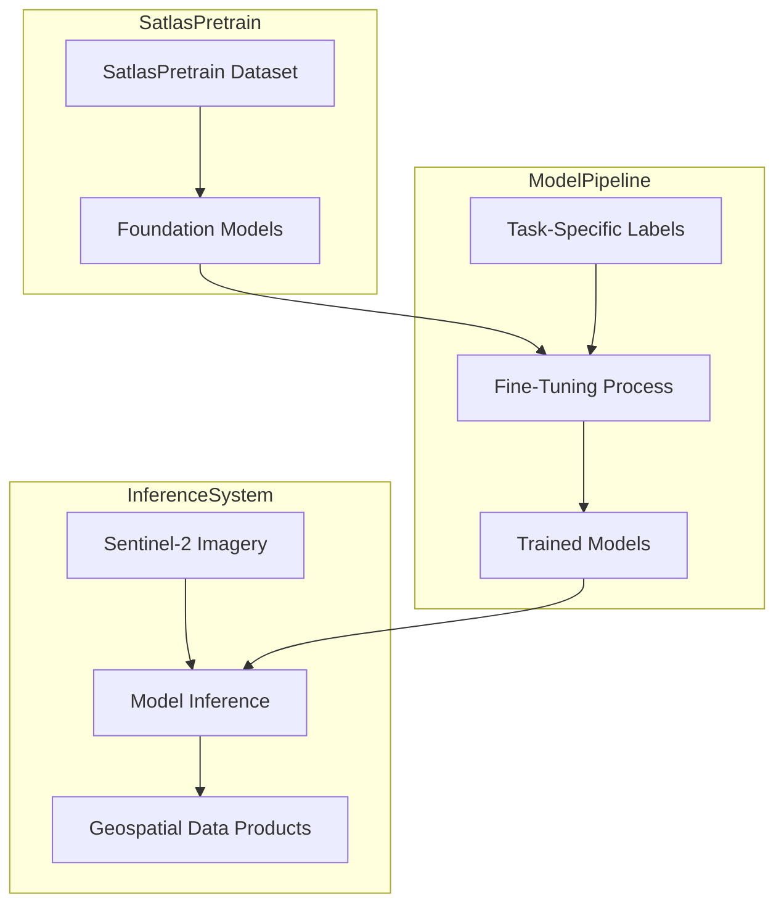
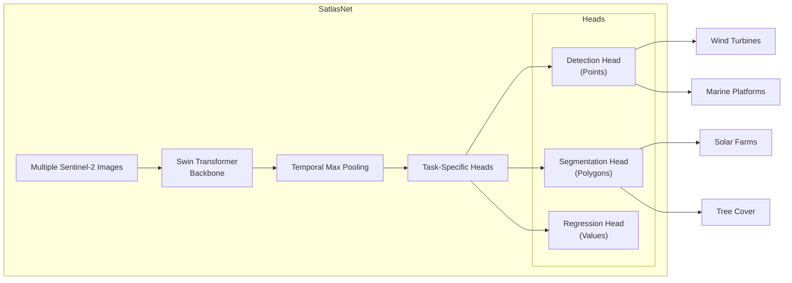
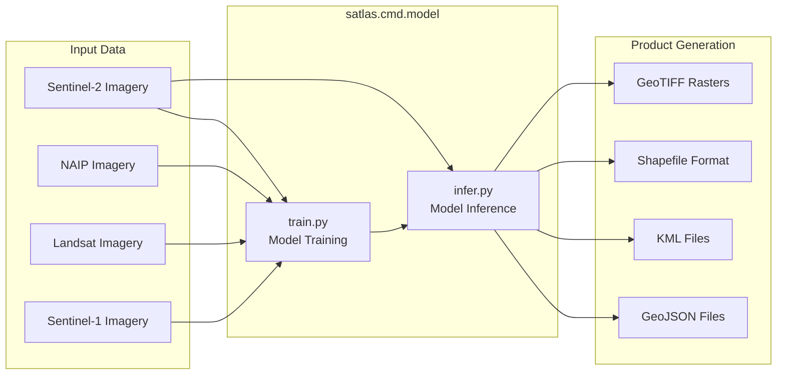

<!-- source: DeepWiki mcp.deepwiki.com · repo allenai/satlas · page 1 Overview · fetched 2026-10-26 -->

# Overview

Relevant source files

The following files were used as context for generating this wiki page:

- [OngoingProjects.md](OngoingProjects.md)
- [README.md](README.md)
- [satlaspretrain_urls.txt](satlaspretrain_urls.txt)
- [satlaspretrain_urls_small.txt](satlaspretrain_urls_small.txt)

## Purpose and Scope

This document provides an introduction to the Satlas repository, explaining its purpose, core components, and high-level architecture. Satlas is an open-source project developed by Allen AI that provides AI-generated geospatial data products and foundation models for satellite imagery analysis.

For detailed information about specific components, please refer to the corresponding wiki pages:
- For the SatlasPretrain dataset, see [SatlasPretrain Dataset](#2)
- For model architecture and implementation, see [Model System](#3)
- For geospatial data products, see [Geospatial Data Products](#4)
- For validation methodologies, see [Data Validation and Evaluation](#5)
- For developer resources, see [Developer Guide](#6)

Sources: [README.md:1-15]()

## What is Satlas?

Satlas aims to provide open AI-generated geospatial data that is highly accurate, available globally, and updated on a monthly basis. The AI-generated geospatial data in Satlas is computed by applying deep learning models on Sentinel-2 satellite imagery, which is open imagery released by the European Space Agency. While Sentinel-2 images are relatively low-resolution (10 m/pixel), they cover the bulk of Earth's land mass weekly, enabling frequent updates to geospatial data products.

Current capabilities include:
- Foundation models pre-trained on a large-scale remote sensing dataset
- Detection of renewable energy infrastructure (wind turbines, solar farms)
- Detection of marine infrastructure (offshore platforms)
- Tree cover analysis
- Super-resolution imagery processing

Sources: [README.md:16-22](), [README.md:66-72](), [OngoingProjects.md:24-31]()

## System Architecture Overview

**Satlas System Architecture Diagram**

The Satlas system follows a multi-stage process:
1. **Pre-training**: Foundation models are pre-trained on the comprehensive SatlasPretrain dataset
2. **Fine-tuning**: Models are fine-tuned on task-specific datasets (renewable energy, marine infrastructure, etc.)
3. **Inference**: Fine-tuned models are applied to current Sentinel-2 imagery
4. **Distribution**: Resulting geospatial data products are validated and distributed

Sources: [README.md:24-40](), [README.md:78-100]()

## Core Components

### SatlasPretrain Dataset

The SatlasPretrain dataset is a large-scale remote sensing image understanding dataset containing 302 million labels across 137 categories. It integrates multiple satellite imagery sources:
- Sentinel-2 (low-resolution mode)
- NAIP (high-resolution mode)
- Landsat
- Sentinel-1

The dataset structure includes both static labels (slow-changing features) and dynamic labels (time-specific features).

Sources: [README.md:34-41](), [satlaspretrain_urls.txt:1-18]()

### Model Architecture

**SatlasNet Architecture and Task Outputs**

The models are trained to make predictions from multiple Sentinel-2 images using a multi-stage architecture:
1. Extract features from each image independently through a Swin Transformer backbone
2. Apply temporal max pooling on corresponding feature maps at multiple resolutions
3. Pass the pooled feature maps to task-specific heads for different prediction types

Sources: [README.md:58-63]()

### Development Process

Satlas models are developed in four phases:
1. **Pre-training**: Train foundational models on the SatlasPretrain dataset
2. **Annotation**: Create high-quality task-specific training labels
3. **Fine-tuning**: Fine-tune models on task-specific labels
4. **Validation**: Test models globally and iterate on training data

This iterative process ensures the models achieve high accuracy across diverse geographical regions.

Sources: [README.md:24-33]()

## Data Flow Pipeline

**End-to-End Data Processing Pipeline**

The data flow begins with satellite imagery from various sources, which is processed through the training and inference pipeline to generate geospatial data products in multiple formats:
- Training: `python -m satlas.cmd.model.train --config_path configs/satlas_explorer_*.txt`
- Inference: `python -m satlas.cmd.model.infer --config_path configs/satlas_explorer_*.txt`

Sources: [README.md:78-100]()

## Current Geospatial Data Products

Satlas currently offers several AI-generated geospatial data products:

| Data Product | Description | Format | Update Frequency |
|--------------|-------------|--------|------------------|
| Renewable Energy Infrastructure | Wind turbines and solar farms | GeoJSON, KML, Shapefile | Monthly |
| Marine Infrastructure | Offshore platforms and structures | GeoJSON, KML, Shapefile | Monthly |
| Tree Cover | Forest and tree density | GeoTIFF | Monthly |
| Super-Resolution | Enhanced Sentinel-2 imagery | GeoTIFF | Varies |

All data products are available for download and offline analysis, with updates published monthly based on recent Sentinel-2 imagery.

Sources: [README.md:66-72](), [OngoingProjects.md:24-31]()

## Repository Structure

The repository is organized into several key components:

- **Configuration files**: Located in `configs/` directory, define model parameters and training settings
- **Training module**: Located in `satlas.cmd.model.train`, handles model training on datasets
- **Inference module**: Located in `satlas.cmd.model.infer`, handles applying models to new imagery
- **Model architecture**: Defines the SatlasNet architecture with Swin Transformer backbone
- **Utility functions**: Support for data loading, coordinate transformations, and visualization

The repository also includes documentation for accessing the SatlasPretrain dataset, downloading model weights, and obtaining pre-computed geospatial data products.

Sources: [README.md:78-104]()

## Ongoing Development

The Satlas team actively develops new capabilities and improves existing ones. Recent and upcoming developments include:

- Improved ease-of-use for SatlasPretrain foundation models
- Data updates through 2024
- Offshore platform classification
- Enhanced super-resolution
- Land cover monitoring and change detection
- Forest loss cause classification

For the latest updates on ongoing projects, see the [Ongoing Projects page](https://github.com/allenai/satlas/blob/main/OngoingProjects.md).

Sources: [OngoingProjects.md:6-66]()

---

