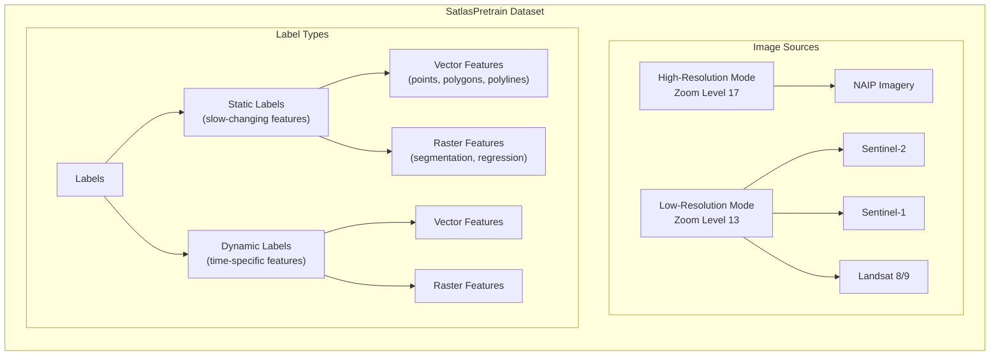
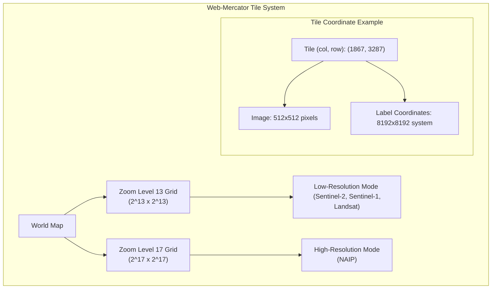
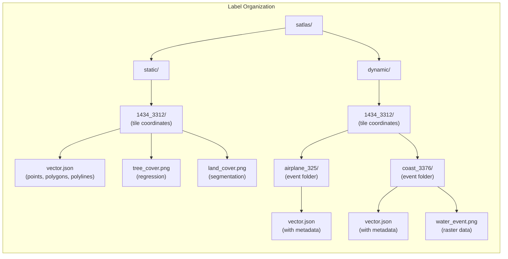
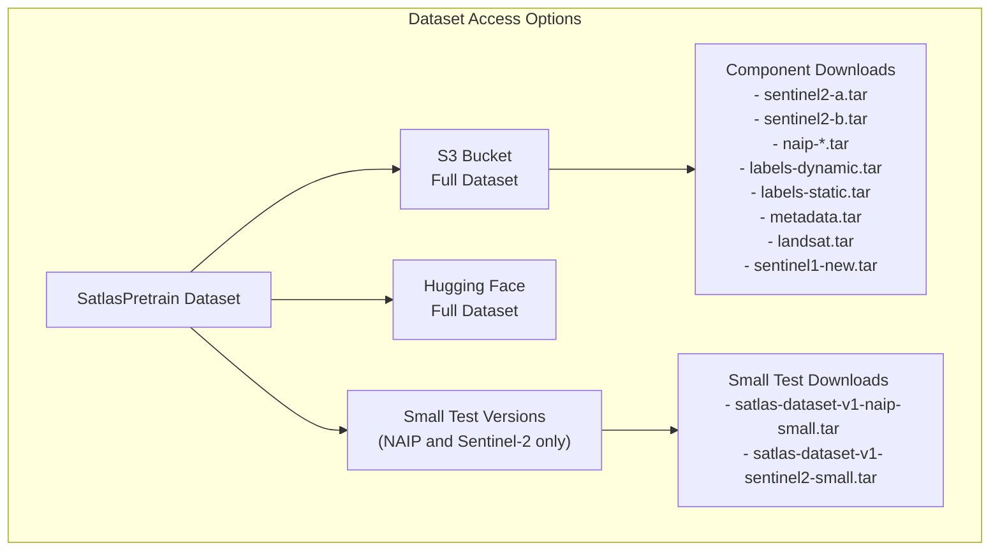
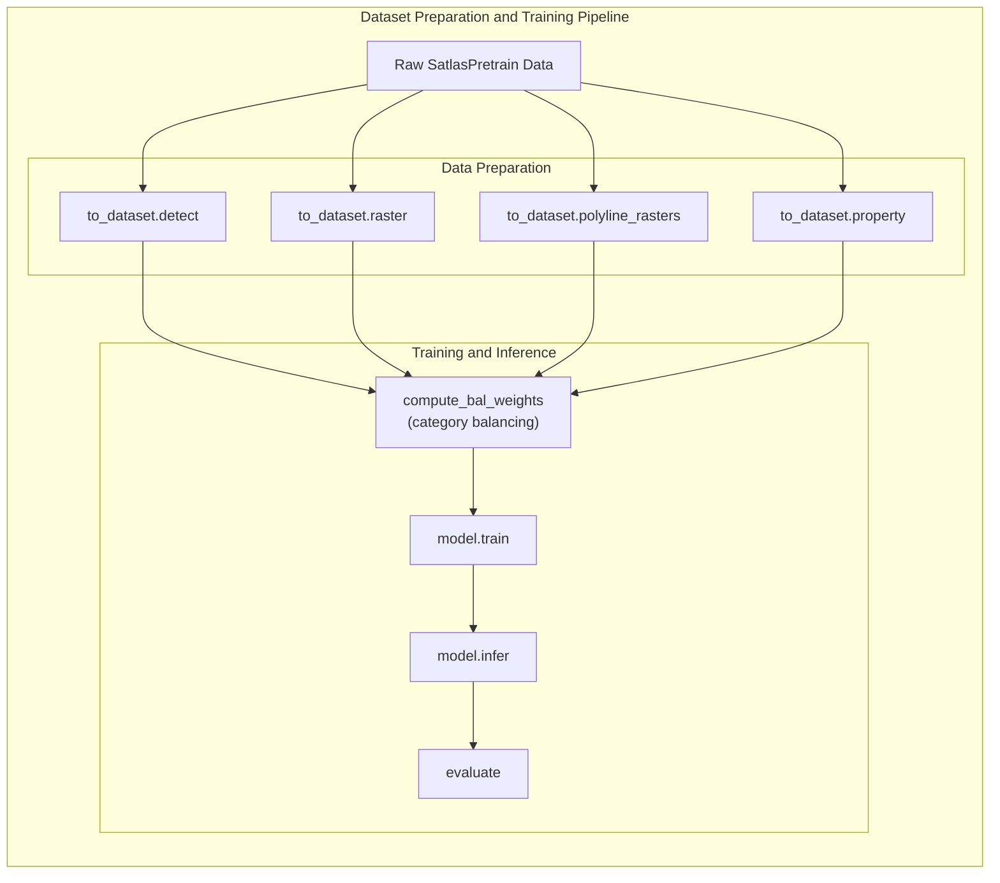

<!-- source: DeepWiki mcp.deepwiki.com · repo allenai/satlas · page 2 SatlasPretrain Dataset · fetched 2026-10-26 -->

# SatlasPretrain Dataset

<details>
<summary>Relevant source files</summary>

The following files were used as context for generating this wiki page:

- [OngoingProjects.md](OngoingProjects.md)
- [SatlasPretrain.md](SatlasPretrain.md)
- [satlaspretrain_urls.txt](satlaspretrain_urls.txt)
- [satlaspretrain_urls_small.txt](satlaspretrain_urls_small.txt)

</details>


## Purpose and Scope

The SatlasPretrain dataset is a large-scale pre-training dataset for remote sensing image understanding created by Allen AI. This document describes the dataset's structure, content, and access methods. SatlasPretrain forms the foundation of the Satlas system, providing the data used to train the foundation models that power various geospatial data products.

The dataset consists of 302 million labels across 137 categories and seven label types (points, polygons, polylines, properties, segmentation labels, regression labels, and classification labels). Pre-training on SatlasPretrain increases average performance on downstream tasks by 18% over ImageNet and 6% over DOTA and iSAID.

For information about the model architecture that utilizes this dataset, see [Model System](#3).

Sources: [SatlasPretrain.md:6-10]()

## Dataset Organization and Structure

SatlasPretrain is organized into two main resolution modes with different images and coordinate systems, but sharing the same label categories and types.



The dataset is divided into train and test splits for each resolution mode. The splits are defined by JSON files that contain lists of (col, row) tile coordinates:
- satlas/metadata/train_lowres.json
- satlas/metadata/test_lowres.json
- satlas/metadata/train_highres.json
- satlas/metadata/test_highres.json
- satlas/metadata/train_event.json 
- satlas/metadata/test_event.json

Dynamic labels (which represent time-varying phenomena) use the "_event" splits while static labels use the regular splits.

Sources: [SatlasPretrain.md:56-67](), [SatlasPretrain.md:128-130]()

### Tile System

All data in SatlasPretrain is projected to the Web-Mercator projection and organized into a global tile grid:



- Low-resolution images are stored at zoom level 13, with the world divided into a grid of 2^13 × 2^13 tiles
- High-resolution images (NAIP) are stored at zoom level 17 to maintain 512×512 pixel image size
- Within each tile, an 8192×8192 coordinate system is used for label geometries
- Tile coordinates can be converted to geographic coordinates (longitude, latitude) using utility functions

Sources: [SatlasPretrain.md:70-74](), [SatlasPretrain.md:119-123]()

## Images

The dataset contains satellite and aerial imagery from multiple sources:

| Image Source | Resolution Mode | Directory | Bands |
|--------------|-----------------|-----------|-------|
| Sentinel-2 | Low-resolution | satlas/sentinel2/ | tci (RGB), b01-b12 (various spectral bands) |
| Sentinel-1 | Low-resolution | satlas/sentinel1/ | SAR bands |
| Landsat 8/9 | Low-resolution | satlas/landsat/ | Various spectral bands |
| NAIP | High-resolution | satlas/naip/ | tci (RGB), ir (near-infrared) |

The imagery is organized with the following directory structure:

```
satlas/sentinel2/
    S2A_MSIL1C_20160808T181452_N0204_R041_T12SVC_20160808T181447/
        tci/
            1867_3287.png
            1867_3288.png
            ...
        b05/
        b06/
        ...
    S2B_MSIL1C_20221230T180749_N0509_R041_T13UCR_20221230T195817/
        ...
    ...
satlas/naip/
    m_2508008_nw_17_1_20151013/
        tci/
            36368_55726.png
            ...
        ir/
            36368_55726.png
            ...
    ...
```

Each image is stored as a collection of 512×512 PNG files, organized by band and tile coordinates. The tci (true-color image) folder contains standard RGB imagery, while other folders contain additional spectral bands.

Sources: [SatlasPretrain.md:78-116]()

## Labels

SatlasPretrain contains two categories of labels:

1. **Static labels** - Representing slow-changing features that should correspond to the most recent image at each tile
2. **Dynamic labels** - Time-specific features that reference a particular image/timestamp



The directory structure for labels is organized by tile coordinates and then by label type:

```
satlas/static/
    1434_3312/
        vector.json
        tree_cover.png
        land_cover.png
    1434_3313/
    ...
satlas/dynamic/
    1434_3312/
        airplane_325/
            vector.json
        coast_3376/
            vector.json
            water_event.png
        ...
    ...
```

Dynamic labels include metadata specifying the corresponding source image and timestamp:

```json
{
    "metadata": {
        "Start": "2014-08-04T23:59:59+00:00",
        "End": "2014-08-05T00:00:01+00:00",
        "ImageUUID": "996e6f0f4f3f42838211caf73c4692f2",
        "ImageName": "m_3211625_sw_11_1_20140805"
    },
    "airplane": [
        ...
    ]
}
```

Sources: [SatlasPretrain.md:130-167]()

### Label Types

SatlasPretrain includes seven types of labels:

1. **Points** - Single coordinate locations (e.g., airplane positions)
2. **Polygons** - Closed shapes with boundaries (e.g., building footprints)
3. **Polylines** - Connected line segments (e.g., roads, rivers)
4. **Properties** - Attributes associated with geometries (e.g., road type)
5. **Segmentation labels** - Pixel-wise classification (e.g., land cover)
6. **Regression labels** - Continuous values (e.g., tree cover percentage)
7. **Classification labels** - Whole-tile categorization

Vector features (points, polygons, polylines, properties, and classification) are stored in vector.json files with this structure:

```json
{
    "airplane": [{
        "Geometry": {
            "Type": "point",
            "Point": [454, 401]
        },
        "Properties": {}
    }],

    "power_plant": [{
        "Geometry": {
            "Type": "polygon",
            "Polygon": [[[6197, 6210], [6151, 6284], [6242, 6341], [6260, 6312], [6288, 6268], [6197, 6210]]]
        },
        "Properties": {"plant_type": "gas"}
    }],

    "road": [{
        "Geometry": {
            "Type": "polyline",
            "Polyline": [[7287, 789], [7281, 729], [7280, 716], [7277, 690], [7267, 581], [7256, 466], [7242, 312], [7206, -45], [7149, -628]]
        },
        "Properties": {"road_type": "residential"}
    }]
}
```

Segmentation and regression labels are stored as 512×512 PNG files with task-specific naming conventions (e.g., land_cover.png, tree_cover.png).

Sources: [SatlasPretrain.md:6-8](), [SatlasPretrain.md:169-231]()

## Accessing the Dataset

The SatlasPretrain dataset can be downloaded from:

1. **S3 bucket** - URLs provided in satlaspretrain_urls.txt
2. **Hugging Face** - Available at huggingface.co/allenai/satlas-pretrain/tree/main/dataset

The complete dataset is large, but small versions of the NAIP and Sentinel-2 images are available for testing purposes.



Sources: [SatlasPretrain.md:32-41](), [satlaspretrain_urls.txt:1-18](), [satlaspretrain_urls_small.txt:1-6](), [OngoingProjects.md:8]()

## Using the Dataset

To use SatlasPretrain for model training, the data must first be converted to a format compatible with the training pipeline:



The preparation process involves:

1. Converting raw data to task-specific formats using `satlas.cmd.to_dataset.*` scripts
2. Computing class-balancing weights with `satlas.cmd.model.compute_bal_weights`
3. Training models with `satlas.cmd.model.train`
4. Running inference with `satlas.cmd.model.infer`
5. Evaluating results with `satlas.cmd.evaluate`

### Converting Dataset Format

```bash
python -m satlas.cmd.to_dataset.detect --satlas_root satlas_root/ --out_path satlas_root/datasets/
python -m satlas.cmd.to_dataset.raster --satlas_root satlas_root/ --out_path satlas_root/datasets/
python -m satlas.cmd.to_dataset.polyline_rasters --dataset_root satlas_root/datasets/
python -m satlas.cmd.to_dataset.property --satlas_root satlas_root/ --out_path satlas_root/datasets/ --ids satlas_root/metadata/train_lowres_property_100k.json
```

### Computing Balance Weights

```bash
python -m satlas.cmd.model.compute_bal_weights --dataset_path satlas_root/datasets/highres/ --out_path satlas_root/bal_weights/highres.json
python -m satlas.cmd.model.compute_bal_weights --dataset_path satlas_root/datasets/lowres/ --out_path satlas_root/bal_weights/lowres.json
```

### Training Models

```bash
python -m torch.distributed.launch --nproc_per_node=8 --master_port 29500 -m satlas.cmd.model.train --config_path configs/aerial/swinb_si_pretrain.txt --world_size 8
```

### Running Inference and Evaluation

```bash
python -m satlas.cmd.model.infer --config_path configs/aerial/swinb_si_pretrain.txt --details
python -m satlas.cmd.evaluate --gt_path path/to/satlas/static/ --pred_path path/to/outputs/ --modality point --split path/to/satlas/metadata/test_highres.json --format static
```

Sources: [SatlasPretrain.md:279-323]()

## Foundation Models

Foundation models pre-trained on SatlasPretrain are available for download for each of these image modalities:

- Sentinel-2
- Sentinel-1
- Landsat 8/9
- 0.5 - 2 m/pixel aerial imagery

These models provide a starting point for fine-tuning on downstream applications. The models are released under the ODC-BY license.

The companion `satlaspretrain_models` package provides an easy way to download and initialize these models for fine-tuning.

Sources: [SatlasPretrain.md:13-27](), [OngoingProjects.md:14-20]()

## Data Sources and Licensing

SatlasPretrain includes images and labels from multiple sources:

| Data Source | License |
|-------------|---------|
| Sentinel-1, Sentinel-2 (ESA) | Copernicus Sentinel Data License |
| NAIP (USGS) | Public domain |
| OpenStreetMap | ODbL |
| C2S | CC-BY-4.0 |
| Microsoft Buildings | ODbL |
| WorldCover | CC-BY-4.0 |
| NOAA Lidar Scans | Public domain |
| New annotation for SatlasPretrain | ODC-BY |

For a complete breakdown of sources, see the supplementary material for the paper.

Sources: [SatlasPretrain.md:43-53]()

---

