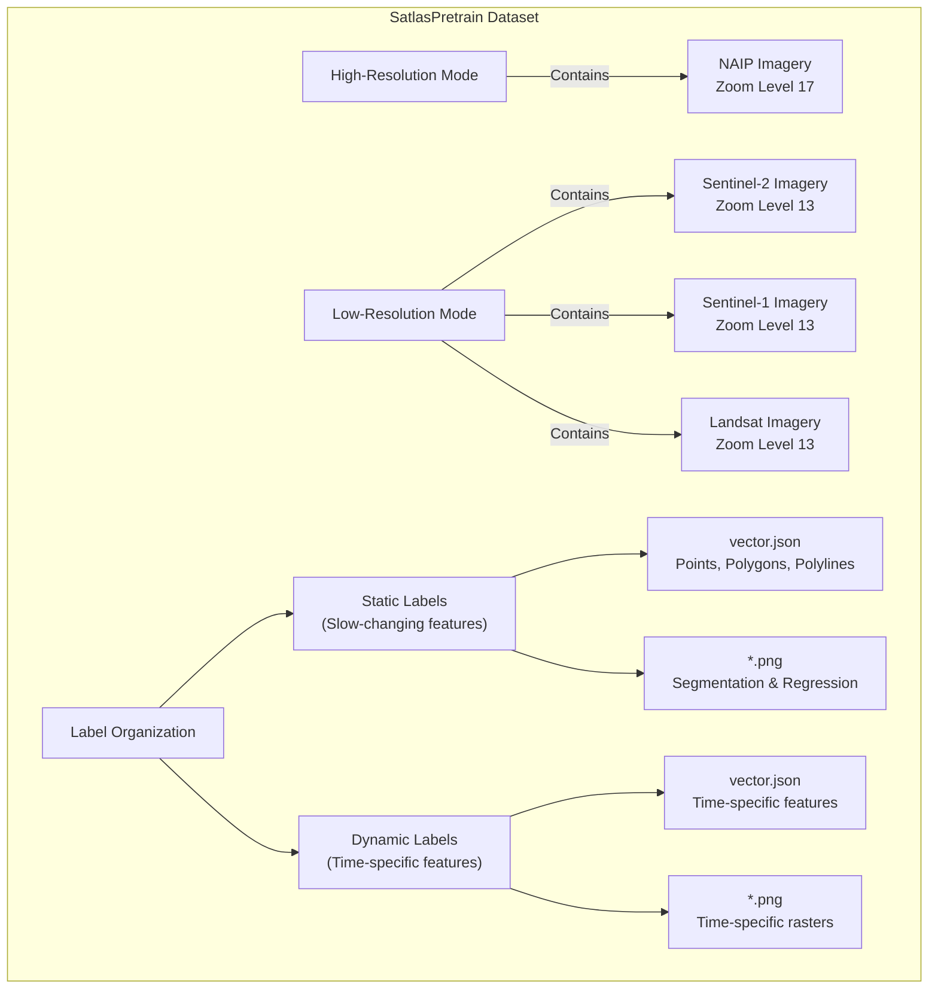
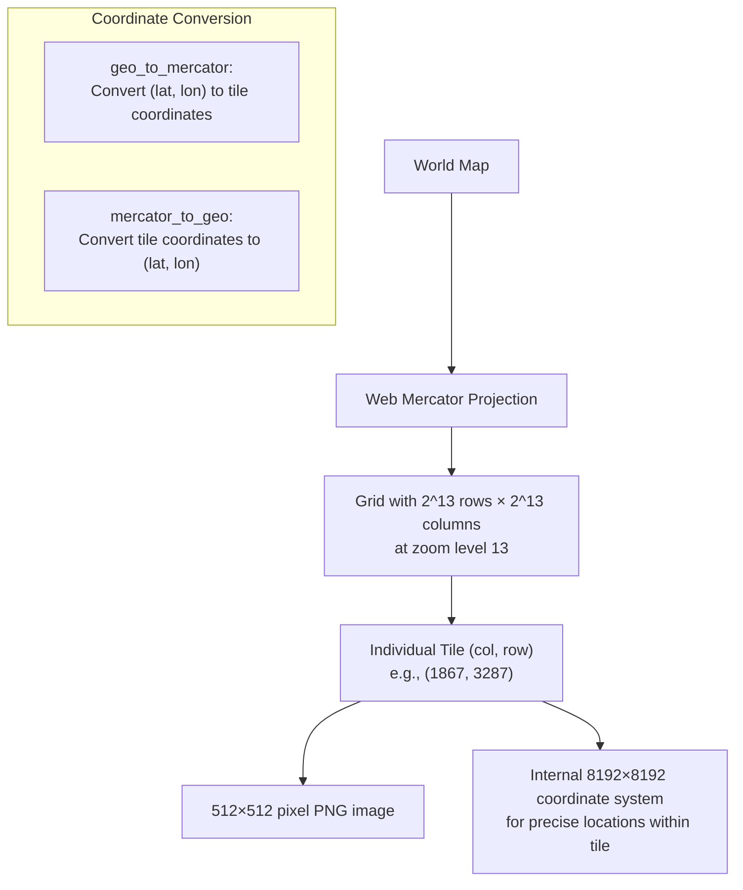
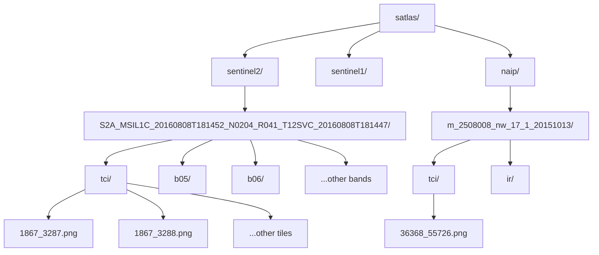
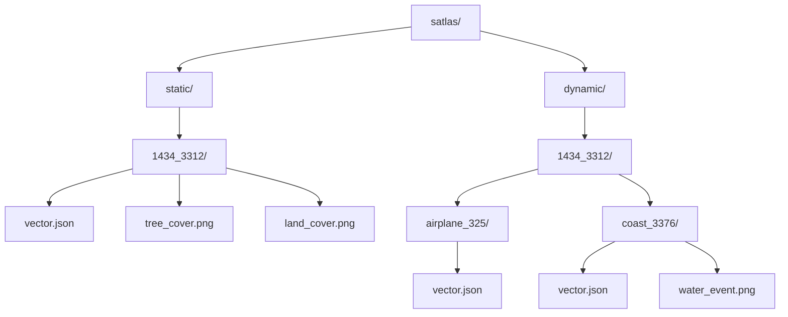
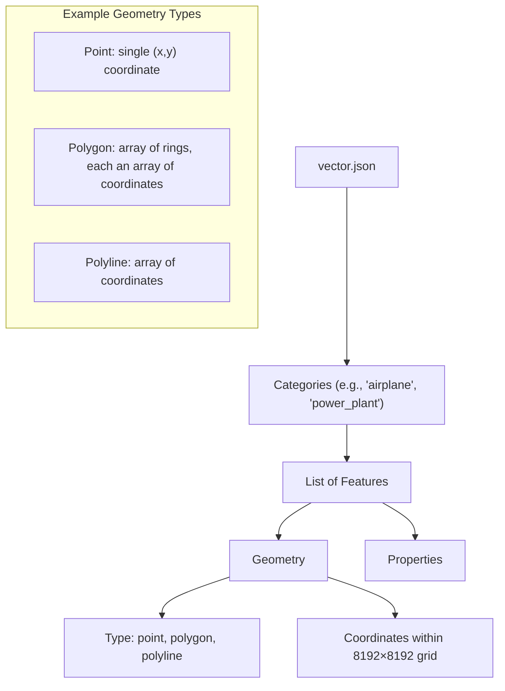

<!-- source: DeepWiki mcp.deepwiki.com · repo allenai/satlas · page 2.1 Dataset Structure · fetched 2026-10-26 -->

# Dataset Structure

<details>
<summary>Relevant source files</summary>

The following files were used as context for generating this wiki page:

- [DataLicense](DataLicense)
- [DatasetSpec.md](DatasetSpec.md)
- [SatlasPretrain.md](SatlasPretrain.md)

</details>


## Purpose and Overview

This document details the organization and structure of the SatlasPretrain dataset, explaining how data is arranged into different resolution modes, the tile system used, and the file formats for images and labels. For information about the specific label types and tasks covered by the dataset, see [Labels and Tasks](#2.2).

SatlasPretrain is a large-scale remote sensing dataset containing 302 million labels across 137 categories. The dataset is designed to provide a comprehensive foundation for training and evaluating machine learning models for satellite imagery analysis.

## Dataset Organization

SatlasPretrain is organized into two primary modes based on resolution:

1. **High-Resolution Mode**: Uses NAIP (National Agriculture Imagery Program) imagery at zoom level 17
2. **Low-Resolution Mode**: Uses Sentinel-2, Sentinel-1, and Landsat imagery at zoom level 13

Both modes share a common labeling structure but differ in their image sources and resolution.



Sources: [SatlasPretrain.md:56-152]()

## Train and Test Splits

Each image mode (high-resolution and low-resolution) has its own train and test split. The splits are defined in JSON files that contain lists of (col, row) pairs which identify specific tiles:

- `satlas/metadata/train_lowres.json`
- `satlas/metadata/test_lowres.json`
- `satlas/metadata/train_highres.json`
- `satlas/metadata/test_highres.json`

Dynamic labels (time-specific features) have separate split files:

- `satlas/metadata/train_event.json`
- `satlas/metadata/test_event.json`

Sources: [SatlasPretrain.md:56-68]()

## Tile System

The SatlasPretrain dataset uses the Web Mercator projection to organize all its data in a grid-based tile system.



Sources: [SatlasPretrain.md:70-76](), [SatlasPretrain.md:119-125]()

### Key Aspects of the Tile System

1. **Projection**: All images and labels are projected to Web Mercator
2. **Resolution Levels**:
   - Low-resolution mode: Zoom level 13
   - High-resolution mode: Zoom level 17
3. **Tile Size**: Each image tile is 512×512 pixels
4. **Intra-Tile Coordinates**: An 8192×8192 coordinate system is used within each tile for precise positioning of features

The `satlas.util` module provides functions to convert between geographic coordinates (latitude, longitude) and tile coordinates:

```python
import satlas.util
# Convert tile coordinates to geographic coordinates (latitude, longitude)
satlas.util.mercator_to_geo((1867, 3287), pixels=1, zoom=13)

# For coordinates within a tile
tile = (1234, 5678)
point = (454, 401)
satlas.util.mercator_to_geo(
    (tile[0]*8192 + point[0], tile[1]*8192 + point[1]), 
    pixels=8192, 
    zoom=13
)
```

Sources: [SatlasPretrain.md:70-76](), [SatlasPretrain.md:119-125](), [SatlasPretrain.md:208-213]()

## Image Directory Structure

Images are organized by their source and type in the following directory structure:



Sources: [SatlasPretrain.md:77-108]()

### Image Organization Details

1. **Sentinel-2 and Sentinel-1 (Low-Resolution)**:
   - Located in `satlas/sentinel2/` and `satlas/sentinel1/`
   - Each source image has its own directory named by the image ID
   - Within each image directory, subdirectories contain different bands:
     - `tci/`: True-color image (RGB)
     - Other band directories like `b05/`, `b06/`, etc. for Sentinel-2
   - Each PNG file is named by its column and row in the tile grid, e.g., `1867_3287.png`

2. **NAIP (High-Resolution)**:
   - Located in `satlas/naip/`
   - Stored at zoom level 17 instead of 13
   - Similar organization with image ID directories
   - Contains bands like `tci/` (true color) and `ir/` (infrared)

Sources: [SatlasPretrain.md:77-108]()

## Label Directory Structure

Labels are organized into static (slow-changing) and dynamic (time-specific) categories:



Sources: [SatlasPretrain.md:127-149]()

### Label Organization Details

1. **Static Labels** (`satlas/static/`):
   - Represent slow-changing features that generally correspond to the most recent image
   - Organized by tile coordinates, e.g., `1434_3312/`
   - Each tile directory contains:
     - `vector.json`: Contains point, polygon, polyline, and classification labels
     - Additional PNG files for segmentation and regression tasks (e.g., `tree_cover.png`, `land_cover.png`)

2. **Dynamic Labels** (`satlas/dynamic/`):
   - Represent time-specific features that reference a specific image/time
   - First organized by tile coordinates, then by category and an identifier
   - Example: `dynamic/1434_3312/airplane_325/`
   - Each category directory contains:
     - `vector.json`: Contains feature labels with metadata linking to a specific image
     - Optional PNG files for time-specific raster data (e.g., `water_event.png`)

Sources: [SatlasPretrain.md:127-149]()

## Label Data Formats

The dataset uses two primary formats for labels:

1. **Vector JSON Format** (`vector.json`): Used for geometric features
2. **Raster PNG Format** (various `.png` files): Used for segmentation and regression tasks

### Vector JSON Structure

The `vector.json` files contain structured data for points, polygons, polylines, properties, and classification labels. Here's the general structure:



Sample structure for dynamic labels:

```json
{
    "metadata": {
        "Start": "2014-08-04T23:59:59+00:00",
        "End": "2014-08-05T00:00:01+00:00",
        "ImageUUID": "996e6f0f4f3f42838211caf73c4692f2",
        "ImageName": "m_3211625_sw_11_1_20140805"
    },
    "airplane": [
        {
            "Geometry": {
                "Type": "point",
                "Point": [454, 401]
            },
            "Properties": {}
        }
    ]
}
```

Sources: [SatlasPretrain.md:150-204]()

### Raster PNG Format

For segmentation and regression tasks, labels are stored as 512×512 pixel grayscale PNG images:

| Task Type | Filename Example | Pixel Value Interpretation |
|-----------|------------------|----------------------------|
| Regression | `tree_cover.png` | Proportional to quantity (e.g., 0-200 for tree cover) |
| Segmentation | `land_cover.png` | Pixel value indicates class ID (0 = invalid, 1+ = class) |
| Binary Segmentation | `water_event.png` | Bit flags (rightmost bit = first category) |

The meaning of each raster file is defined by its filename, and the tasks and categories are defined in `satlas/tasks.py`.

Sources: [SatlasPretrain.md:217-231]()

## Additional Metadata Files

The dataset includes several metadata files in the `satlas/metadata/` directory:

| Filename | Purpose |
|----------|---------|
| `train_highres.json`, `test_highres.json` | List of tiles in high-resolution train/test splits |
| `train_lowres.json`, `test_lowres.json` | List of tiles in low-resolution train/test splits |
| `train_event.json`, `test_event.json` | List of tiles for dynamic event train/test splits |
| `image_times.json` | Timestamps for each image based on its name |
| `test_highres_property.json`, `test_lowres_property.json` | Subsets for evaluating properties |
| `good_images_X.json` | Lists of images with few cloudy or missing pixels |

Sources: [SatlasPretrain.md:239-247]()

## Usage Guidelines for Prediction Tasks

The dataset includes specific guidelines on what data can be used for different prediction tasks:

### For Non-Property Labels

When predicting non-property labels, models may use:
- Tile position (e.g., `1434_3312`)
- Image name (from `vector.json`)
- The subset of categories annotated in the label folder (only for optimizing inference)
- Label folder name (only for creating identically named output folders)

### For Property and Classification Labels

When predicting property and classification labels, models may additionally use:
- The entirety of `vector.json` except the property values themselves
- This allows using the coordinates of points, polygons, and polylines to inform property prediction

Sources: [SatlasPretrain.md:249-266]()

## Evaluation Format

For evaluation, predictions should mirror the organization of the ground truth labels:

- For each label folder like `static/1434_3312/` or `dynamic/1434_3312/airplane_325/`, a corresponding output folder should be created
- The evaluation command uses the `satlas.cmd.evaluate` module with appropriate parameters for different label types

Example evaluation command:
```bash
python -m satlas.cmd.evaluate --gt_path path/to/satlas/static/ --pred_path path/to/outputs/ --modality point --split path/to/satlas/metadata/test_highres.json --format static
```

Sources: [SatlasPretrain.md:269-277]()

---

