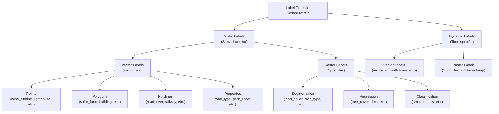
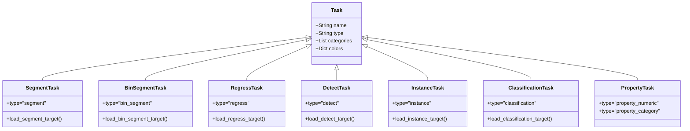
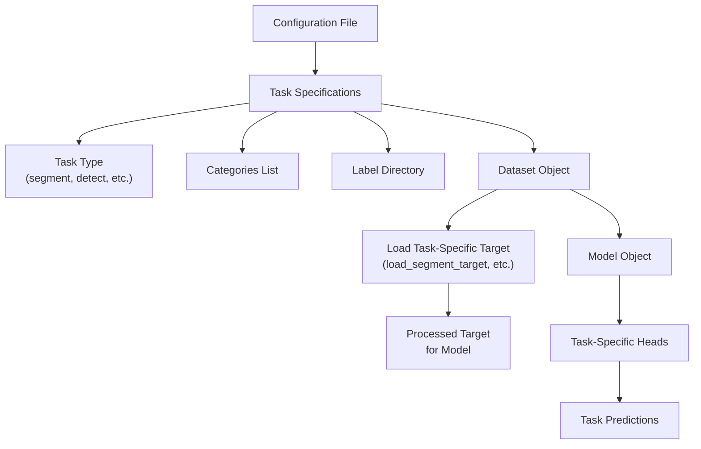

<!-- source: DeepWiki mcp.deepwiki.com · repo allenai/satlas · page 2.2 Labels and Tasks · fetched 2026-10-26 -->

# Labels and Tasks

<details>
<summary>Relevant source files</summary>

The following files were used as context for generating this wiki page:

- [SatlasPretrain.md](SatlasPretrain.md)
- [requirements.txt](requirements.txt)
- [satlas/cmd/vis.py](satlas/cmd/vis.py)
- [satlas/model/classify.py](satlas/model/classify.py)
- [satlas/model/dataset.py](satlas/model/dataset.py)
- [satlas/model/models.py](satlas/model/models.py)
- [satlas/tasks.py](satlas/tasks.py)

</details>


This page documents the labels available in the SatlasPretrain dataset and their corresponding tasks. It explains the different label types, formats, and how they are organized in the dataset. For information about the overall dataset structure, see [Dataset Structure](#2.1).

## Label Types Overview

The SatlasPretrain dataset contains 302 million labels across 137 categories with seven distinct label types:

1. **Points** - Single coordinate locations (e.g., wind turbines, lighthouses)
2. **Polygons** - Closed shapes with vertices (e.g., buildings, parks, airports)
3. **Polylines** - Connected line segments (e.g., roads, rivers, railways)
4. **Properties** - Attributes associated with geometric features
5. **Segmentation** - Pixel-level categorical masks
6. **Regression** - Pixel-level continuous value maps
7. **Classification** - Tile-level categorical labels

These labels are divided into two major categories:
- **Static (slow-changing) labels** - Features that change infrequently over time
- **Dynamic (time-specific) labels** - Features associated with specific images/timestamps



Sources: [SatlasPretrain.md:7-8](), [SatlasPretrain.md:130-149]()

## Label Storage Format

### Vector Label Format (vector.json)

Points, polygons, polylines, and properties are stored in `vector.json` files. The file structure uses a JSON format where each category is a key, and the value is a list of features with their geometry and properties.

```
{
    "category1": [
        {
            "Geometry": {
                "Type": "point|polygon|polyline",
                "Point|Polygon|Polyline": [coordinates]
            },
            "Properties": {
                "property1": value1,
                "property2": value2
            }
        },
        ...
    ],
    "category2": [
        ...
    ]
}
```

For example, a `vector.json` file might contain entries for airplanes (points), power plants (polygons), and roads (polylines):

```
{
    "airplane": [{
        "Geometry": {
            "Type": "point",
            "Point": [454, 401]
        },
        "Properties": {}
    }],
    
    "power_plant": [{
        "Geometry": {
            "Type": "polygon",
            "Polygon": [[[6197, 6210], [6151, 6284], [6242, 6341], [6260, 6312], [6288, 6268], [6197, 6210]]]
        },
        "Properties": {"plant_type": "gas"}
    }],
    
    "road": [{
        "Geometry": {
            "Type": "polyline",
            "Polyline": [[7287, 789], [7281, 729], [7280, 716], [7277, 690], [7267, 581], [7256, 466], [7242, 312], [7206, -45], [7149, -628]]
        },
        "Properties": {"road_type": "residential"}
    }]
}
```

For dynamic labels, the `vector.json` files include metadata specifying the timestamp and corresponding image:

```
{
    "metadata": {
        "Start": "2014-08-04T23:59:59+00:00",
        "End": "2014-08-05T00:00:01+00:00",
        "ImageUUID": "996e6f0f4f3f42838211caf73c4692f2",
        "ImageName": "m_3211625_sw_11_1_20140805"
    },
    "category1": [
        ...
    ]
}
```

### Raster Label Format (PNG files)

Segmentation, regression, and classification tasks use PNG files to represent their labels:

1. **Segmentation Labels**: Each pixel value corresponds to a category index (e.g., 1 for water, 2 for developed, etc.)
2. **Binary Segmentation Labels**: Each bit in the pixel value corresponds to a boolean flag for a category
3. **Regression Labels**: Pixel values are proportional to the quantity (e.g., 0-200 for tree cover percentage)

Sources: [SatlasPretrain.md:170-231](), [satlas/model/dataset.py:372-452]()

## Task Types

The SatlasPretrain dataset supports seven primary task types, each with its own data format and processing approach:



Sources: [satlas/model/dataset.py:333-371](), [satlas/tasks.py:1-241]()

### 1. Segmentation (`segment`)

Pixel-level classification where each pixel belongs to a single category. Used for tasks like land cover classification.

Example tasks:
- `land_cover`: Classify each pixel as water, developed, tree, etc.
- `crop_type`: Identify different crop types in agricultural areas
- `water_event`: Detect water events like flooding

### 2. Binary Segmentation (`bin_segment`)

Multi-label segmentation where each pixel can belong to multiple categories. Each bit in the pixel value represents a different category.

Example tasks:
- `polyline_bin_segment`: Identify multiple linear features (roads, rivers, railways)
- `wildfire`: Detect fire retardant areas and burned areas
- `cloud`: Identify clouds and their shadows

### 3. Regression (`regress`)

Pixel-level prediction of continuous values.

Example tasks:
- `tree_cover`: Percentage of tree cover (0-200 scale)
- `dem`: Digital elevation model (height information)

### 4. Detection (`detect`)

Identify and localize objects with bounding boxes.

Example tasks:
- `point`: Detect point objects like wind turbines, lighthouses
- `airplane`: Detect airplanes
- `vessel`: Detect vessels in water bodies

### 5. Instance Segmentation (`instance`)

Pixel-level masks for individual object instances.

Example tasks:
- `polygon`: Identify individual instances of areas like solar farms, parks
- `building`: Identify individual building footprints

### 6. Classification (`classify`)

Image-level labels for an entire tile.

Example tasks:
- `smoke`: Determine if an image contains smoke (no/partial/yes)
- `snow`: Determine if an image contains snow (no/partial/yes)

### 7. Property Prediction

Predicting attributes of geometric features:
- `property_numeric`: Numerical properties (e.g., road lanes, turbine diameter)
- `property_category`: Categorical properties (e.g., road type, park sport)

Sources: [satlas/model/dataset.py:95-331](), [satlas/tasks.py:22-241]()

## Task Categories

The SatlasPretrain dataset covers 137 categories distributed across different task types. The main category groups include:

| Task Type | Example Categories |
|-----------|-------------------|
| Point | wind_turbine, lighthouse, offshore_platform, helipad, chimney |
| Polygon | solar_farm, power_plant, airport, stadium, parking_lot |
| Polyline | road, river, railway, airport_runway, raceway |
| Land Cover | water, developed, tree, grass, crop, bare, snow |
| Crop Type | rice, grape, corn, sugarcane, wheat, soy, potato |
| Property | road_type, park_sport, track_sport, power_plant_type |

The full list of categories is defined in the `satlas/model/dataset.py` and `satlas/tasks.py` files.

Sources: [satlas/model/dataset.py:16-331](), [satlas/tasks.py:2-241]()

## Code Implementation

The task and label systems are implemented primarily through the following components:



### Task Definitions

Tasks are defined in `satlas/tasks.py` and organized into groups:

1. `detect_tasks`: For point and polygon detection
2. `polyline_tasks`: For polyline features
3. `raster_tasks`: For segmentation and regression tasks
4. `property_tasks`: For properties and classification tasks

Each task definition includes:
- `name`: Task identifier
- `type`: Task type (point, polygon, segment, etc.)
- `categories`: List of categories for the task
- `image_type`: Type of imagery the task applies to (highres, lowres, all)

### Dataset Loading

The `Dataset` class in `satlas/model/dataset.py` handles loading and processing labels:

1. It takes a list of task specifications from a configuration file
2. For each task, it finds the relevant examples 
3. When accessing an example, it loads the corresponding images and labels
4. Labels are processed into a standardized format based on the task type

### Task-Specific Target Loading

Each task type has a specific loading function:

- `load_segment_target`: Loads segmentation masks
- `load_bin_segment_target`: Loads binary segmentation masks
- `load_regress_target`: Loads regression values
- `load_detect_target`: Loads detection boxes
- `load_instance_target`: Loads instance masks
- `load_classification_target`: Loads classification labels

These functions convert the raw label data (from JSON or PNG files) into PyTorch tensors suitable for model training.

Sources: [satlas/model/dataset.py:615-825](), [satlas/tasks.py:22-241]()

## Working with Labels and Tasks

### Visualizing Examples

The repository includes visualization utilities to help inspect labels:

```bash
python -m satlas.cmd.vis --path dataset_path/highres/polygon/ --task polygon --out_path ~/vis/
```

This generates visualizations of images and their corresponding labels for the specified task.

### Specifying Tasks in Model Configuration

To use specific tasks in model training, you specify them in the configuration file:

```
TaskSpecs:
- Name: land_cover
  Task: land_cover
  LabelDir: /path/to/datasets/lowres/
  TrainSplit: /path/to/metadata/train_lowres.json
  ValSplit: /path/to/metadata/val_lowres.json
  TestSplit: /path/to/metadata/test_lowres.json
```

This system allows for flexible combination of different tasks during model training and evaluation.

Sources: [satlas/cmd/vis.py:19-28](), [satlas/model/dataset.py:632-647]()

---

