<!-- source: DeepWiki mcp.deepwiki.com · repo allenai/satlas · page 3 Model System · fetched 2026-10-26 -->

# Model System

Relevant source files

The following files were used as context for generating this wiki page:

- [DataValidationReport.md](DataValidationReport.md)
- [ModelArchitecture.md](ModelArchitecture.md)
- [images/satlasnet.svg](images/satlasnet.svg)
- [requirements.txt](requirements.txt)
- [satlas/model/classify.py](satlas/model/classify.py)
- [satlas/model/dataset.py](satlas/model/dataset.py)
- [satlas/model/model.py](satlas/model/model.py)
- [satlas/model/models.py](satlas/model/models.py)
- [satlas/transforms/augment.py](satlas/transforms/augment.py)

This page provides an overview of the SatlasNet model system, its architecture, components, and how they work together to process satellite imagery for various tasks. For details on model training, see [Training Pipeline](#3.2), and for information about using trained models for inference, see [Inference Pipeline](#3.3).

## Overview

The Model System in Satlas is built around SatlasNet, a flexible neural network architecture designed specifically for satellite imagery analysis. The system provides a modular framework where different components can be combined to create models for various geospatial tasks, such as object detection, segmentation, and regression.

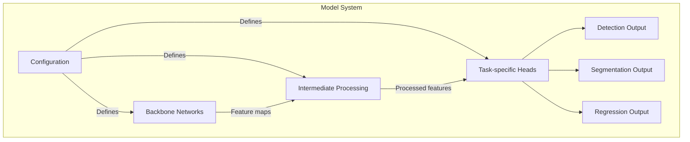

Sources: [satlas/model/model.py:1-26](). [satlas/model/models.py:1-9]().

## Key Components

The SatlasNet model architecture consists of three main component types:

1. **Backbone** - Extracts feature maps from input images at different resolutions
2. **Intermediates** - Process feature maps from the backbone (optional)
3. **Heads** - Task-specific components that produce the final outputs

These components are configured through a configuration system that allows for flexible model creation.

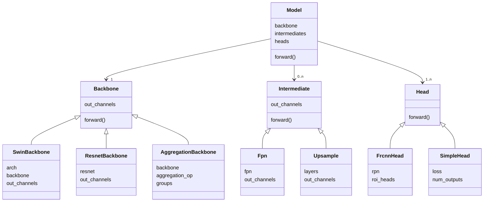

Sources: [satlas/model/model.py:27-31](). [ModelArchitecture.md:1-23]().

## Model Architecture

The Model System uses a flexible architecture that processes satellite imagery through several stages:

1. Multiple aligned images are input to a backbone network
2. Features are extracted at different resolutions
3. Intermediate layers can process and refine these features
4. Task-specific heads produce various outputs for different purposes

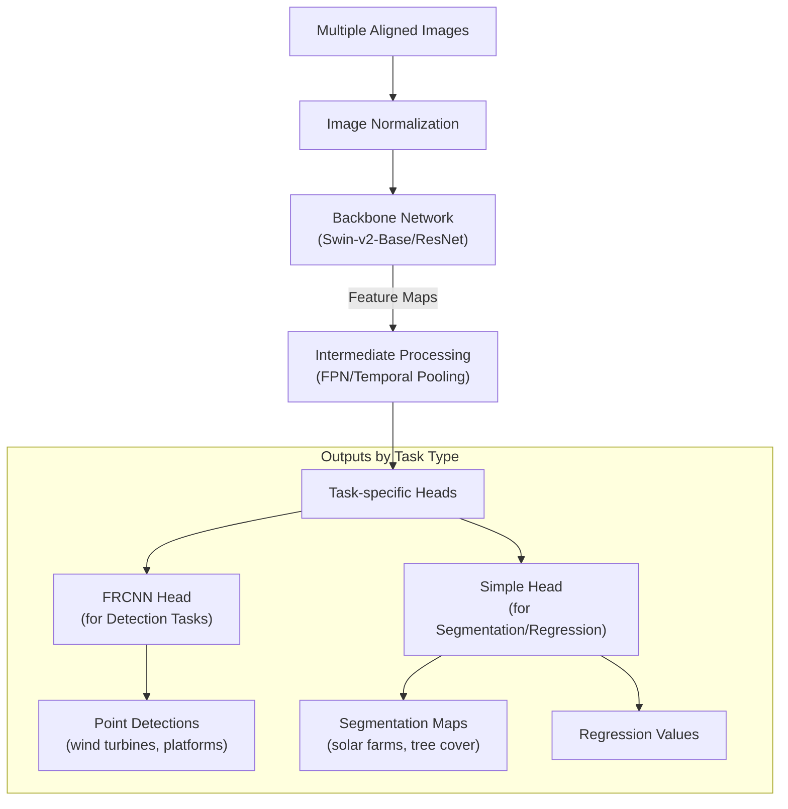

Sources: [satlas/model/model.py:10-26](). [ModelArchitecture.md:1-16]().

## Backbone Networks

The backbone is responsible for extracting features from input images. Satlas supports several backbone architectures:

### Swin Transformer Backbone

The Swin Transformer backbone is the default backbone used in SatlasNet. It's a hierarchical vision transformer that uses shifted windows to process images efficiently.

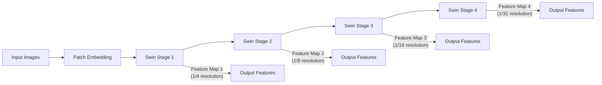

Sources: [satlas/model/model.py:32-118](). [ModelArchitecture.md:2-11]().

### ResNet Backbone

The ResNet backbone provides an alternative feature extraction approach using residual connections.

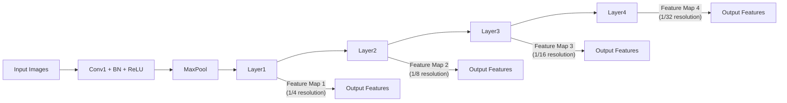

Sources: [satlas/model/model.py:120-191]().

### Aggregation Backbone

The Aggregation Backbone is a special backbone that processes multiple aligned images and combines their features using various operations (max pooling, mean, convolutional RNN, etc.).

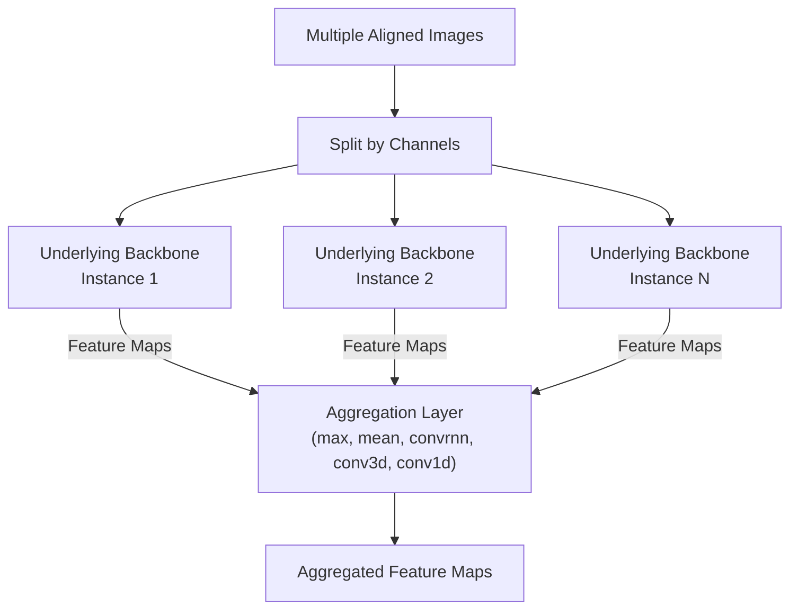

Sources: [satlas/model/model.py:193-322]().

## Intermediate Processing

Intermediates are optional components that process feature maps from the backbone before they're sent to the heads.

### Feature Pyramid Network (FPN)

The FPN combines high-level semantically strong features with low-level spatially accurate features to improve performance on tasks requiring multi-scale predictions.

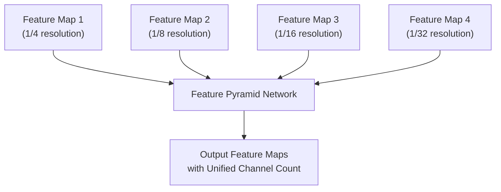

Sources: [satlas/model/model.py:324-348](). [ModelArchitecture.md:12]().

### Upsample

The Upsample intermediate creates a feature map at the input resolution, which can be useful for high-resolution tasks like segmentation.

Sources: [satlas/model/model.py:350-425]().

## Task-Specific Heads

The heads are responsible for transforming feature maps into task-specific outputs.

### Faster R-CNN Head (Detection Tasks)

Used for object detection tasks like identifying wind turbines or offshore platforms. It consists of a Region Proposal Network (RPN) and ROI Heads.

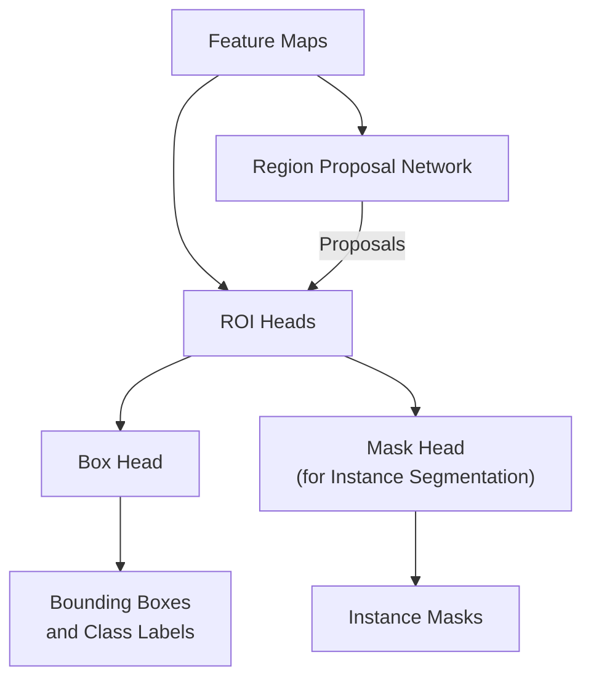

Sources: [satlas/model/model.py:447-546]().

### Simple Head (Segmentation and Regression Tasks)

Used for segmentation tasks (like solar farm identification) and regression tasks (like tree cover measurement).

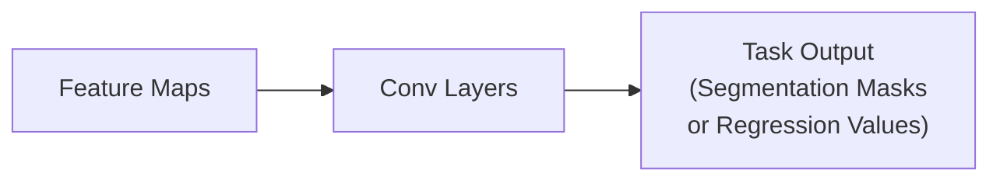

Sources: [satlas/model/model.py:548-786]().

## Data Flow

The following diagram illustrates how data flows through the model system during inference:

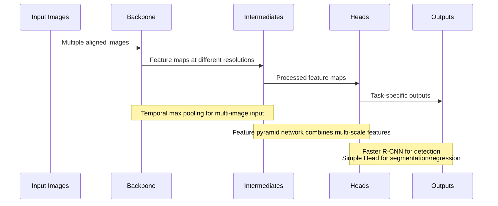

Sources: [satlas/model/model.py](). [ModelArchitecture.md]().

## Dataset and Tasks

The model system supports various geospatial tasks defined in the dataset configuration:

| Task Type | Description | Examples |
|-----------|-------------|----------|
| `detect` | Object detection with bounding boxes | Wind turbines, offshore platforms |
| `instance` | Instance segmentation with masks | Buildings, solar farms |
| `segment` | Semantic segmentation | Land cover types |
| `bin_segment` | Binary segmentation for multiple categories | Roads, rivers, runways |
| `regress` | Regression values | Tree cover percentage |
| `classification` | Image-level classification | Sport type, park type |

Sources: [satlas/model/dataset.py:16-331]().

## Model Creation Process

The model system creates models based on a configuration object that specifies the backbone, intermediates, and heads to use:

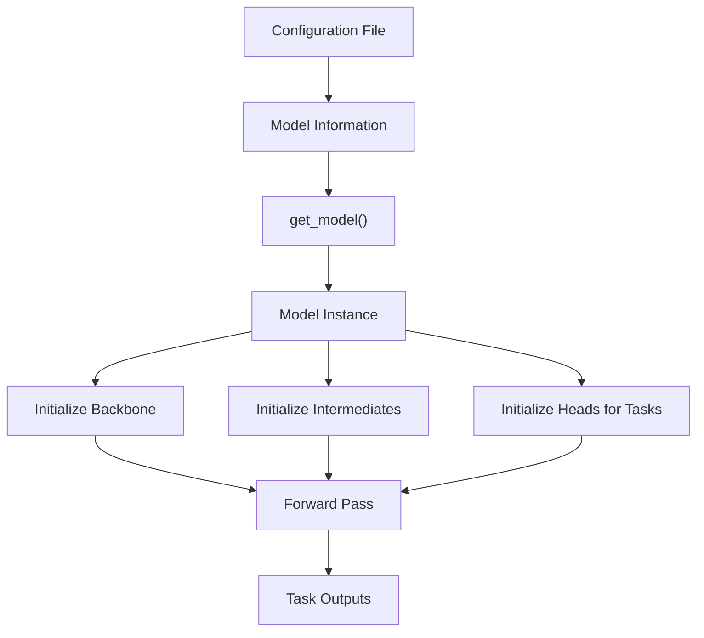

Sources: [satlas/model/models.py:1-9](). [satlas/model/model.py]().

## Integration with Data Augmentation

The model system integrates with data augmentation techniques to improve training:

| Augmentation | Description |
|--------------|-------------|
| CropFlip | Randomly crops and flips images |
| Pad | Pads images to a specified size |
| MixChannels | Mixes channels in specified groups |
| Noise | Adds random noise to images |
| Brightness | Adjusts brightness randomly |
| Resize | Resizes images to random sizes |

Sources: [satlas/transforms/augment.py:8-366]().

## Key Operations in Multi-temporal Processing

When processing multiple temporal images, the model can use various aggregation operations:

| Aggregation | Description |
|-------------|-------------|
| max | Maximum value across temporal dimension |
| mean | Average value across temporal dimension |
| convrnn | Convolutional recurrent neural network |
| conv3d | 3D convolution across temporal dimension |
| conv1d | 1D convolution across temporal dimension |

Sources: [satlas/model/model.py:193-322]().

## Summary

The Model System in Satlas provides a flexible architecture for processing satellite imagery for various geospatial tasks. It combines state-of-the-art backbones like Swin Transformers with task-specific heads to create models that can detect objects, segment regions, and perform regression tasks on satellite imagery.

The modular design allows for easy customization and extension to support new tasks and model architectures while maintaining compatibility with the overall Satlas framework.

---

