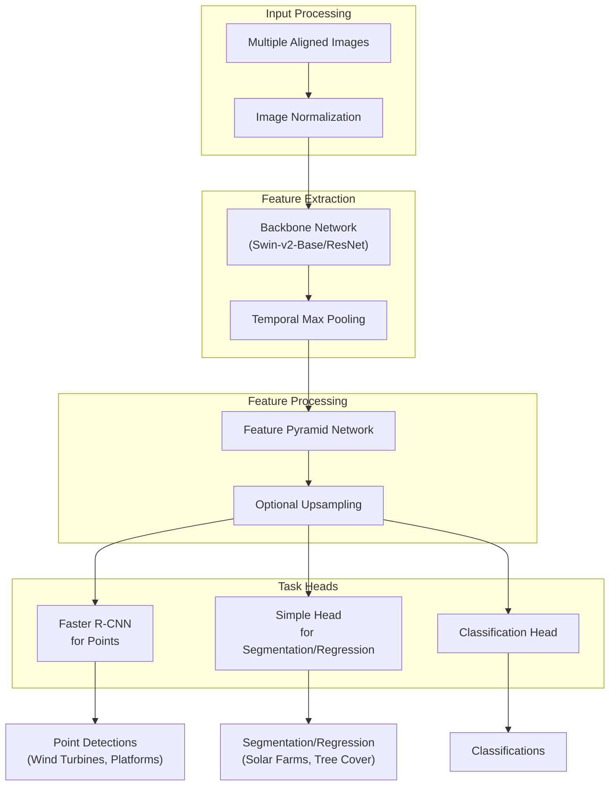
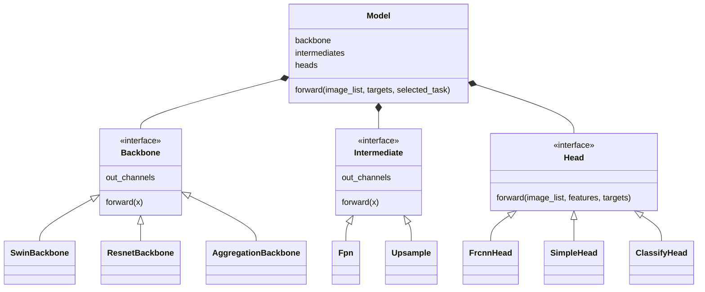
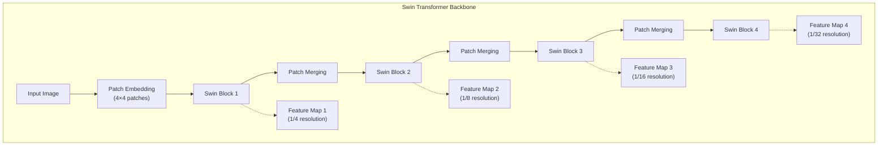
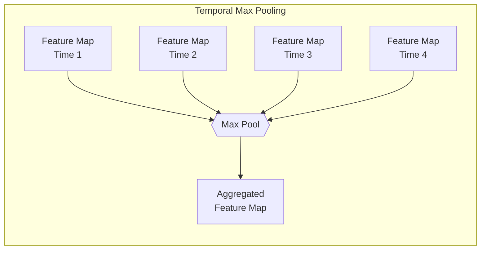
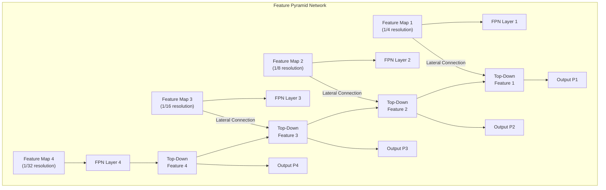
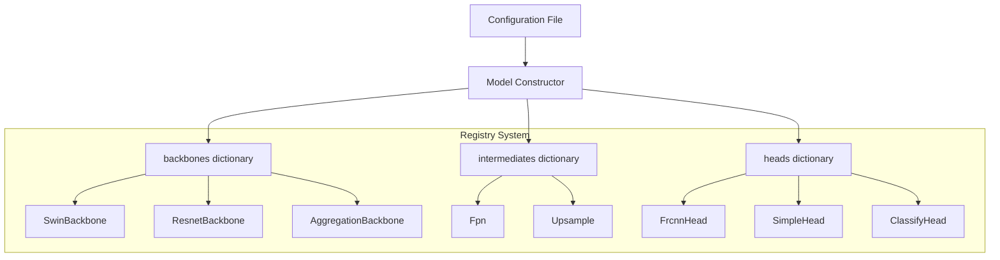
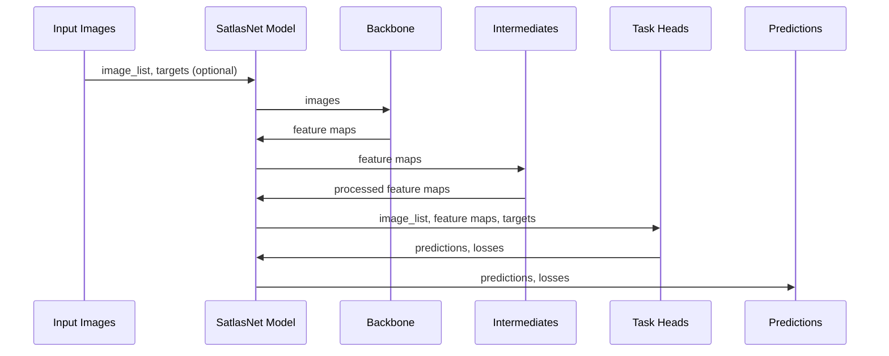

<!-- source: DeepWiki mcp.deepwiki.com · repo allenai/satlas · page 3.1 Model Architecture · fetched 2026-10-26 -->

# Model Architecture

<details>
<summary>Relevant source files</summary>

The following files were used as context for generating this wiki page:

- [DataValidationReport.md](DataValidationReport.md)
- [ModelArchitecture.md](ModelArchitecture.md)
- [configs/sentinel2/resnet152_mi_ms.txt](configs/sentinel2/resnet152_mi_ms.txt)
- [configs/sentinel2/resnet50_mi_ms.txt](configs/sentinel2/resnet50_mi_ms.txt)
- [configs/sentinel2/swint_mi_ms.txt](configs/sentinel2/swint_mi_ms.txt)
- [images/satlasnet.svg](images/satlasnet.svg)
- [satlas/model/model.py](satlas/model/model.py)
- [satlas/transforms/augment.py](satlas/transforms/augment.py)

</details>


This page describes the SatlasNet architecture, the primary neural network model used in the Satlas project. This document covers the core components, data flow, and implementation details of the model. For information about training the model, see [Training Pipeline](#3.2). For information about running inference, see [Inference Pipeline](#3.3).

## Overview

SatlasNet processes multiple temporally aligned satellite images to perform various geospatial analysis tasks, including point detection (e.g., wind turbines), polygon segmentation (e.g., solar farms), and regression (e.g., tree cover). The architecture is modular, consisting of a backbone for feature extraction, intermediates for feature processing, and task-specific heads for predictions.



Sources: [ModelArchitecture.md:1-16](). [satlas/model/model.py:10-26]().

## Architecture Components

The SatlasNet model follows a modular design with three main component types:

1. **Backbone**: Extracts features from input images
2. **Intermediates**: Process features from the backbone
3. **Heads**: Generate task-specific outputs

The model is implemented using a configuration-driven approach, allowing for customization of each component.



Sources: [satlas/model/model.py:776-804]().

### Input Processing

SatlasNet processes multiple aligned satellite images (typically 3-4) of the same geographic area captured at different times. The input is organized as a batch of image sequences, where each sequence contains images from different time points for the same location.

The images are normalized to have values between 0-1 before being passed to the backbone. This normalization process varies by satellite source and is documented in the Normalization page.

Sources: [ModelArchitecture.md:7-8]().

### Backbone Architecture

The backbone is responsible for extracting features from the input images. SatlasNet supports multiple backbone architectures:

1. **Swin Transformer**: The primary backbone is Swin-v2-Base, which processes images through a hierarchical transformer architecture
2. **ResNet**: ResNet50/101/152 backbones are also supported
3. **Aggregation Backbone**: A wrapper that applies one of the above backbones to each image and then aggregates features

Each backbone outputs a list of feature maps at different spatial resolutions (typically 1/4, 1/8, 1/16, and 1/32 of the input resolution).



Sources: [satlas/model/model.py:32-118](). [ModelArchitecture.md:9]().

### Temporal Aggregation

For multi-temporal image sequences, SatlasNet applies the backbone to each image separately and then aggregates the features across the temporal dimension. The default aggregation operation is max pooling, which selects the maximum value at each spatial position across all time points. This helps the model focus on features that are most prominent in any of the images, making it robust to temporal variations.

Other supported aggregation operations include:
- Mean pooling
- Convolutional RNN
- 3D convolution
- 1D convolution



Sources: [satlas/model/model.py:193-322](). [ModelArchitecture.md:10]().

### Feature Processing Intermediates

After the backbone and temporal aggregation, SatlasNet applies "intermediates" to process the feature maps:

1. **Feature Pyramid Network (FPN)**: Combines features across different resolutions to create a feature pyramid. This helps the model handle objects at different scales.

2. **Upsampling**: Optionally adds a UNet-style decoder to generate high-resolution feature maps (1x the input resolution) for tasks requiring detailed spatial information.



Sources: [satlas/model/model.py:324-425](). [ModelArchitecture.md:11-12]().

### Task-specific Heads

SatlasNet employs different prediction heads for different tasks:

1. **Faster R-CNN Head (`FrcnnHead`)**: Used for object detection tasks like identifying wind turbines or offshore platforms. It consists of a Region Proposal Network (RPN) and ROI heads.

2. **Simple Head (`SimpleHead`)**: A versatile head that can be configured for:
   - Segmentation tasks (e.g., solar farm detection)
   - Binary segmentation
   - Regression tasks (e.g., tree cover estimation)
   - Classification tasks

3. **Classification Head (`ClassifyHead`)**: Specialized for image-level classification tasks.

```mermaid
flowchart TD
    subgraph "FrcnnHead"
        FeatsFRCNN["Feature Maps"] --> RPN["Region Proposal Network"]
        RPN --> Proposals["Region Proposals"]
        Proposals --> ROIPool["ROI Pooling"]
        FeatsFRCNN --> ROIPool
        ROIPool --> BoxHead["Box Head"]
        BoxHead --> BoxPred["Box Predictor"]
        BoxPred --> Detections["Detections<br>(boxes, scores, classes)"]
    end
    
    subgraph "SimpleHead"
        FeatsSimple["Feature Maps"] --> Conv["Convolutional Layers"]
        Conv --> TaskType{"Task Type"}
        TaskType -->|"Segmentation"| SegOutput["Segmentation Map"]
        TaskType -->|"Regression"| RegOutput["Regression Values"]
        TaskType -->|"Classification"| ClsOutput["Class Probabilities"]
    end
    
    subgraph "ClassifyHead"
        FeatsClassify["Feature Maps"] --> AvgPool["Global Average Pooling"]
        AvgPool --> Linear["Linear Layer"]
        Linear --> ClassProbs["Class Probabilities"]
    end
```



Sources: [satlas/model/model.py:447-774](). [ModelArchitecture.md:12]().

## Model Configuration

SatlasNet is highly configurable through JSON configuration files. These files define:

1. The backbone architecture and parameters
2. The intermediate layers (FPN, Upsampling)
3. The task-specific heads for each task
4. Training parameters like batch size, learning rate, etc.

Here's a simplified example of the configuration structure:

```
Model: {
    Name: "multihead4",
    Backbone: {
        Name: "aggregation",
        ImageChannels: 9,
        Groups: [[0, 1, 2, 3, 4, 5, 6, 7]],
        AggregationOp: "max",
        Backbone: {
            Name: "swin",
            Arch: "swin_v2_b",
            Pretrained: true
        }
    },
    Intermediates: [{
        Name: "fpn"
    }, {
        Name: "upsample"
    }],
    Heads: [{
        Name: "frcnn",
        UseLayers: [1, 2, 3, 4],
        AnchorSizes: [[32], [64], [128], [256]]
    }, {
        Name: "simple"
    }, {
        Name: "classify",
        Loss: "cross_entropy"
    }]
}
```

The configuration allows for customizing:
- Number of input channels
- Backbone type and parameters
- Temporal aggregation method
- Feature processing steps
- Task-specific head configurations
- Loss functions

Sources: [configs/sentinel2/swint_mi_ms.txt:36-104](). [configs/sentinel2/resnet50_mi_ms.txt:36-104]().

## Module Registry System

SatlasNet uses a registry pattern to manage different implementations of backbones, intermediates, and heads. This allows for easy extension with new components.



The Model class instantiates components based on the configuration using these registries:

```python
backbone_config = self.model_config['Backbone']
self.backbone = backbones[backbone_config['Name']](self.num_channels, backbone_config)
```

Sources: [satlas/model/model.py:28-31](). [satlas/model/model.py:776-804]().

## Data Flow

The forward pass through SatlasNet follows these steps:

1. Input images are stacked into a batch
2. The backbone processes each image to extract features
3. Temporal aggregation combines features across time
4. Intermediates process the feature maps
5. Task-specific heads generate predictions
6. During training, losses are computed and returned



Sources: [satlas/model/model.py:805-821]().

## Data Augmentation

During training, SatlasNet applies various data augmentation techniques to improve model robustness:

1. **CropFlip**: Random cropping and flipping of images and corresponding labels
2. **Pad**: Padding images to a specific size
3. **Resize**: Resizing images and corresponding labels
4. **MixChannels**: Mixing spectral channels
5. **Noise**: Adding random noise
6. **Brightness**: Adjusting brightness

These transformations are applied consistently to both input images and target labels to maintain alignment.

Sources: [satlas/transforms/augment.py:8-366]().

## Model File Structure

The model implementation is organized into these main components:

- `satlas/model/model.py`: Core model implementation
  - Backbone implementations (`SwinBackbone`, `ResnetBackbone`, `AggregationBackbone`)
  - Intermediate layers (`Fpn`, `Upsample`)
  - Task heads (`FrcnnHead`, `SimpleHead`, `ClassifyHead`)
  - Model class that assembles all components

The model weights in `.pth` files have these component prefixes:
- `backbone.backbone.backbone.`: The backbone network
- `intermediates.0.fpn.`: The FPN component
- `heads.0.`: The prediction heads

Sources: [ModelArchitecture.md:17-23]().

## Conclusion

SatlasNet is a flexible and powerful architecture for satellite imagery analysis. Its modular design allows for easy customization for different tasks and datasets. The combination of advanced backbone networks, temporal aggregation, and task-specific heads enables SatlasNet to effectively process multi-temporal satellite imagery for a wide range of geospatial applications, from renewable energy infrastructure mapping to tree cover estimation.

---

