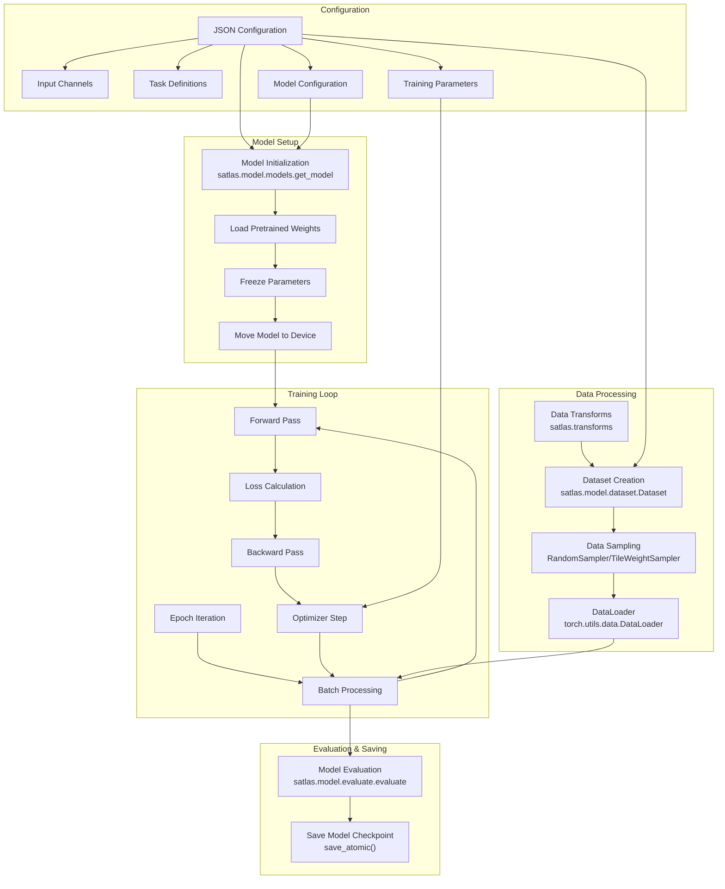
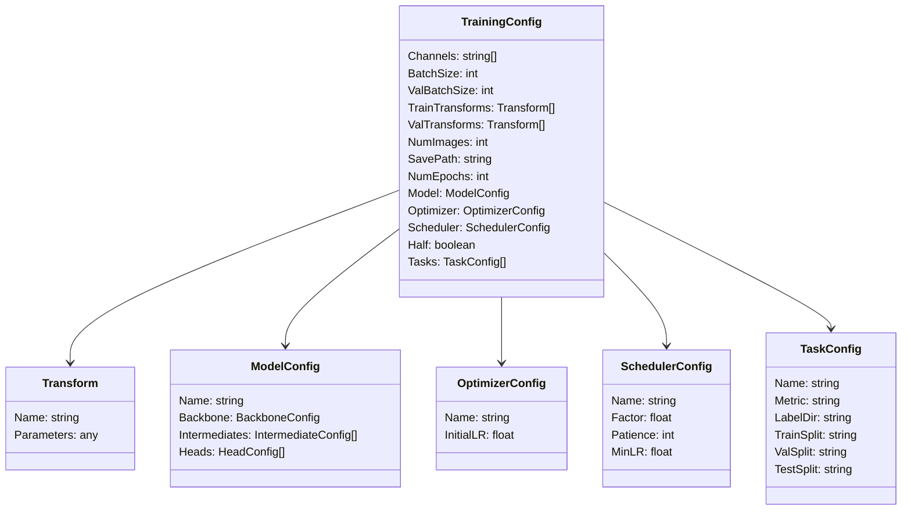
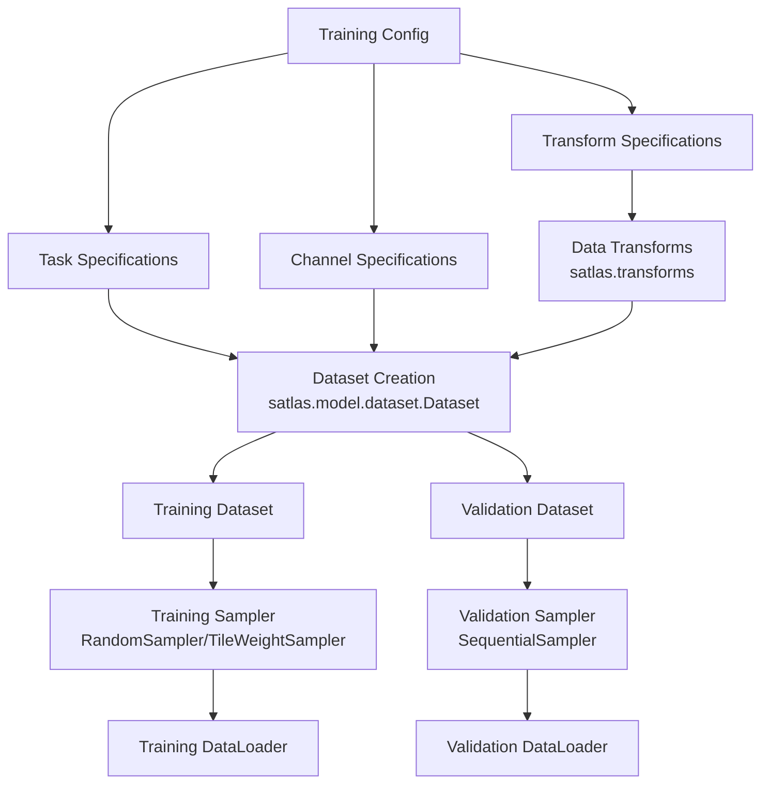
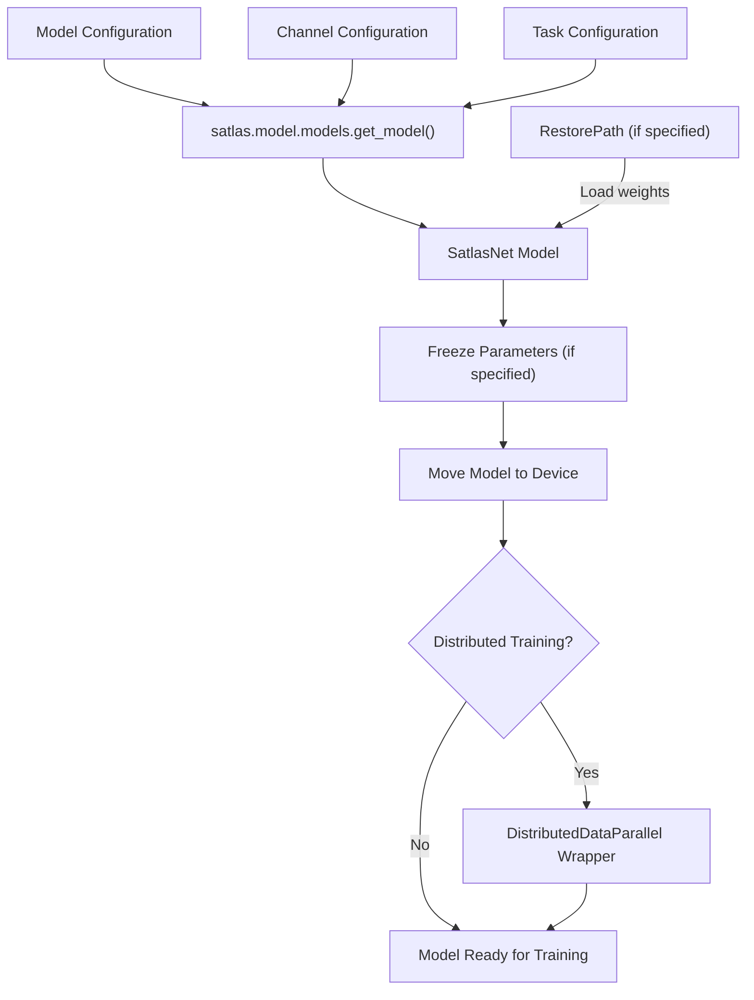
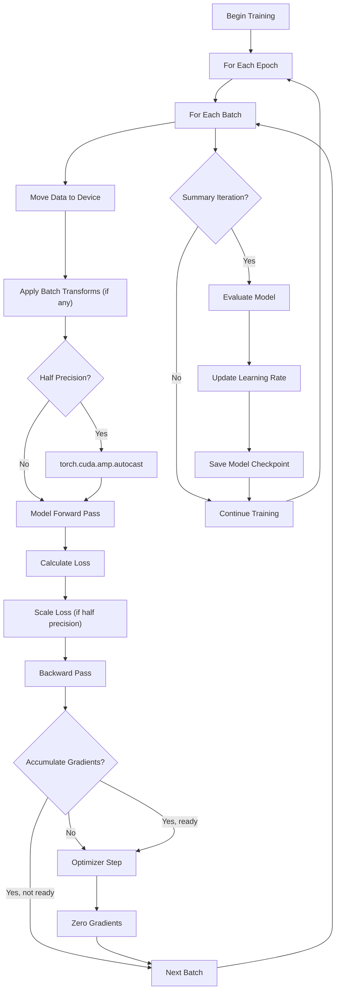
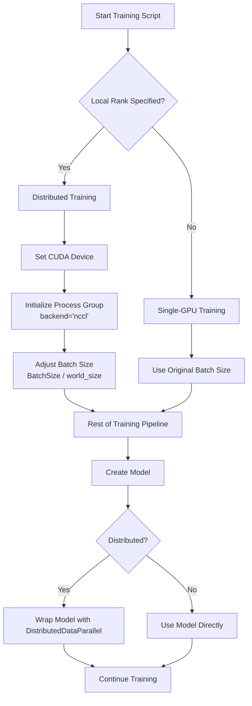
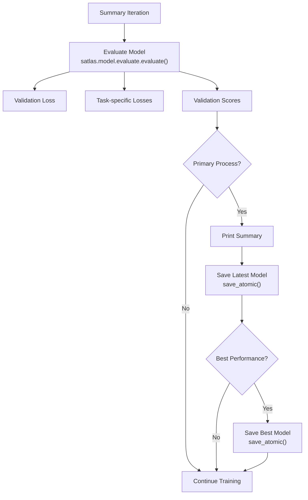

<!-- source: DeepWiki mcp.deepwiki.com · repo allenai/satlas · page 3.2 Training Pipeline · fetched 2026-10-26 -->

# Training Pipeline

<details>
<summary>Relevant source files</summary>

The following files were used as context for generating this wiki page:

- [configs/satlas_explorer_solar_farm.txt](configs/satlas_explorer_solar_farm.txt)
- [configs/sentinel2/resnet152_mi_ms.txt](configs/sentinel2/resnet152_mi_ms.txt)
- [configs/sentinel2/resnet50_mi_ms.txt](configs/sentinel2/resnet50_mi_ms.txt)
- [configs/sentinel2/swint_mi_ms.txt](configs/sentinel2/swint_mi_ms.txt)
- [satlas/cmd/model/train.py](satlas/cmd/model/train.py)
- [satlas/cmd/to_dataset/common.py](satlas/cmd/to_dataset/common.py)

</details>


The Satlas Training Pipeline provides a comprehensive system for training satellite imagery analysis models on the SatlasPretrain dataset. This page explains how to configure and execute model training using the provided command-line tools and configuration files. For information about the model architecture itself, see [Model Architecture](#3.1), and for running inference with trained models, refer to [Inference Pipeline](#3.3).

## Overview

The training pipeline enables training of SatlasNet models on multiple satellite imagery tasks simultaneously, with support for distributed training, mixed precision, learning rate scheduling, and a variety of data augmentation techniques.



Sources: [satlas/cmd/model/train.py:33-393]()

## Configuration System

The training pipeline is driven by JSON configuration files that define all aspects of the training process. These files specify input data channels, model architecture, optimization parameters, and tasks to be trained on.

### Key Configuration Elements

| Section | Purpose | Example Values |
|---------|---------|---------------|
| Channels | Input data channels | `["tci", "b05", "b06", "b07", "b08", "b11", "b12"]` |
| BatchSize | Training batch size | `16` |
| TrainTransforms | Data augmentation for training | `CropFlip`, `Resize` |
| Model | Model architecture definition | Backbone, Intermediates, Heads |
| Optimizer | Optimization algorithm and parameters | `adam`, `0.00001` |
| Tasks | Tasks to train on | `polygon`, `point`, `land_cover` |
| Half | Enable mixed precision training | `true`/`false` |
| SavePath | Where to save model checkpoints | `"models/sentinel2/LABEL/"` |

Here's a diagram showing the configuration hierarchy:



Sources: [configs/sentinel2/resnet50_mi_ms.txt:1-276](), [configs/sentinel2/swint_mi_ms.txt:1-276](), [configs/sentinel2/resnet152_mi_ms.txt:1-276]()

## Dataset Preparation and Loading

The training pipeline loads data using the `satlas.model.dataset.Dataset` class, which handles the extraction of satellite imagery and corresponding labels for each specified task.

### Dataset Loading Process



The pipeline supports two types of samplers for training data:
1. `RandomSampler` - Standard random sampling for balanced datasets
2. `TileWeightSampler` - Weighted sampling that adjusts sampling frequency based on tile contents

Sources: [satlas/cmd/model/train.py:68-118]()

## Model Initialization

Models in Satlas are built according to the configuration specification. The system supports loading pre-trained weights and selectively freezing parts of the model.

### Model Creation Process



The model initialization process supports several advanced features:
- Loading pre-trained weights from checkpoint files
- Selectively restoring weights using prefixes
- Parameter freezing for transfer learning
- Configurable unfreezing during training

Sources: [satlas/cmd/model/train.py:125-184](), [satlas/cmd/model/train.py:200-221]()

## Training Loop and Optimization

The training loop processes batches of data, computes losses, and updates model weights. It supports learning rate scheduling, gradient accumulation, and mixed precision training.

### Training Loop Components



Key optimization features:
- Support for Adam and SGD optimizers
- Learning rate warm-up periods
- Plateau-based learning rate scheduling
- Mixed precision training with automatic gradient scaling
- Gradient accumulation for larger effective batch sizes
- Parameter freezing/unfreezing during training

Sources: [satlas/cmd/model/train.py:193-198](), [satlas/cmd/model/train.py:223-246](), [satlas/cmd/model/train.py:248-249](), [satlas/cmd/model/train.py:269-381]()

## Distributed Training Support

The training pipeline supports distributed training across multiple GPUs using PyTorch's DistributedDataParallel wrapper.



When running in distributed mode, the pipeline automatically:
- Adjusts batch sizes based on the number of processes
- Coordinates learning rate scheduling across nodes
- Synchronizes evaluation metrics

Sources: [satlas/cmd/model/train.py:33-36](), [satlas/cmd/model/train.py:121-124](), [satlas/cmd/model/train.py:183-184](), [satlas/cmd/model/train.py:328-336]()

## Evaluation and Model Saving

Models are evaluated periodically during training, with checkpoints saved based on validation performance.



The evaluation process:
1. Runs the model on validation data
2. Calculates losses and task-specific metrics
3. Saves the current model state as "last.pth"
4. If the model achieves the best validation score so far, also saves it as "best.pth"

Sources: [satlas/cmd/model/train.py:339-380]()

## Command-line Usage

The training pipeline is invoked through a command-line interface that requires a path to a configuration file:

```
python -m satlas.cmd.model.train --config_path configs/sentinel2/swint_mi_ms.txt [--local-rank RANK] [--world_size SIZE]
```

Command-line arguments:
- `--config_path`: Path to the JSON configuration file
- `--local-rank`: Local rank for distributed training (set by PyTorch distributed launcher)
- `--world_size`: Total number of processes for distributed training

For distributed training, the recommended approach is to use PyTorch's distributed launcher:

```
python -m torch.distributed.launch --nproc_per_node=NUM_GPUS satlas/cmd/model/train.py --config_path CONFIG_PATH --world_size NUM_GPUS
```

Sources: [satlas/cmd/model/train.py:382-392]()

## Example Configuration File

Here's an annotated example of a configuration file for training a multi-task model on Sentinel-2 imagery:

```json
{
    "Channels": ["tci", "fake", "fake", "b05", "b06", "b07", "b08", "b11", "b12"],
    "BatchSize": 16,
    "ValBatchSize": 2,
    
    "TrainTransforms": [{
        "Name": "CropFlip",
        "HorizontalFlip": true,
        "VerticalFlip": true,
        "CropMin": 416,
        "CropMax": 512
    }, {
        "Name": "Resize",
        "ResizeMin": 512,
        "ResizeMax": 512
    }],
    
    "ValTransforms": [{
        "Name": "Pad",
        "PadTo": 512,
        "Mode": "center"
    }],
    
    "NumImages": 8,
    "SavePath": "models/sentinel2/LABEL/",
    "NumEpochs": 10000,
    
    "Model": {
        "Name": "multihead4",
        "Backbone": {
            "Name": "aggregation",
            "ImageChannels": 9,
            "Groups": [[0, 1, 2, 3, 4, 5, 6, 7]],
            "AggregationOp": "max",
            "Backbone": {
                "Name": "swin",
                "Arch": "swin_v2_t",
                "Pretrained": true
            }
        },
        "Intermediates": [{
            "Name": "fpn"
        }, {
            "Name": "upsample"
        }],
        "Heads": [
            // Task-specific heads...
        ]
    },
    
    "Optimizer": {
        "Name": "adam",
        "InitialLR": 0.00001
    },
    
    "WarmupExamples": 8192,
    "Scheduler": {
        "Name": "plateau",
        "Factor": 0.5,
        "Patience": 1,
        "Cooldown": 5,
        "MinLR": 1e-6
    },
    
    "Half": true,
    "SummaryExamples": 32768,
    
    "Tasks": [
        // Task definitions...
    ]
}
```

Sources: [configs/sentinel2/swint_mi_ms.txt:1-276]()

---

