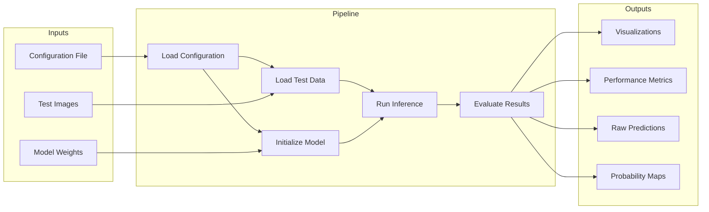
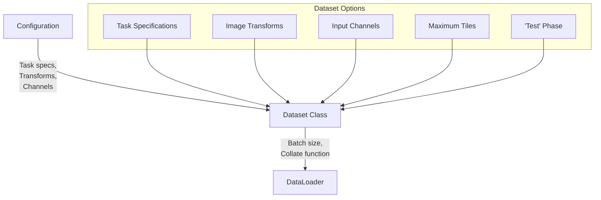
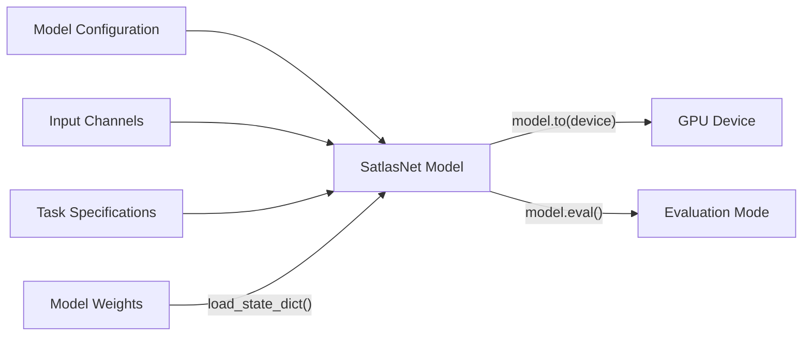
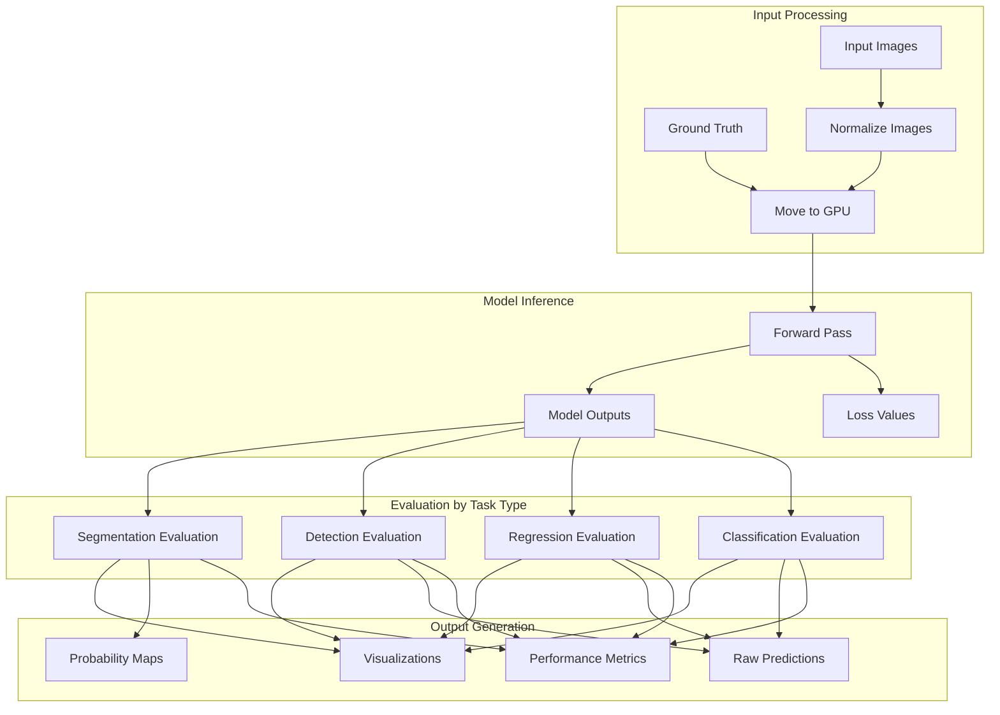
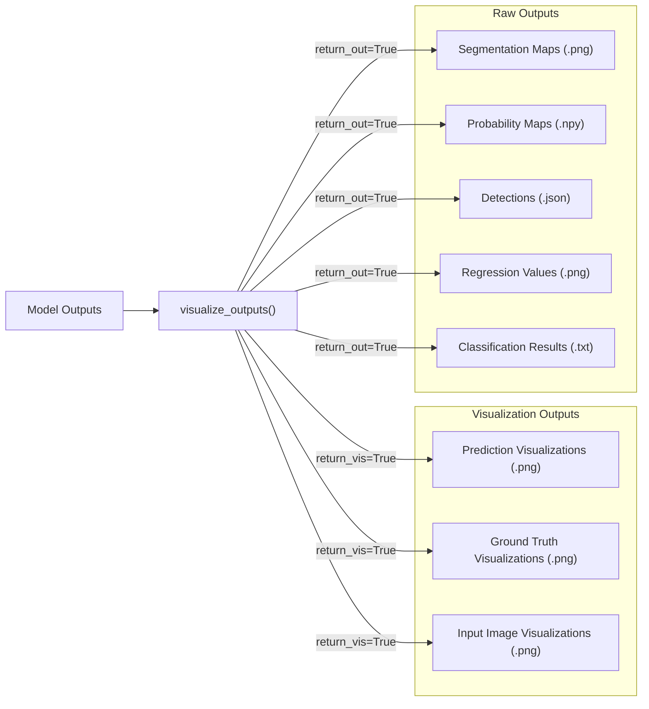
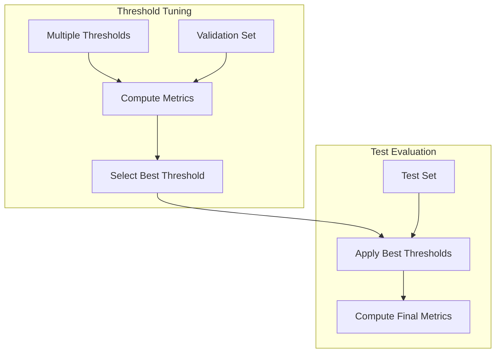
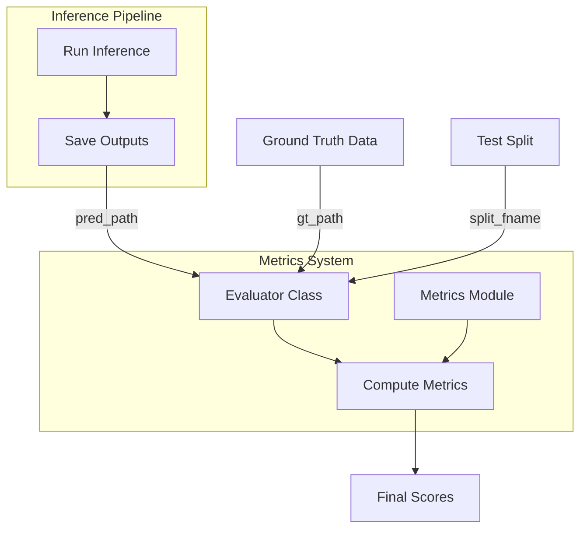

<!-- source: DeepWiki mcp.deepwiki.com · repo allenai/satlas · page 3.3 Inference Pipeline · fetched 2026-10-26 -->

# Inference Pipeline

<details>
<summary>Relevant source files</summary>

The following files were used as context for generating this wiki page:

- [satlas/cmd/evaluate.py](satlas/cmd/evaluate.py)
- [satlas/cmd/model/infer.py](satlas/cmd/model/infer.py)
- [satlas/metrics/evaluator.py](satlas/metrics/evaluator.py)
- [satlas/model/evaluate.py](satlas/model/evaluate.py)

</details>


The Satlas Inference Pipeline provides a systematic approach for applying trained models to satellite imagery data and evaluating their performance. This document explains how to run inference with trained Satlas models, configure the inference process, and interpret the outputs.

For information about training new models, see [Training Pipeline](#3.2). For custom inference with your own imagery, see [Custom Inference](#3.4).

## 1. Pipeline Overview

The inference pipeline takes a trained model and runs it on a set of images, producing predictions that can be evaluated against ground truth data and/or saved for further use.



Sources: [satlas/cmd/model/infer.py:17-149]()

## 2. Configuration

The inference pipeline is driven by a JSON configuration file that specifies:

- Model architecture
- Input channels
- Tasks to perform
- Data paths and splits
- Batch size and other processing parameters
- Output directories

Here are the key configuration parameters:

| Parameter | Description | Default |
|-----------|-------------|---------|
| `Channels` | List of input channels (e.g., "tci", "s1") | `["tci", "fake", "fake"]` |
| `BatchSize` | Number of samples per batch | Required |
| `VisDir` | Directory for saving visualizations | None |
| `ProbsDir` | Directory for saving probability maps | None |
| `OutDir` | Directory for saving raw outputs | None |
| `SavePath` | Path for model weights | Required |
| `EvaluateTask` | Specific task to evaluate (if only one needed) | None |
| `Half` | Enable half-precision inference | False |
| `TestMaxTiles` | Maximum number of tiles to process | None |
| `NumImages` | Number of images per tile to use | 1 |

Sources: [satlas/cmd/model/infer.py:18-41]()

## 3. Data Loading

The inference pipeline loads test data using the Satlas Dataset class, which supports various image sources and task types.



Sources: [satlas/cmd/model/infer.py:57-77]()

## 4. Model Loading

The pipeline initializes the model according to the configuration and loads pre-trained weights.



Sources: [satlas/cmd/model/infer.py:79-100]()

## 5. Inference and Evaluation Process

The core of the inference pipeline is the `evaluate()` function from the `satlas.model.evaluate` module, which:

1. Initializes appropriate evaluators for each task
2. Processes input images through the model
3. Computes task-specific metrics
4. Optionally generates visualizations and saves outputs



Sources: [satlas/model/evaluate.py:825-993]()

## 6. Task-Specific Evaluators

The inference pipeline uses different evaluators based on the task type. Each evaluator computes appropriate metrics for that task.

| Task Type | Available Metrics | Description |
|-----------|-------------------|-------------|
| `segment` | accuracy, logprob, f1, mIou | Semantic segmentation (multi-class) |
| `bin_segment` | accuracy, f1 | Binary segmentation (foreground/background) |
| `regress` | mse, l1 | Regression (continuous values) |
| `detect` | f1 | Object detection (bounding boxes) |
| `instance` | f1 | Instance segmentation (masks) |
| `classification` | accuracy, f1 | Image classification |

The task-specific evaluators manage:
- Comparing predictions to ground truth
- Computing appropriate metrics
- Handling threshold tuning for probabilistic outputs
- Generating visualization outputs

Sources: [satlas/model/evaluate.py:74-561]()

## 7. Visualization and Output Formats

The inference pipeline can generate several types of outputs:



The `visualize_outputs()` function generates these visualizations and raw outputs based on the task type:

- **Segmentation tasks**: Color-coded segmentation maps and class probability maps
- **Detection tasks**: Bounding boxes with class labels and confidence scores
- **Instance tasks**: Polygonized instance masks with class labels
- **Regression tasks**: Continuous value maps
- **Classification tasks**: Class labels

Sources: [satlas/model/evaluate.py:634-823]()

## 8. Command-line Usage

The inference pipeline can be run from the command line using the `infer.py` script:

```
python -m satlas.cmd.model.infer --config_path CONFIG_PATH [options]
```

Key command-line options:

| Option | Description |
|--------|-------------|
| `--config_path` | Path to configuration file (required) |
| `--vis_dir` | Override visualization directory |
| `--probs_dir` | Override probability maps directory |
| `--out_dir` | Override output directory |
| `--task` | Only evaluate a specific task |
| `--weights` | Path to model weights (overrides SavePath) |
| `--batch_size` | Override batch size from config |
| `--details` | Print detailed scores |
| `--pick_threshold` | Tune thresholds on validation set |

Sources: [satlas/cmd/model/infer.py:151-169]()

## 9. Score Thresholds and Evaluation

For tasks with probabilistic outputs (e.g., detection, segmentation), the pipeline can automatically find optimal score thresholds for evaluation:



The pipeline can automatically tune thresholds for tasks like detection and segmentation by:
1. Testing multiple threshold values on a validation set (0.05, 0.1, 0.2, ..., 0.95)
2. Computing metrics (e.g., F1 score) at each threshold
3. Selecting the threshold that maximizes the metric
4. Applying the selected threshold to the test set

Sources: [satlas/cmd/model/infer.py:102-134](), [satlas/model/evaluate.py:385-431]()

## 10. Integration with Metrics System

For more comprehensive evaluation beyond the basic metrics included in the inference pipeline, Satlas provides a separate metrics system that can be used to evaluate saved outputs:



The metrics system supports parallel evaluation across multiple tiles and can compute more specialized metrics for different data products.

Sources: [satlas/metrics/evaluator.py:6-74](), [satlas/cmd/evaluate.py:1-23]()

---

