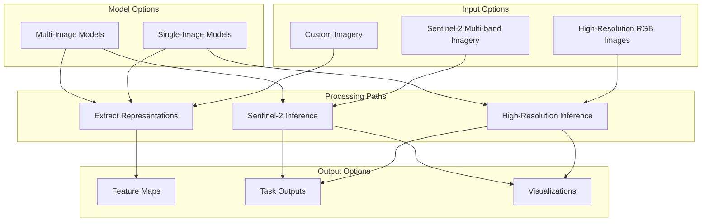
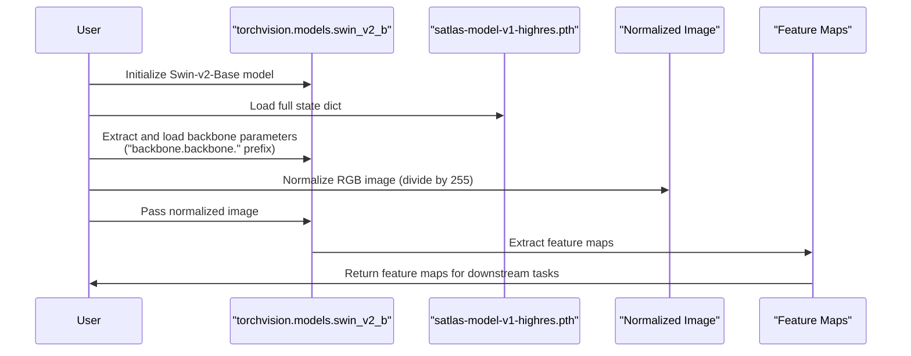
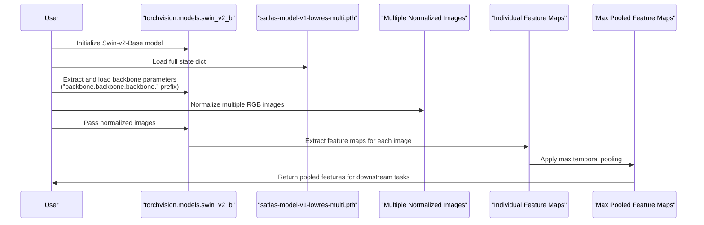
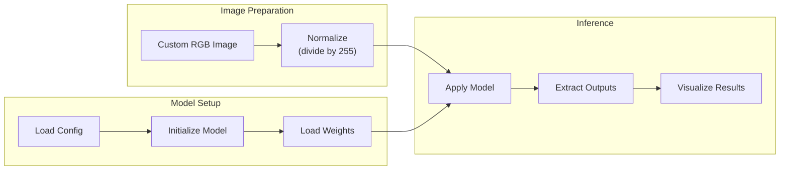
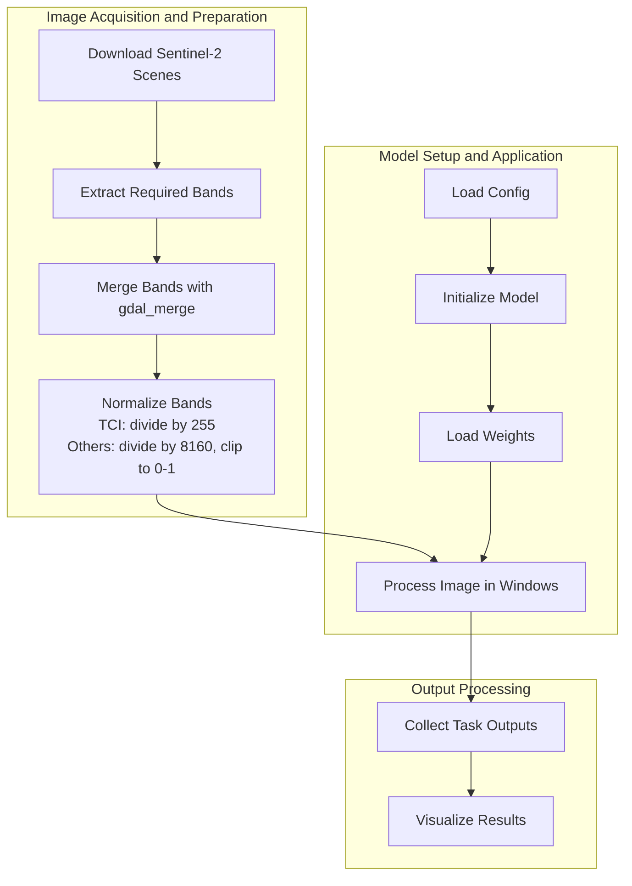

<!-- source: DeepWiki mcp.deepwiki.com · repo allenai/satlas · page 3.4 Custom Inference · fetched 2026-10-26 -->

# Custom Inference

<details>
<summary>Relevant source files</summary>

The following files were used as context for generating this wiki page:

- [CustomInference.md](CustomInference.md)
- [Normalization.md](Normalization.md)

</details>


## Purpose and Scope

This document explains how to use Satlas models with custom satellite imagery that is not part of the standard inference pipeline. It covers extracting features from pre-trained models, applying high-resolution models to custom high-resolution imagery, and applying multi-band models to Sentinel-2 data. For standard inference execution on pre-packaged datasets, refer to the [Inference Pipeline](#3.3).

## Overview of Custom Inference Workflows

The Satlas system supports several approaches to work with custom imagery:



Sources: [CustomInference.md:1-6]()

## Extracting Representations for Downstream Tasks

Satlas models can be used to extract powerful feature representations from satellite imagery for downstream tasks without using the full Satlas codebase.

### Single-Image Model Backbone Extraction

To extract the Swin-v2-Base backbone from a single-image model:



The backbone parameters are extracted from the full model state dictionary using the prefix `backbone.backbone.`.

Sources: [CustomInference.md:7-37]()

### Multi-Image Model Backbone Extraction

For multi-image models, the process is similar but includes temporal max pooling of features:



The backbone parameters have a slightly different prefix: `backbone.backbone.backbone.`. After obtaining feature maps for each image, max temporal pooling is applied to aggregate information across time.

Sources: [CustomInference.md:39-67]()

## High-Resolution Inference on Custom Images

This section explains how to apply high-resolution Satlas models to custom high-resolution imagery.

### Image Preparation and Model Application

The process involves:



1. Read and normalize the RGB image (divide by 255)
2. Load the model configuration and weights
3. Initialize the model with the configuration
4. Apply the model to the normalized image
5. Extract and visualize the outputs

The model is configured using a JSON configuration file that defines the input channels and tasks. The outputs can be visualized using the `satlas.model.evaluate.visualize_outputs` utility.

Sources: [CustomInference.md:69-133](), [Normalization.md:6-39]()

## Multi-band Satellite Imagery Inference

This section covers applying multi-band, multi-image Satlas models to custom Sentinel-2 imagery.

### Sentinel-2 Image Processing and Model Application



The process for Sentinel-2 imagery involves:

1. Acquiring multiple Sentinel-2 scenes covering the same geographic area
2. Extracting and merging the required bands (TCI, B05, B06, B07, B08, B11, B12)
3. Normalizing the bands appropriately
4. Processing the image in windows (for large images)
5. Collecting and visualizing the model outputs

For multi-band models, the expected band order and normalization is critical:
- TCI (RGB): divide by 255
- Other bands (B05, B06, B07, B08, B11, B12): divide by 8160, clip to 0-1

Sources: [CustomInference.md:135-219](), [Normalization.md:42-107]()

## Image Normalization Requirements

Proper normalization is essential for Satlas models to work correctly with custom imagery.

| Image Type | Bands | Normalization Method |
|------------|-------|----------------------|
| High-Resolution (NAIP, Google Earth) | RGB | Divide by 255 |
| Sentinel-2 TCI | RGB | Divide by 255 |
| Sentinel-2 Other Bands | B05, B06, B07, B08, B11, B12 | Divide by 8160, clip to 0-1 |
| Landsat-8/9 | B1-B11 | Clip (N-4000)/16320 to 0-1 |
| Sentinel-1 | vh, vv | Clip N/255 to 0-1 |

Sources: [Normalization.md:1-124]()

## Code Structure and Components

The custom inference functionality relies on several key components in the Satlas codebase:

```mermaid
classDiagram
    class "Model" {
        +load_state_dict()
        +eval()
        +__call__()
    }
    
    class "Evaluate" {
        +visualize_outputs()
    }
    
    class "Dataset" {
        +tasks
    }
    
    class "Util" {
        +geo_to_mercator()
    }
    
    class "CustomInference" {
        +extract_features()
        +high_res_inference()
        +sentinel2_inference()
    }
    
    CustomInference --> Model: uses
    CustomInference --> Evaluate: uses for visualization
    Model --> Dataset: uses task definitions
    CustomInference --> Util: uses for coordinate conversion
```

The key files and functions involved in custom inference include:

1. `satlas.model.model.Model`: The main model class that handles loading model weights and running inference
2. `satlas.model.evaluate.visualize_outputs`: Utility for visualizing model outputs
3. `satlas.model.dataset.tasks`: Dictionary of task definitions
4. `satlas.util.geo_to_mercator`: Utility for geographic coordinate conversion

Sources: [CustomInference.md:87-219]()

## Best Practices and Tips

When using Satlas models for custom inference:

1. **Ensure correct normalization**: Different image types and bands require specific normalization techniques
2. **Check model configuration**: The number of expected input images varies by model and is specified by `NumImages` in the configuration file
3. **Process large images in windows**: For large images, process them in windows to avoid memory issues
4. **Verify band order**: Make sure bands are in the correct order as specified in the model configuration
5. **Consider hardware requirements**: For faster inference, use GPU if available

Sources: [CustomInference.md:69-219](), [Normalization.md:1-124]()

---

