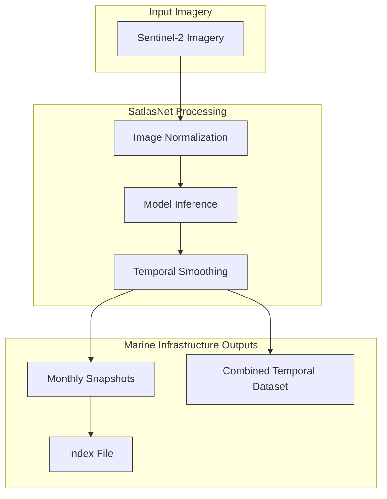
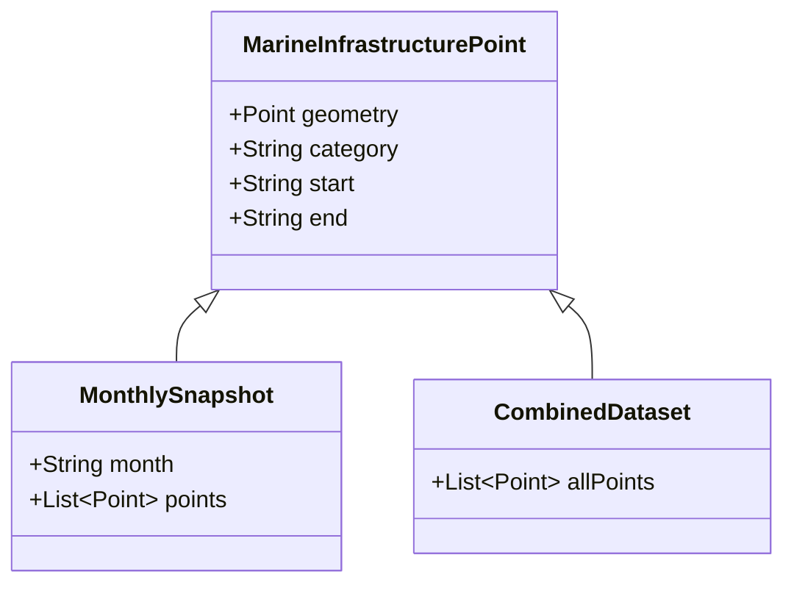
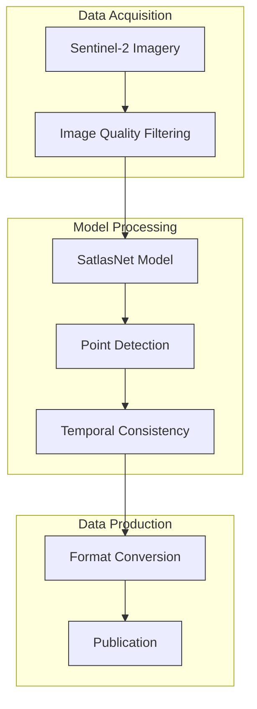
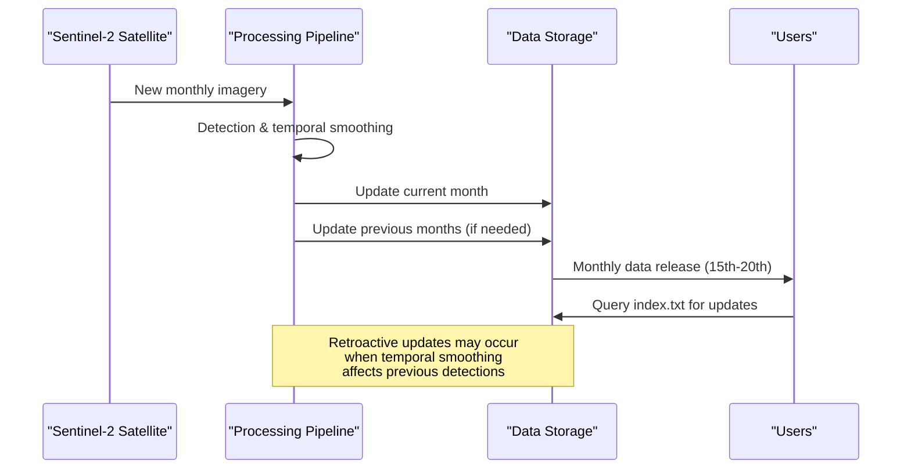

<!-- source: DeepWiki mcp.deepwiki.com · repo allenai/satlas · page 4.1 Marine Infrastructure · fetched 2026-10-26 -->

# Marine Infrastructure

<details>
<summary>Relevant source files</summary>

The following files were used as context for generating this wiki page:

- [GeospatialDataProducts.md](GeospatialDataProducts.md)
- [marine_infrastructure_dataset.md](marine_infrastructure_dataset.md)
- [satlas/cmd/to_dataset/get_good_images.py](satlas/cmd/to_dataset/get_good_images.py)

</details>


## Purpose and Scope

This document details the Marine Infrastructure data product within the Satlas ecosystem, specifically focusing on offshore wind turbines and offshore platforms detected from satellite imagery. This geospatial dataset provides point-based detections of marine infrastructure with temporal tracking. For information about other geospatial data products like on-shore renewable energy infrastructure, see [Renewable Energy Infrastructure](#4.2).

## Overview

The Marine Infrastructure dataset is an AI-generated geospatial product that identifies and tracks offshore wind turbines and platforms globally. It provides monthly snapshots of infrastructure locations derived from satellite imagery analysis using Satlas foundation models.



Sources: [GeospatialDataProducts.md:10-36]()

## Data Structure

The Marine Infrastructure dataset consists of point geometries with the following attributes:

| Attribute | Description |
|-----------|-------------|
| `geometry` | Point geometry in WGS84 coordinates |
| `category` | Classification as either `offshore_wind_turbine` or `offshore_platform` |
| `start` | Month when structure was first detected (format: YYYY-MM) - only in combined file |
| `end` | Month when structure was removed (format: YYYY-MM) - only in combined file |

Data is available in two primary forms:
1. **Monthly snapshots** - Point data of structures present in a specific month
2. **Combined temporal dataset** - All structures with start/end dates indicating construction and removal periods



Sources: [GeospatialDataProducts.md:10-36](), [marine_infrastructure_dataset.md:3-8]()

## Data Access

The Marine Infrastructure data is freely available for download in multiple formats:

### Monthly Snapshots

Monthly snapshots represent marine infrastructure detected as of a specific month, available in three formats:

```
GeoJSON: https://pub-956f3eb0f5974f37b9228e0a62f449bf.r2.dev/outputs/marine/latest.geojson
KML: https://pub-956f3eb0f5974f37b9228e0a62f449bf.r2.dev/outputs/marine/latest.kml
Shapefile: https://pub-956f3eb0f5974f37b9228e0a62f449bf.r2.dev/outputs/marine/latest.shp.zip
```

To access a specific month's data, replace `latest` with the year and month in YYYY-MM format:

```
https://pub-956f3eb0f5974f37b9228e0a62f449bf.r2.dev/outputs/marine/2023-01.geojson
```

### Combined Temporal Dataset

The combined dataset contains all infrastructure points with temporal attributes:

```
GeoJSON: https://pub-956f3eb0f5974f37b9228e0a62f449bf.r2.dev/outputs/marine/marine.geojson
```

### Index File

An index file lists all available monthly snapshots with hash and modification time information:

```
Index: https://pub-956f3eb0f5974f37b9228e0a62f449bf.r2.dev/outputs/marine/index.txt
```

This file can be queried programmatically to detect updates, which are typically published between the 15th and 20th of each month.

Sources: [GeospatialDataProducts.md:10-36]()

## Generation Pipeline

The Marine Infrastructure dataset is generated through a multi-stage processing pipeline that leverages Satlas foundation models.



Key steps in the pipeline:

1. **Data Acquisition**: Sentinel-2 satellite imagery is collected and filtered for quality (removing cloudy or incomplete images)
2. **Quality Filtering**: Images with excessive black (missing data) or white (cloud/snow) pixels are excluded
3. **Model Inference**: SatlasNet processes the imagery to detect marine infrastructure points
4. **Temporal Consistency**: Detections are smoothed across time to reduce false positives
5. **Publication**: Data is formatted and published in multiple formats

Sources: [satlas/cmd/to_dataset/get_good_images.py:15-25](), [GeospatialDataProducts.md:27-28]()

## Training Dataset

The model development for marine infrastructure detection used a specialized training dataset with the following characteristics:

- **Classes**: Vessels, Off-shore Wind Turbines, Off-shore Platforms
- **Data Format**: Point labels in bounding box format `[x1, y1, x2, y2, class_label]`
- **Imagery**: Temporally aligned Sentinel-2 images (1024x1024 windows) from different timestamps

The training dataset structure follows this pattern:

```
{tile_id}/
    gt.json  # ground truth labels
    images/
        {image_uuid}/
            tci.png  # primary image
            virtual:overlap_tci_0.png  # temporal image 1
            virtual:overlap_tci_1.png  # temporal image 2
            virtual:overlap_tci_2.png  # temporal image 3
            virtual:overlap_tci_3.png  # temporal image 4
```

Labels in `gt.json` follow this format:
```json
[
    [991, 190, 1031, 230, "vessel"],
    [822, 648, 862, 688, "turbine"],
    [993, 457, 1033, 497, "platform"]
]
```

Although represented as bounding boxes, the labels are actually point-based detections, with boxes of consistent size centered on points.

Sources: [marine_infrastructure_dataset.md:1-42]()

## Update Process

The Marine Infrastructure dataset follows a regular update schedule:

1. **Monthly Updates**: New data is published between the 15th and 20th of each month
2. **Retroactive Updates**: Previous months' data may be updated when:
   - New imagery provides information that changes previous detections
   - Improved models are developed that better identify structures



Sources: [GeospatialDataProducts.md:24-28]()

## Use Cases

The Marine Infrastructure dataset is particularly valuable for:

1. **Energy Sector Analysis**: Tracking the expansion of offshore wind energy infrastructure
2. **Environmental Monitoring**: Assessing the distribution and impact of offshore platforms
3. **Maritime Planning**: Supporting marine spatial planning efforts
4. **Change Detection**: Analyzing construction patterns and infrastructure removal over time
5. **Research**: Providing global data for studies on marine infrastructure development

## Data License

The Marine Infrastructure dataset is released under the [ODC-BY](DataLicense) license, which allows for free use with attribution.

Sources: [GeospatialDataProducts.md:6]()

## Related Resources

For additional information about other Satlas components:
- [SatlasPretrain Dataset](#2) - The foundation dataset used to train Satlas models
- [Model System](#3) - Information about the SatlasNet architecture and training
- [Renewable Energy Infrastructure](#4.2) - Similar dataset for on-shore wind turbines and solar farms
- [Data Validation and Evaluation](#5) - How model outputs are validated

---

