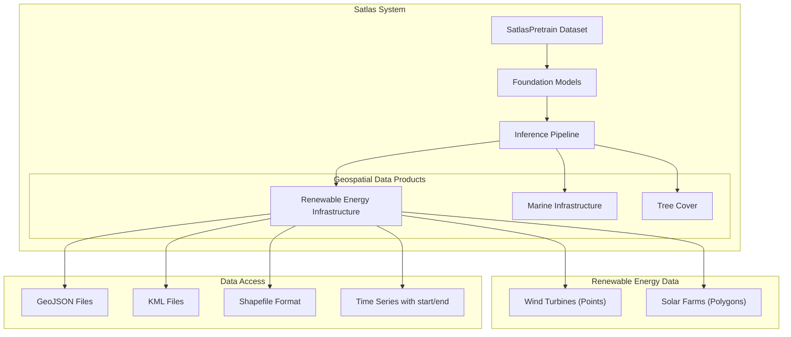
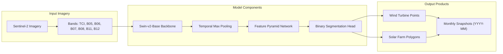
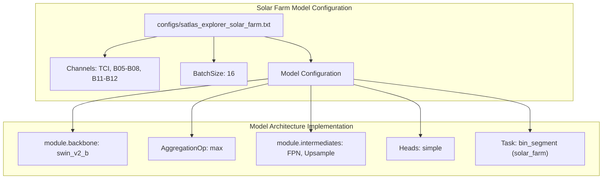
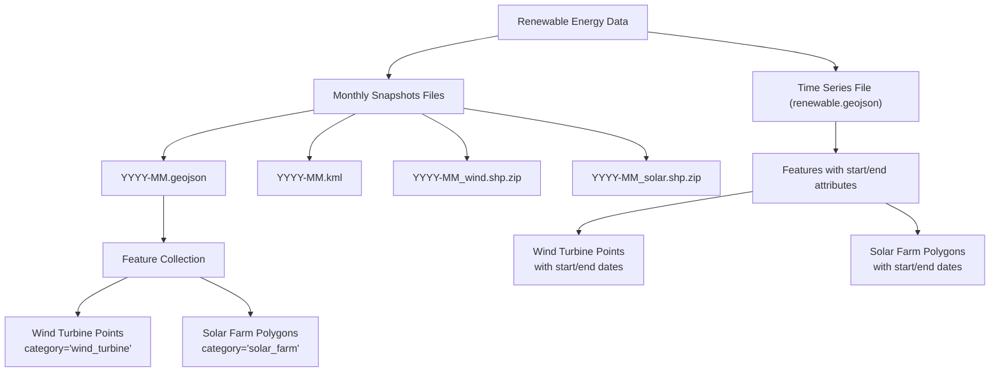

<!-- source: DeepWiki mcp.deepwiki.com · repo allenai/satlas · page 4.2 Renewable Energy Infrastructure · fetched 2026-10-26 -->

# Renewable Energy Infrastructure

<details>
<summary>Relevant source files</summary>

The following files were used as context for generating this wiki page:

- [GeospatialDataProducts.md](GeospatialDataProducts.md)
- [configs/satlas_explorer_solar_farm.txt](configs/satlas_explorer_solar_farm.txt)

</details>


## Purpose and Scope

This document describes the Renewable Energy Infrastructure data product in the Satlas system, which consists of AI-detected on-shore wind turbines (as points) and solar farms (as polygons) derived from satellite imagery. This dataset tracks the global distribution and temporal evolution of renewable energy installations.

For information about offshore wind turbines, please see [Marine Infrastructure](#4.1).

## Overview

The Renewable Energy Infrastructure dataset is one of the core geospatial data products generated by the Satlas system. It provides comprehensive mapping of onshore wind turbines and solar farms with temporal tracking to monitor the growth of renewable energy capacity worldwide.

### System Context

Diagram: Renewable Energy Infrastructure in the Satlas System


Sources: [GeospatialDataProducts.md:62-90]()

## Data Generation Process

The Renewable Energy Infrastructure data is generated through a specialized model pipeline that processes satellite imagery, primarily from Sentinel-2. The model architecture employs a Swin Transformer backbone with temporal max pooling to identify renewable energy infrastructure across multiple time periods.

Diagram: Data Generation Pipeline


Sources: [configs/satlas_explorer_solar_farm.txt:1-83]()

### Model Configuration to Code Entities Mapping

The solar farm detection model is configured through the `satlas_explorer_solar_farm.txt` configuration file, which defines the model architecture, training parameters, and task specifications.

Diagram: Solar Farm Model Configuration to Implementation


Sources: [configs/satlas_explorer_solar_farm.txt:2-83]()

The model uses the following key components:
- Input channels from Sentinel-2 imagery (lines 2-3)
- A Swin-v2-Base backbone pre-trained on the SatlasPretrain dataset (lines 34-44)
- Temporal max pooling for feature aggregation (line 38)
- Feature Pyramid Network (FPN) for multi-scale feature processing (lines 46-50)
- Binary segmentation task specification for solar farms (lines 68-83)

Wind turbine detection follows a similar architecture but uses point detection instead of segmentation.

## Data Structure and Formats

Diagram: Renewable Energy Data Structure


Sources: [GeospatialDataProducts.md:62-90]()

### Data Formats

The data is available in multiple formats to accommodate different GIS workflows:

| Format | Description | Wind Turbines | Solar Farms |
|--------|-------------|---------------|-------------|
| GeoJSON | Open format for geospatial data using JSON | Points with category="wind_turbine" | Polygons with category="solar_farm" |
| KML | XML-based format for visualization in Google Earth | Points with category="wind_turbine" | Polygons with category="solar_farm" |
| Shapefile | Common GIS format for spatial analytics | Separate file: YYYY-MM_wind.shp.zip | Separate file: YYYY-MM_solar.shp.zip |

Sources: [GeospatialDataProducts.md:67-70]()

### Feature Attributes

Each feature in the dataset contains the following attributes:

| Attribute | Description |
|-----------|-------------|
| category | Either "wind_turbine" or "solar_farm" |
| geometry | Point geometry for wind turbines, Polygon geometry for solar farms |
| start | (Time series only) The month when the feature was first detected (YYYY-MM) |
| end | (Time series only) The month when the feature was last detected (YYYY-MM) |

Sources: [GeospatialDataProducts.md:75-90]()

## Data Access

The Renewable Energy Infrastructure data can be accessed through direct download links:

### Monthly Snapshots

```
# GeoJSON format
https://pub-956f3eb0f5974f37b9228e0a62f449bf.r2.dev/outputs/renewable/YYYY-MM.geojson

# KML format
https://pub-956f3eb0f5974f37b9228e0a62f449bf.r2.dev/outputs/renewable/YYYY-MM.kml

# Shapefile format (wind turbines)
https://pub-956f3eb0f5974f37b9228e0a62f449bf.r2.dev/outputs/renewable/YYYY-MM_wind.shp.zip

# Shapefile format (solar farms)
https://pub-956f3eb0f5974f37b9228e0a62f449bf.r2.dev/outputs/renewable/YYYY-MM_solar.shp.zip
```

For the latest available data, replace `YYYY-MM` with `latest`:

```
https://pub-956f3eb0f5974f37b9228e0a62f449bf.r2.dev/outputs/renewable/latest.geojson
```

Sources: [GeospatialDataProducts.md:67-70]()

### Time Series Data

For tracking the temporal evolution of renewable energy infrastructure, a consolidated GeoJSON file is available:

```
https://pub-956f3eb0f5974f37b9228e0a62f449bf.r2.dev/outputs/renewable/renewable.geojson
```

This file includes additional `start` and `end` attributes that indicate when each feature was first and last detected.

Sources: [GeospatialDataProducts.md:85-90]()

### Data Index

An index file is available to track updates and changes to the dataset:

```
https://pub-956f3eb0f5974f37b9228e0a62f449bf.r2.dev/outputs/renewable/index.txt
```

This file lists all available files along with their hash and last modified time, making it possible to programmatically detect updates.

Sources: [GeospatialDataProducts.md:77-83]()

## Update Cycle and Data Maintenance

The Renewable Energy Infrastructure dataset follows a monthly update schedule:

1. New data is typically published between the 15th and 20th of each month
2. Updates include new detections from recent satellite imagery
3. Historical data (previous months) may be updated when:
   - Smoothing algorithms that incorporate the latest imagery change estimates for previous months
   - Improved models are developed and applied to the historical data

Users can monitor the index file to detect when updates are published.

Sources: [GeospatialDataProducts.md:77-83]()

## Limitations and Considerations

When working with the Renewable Energy Infrastructure data, consider the following:

1. **Temporal Accuracy**: The monthly snapshots represent the renewable energy infrastructure detected as of that month. However, construction or removal might have occurred earlier than the detected date due to image availability or cloud cover.

2. **Solar Farm Segmentation**: In the time series format, solar farms may be split into multiple polygons if different parts were built at different times, affecting the accuracy of temporal tracking.

3. **Coverage**: While the dataset aims for global coverage, detection quality may vary by region depending on imagery availability and environmental factors (cloud cover, seasonal changes).

4. **Validation**: The dataset is produced by AI models and, while extensively validated, may contain false positives or miss some installations, especially in challenging imaging conditions.

Sources: [GeospatialDataProducts.md:77-90]()

## Related Pages

- For information about offshore wind turbines, see [Marine Infrastructure](#4.1)
- For details on the model architecture, see [Model Architecture](#3.1)
- For information about the inference pipeline, see [Inference Pipeline](#3.3)

---

