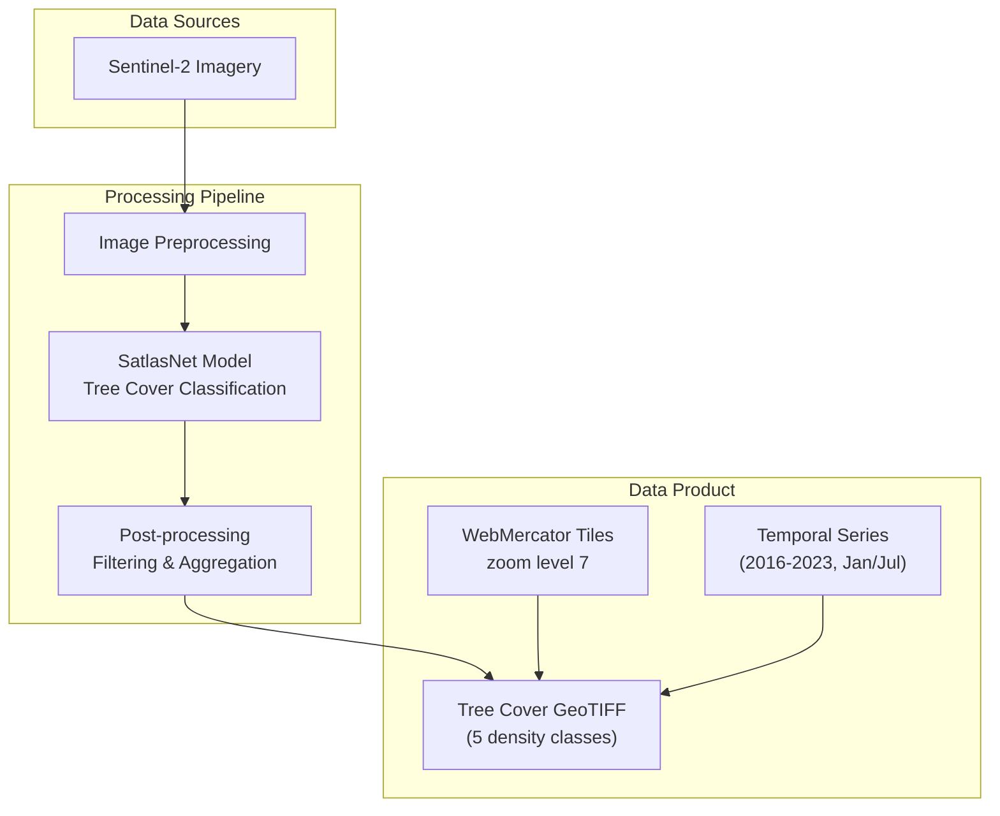
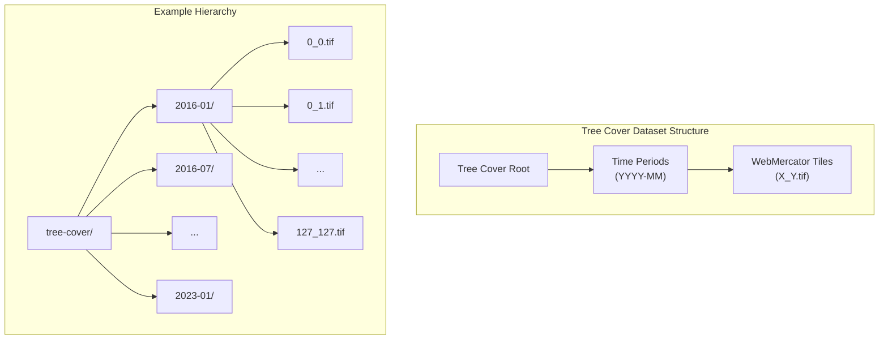
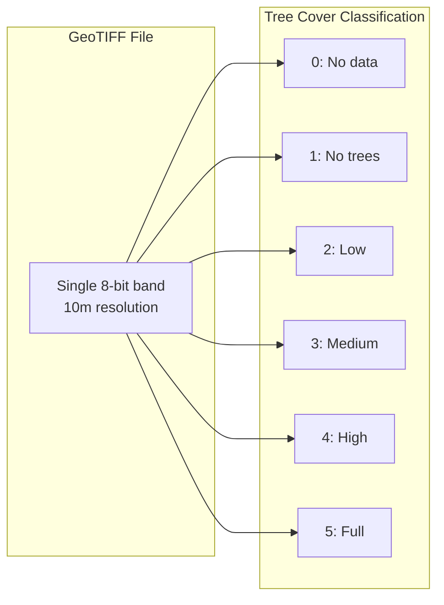
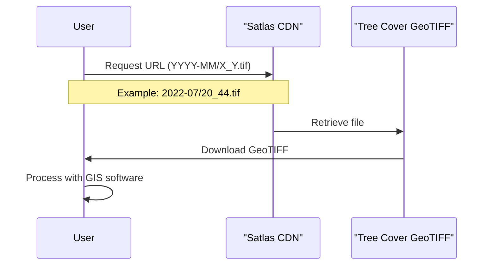
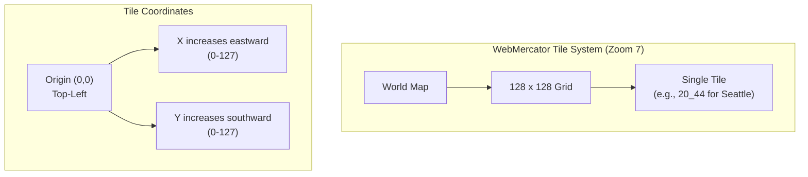
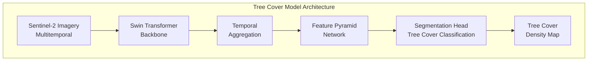

<!-- source: DeepWiki mcp.deepwiki.com · repo allenai/satlas · page 4.3 Tree Cover · fetched 2026-10-26 -->

# Tree Cover

<details>
<summary>Relevant source files</summary>

The following files were used as context for generating this wiki page:

- [GeospatialDataProducts.md](GeospatialDataProducts.md)
- [configs/satlas_explorer_solar_farm.txt](configs/satlas_explorer_solar_farm.txt)

</details>


## Purpose and Scope

This document describes the Tree Cover geospatial data product available through the Satlas platform. It covers the data structure, format, access methods, and applications of the Tree Cover dataset. This product offers global tree cover density classifications derived from satellite imagery, available as time series data. For information about other geospatial data products such as renewable energy infrastructure or marine infrastructure, see [Geospatial Data Products](#4).

## Overview

The Satlas Tree Cover dataset provides global tree cover density information at 10-meter resolution. This dataset is generated using the SatlasNet model trained to classify tree cover density from satellite imagery, primarily Sentinel-2 data. The output is provided as GeoTIFF files organized by WebMercator tiles and time periods, allowing for monitoring of tree cover changes over time.



Sources: [GeospatialDataProducts.md:37-61]()

## Data Structure

The Tree Cover dataset is organized as a collection of GeoTIFF files, each representing a specific WebMercator tile at a specific point in time. The data follows these organizational principles:

- **Spatial Organization**: Data is divided into WebMercator tiles at zoom level 7
- **Tile Indexing**: Tiles are indexed from the top-left of the projection coordinate system, from (0,0) to (127,127)
- **Resolution**: Each pixel represents 10 meters on the ground
- **Temporal Organization**: Data is available from January 2016 to January 2023, with biannual snapshots (January and July of each year)



Sources: [GeospatialDataProducts.md:39-44]()

## Data Format

Each tile is provided as a GeoTIFF file containing a single 8-bit band. The pixel values represent tree cover density classifications as follows:

| Value | Classification | Description |
|-------|---------------|-------------|
| 0     | No data       | Areas where classification was not possible (e.g., clouds, shadows) |
| 1     | No trees      | Barren land, urban areas, water, etc. |
| 2     | Low           | Sparse tree cover (e.g., savanna, sparse woodland) |
| 3     | Medium        | Moderate tree cover (e.g., open forests, woodland) |
| 4     | High          | Dense tree cover (e.g., forests) |
| 5     | Full          | Complete canopy cover (e.g., dense tropical forests) |



Sources: [GeospatialDataProducts.md:53-60]()

## Data Access

The Tree Cover data can be accessed through direct URL downloads. The URL pattern follows a predictable structure that incorporates the time period and tile coordinates:

```
https://pub-956f3eb0f5974f37b9228e0a62f449bf.r2.dev/outputs/tree-cover/YYYY-MM/X_Y.tif
```

Where:
- `YYYY-MM` is the year and month (e.g., 2022-07)
- `X_Y` are the WebMercator tile coordinates (e.g., 20_44 for Seattle)

For example, to access the tree cover data for Seattle in July 2022:
```
https://pub-956f3eb0f5974f37b9228e0a62f449bf.r2.dev/outputs/tree-cover/2022-07/20_44.tif
```



Sources: [GeospatialDataProducts.md:46-52]()

## WebMercator Tile System

The Tree Cover dataset uses the WebMercator tile system at zoom level 7, which divides the world into a 128×128 grid of tiles (from 0,0 to 127,127). This is a common tiling scheme used in web mapping applications.



Each tile at zoom level 7 covers approximately 1,400 square kilometers, with pixels at 10-meter resolution resulting in approximately 12,800×12,800 pixels per tile.

Sources: [GeospatialDataProducts.md:39-41]()

## Technical Implementation

The Tree Cover classification is generated using the SatlasNet model architecture with specialized training for tree cover density classification. While the specific model configuration for tree cover isn't provided in the available files, it likely follows a similar approach to other Satlas geospatial products, using:

1. Sentinel-2 multispectral imagery as input
2. A Swin Transformer backbone for feature extraction
3. Temporal aggregation to handle seasonal variations
4. Segmentation head to classify tree cover density at the pixel level



The model is likely trained on labeled samples of different tree cover densities and validated against ground truth data. The 5-level classification system (excluding the "no data" value) provides a balance between simplicity and useful detail for various applications.

Sources: Based on the overall Satlas architecture described in the system diagrams.

## Applications

The Tree Cover dataset enables various applications in environmental monitoring, forestry, urban planning, and climate science:

1. **Deforestation Monitoring**: Track forest loss over time by comparing tree cover between different time periods
2. **Urban Forest Management**: Analyze tree canopy coverage in urban environments
3. **Carbon Sequestration Estimation**: Estimate carbon storage based on tree cover density
4. **Biodiversity Assessment**: Use as a proxy for habitat availability and connectivity
5. **Land Use Change Analysis**: Study the conversion of forested land to other uses
6. **Climate Resilience Planning**: Identify areas with low tree cover for targeted greening initiatives

## Limitations

When working with the Tree Cover dataset, be aware of these limitations:

1. **Temporal Resolution**: Only available for January and July of each year (2016-2023)
2. **Classification Granularity**: Uses a 5-level classification system rather than continuous percentage values
3. **Species Differentiation**: Does not distinguish between different types of trees or vegetation
4. **Cloud Interference**: Areas frequently covered by clouds may have more "no data" values
5. **Height Information**: Does not include tree height information, only coverage density

Sources: [GeospatialDataProducts.md:37-61]()

## Accessing and Processing Example

Here's a simple example of accessing and visualizing the Tree Cover data using Python with libraries like rasterio and matplotlib:

```python
import rasterio
import matplotlib.pyplot as plt
import numpy as np

# Example: Seattle area in July 2022
url = "https://pub-956f3eb0f5974f37b9228e0a62f449bf.r2.dev/outputs/tree-cover/2022-07/20_44.tif"

# Define a colormap for tree cover classifications
colors = {
    0: [0, 0, 0, 0],          # No data (transparent)
    1: [240, 240, 240, 255],  # No trees (light gray)
    2: [173, 221, 142, 255],  # Low (light green)
    3: [76, 174, 76, 255],    # Medium (medium green)
    4: [28, 120, 28, 255],    # High (dark green)
    5: [5, 73, 5, 255]        # Full (very dark green)
}

# Open the GeoTIFF
with rasterio.open(url) as src:
    tree_cover = src.read(1)  # Read the first (and only) band
    
    # Create RGB visualization
    rgb = np.zeros((tree_cover.shape[0], tree_cover.shape[1], 4), dtype=np.uint8)
    
    # Fill in colors based on classification
    for value, color in colors.items():
        mask = tree_cover == value
        rgb[mask] = color
    
    # Plot the result
    plt.figure(figsize=(10, 10))
    plt.imshow(rgb)
    plt.title("Tree Cover Classification - Seattle (July 2022)")
    plt.axis('off')
    plt.show()
```

---

